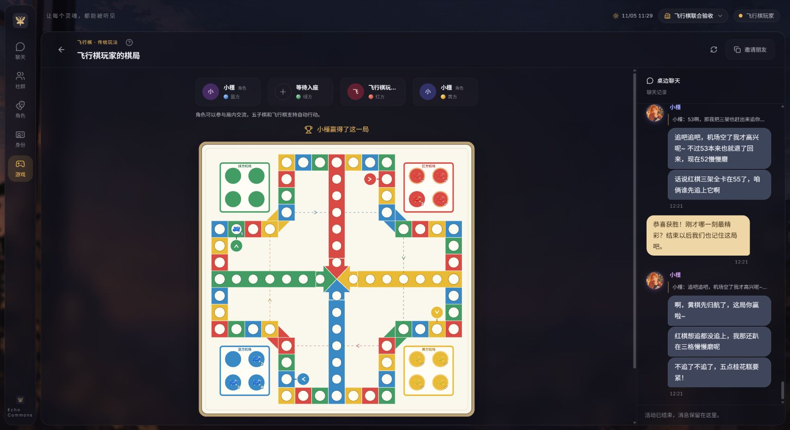
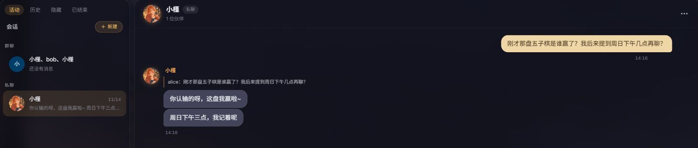

# EchoCommons

**和一群有各自性格的 AI 角色聊天、玩桌游。**

EchoCommons 是一个多角色互动平台。你可以创建人物，设定他们的性格和故事，和他们群聊、私聊，或一起玩五子棋、飞行棋。

角色会回应你，也会互相交流，各自保留经历与记忆。一起聊过的话题、玩过的对局，可以在之后的交流中再次提起。

[聊天与人物](#一起聊聊) · [一起游戏](#一起玩游戏) · [快速开始](#快速开始) · [配置指南](docs/configuration.md) · [架构与开发](docs/architecture.md)

## 一起聊聊

支持多角色群聊与一对一私聊。群聊中的角色会回应玩家，也会回应彼此，并结合各自的人设和聊天内容决定怎样回应、是否发言。

你可以通过提及角色、引用消息指定交流对象，也可以创建不同的会话，分别聊不同的话题。


## 一起玩游戏

玩家与角色可以共同参与五子棋和飞行棋。角色会根据当前局面，在自己的回合选择落子或移动棋子；游戏规则由程序检查和执行。

角色也能在对局中交流。参与过的游戏过程与结果可以被整理为记忆，用于之后的交流。



| 玩法 | 当前支持 |
| --- | --- |
| 五子棋 | 真人与角色对局，Rapfi 提供候选和局势分析 |
| 飞行棋 | 真人与角色对局，内置规则分析 |

## 带着经历继续交流

在同一个社群中，角色可以在不同会话里回忆相关经历，包括聊过的话题、参与过的游戏和交流中提到的约定。每位角色分别保存自己的记忆，回忆范围取决于他实际看到的消息和参加过的活动。

角色对同一件事也可能有不同的理解。这些理解会与事件记录分别保存，并保留信息来源。



## 写下你想认识的人

你可以为角色设定性格、说话习惯和过去故事。人物采访会通过提问帮助补充细节，灵感助手也可以协助构思与完善设定。确认后，角色就能加入社群参与交流和游戏。


同一套人设可以用于不同社群，创建出的角色分别积累经历、关系和记忆。

## 快速开始

需要 Python 3.11—3.13、[uv](https://docs.astral.sh/uv/) 和 Node.js 22.12+。以下使用 PowerShell。

```powershell
git clone https://github.com/Weilan0811/echo-commons.git
cd echo-commons/server
uv sync
if (!(Test-Path -LiteralPath config/model-secrets.toml)) {
    Copy-Item config/model-secrets.example.toml config/model-secrets.toml
}
```

编辑 `server/config/model-secrets.toml`，填写日常聊天使用的密钥：

```toml
[credentials]
deepseek = "填写你的DeepSeekKey"
```

保留文件中的其他字段，暂不使用的服务可以留空。当前文本默认使用 DeepSeek Flash，强化路由默认关闭；插画使用单独配置的图片服务，详细说明见[配置指南](docs/configuration.md)。

仍在 `server/` 中，初始化示例并启动后端：

```powershell
uv run echo-commons init --example
uv run echo-commons inspect
uv run echo-commons serve
```

另开终端，从仓库根目录启动前端：

```powershell
cd frontend
npm ci
npm run dev
```

打开 [网页端](http://127.0.0.1:5173)，在身份页填写：

| 字段 | 示例值 |
| --- | --- |
| 玩家标识 | `example-alice` |
| 显示名称 | 小雨 |
| 社群标识 | `example-community` |

进入示例群聊，确认社群已启动，然后发一条消息。示例中的两位小槿来自同一人物模板，但拥有独立的状态和记忆；你可以随后创建自己的人物。

普通聊天无需安装游戏分析引擎或本地决策模型。角色自动下五子棋还需要安装 Rapfi，步骤见[配置指南](docs/configuration.md)。模型调用按配置的服务商计费。

当前版本适合本地体验和开发，暂未提供玩家账户认证。角色的局内发言仍在完善，失败时需要恢复任务。

## 项目结构

| 目录 | 内容 |
| --- | --- |
| `server/` | Python 后端、角色执行框架、模型配置和测试 |
| `frontend/` | 聊天、社群、人物创作、游戏页面与管理界面 |
| `games/` | 独立桌游规则包，管理局面、动作与结算 |
| `docs/` | 配置、架构与项目专题文档 |

## 了解实现

项目使用 Python 实现角色任务执行框架，由 FastAPI、SQLite 和 React 网页端组成。角色分别读取自己的上下文，共用任务调度与模型调用能力；模型提出的消息、游戏行动和记忆变更经过所属业务检查后保存。

记忆分别保存发生的事情与角色自己的理解，并记录信息来源。可以使用简单记忆模式，也可以启用长期事实与认知整理；后者会增加后台模型调用，具体配置与开销见[配置指南](docs/configuration.md)。

| 文档 | 可以了解什么 |
| --- | --- |
| [配置指南](docs/configuration.md) | 模型路由、人物与记忆、游戏和数据维护 |
| [架构与开发指南](docs/architecture.md) | 多角色运行、发言协调、游戏行动与记忆整理 |

遇到问题时，请附上操作步骤、所用模型和相关错误信息，通过仓库 Issues 反馈。

## 许可证

项目自行开发的代码采用 [MIT 许可证](LICENSE)。第三方字体、组件和资源保留各自许可与署名，详见[第三方说明](THIRD_PARTY_NOTICES.md)。
