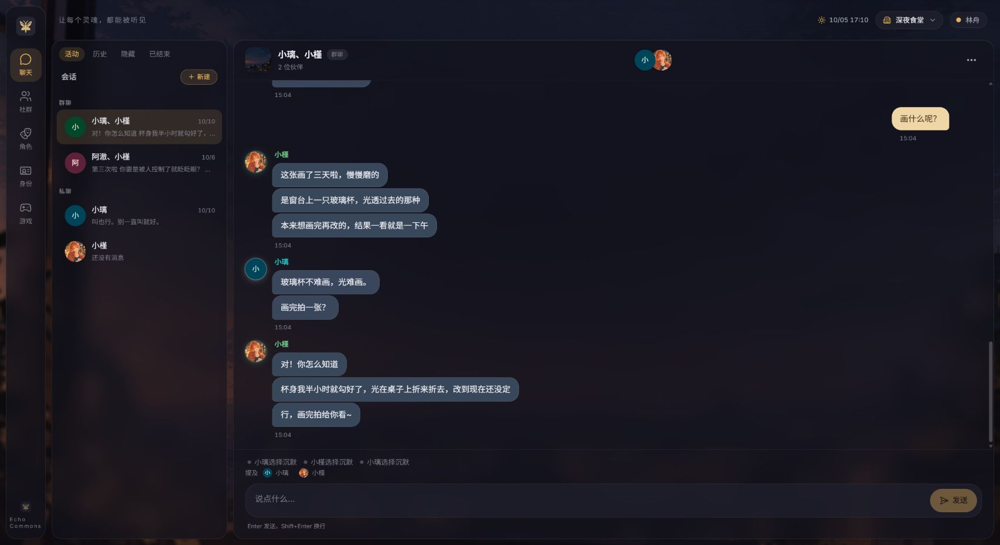
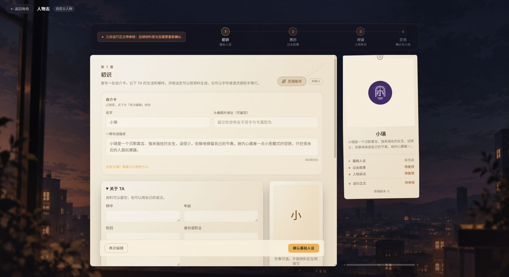

# EchoCommons

**和一群有自己性格、也记得往事的 AI 角色，聊聊天，玩玩游戏。**

今天有什么想吐槽的？最近在折腾什么？找几位角色开个群，看看话题会聊到哪里；想单独说几句，就切换到私聊。聊累了，还可以邀请他们下一盘五子棋，或者一起掷骰子玩飞行棋。

角色有各自的说话习惯，会接你的话，也会互相回应，偶尔保持安静。每位角色分别积累经历、关系与记忆，让交流有机会延续下去。

[聊天与人物](#一起聊聊) · [一起游戏](#一起玩游戏) · [快速开始](#快速开始) · [配置指南](docs/configuration.md) · [架构与开发](docs/architecture.md)



## 一起聊聊

小槿画了三天的玻璃杯，杯身半小时就勾好了，桌上的光却一直没定下来。小璃接了一句：“玻璃杯不难画，光难画。”

上图就是「深夜食堂」里这段实际聊天。你可以插上一句，也可以看他们继续聊。想把话递给某个人，可以提及角色或引用一条消息；想聊点别的，也随时能另开一个会话。

## 写下你想认识的人

一个寡言但偶尔爱捉弄人的朋友，或者一个总有新点子的聊天搭子？先写一两句话，再慢慢补充性格、说话习惯和过去故事。人物采访会用具体问题帮你想清楚：TA 喜欢什么，遇到分歧会怎么做，又怎样表达关心。

可以自己填写，也可以请灵感助手一起构思。确认设定后，让角色入住社群，开始交流。



人物模板可以在不同社群中创建独立实例。即使来自同一模板，各个实例的经历、关系和记忆也分别积累。

## 一起玩游戏

把聊天伙伴邀请进对局，轮到谁，谁来行动。角色会根据局面选择落子或移动棋子，也可以聊聊刚才那一步。棋局与聊天放在同一个页面，边玩边说。

| 玩法 | 当前支持 |
| --- | --- |
| 五子棋 | 真人与角色对局，Rapfi 提供候选和局势分析 |
| 飞行棋 | 真人与角色对局，内置规则分析 |
| Kingdomino（多米诺王国） | 真人对局与局内聊天 |

角色游戏行动仍在完善，自动表达任务可能失败并需要恢复。当前适合本地体验和开发，尚未提供玩家账户认证。

## 带着经历继续交流

聊过的话题、参加过的游戏，都会成为角色整理经历的材料。下次交流时，角色可以按需回忆相关内容；不同角色看到的事情不同，留下的认识也可能不同。

记忆分别保存发生的事情与角色自己的理解，并保留来源，帮助角色分清经历、听闻和猜测。

角色可以使用简单记忆模式，也可以启用长期事实与认知整理。更完整的整理会增加后台模型调用，详见[配置指南](docs/configuration.md)。

## 快速开始

需要 Python 3.11—3.13、[uv](https://docs.astral.sh/uv/) 和 Node.js 22.12+。以下使用 PowerShell。

```powershell
git clone https://github.com/Weilan0811/echo-commons.git
cd echo-commons/server
uv sync
if (!(Test-Path -LiteralPath config/model-secrets.toml)) {
    Copy-Item config/model-secrets.example.toml config/model-secrets.toml
}
```

编辑 `server/config/model-secrets.toml`，填写日常聊天使用的密钥：

```toml
[credentials]
deepseek = "填写你的DeepSeekKey"
```

保留文件中的其他字段，暂不使用的服务可以留空。当前文本默认使用 DeepSeek Flash，强化路由默认关闭；插画使用单独配置的图片服务，详细说明见[配置指南](docs/configuration.md)。

仍在 `server/` 中，初始化示例并启动后端：

```powershell
uv run echo-commons init --example
uv run echo-commons inspect
uv run echo-commons serve
```

另开终端，从仓库根目录启动前端：

```powershell
cd frontend
npm ci
npm run dev
```

打开 [网页端](http://127.0.0.1:5173)，在身份页填写：

| 字段 | 示例值 |
| --- | --- |
| 玩家标识 | `example-alice` |
| 显示名称 | 小雨 |
| 社群标识 | `example-community` |

进入示例群聊，确认社群已启动，然后发一条消息。示例中的两位小槿来自同一人物模板，但拥有独立的状态和记忆；你可以随后创建自己的人物。

普通聊天无需安装游戏分析引擎或本地决策模型。角色自动下五子棋还需要安装 Rapfi，步骤见[配置指南](docs/configuration.md)。模型调用按配置的服务商计费。

## 项目结构

| 目录 | 内容 |
| --- | --- |
| `server/` | Python 后端、角色执行框架、模型配置和测试 |
| `frontend/` | 聊天、社群、人物创作、游戏页面与管理界面 |
| `games/` | 独立桌游规则包，管理局面、动作与结算 |
| `docs/` | 配置、架构与项目专题文档 |

## 了解实现

项目使用 Python 实现角色任务执行框架，由 FastAPI、SQLite 和 React 网页端组成。角色分别读取自己的上下文，共用任务调度与模型调用能力；模型提出的消息、游戏行动和记忆变更经过所属业务检查后保存。

| 文档 | 可以了解什么 |
| --- | --- |
| [配置指南](docs/configuration.md) | 模型路由、人物与记忆、游戏和数据维护 |
| [架构与开发指南](docs/architecture.md) | 多角色运行、发言协调、游戏行动与记忆整理 |

遇到问题时，请附上操作步骤、所用模型和相关错误信息，通过仓库 Issues 反馈。

## 许可证

项目自行开发的代码采用 [MIT 许可证](LICENSE)。第三方字体、组件和资源保留各自许可与署名，详见[第三方说明](THIRD_PARTY_NOTICES.md)。
