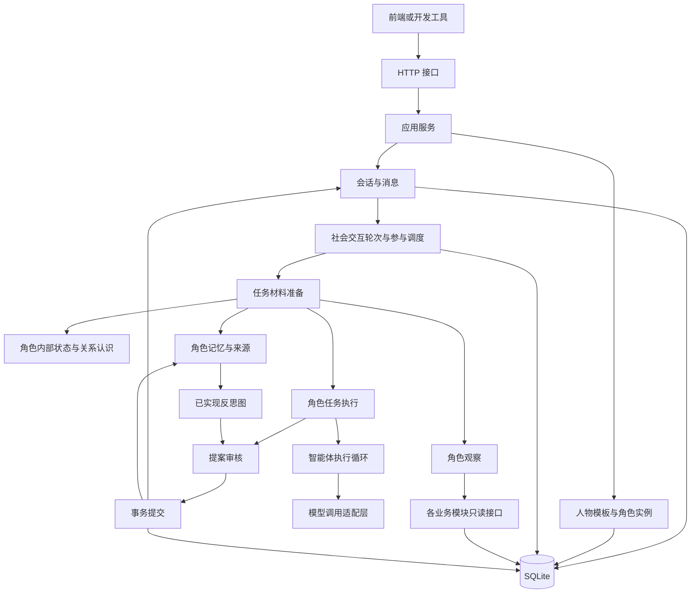

# 后端架构与运行模型

方案版本：`0.1.0`  
更新日期：2026-10-01  
状态：实施前设计  
配套文件：[文件结构](02-backend-file-structure.md)、[实施顺序](03-backend-implementation-plan.md)、[验收与基线](04-backend-baseline-and-acceptance.md)、[数据库设计](05-database-design.md)

## 1. 目标和范围

后端管理社群中的玩家、角色实例、会话、消息与已提交状态。角色智能体根据自身观察和记忆提出行为，后端检查行为并写入事实。

本次建立能够实际运行基础群聊的结构。参与调度采用确定性规则，模型负责角色回应；已有反思流程继续运行。活动、生活模拟与模型驱动的社交意愿属于后续功能。

已有 SQLite、Model Gateway（模型调用适配层）、Harness（智能体执行循环）、任务租约、错误恢复、反思图和关系计算继续复用。实施重点是删除产品默认值与单角色假设，重新明确对象、依赖和提交范围。

## 2. 系统边界

应用组合根创建对象和连接依赖。业务服务接收自己实际使用的接口和数据访问对象。Agent 无数据库写权限；前端消费已提交事实。

单进程 SQLite 足以支撑本次目标。后台任务可以并行调用模型，写入在短事务中串行完成。模型调用期间释放数据库事务。

## 3. 身份、归属与实例

| 对象 | 身份字段 | 责任 |
|---|---|---|
| `Community`（社群） | `community_id` | 社会空间、成员和运行范围 |
| `Player`（玩家） | `player_id` | 人类参与者身份 |
| `CharacterBlueprint`（人物模板） | `blueprint_id`、`content_version` | 作者定义的稳定人格、表达方式、能力和预置记忆 |
| `CharacterInstance`（角色实例） | `character_id`、`community_id`、`blueprint_id`、`blueprint_version` | 模板在特定社群中的独立人物 |
| `ActorRef`（行为主体引用） | `kind`、`id` | 明确一个消息或行为来自玩家、角色或系统 |
| `Conversation`（会话） | `conversation_id`、`community_id` | 交流空间、成员、消息序列和状态 |

`character_id` 为全局唯一实例 ID。示例中的两个小槿实例分别引用同一 `blueprint_id`，但拥有不同 `character_id`。实例状态、记忆、关系和任务均按实例保存。

人物模板加载后保持不可变。实例明确绑定模板版本；本次无需实现运行中切换模板版本。预置记忆初始化时，将模板中的自身引用解析为实例 ID，保留模板资源与版本作为来源。

删除业务对象中的 `account_id`，不再同时用一个字段表达玩家与数据范围。社群提供数据归属，玩家提供实际行为身份。本次是本地开发服务，HTTP 中的玩家 ID 用于身份选择和成员检查；用户登录与公网部署权限另有明确需求时实现。

角色实例只保存最小登记信息。动态状态、关系和记忆仍在各自表中，读取时组装。

## 4. 输入、轮次和任务

### 4.1 InputBatch

`InputBatch`（输入批次）保存同一主体在同一会话中、向同一受众发送的一组消息。发送主体使用 ActorRef，玩家与角色共用结构。收集边界由会话、发送主体、可见性和实际受众共同确定，不同主体各自形成批次。受众保存排序后的成员区间引用，公共和私有输入分别收集；成员变化导致实际受众变化时建立新批次。

状态为 `collecting`（收集中）、`sealed`（已确定输入边界）。玩家等待最后一条消息后的 `quiet_window_seconds`，将连续发送的内容一起处理；角色的窗口为 `0`，一次生成的完整输出在提交事务内立即建立 sealed 批次。零窗口直接结束收集，无需等待下一次定时扫描。界面可以把完整发言分成气泡，这些气泡不单独入库或触发回应。

窗口只决定消息何时收集完成。是否产生新轮次由参与调度策略决定。本次玩家批次可以触发回应；角色批次保存来源与因果关系，连续角色接话仍属于未实现能力。后续接话继续使用同一种批次，策略检查因果来源、连续回应次数和参与预算，避免角色之间无限触发。

移除 `task_id`、`assigned`、`covered`、`terminal_failed`；执行结果由轮次和任务持有。

批次保存实际消息 ID 关联，首尾序号用于边界与排序。多个主体交错发言时，不能把首尾之间的所有消息都当作该主体输入。

### 4.2 SocialTurn

`SocialTurn`（社会交互轮次）组织针对一组来源的一次聊天回应。它确定回应内容、候选角色和完成边界，包括：

- 社群、会话、来源批次、来源消息引用和因果来源。
- 会话观察的最大消息序号及成员版本。
- 轮次状态与创建时间。
- 每个候选角色的参与决定和处理结果。

来源批次与轮次采用明确关联表；一个已结束批次只能进入一个有效来源轮次。本次将一次扫描得到的已结束批次按会话与同一实际受众组合成一个轮次；组合前冻结完整来源列表。公共输入和私有输入形成不同轮次。

轮次状态为 `pending`（待规划）、`running`（执行中）、`completed`（已结束）、`cancelled`（已取消）。角色失败记录在参与结果中；轮次另存完成概况，避免把所有结果压成单个成功或失败值。

候选角色全部沉默时，轮次正常完成。成员离开时，对应参与结果标记取消，其他角色继续处理。

### 4.3 ParticipationDecision

`ParticipationDecision`（参与决定）记录一个候选角色在这一轮是否参与，以及后续处理结果。保存角色、选择结果、原因和稳定顺序；关联任务通过轮次与角色查询，避免重复保存双向引用。状态包含 `silent`（调度时未参与）、`selected`（已选择）、`completed`（已完成）、`failed`（失败）、`cancelled`（取消）。被选择角色执行后主动沉默也属于 completed，另记 `outcome = silent`，不会生成空消息。

本次调度规则固定为：

1. 从输入消息中的结构化 `mentions`（提及对象）读取被提及角色，校验它们属于当前会话。
2. 排除暂停社群、不在会话内、看不到该轮次来源和当前不可回应的角色。
3. 被提及角色优先；其余角色按最近已提交发言时间从早到晚选择，未发言角色优先，同一时间按实例 ID 排序。
4. 最多选择 `max_responders_per_turn` 个角色，初始设置为 `2`。直接对话只选择其中唯一角色。
5. 保存所有候选角色的决定，只有被选择角色创建任务。

这个规则提供可重复验证的调度基础。后续社交意愿评估可以替换规则，继续使用同一轮次与参与结果。

### 4.4 ConversationTask

每个 `ConversationTask`（对话任务）绑定一个轮次与一个角色实例。唯一关系为 `(social_turn_id, character_id)`。轮次可以包含多个角色任务。

会话按轮次推进：一个会话同时只有一个执行中的响应轮次，后续输入继续持久化并等待。一个轮次内各角色拥有独立任务和租约，可以在有限并发下执行。初始模型并发上限为 `3`，全服务共享预算。

数据库删除“整个会话只有一个活动角色任务”的索引，使用“会话只有一个执行中轮次”和“同轮次同角色一个任务”的约束。重试复用原任务；新增交互建立新轮次。

## 5. 权威消息和事件

`Message` 是已提交的发言。保存真实发送者、内容、会话序号、回复对象、提及对象和来源。客户端幂等键按 `(player_id, client_message_id)` 检查，比较会话、文本、提及对象和回复对象是否一致。

统一 `EventRef`（事件来源引用）描述已经发生的事情：`kind`、`id`、`actor`、`occurred_at`、`visibility`。消息是当前真实事件来源；后续活动结果实现自己的来源投影。

本次为每条消息保存可见性：`conversation`（会话成员可见）或 `recipients`（指定成员可见）。指定接收者必须在消息提交时是有效成员，发送者能够看到自己的消息。角色加入前和离开后的消息默认不可见。历史消息的观察资格按发生时的成员区间判断，离开不会抹除此前经历。

公开与私有消息的实际受众都保存在 `message_recipients`，引用获得消息的成员区间。本次 HTTP 可以提交指定接收者的文字消息，用于验证读取边界；界面呈现另由前端处理。

已提交消息与输入批次在同一事务中关联。玩家消息进入等待窗口，后台扫描 sealed 批次并规划轮次。角色回复记录所属轮次，同时以角色自身为发送者建立零窗口 sealed 批次；本次规划策略不自动选择这些角色批次创建连续回应。主动发言与连续接话后续接入 `TurnPlanner`（轮次规划服务），沿用批次并检查因果来源、最大响应次数和参与预算。

轮次保存来源受众及其成员区间，角色回应沿用这个受众。Agent 不能自行扩大回应接收范围。私有输入的回应仍是私有消息，公开输入产生会话可见回应；所有回应都保存实际受众区间，后来加入或重新加入的人不能因身份相同获得当前轮次回应。回应提交时只保留受众中仍有效的原区间，发送角色可以读取自己的已提交消息。

Trace（运行追踪）继续用于诊断，不能作为业务消息来源或待处理队列。

## 6. 角色观察和上下文

### 6.1 PerspectiveReader

`PerspectiveReader`（角色观察读取接口）独立于记忆模块，提供角色在指定范围内能够知道的客观世界信息，适用于对话、活动和反思任务。输入为社群、角色实例、业务来源、观察边界及调用时间，输出带主体与来源引用的可见材料。本次来源为会话消息与已存在状态，活动实现后增加实际活动视图。

它负责：

- 匹配社群与角色实例，检查会话成员区间。
- 依据消息可见性和接收者过滤材料。
- 在已确定的序号边界内读取。
- 读取允许观察的客观状态，例如已确定的身体状况、公开身份和成员关系。
- 通过各业务模块只读接口读取事实，不复制整个世界或修改来源模块数据。

角色情绪、意愿和对他人的信任等内部状态由 characters 模块读取；经历、长期记忆、摘要与自身 Thought（内心记录）由 memory 模块读取。人物的公开身份和客观参与关系属于观察，角色对该人物的判断和有向关系认识属于内部信息。反思可以产生角色对身体或活动的自我描述，这类认识保留为主观材料，不能覆盖活动模块的权威位置、回合或受伤事实。

各任务自己的上下文组装器组合观察、内部信息和记忆。共同读取规则复用，各用途选择所需材料。反思通过明确的历史范围取回实际经历，不局限于当前时刻。

消息列表、全文检索索引、索引重建和反思来源必须使用同一资格规则。来源版本也根据筛选后的材料计算，禁止让不可见内容改变角色可用来源。

检索索引记录可见材料的投影，原始消息与记忆仍是来源。加入、离开和私有接收者的规则在索引写入与重建时一致执行。

### 6.2 ContextSnapshot

新基线使用 `ContextSnapshot`，`schema_version = 1`。

| 部分 | 内容 |
|---|---|
| `scope` | 社群、角色实例、会话、轮次和观察边界 |
| `self` | 人物模板、实例身份、情绪与意愿、对有关主体的关系认识、有效能力 |
| `perspective` | 当前输入、可见历史、公开主体信息与允许观察的客观状态 |
| `memory` | 常驻记忆、已有连续性摘要、显式取回的记忆 |
| `environment` | 社群时间和暂停状态、当前会话环境 |
| `action_space` | 当前调用允许的输出契约和读取工具 |
| `source_versions` | 实际使用的来源与版本 |

本次 `environment` 只有社群与会话信息。活动视图在活动实现时加入，禁止用空对象伪装已支持活动。

角色自身历史发言投影为模型的 `assistant`（助手）历史；其他玩家、角色和系统材料投影为带主体身份的观察输入。提供给模型的角色名称与实例引用必须明确。自身 Thought 可以加入自身历史，其他角色的 Thought 不进入材料。

### 6.3 冻结与重试

规划轮次时，在同一事务内为被选择角色建立初始上下文并保存序列化快照。状态、关系、记忆与观察都确定在这次准备时刻。任务执行和重试复用持久化快照，不重新读取实时状态来改变同一逻辑任务的输入。

后续工具读取遵守快照中的角色范围和观察边界。长期记忆继续使用已存在的来源版本检查；来源变化时返回明确结果，禁止混入不同版本。没有必要为每条消息额外增加校验文件。

一个角色先完成回复，不改变同轮次其他角色的快照。新回复成为后续轮次可见来源。

## 7. Agent 和工具边界

`AgentRegistry`（角色执行注册表）按实例 ID 返回一个绑定该实例的 `CharacterAgent`。所有角色使用同一实现，读取工具、Gateway 和模型路由等共享对象可以复用。

`InvocationScope`（调用范围）显式包含 `community_id`、`character_id` 和具体业务来源。删除全局固定账号与默认角色。反思使用图运行与节点来源，对话使用轮次与任务来源。

有效能力由以下三者共同决定：后端已实现能力、人物模板允许能力、本次任务允许能力。审核和工具执行读取同一计算结果。

`ToolContext`（工具调用上下文）只包含实例范围、快照引用、读取策略及调用标识。具体工具通过自己注入的只读服务取得材料，不要求通用工具上下文只能装入某个对话快照。

Agent 输出保留不可变的 `AgentRunResult`。`ProposalOutput` 使用明确输出契约检查提案类型，移除硬编码“所有提案只能是角色发言”的通用限制。对话业务审核继续只接受 `character_message.v1`；未来活动输出在活动模块真正实现后注册。

## 8. 事务、提交和错误

### 8.1 玩家消息事务

一次事务检查玩家和会话成员、幂等键、可见接收者与回复目标，写入消息及关联来源，更新输入批次，并写入 Trace outbox（追踪待投递记录）。响应表示消息已经持久化。

### 8.2 轮次准备事务

后台结束到期输入批次，检查社群暂停、会话归档及正在处理的轮次。暂停期间输入保留等待恢复，归档会话不创建新回应。允许处理时建立来源关联和观察边界，运行参与策略，保存决定、快照和任务。没有候选回应者时直接完成轮次。进程重启后从这些事实继续处理。

### 8.3 模型执行

Dispatcher（任务分发器）领取角色任务，执行租约续期，调用对应 Agent，记录使用量和错误。Gateway 负责单次供应商请求，Harness 负责模型与工具循环，任务层负责逻辑执行重试。保留三层独立计数。

### 8.4 提交事务

重新检查租约代次、任务状态、角色准备时的成员区间是否仍有效、会话是否归档和社群是否暂停。审核 Agent 身份、输出契约、内容长度、回复目标是否在其快照的可见材料中。离开后再加入形成新区间，原任务不能借新区间提交。

批准后同时写入结果、消息、角色 Thought、任务状态和参与结果。最后检查轮次所有参与结果，必要时完成轮次。模型沉默会完成自己的参与，不生成空消息。重复或迟到结果不能再次提交。

任务状态使用 `pending`（待执行）、`processing`（执行中）、`retry_wait`（等待重试）、`suspended`（挂起）、`completed`（完成）、`failed`（失败）和 `cancelled`（取消）。成员离开、会话归档导致任务取消。社群暂停使任务挂起，恢复后在原成员区间仍有效时复用原快照执行。临时模型错误按预算重试；永久错误记为角色失败。当前模型错误不写成角色长期生活状态。

已提交的新消息不会使同轮次任务失效。成员变化只影响相关角色，不能让整个会话所有结果一律过期。

### 8.5 错误归属

API（HTTP 接口）映射明确的请求与业务错误。Store（持久化层）转换真实数据库错误。未预期的程序错误保留错误类型与日志，删除将所有异常包装成数据库不可用的广泛捕获。

## 9. Memory 和 Reflection

Memory（记忆）保存角色对来源的加工结果。客观消息、角色观察、主观记忆分别拥有明确来源。

同一会话按角色建立 `MemorySegment`（记忆段）。段保存可见消息的精确来源关联，首尾序号用于范围查询，不能包含序号范围中对该角色不可见的消息。归段检查目标角色的观察资格，删除“唯一活跃角色”要求。

段 Thought 只绑定该角色。`segment_reflect` 的材料保留发言者主体信息；段摘要、连续性摘要和记忆整理均以角色实例为范围。

已实现关系反思候选增加明确 `target_actor`（关系目标），审核目标属于来源材料中的合法主体，提交时转换成有向关系键。去重从“每个维度一次”调整为“每个目标、每个维度一次”。保留当前关系计算与 `interaction` 证据行为，其他证据分类扩展另行实施。

已有三种图继续使用当前图执行器、节点租约、Artifact（节点产物）、审核与事实提交。反思节点根据图的角色实例从 AgentRegistry 取得 Agent。

保留 `diary_compose`、`view_refresh` 已存在的契约和表。没有正式调度入口的图继续标注未完成，不增加触发器与事实写入流程。日记日期继续使用明确社群时区；本次只提供日期计算，不实现日程模拟。

## 10. 新 HTTP 契约

统一使用 `/api` 前缀、JSON 的 `snake_case`（下划线命名），字段由新的 Pydantic 类型定义。删除旧 camelCase（驼峰命名）别名和旧路径。

| 方法与路径 | 责任 |
|---|---|
| `POST /api/communities` | 创建社群及运行时间设置 |
| `POST /api/players` | 登记本地玩家 |
| `PUT /api/communities/{community_id}/players/{player_id}` | 加入社群，重复请求返回当前成员 |
| `GET /api/blueprints` | 列出已加载人物模板 |
| `POST /api/communities/{community_id}/characters` | 实例化人物模板并完成真实初始化 |
| `GET /api/communities/{community_id}/characters` | 读取实例登记与公开状态 |
| `POST /api/communities/{community_id}/conversations` | 创建会话和初始玩家、角色成员 |
| `GET /api/communities/{community_id}/conversations` | 列出会话 |
| `PUT /api/conversations/{conversation_id}/members/{actor_kind}/{actor_id}` | 加入成员，建立明确成员区间 |
| `DELETE /api/conversations/{conversation_id}/members/{actor_kind}/{actor_id}` | 结束成员区间 |
| `POST /api/conversations/{conversation_id}/messages` | 提交玩家文字消息，返回 `202` 和消息、追踪标识 |
| `GET /api/conversations/{conversation_id}/messages` | 按玩家视角和游标读取可见消息 |
| `GET /api/conversations/{conversation_id}/turns` | 按读取玩家的可见范围查询轮次与参与状态 |
| `GET /internal/characters/{character_id}/tasks/{task_id}/context` | 本地开发诊断读取持久化角色快照 |
| `GET /internal/reflection/runs/{graph_run_id}` | 保留反思诊断能力，使用新范围与版本 |
| `GET /internal/traces/{correlation_id}` | 查询运行追踪 |
| `GET /health/live`、`GET /health/ready` | 进程存活、数据库与后台执行状态 |

发送消息体包含 `player_id`、`client_message_id`、`text`、可选 `reply_to_message_id`、`mentions` 与 `visibility`。账号级混合消息同步、`chips`、空 `traces`、未实现的图片输入和客户端时间字段全部删除。

消息时间由服务生成。游标绑定会话、读取玩家和实际扫描位置；即使被过滤消息没有返回，扫描位置也要前进，避免重复扫描不可见消息。消息和轮次查询显式提供 `player_id`，检查实际成员与观察资格。不可见轮次不返回，公开响应只展示可见状态和参与角色，不返回私有来源、快照、Thought 或内部错误堆栈。

会话创建与成员操作明确检查玩家、角色所属社群。直接会话只允许一个玩家与一个角色；群聊允许多个玩家和角色。创建接口与领域规则采用同一校验。

## 11. Activity 的接入位置

活动实现时新增独立的 `modules/activities/`，内部管理领域规则、业务流程、存储、接口与活动任务。契约包含参与者、公开状态、私有状态、合法动作、状态版本和结果。

具体活动提供 `create`（创建）、`observe`（生成参与者视图）、`legal_actions`（列出合法动作）、`validate`（校验）、`apply`（应用动作）与 `summarize`（生成结果）操作。活动读取只返回当前主体的可见局面。

玩家动作和 Agent 的活动提案经过同一规则校验与状态提交。提交时检查当前行动者、行动阶段、状态版本与合法动作；过期或越权操作不能改变活动。角色发言仍由会话模块提交。活动结果通过 EventRef 与角色观察进入后续来源处理；只有调度策略选中的事件产生聊天轮次，场景更新无需全部触发回应。

### 11.1 对话任务与活动任务

`ConversationTask` 属于 SocialTurn 与角色，负责发言；`ActivityTask`（活动任务）属于活动实例、明确行动机会与角色，负责玩法操作。两者独立保存输入、状态、租约、结果、重试与完成条件。对话完成不会自动推进棋局，活动完成不会自动结束聊天任务。活动结果使用自己的存储与外键，不借用对话结果表或增加通用可空任务字段。

两类任务共享 Agent、真实模型适配、只读工具机制和 execution 中的调度资源。活动行动顺序由活动规则管理，会话执行中轮次的限制仅作用于聊天；等待聊天模型结果不能持有活动执行权限。模型并发名额在单次真实请求前分配，调度器优先服务当前合法行动者；连续聊天不能占用全部后续领取机会，同时保留其他任务的公平执行机会。已开始的模型请求无需被强行中断。

活动观察保存状态版本。相同任务的模型重试复用原输入；若提交时行动机会已失效或局面已变化，活动任务结束为取消或明确的过期结果，由活动调度重新准备仍然有效的工作，不能静默替换原快照继续提交。

### 11.2 飞行棋运行例子

你、小槿、阿澈和小雨固定轮流行动。轮到小槿时，活动建立她的 ActivityTask，并提供她可知的棋盘与合法移动。你说“左边更安全”，消息独立进入输入批次和 SocialTurn，阿澈可以获得 ConversationTask 评论棋局。参与聊天不授予棋局操作权。

小槿的移动通过活动校验并提交后，棋局进入阿澈的行动机会；小雨的聊天任务可以仍在执行。两个任务互不结束对方，聊天回答引用自己快照中的局面，无法把尚未提交的移动当成已发生事实。小槿同时被安排解释路线时，她的对话任务与活动任务分别调用模型并记录结果。

本次不创建活动表、活动路由、空插件加载器或假的游戏状态。接入位置与必须遵守的范围规则已确定，具体代码随首个真实活动实现。

## 12. 核心不变量

1. 权威事实只由业务提交服务写入。
2. 一次角色调用只代表一个角色实例。
3. 一次轮次可以有多个任务，每个任务独立完成或失败。
4. 一个任务的重试使用同一持久化输入快照。
5. 私有内容在读取时过滤，工具与反思使用相同观察规则。
6. 同一模板的不同实例拥有独立状态、关系和记忆。
7. 模型角色标签只用于请求投影，真实主体使用 ActorRef。
8. 公开消息与私有 Thought 分开持久化和返回。
9. 模型调用期间不持有数据库事务。
10. 已实现反思能力保持，未实现能力有明确状态。
11. 角色观察、内部状态与记忆分别读取，任务准备时组合为一致材料。
12. 聊天轮次与活动行动机会独立管理，参与聊天不授予玩法操作权。

数据库字段、约束和保存规则以 [05 数据库设计](05-database-design.md) 为准；目录与模块公开边界以 [02 文件结构](02-backend-file-structure.md) 为准。
