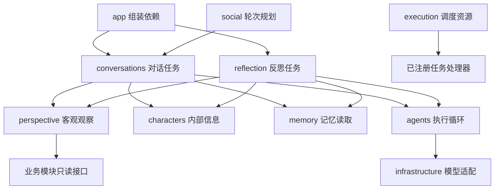

# 后端文件结构与职责

方案版本：`0.1.0`  
更新日期：2026-10-01  
状态：实施前设计  
配套文件：[运行模型](01-backend-architecture.md)、[实施顺序](03-backend-implementation-plan.md)、[数据库设计](05-database-design.md)

## 1. 查找方式与目录原则

保留 `server/src/echo_commons/` 作为统一 Python 包，发行名称为 `echo-commons-server`。先按业务找到模块，再按规则、流程、存储、接口或任务找到文件。接口层、领域层和持久化层的职责在各模块内部保持清楚。

下文路径均相对 `server/src/echo_commons/`，工程文件另行标明。文件表定义完成后的实际归属；同一目录共用路径前缀。Python 包按需要包含简短的 `__init__.py`，不通过重复导出隐藏真实定义位置。

| 顶层目录 | 查找内容 | 明确边界 |
|---|---|---|
| `app/` | 入口、配置、对象组装、启动与关闭 | 负责连接模块，不承载业务规则 |
| `modules/` | 社群、角色、聊天、记忆和反思 | 各业务管理自己的事实与执行流程 |
| `agents/` | 调用契约、角色 Agent 和模型工具循环 | 无数据库访问权限，输出提议 |
| `execution/` | 分发、租约、并发与后台运行 | 管理执行资源，不决定玩法规则 |
| `infrastructure/` | 数据库连接、模型供应商与诊断 | 不拥有角色身份或业务默认值 |
| `shared/` | 多个模块实际共用的基础引用与错误 | 不集中杂项业务和便利转发 |
| `resources/` | 随包发布的完整人物资源 | 不保存运行中的角色实例 |

不设置宽泛的 `utils.py`、`common.py` 或通用模块基类。单个实际职责可以使用一个文件，已有多个独立职责时使用目录；不要为统一外形创建空文件。

## 2. 模块导航与依赖

| 业务目录 | 管理的对象和能力 | 对外提供 |
|---|---|---|
| `modules/communities/` | 玩家、社群、社群成员、时间与暂停 | 身份及运行范围读取、登记操作 |
| `modules/characters/` | 模板、实例、可用状态、自身状态和有向关系认识 | 实例及内部信息读取、审核后的状态更新 |
| `modules/conversations/` | 会话、成员区间、消息、输入批次、对话任务 | 会话操作、消息读取和角色发言提交 |
| `modules/social/` | SocialTurn、参与决定、来源与完成状态 | 轮次规划、参与选择与状态读取 |
| `modules/perspective/` | 角色能够观察的客观世界材料 | 带角色身份、来源和观察范围的只读视图 |
| `modules/memory/` | 经历、记忆、摘要、Thought、来源与检索 | 私有记忆读取、来源处理与正式记忆写入 |
| `modules/reflection/` | 反思图、节点、产物、审核与提交 | 三种已实现图的真实执行 |

未来实际实现活动时加入 `modules/activities/`，活动实例、规则、行动机会与 ActivityTask 在其中管理。本次不创建该目录或活动表。

图中的依赖表示使用接口。`perspective` 依赖各业务的只读契约，不导入对话任务执行器；任务依赖观察接口。`app/composition.py` 注入具体实现，避免模块服务互相导入造成循环。跨模块事务由发起业务服务持有同一事务，并调用明确写入端口；Repository（数据访问对象）不自行开启第二项业务事务。

任务调用格式中，客观事实归 `perspective`，情绪、意愿和关系认识归 `self`，经历与摘要归 `memory`。数据仍保存在原业务模块，不按输入字段复制数据库。

## 3. 应用、共享基础类型与工程资源
### 3.1 应用入口

路径前缀：`app/`。

| 文件 | 职责 |
|---|---|
| `main.py` | create_app 工厂、HTTP 服务与跨站配置 |
| `cli.py` | 初始化、检查与导出命令，使用 argparse 标准命令行解析库 |
| `settings.py` | 用 tomllib 加载设置并解析配置相对路径 |
| `composition.py` | 创建具体 Repository、Agent 注册表和业务服务 |
| `application.py` | 保存明确的服务与资源引用，不转发私有方法 |
| `lifecycle.py` | 迁移、任务恢复、后台启动和资源关闭 |
| `bootstrap.py` | 通过正式业务入口初始化显式示例，重复操作检查已有内容 |
| `http.py` | 组合各模块路由、依赖提供和统一错误响应 |
| `health.py` | 实际存活、数据库和后台就绪检查 |
| `diagnostics.py` | 上下文、追踪和反思运行的内部诊断路由及响应类型 |

启动入口为 `echo_commons.app.main:create_app`，命令入口指向 `echo_commons.app.cli`。模块导入不会创建业务记录或调用模型。数据管理模式只运行实际配置的能力，关闭角色执行时不返回模拟回应。

### 3.2 共享基础类型

路径前缀：`shared/`。

| 文件 | 职责 |
|---|---|
| `actors.py` | ActorRef 与主体种类，数据库真实存在性由业务服务校验 |
| `events.py` | EventRef、发生时间和来源引用，不创建通用事件表 |
| `errors.py` | 各层实际共用的业务错误基类 |

只有多个模块实际使用的稳定类型放在这里。快照与模型契约属于 agents，具体业务状态和错误属于业务模块。

### 3.3 工程文件

路径前缀：`server/`。

| 文件 | 职责 |
|---|---|
| `pyproject.toml` | 发行名称、依赖、工具配置、启动命令与完整资源打包 |
| `uv.lock` | 真实依赖锁定 |
| `.python-version` | 开发解释器版本 |
| `README.md` | 安装、配置、启动、示例初始化和工程文档入口 |
| `config/settings.toml` | 数据库、执行预算、玩家输入窗口、上下文和诊断设置 |
| `config/model-registry.toml` | 真实模型登记与任务用途路由 |
| `config/model-secrets.example.toml` | 密钥格式示例 |
| `config/model-secrets.toml` | 用户本地真实密钥，保持被忽略 |
| `examples/community.yaml` | 显式社群、玩家、实例和会话示例 |

包版本定义在 `echo_commons/__init__.py`。配置没有默认玩家、角色或会话。当前已有数据和密钥保持原样，新初始化使用明确的新数据库路径。

### 3.4 人物资源

路径前缀：`resources/identity/`。

| 文件 | 职责 |
|---|---|
| `manifest.yaml` | 人物模板目录与初始格式声明 |
| `common/agent-contract.md` | 通用角色行为契约 |
| `blueprints/xiaojin/manifest.yaml` | 小槿模板及全部子资源引用 |
| `blueprints/xiaojin/profile.md` | 人格与背景 |
| `blueprints/xiaojin/voice.md` | 表达方式 |
| `blueprints/xiaojin/relational-dynamics.md` | 相处方式 |
| `blueprints/xiaojin/capabilities.yaml` | 允许能力 |
| `blueprints/xiaojin/memory-preload.yaml` | 预置记忆及自身引用 |

整个 resources 进入发布包。外部目录被明确指定后，缺失或无效应报告配置错误；未指定时使用完整内置资源。模板保持不可变，角色实例通过正式创建操作登记。

## 4. 业务模块文件清单

每节包含所属模块的全部业务文件。API（接口）中的 routes 和 schemas 分别负责路由及请求响应类型；不重复保存领域规则。

纯领域对象与规则使用标准数据类型，不依赖 FastAPI、Pydantic、SQLite 或模型供应商库。HTTP 类型、模型契约和数据库记录各自在边界显式转换；移动目录不会改变这些职责。

### 4.1 社群与玩家

路径前缀：`modules/communities/`。

| 文件 | 职责 |
|---|---|
| `domain.py` | 社群、玩家、成员、社群时间和暂停规则 |
| `contracts.py` | 身份、成员资格与社群运行状态读取契约 |
| `service.py` | 登记玩家、建立社群、加入成员和暂停恢复 |
| `repository.py` | 社群、玩家和成员表读写 |
| `api/routes.py` | 社群与玩家接口 |
| `api/schemas.py` | 对应 HTTP 类型 |

### 4.2 角色

路径前缀：`modules/characters/`。

| 文件 | 职责 |
|---|---|
| `domain/instance.py` | 模板引用、实例与可用状态 |
| `domain/state.py` | 现有身体、情绪与活动自述条目及版本规则 |
| `domain/relationship.py` | 有向关系、证据与既有数值变化规则 |
| `contracts.py` | 实例、客观状态、私有内部信息和状态更新端口 |
| `templates/loader.py` | 唯一初始格式、资源引用与模板验证 |
| `templates/catalog.py` | 不可变模板查询 |
| `services/bootstrap.py` | 实例、可用状态与预置记忆的事务初始化 |
| `services/registry.py` | 按实例解析绑定身份的 CharacterAgent |
| `services/state.py` | 本角色内部状态与允许观察的客观状态读取、正式更新 |
| `services/relationships.py` | 关系认识、证据与正式关系更新 |
| `services/capabilities.py` | 后端、模板和本次调用共同允许的能力 |
| `repositories/instances.py` | 实例与可用状态 |
| `repositories/state.py` | 状态历史条目 |
| `repositories/relationships.py` | 关系和证据 |
| `api/routes.py` | 模板查询、实例创建与公开状态 |
| `api/schemas.py` | 对应 HTTP 类型 |

角色的情绪和关系认识不进入其他角色观察。位置、身体等权威事实按实际来源读取；反思自述不能改变活动规则管理的状态。

### 4.3 会话与对话任务

路径前缀：`modules/conversations/`。

| 文件 | 职责 |
|---|---|
| `domain/conversation.py` | 会话种类、状态与成员区间 |
| `domain/message.py` | 消息、受众、回复与提及 |
| `domain/input_batch.py` | 按 ActorRef 收集输入，玩家窗口与角色零窗口 |
| `domain/task.py` | 对话任务状态、租约、挂起、重试与取消 |
| `domain/result.py` | 对话审核结果与消息提交关联 |
| `contracts.py` | 消息只读端口、任务准备与轮次结果通知端口 |
| `services/conversation.py` | 创建、归档和成员区间管理 |
| `services/intake.py` | 玩家发言、幂等检查与输入收集事务 |
| `services/batching.py` | 共用收集逻辑，零窗口在提交内直接结束 |
| `services/query.py` | 玩家视角消息读取和游标 |
| `tasks/context.py` | 组合观察、内部信息与记忆，保存任务快照 |
| `tasks/execution.py` | 读取快照、调用 Agent 和任务错误处理 |
| `tasks/review.py` | 发言契约、主体、回复目标、长度与受众审核 |
| `tasks/commit.py` | 结果、发言、Thought、零窗口批次与完成状态事务 |
| `tasks/queue.py` | 领取、租约和恢复的对话队列适配 |
| `repositories/conversations.py` | 会话和成员区间 |
| `repositories/messages.py` | 消息、提及、受众与客户端幂等键 |
| `repositories/input_batches.py` | 批次与精确消息关联 |
| `repositories/tasks.py` | 对话任务与内嵌持久快照 |
| `repositories/results.py` | 对话结果与批准唯一性 |
| `api/routes.py` | 会话、成员、发言和增量读取 |
| `api/schemas.py` | 对应 HTTP 类型 |

一个角色发言保存一条完整消息；气泡拆分由前端处理。结果表只归对话任务，未来活动结果不加入可空的对话任务外键。

### 4.4 社交轮次

路径前缀：`modules/social/`。

| 文件 | 职责 |
|---|---|
| `domain.py` | 轮次、参与决定、来源关联和完成规则 |
| `contracts.py` | 参与结果通知与轮次查询端口 |
| `planner.py` | 收集到期来源、冻结受众和观察边界、准备角色任务 |
| `participation.py` | 提及优先、资格与稳定选择顺序 |
| `completion.py` | 汇总沉默、失败、完成和取消 |
| `repository.py` | 轮次、来源批次和参与记录 |
| `api/routes.py` | 按玩家可见范围读取轮次 |
| `api/schemas.py` | 公开参与状态类型 |

本次只自动规划玩家来源。角色输出已使用同一批次结构，自动接话的因果次数与参与预算策略在该能力实现时加入。

### 4.5 角色观察

路径前缀：`modules/perspective/`。

| 文件 | 职责 |
|---|---|
| `contracts.py` | 观察范围、来源材料与 PerspectiveReader 只读接口 |
| `policy.py` | 成员区间、接收者、发生时刻与序号边界规则 |
| `reader.py` | 调用各业务只读端口，组织允许观察的客观材料 |
| `conversation.py` | 会话消息和公开成员信息的观察适配 |
| `character.py` | 允许观察的角色客观状态适配 |

本模块没有自己的事实表、Repository 或公开 HTTP。检索与反思复用可见资格规则；读取内部信息和长期记忆由任务组装器分别调用 characters 与 memory。活动视图适配随真实活动加入。

### 4.6 记忆

路径前缀：`modules/memory/`。

| 文件 | 职责 |
|---|---|
| `domain/memory.py` | 记忆页、段、Thought、日记与视图 |
| `domain/sources.py` | 精确来源、版本、摘要批次与消费 |
| `contracts.py` | 角色私有记忆读取、检索与来源写入端口 |
| `services/bootstrap.py` | 模板预置记忆的实例主体解析 |
| `services/sealing.py` | 按可见精确来源建立角色记忆段 |
| `services/retrieval.py` | 角色私有记忆与可见材料检索 |
| `services/indexing.py` | 同资格规则下的索引写入与重建 |
| `services/tokenization.py` | 成熟分词与全文检索请求构造 |
| `tools/search.py` | 基于明确调用范围的只读检索工具 |
| `repositories/segments.py` | 记忆段与精确来源 |
| `repositories/entries.py` | 记忆页与有效期 |
| `repositories/thoughts.py` | 私有文本、来源元数据与段关联 |
| `repositories/diaries.py` | 现有日记存储，正式消费者保持未完成 |
| `repositories/views.py` | 现有视图与来源版本 |
| `repositories/graph.py` | 记忆实体、别名和边 |
| `repositories/provenance.py` | 覆盖、摘要批次、连续性摘要与消费 |
| `repositories/search.py` | 可重建的全文索引 |

### 4.7 反思

路径前缀：`modules/reflection/`。

| 文件 | 职责 |
|---|---|
| `domain/graph.py` | 图、节点、状态与不可变产物 |
| `domain/node.py` | 节点执行与租约规则 |
| `domain/result.py` | 图级审核结果 |
| `domain/rules.py` | 已有图的确定性规则 |
| `contracts/candidates.py` | 既有候选事实与节点动作，保留未完成契约 |
| `contracts/context.py` | 反思材料、图快照、节点输入与产物引用 |
| `workflow.py` | 三种已接入图的调度入口 |
| `coordinator.py` | 图定义、来源和节点准备 |
| `registry.py` | 真实图定义与节点契约 |
| `contexts/graph.py` | 组合观察、内部信息与记忆并保存图快照 |
| `contexts/segment.py` | 可见记忆段材料 |
| `contexts/continuity.py` | 连续性摘要批次材料 |
| `contexts/memory.py` | 长期记忆整理材料 |
| `contexts/identity.py` | 模板与实例身份投影 |
| `tasks/input.py` | 每个节点的受限输入投影 |
| `tasks/queue.py` | 反思节点任务队列适配 |
| `tasks/executor.py` | 节点执行、产物提交和完成 |
| `tasks/normalizer.py` | 现有真实模型产物归一化 |
| `tasks/aggregate.py` | 节点产物聚合为图级候选 |
| `tasks/review.py` | 图级候选和来源审核 |
| `tasks/commit.py` | 通过明确写入端口提交记忆、状态和关系 |
| `repositories/runs.py` | 图运行与内嵌完整快照 |
| `repositories/nodes.py` | 节点任务与租约 |
| `repositories/artifacts.py` | 不可变节点产物 |
| `repositories/results.py` | 图级审核结果 |

反思专有契约归本模块。agents 只定义共同的输出契约接口，app 注册具体反思类型和模型输出解析器。保留现有图算法；diary_compose、view_refresh 的正式调度和事实写入继续未实现。

## 5. Agent 与共享执行

任务的业务语义归任务所属模块；这里复用模型执行算法与资源机制。

### 5.1 Agent

路径前缀：`agents/`。

| 文件 | 职责 |
|---|---|
| `character/agent.py` | 绑定角色身份、检查调用范围并运行执行循环 |
| `factory.py` | 注入真实模型后端与只读工具，构造 Agent |
| `contracts/context.py` | 共同 ContextSnapshot 初始格式与来源版本 |
| `contracts/invocation.py` | 调用范围、用途和预算 |
| `contracts/capabilities.py` | 工具与输出能力 |
| `contracts/output.py` | 共同输出契约、提案与审核决定类型 |
| `contracts/run.py` | 不可变执行结果、用量和错误 |
| `contracts/refs.py` | 快照、主体与来源的模型类型投影 |
| `contracts/recovery.py` | 恢复动作与错误信息 |
| `harness/runner.py` | 真实模型执行入口 |
| `harness/loop.py` | 模型与工具执行循环 |
| `harness/context.py` | 快照到模型历史的主体视角投影 |
| `harness/prompt.py` | 已实现用途的模型输入指令编译 |
| `harness/output.py` | 按注入的具体契约解析响应 |
| `harness/tools.py` | 只读工具注册、调用与通用工具范围 |
| `harness/policy.py` | 执行预算 |
| `harness/recovery.py` | 模型和工具错误恢复 |
| `harness/progress.py` | 查询进展判断 |
| `harness/state.py` | 单次循环的可变状态 |

提案审核在所属业务任务中完成。agents 不导入 Repository，不含 Stub 或 Fake；步骤、修正次数和工具进展由每次调用独立创建。

### 5.2 共享执行

路径前缀：`execution/`。

| 文件 | 职责 |
|---|---|
| `contracts.py` | 实际队列、任务处理器与领取结果端口 |
| `dispatcher.py` | 领取并执行一项正式任务 |
| `registry.py` | 明确注册对话与反思处理器 |
| `lease.py` | 通用租约续期 |
| `recovery.py` | 现有任务重试与恢复决策 |
| `clock.py` | 真实时钟与可注入时间接口 |
| `model_budget.py` | 共享真实模型请求并发额度 |
| `workers/social.py` | 到期输入和轮次扫描 |
| `workers/conversations.py` | 对话任务的有限并发执行 |
| `workers/reflection.py` | 现有反思节点执行 |
| `workers/traces.py` | 追踪待投递记录的后台投递 |
| `supervisor.py` | 后台任务启动、失败状态和有序关闭 |

规划、追踪和数据库读取不消耗模型名额。关闭时停止领取，等待当前工作，超过关闭期限后取消调用并通过租约恢复。活动实现后加入实际活动队列和行动者优先策略，不预建空处理器。

## 6. 基础设施

### 6.1 数据库

路径前缀：`infrastructure/database/`。

| 文件 | 职责 |
|---|---|
| `connection.py` | 连接、外键、SQLite 写入日志与短事务 |
| `migrations.py` | 递增迁移运行与版本记录 |
| `mapping.py` | 实际共用的 SQL 值与标准类型转换 |
| `sql/0001_initial.sql` | 按业务分节建立最终有效结构 |

字段和约束以 05 为准。各业务 Repository 位于本模块内部，不在基础设施重新建立第二套业务存储。

### 6.2 真实模型

路径前缀：`infrastructure/models/`。

| 文件 | 职责 |
|---|---|
| `protocol.py` | 单一输出契约与模型请求响应类型 |
| `registry.py` | 实际模型配置与密钥引用 |
| `routing.py` | 任务用途到模型配置的确定性路由 |
| `openai_compatible.py` | 实际供应商请求、响应与流处理 |
| `errors.py` | 供应商错误分类 |
| `metrics.py` | 真实用量统计 |

删除 auto、stub 路由和缺少密钥时的模拟回复。配置错误在就绪检查中报告；共享连接不携带单个角色的可变执行状态。

### 6.3 诊断

路径前缀：`infrastructure/observability/`。

| 文件 | 职责 |
|---|---|
| `logging.py` | 日志与允许记录的字段 |
| `trace.py` | 追踪事件、查询和安全内容投影 |
| `repository.py` | 追踪待投递记录与已投递记录 |
| `delivery.py` | 独立投递服务 |
| `debug_capture.py` | 显式开启的真实模型输入输出捕获 |
| `reflection_run_view.py` | 反思图运行诊断 |

追踪用于诊断，业务事实由所属模块保存。私有文本与密钥不进入普通日志。

## 7. 新功能怎样找到归属

| 新增内容 | 修改位置 | 应复用的接口 |
|---|---|---|
| 飞行棋玩法 | 实现时创建 `modules/activities/`，具体玩法放其内部 | 主体引用、角色观察、Agent 与共享调度 |
| 活动中的角色发言 | `conversations/` 与 `social/` | 活动事件引用和可见材料 |
| 新模型供应商 | `infrastructure/models/` | 共同模型协议与用途路由 |
| 新记忆检索方式 | `modules/memory/` | 角色私有范围和 perspective 可见资格规则 |
| 新观察来源 | `modules/perspective/` 增加实际适配 | 来源业务模块的只读契约 |
| 新反思图 | `modules/reflection/` | 真实节点契约、已有 Agent 和持久队列 |

公开 HTTP 随所属业务模块增加，app 仅注册路由。反思写入其他模块时调用明确写入端口，不直接绕过所属模块规则。

## 8. 测试与依赖

测试按业务对应：`server/tests/modules/communities/`、`characters/`、`conversations/`、`social/`、`perspective/`、`memory/`、`reflection/`；共享部分对应 `tests/agents/`、`tests/execution/` 和 `tests/infrastructure/`。端到端场景归 `tests/scenarios/`，真实人物材料归 `tests/fixtures/identity/`。未来 activities 有自己的真实规则和存储验证目录。

纯规则直接使用正式对象，Repository 使用真实临时 SQLite，HTTP 使用正式应用；需要生成内容的验证显式连接真实模型。不创建模拟业务服务或供应商替身。具体验收与命令见 [04](04-backend-baseline-and-acceptance.md)。

保留 FastAPI、Pydantic、aiosqlite、OpenAI SDK、PyYAML、jieba、uvicorn 等实际使用的成熟依赖。没有真实消费者的配置与依赖按实际引用删除，不以减少依赖数量为目标。

旧代码逐项移动、替换和删除的位置见 [03 的文件处理清单](03-backend-implementation-plan.md#15-现有文件的处理清单)。本文件只定义目标组织，未来活动不计入本次必须创建的文件。
