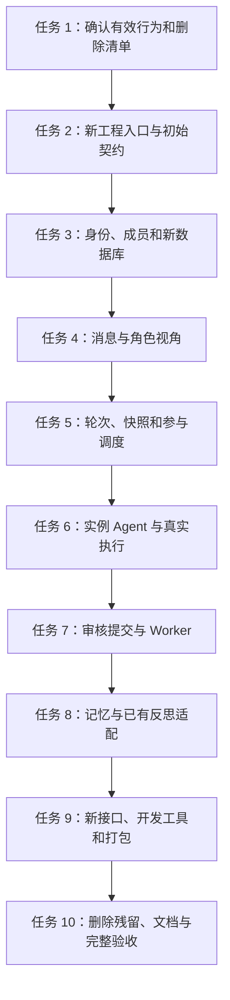

# 改造任务与实施顺序

方案版本：`0.1.0`  
更新日期：2026-10-01  
状态：实施前设计  
配套文件：[运行模型](01-backend-architecture.md)、[文件结构](02-backend-file-structure.md)、[验收](04-backend-baseline-and-acceptance.md)、[数据库设计](05-database-design.md)

## 1. 实施完成后的结果

一个新的社群可以登记玩家、从人物模板创建角色实例、建立会话并发送消息。基础群聊中的角色被明确选择后，使用各自快照执行，分别审核与提交。多个社群中的同模板实例拥有独立状态和记忆。

现有模型调用、执行循环、任务恢复和三种已实现反思图在新范围下工作。新前端使用明确的新接口。代码、资源、配置、数据库与工程文档共同采用初始版本。

工作允许替换现有内部接口与目录，不保留旧导入、HTTP、配置、SQL 和测试替身。保留有实际价值的规则与算法，按当前职责重新组织。

## 2. 执行总顺序

下面的任务是同一方案的依赖顺序。各步骤可以暂时影响旧程序启动；实施过程只维护一个有效模型，不建立旧新双运行路径。每步完成自己的真实验证，最后验证完整系统。

## 3. 任务 1：确认有效行为和删除清单

状态：已完成确认（2026-10-01）。[任务 1 确认记录](task-01-confirmation.md) 保存入口、规则、依赖、删除调用方、逐表核对和测试分类；本任务没有修改后端。

### 工作

1. 记录当前正式模型适配、Harness、租约、审核、关系规则、记忆来源和三种图的入口及重要不变量。
2. 将现有测试按实际规则归类：纯对象规则、真实 SQLite、业务提交、模型调用、旧产品内容和模拟故障。有效规则保留验证目标，模拟实现删除或转换为正式路径验证。
3. 确认所有依赖原仓库工具、工作台和旧导入的引用；使用新包 CLI 与新路径替换。
4. 依据本文第 15 节记录移动、修改和删除的文件，按 02 确认目标职责及依赖；按 05 检查每张表、字段、约束和实际查询入口。
5. 确认本次使用新数据库路径。当前 `server/data/` 中已有实验数据保持原样。

### 完成条件

模块的公开读写端口与依赖方向明确，数据库设计能够逐表说明必要性；未来活动只有设计契约，不进入本次代码清单。对每项保留能力，能够说明真实入口、状态归属、提交事务与验证方法。对每项删除内容，能够说明其实际调用方的替换位置。旧测试通过数量不作为新基线验收结果。

## 4. 任务 2：新工程入口与初始契约

状态：阶段完成（2026-10-01）。[任务 2 阶段记录](task-02-implementation.md) 保存实际修改、自行审核与独立模块验证；完整运行链按后续任务接入。

### 主要文件

`pyproject.toml`、`echo_commons/app/settings.py`、`shared/`、`agents/contracts/`、`modules/characters/templates/`、`resources/identity/`、`infrastructure/models/`。以下包内路径均以 `echo_commons/` 为前缀。

### 工作

1. 将包和发行名称改为 02 定义的名称，更新全部内部导入与命令。删除旧包导出。
2. 定义初始 ActorRef、CommunityScope（社群调用范围）、实例模板引用和 `ContextSnapshot`。所有结构与内容编号按 04 重置。
3. Identity 仅加载唯一的新格式；删除旧 Markdown 单文件角色、`from_legacy()` 和旧资源类型兼容。
4. 将小槿配置移入完整资源目录，重新设置元数据，完整打包 `voice.md` 等被引用资源。
5. ModelRequest 只接受 `output_contract`，字符串 schema ID 由这个对象生成；删除重复输入与 legacy 输出解析。
6. Agent 的 descriptor（执行描述）、能力和路由成为明确接口，删除缺失属性时的动态猜测。
7. 模型配置只登记真实后端，缺少真实配置时报告具体错误。删除 Stub、Fake 及 `auto` 切换路径。
8. 配置取消默认玩家、默认角色、默认会话、固定开发域名与剧情阶段。

### 完成条件

真实模板加载成功，旧格式被新加载器明确拒绝。真实模型请求的契约、Prompt 布局和运行版本统一从初始值开始。资源加载不依赖仓库外路径。包内纯契约与模板加载不需要启动 Worker 或调用模型。

## 5. 任务 3：身份、成员和新数据库

状态：阶段完成（2026-10-01）。[任务 3 阶段记录](task-03-implementation.md) 保存数据库与身份实现、审核和真实验证；具体消费者按后续任务接入。

### 主要文件

`shared/actors.py`、`modules/communities/`、`modules/characters/`、`modules/conversations/domain/`、各业务 `repositories/`、`infrastructure/database/sql/0001_initial.sql`。

### 工作

1. 建立社群、玩家、社群成员、角色实例和实例状态对象。
2. 使用社群字段替换原账号归属，实例字段替换模板即实例的用法。对话、记忆、关系、图运行和检索引用同时更新。
3. 会话成员使用通用 ActorRef，并保存可重复加入的区间；删除只有 `character_id` 的成员结构。
4. 将全局 WorldState 拆为社群时间与暂停状态，删除剧情字段；身体、情绪、当前活动保留在实例状态条目中。
5. 按 05 建立消息、输入关联、轮次、参与结果和精确记忆来源表。社群状态并入社群，可用状态并入实例，快照并入任务；玩家幂等键保存在消息中。
6. 将现有有效反思四表、记忆图、摘要批次、来源覆盖、Trace 和日记视图存储整理进新初始 SQL。图运行保存完整快照；Thought 文本和来源合并保存，删除双份同步；结构版本只由迁移记录提供。
7. 明确所有外键、唯一性与状态检查，字段、关系、约束和索引以 05 为准；空库验证后再删除旧迁移。
8. 实例初始化在一个事务内登记实例、可用状态、预置记忆和社群身份。成员创建只引用已存在对象。
9. 预置记忆的自身主体解析成实例 ID，原模板来源引用保持明确。

### 完成条件

空数据库一次初始化得到全部有效表，没有先建立再删除的旧表。同一模板能创建两个不同实例，分别拥有状态和预置记忆。重复初始化不会重新生成记忆或改变已有身份。外键拒绝跨社群的非法成员与来源关联。

旧实验数据库不参与启动。新程序没有旧数据转换、旧表读取或双数据库模型。

## 6. 任务 4：消息与角色视角

状态：阶段完成（2026-10-01）。[任务 4 阶段记录](task-04-implementation.md) 保存消息、观察、检索及真实验证；轮次、角色执行和 HTTP 按后续任务接入。

### 主要文件

`modules/conversations/`、`modules/perspective/`、`modules/characters/contracts.py`、`modules/memory/services/` 与各业务 Repository。

### 工作

1. 玩家文字消息使用显式玩家身份，保存公开或指定接收者可见性、回复对象和提及对象。
2. 发送事务检查当前成员身份、接收者与回复对象可见性，处理客户端幂等请求。
3. 建立独立 perspective 只读模块，统一成员区间、实际受众与序号边界。公开和私有消息都保存受众区间；加入与离开保存准确序号边界。角色内部状态、关系认识和私有记忆由所属模块分别读取。
4. 玩家增量读取使用相同消息可见规则；游标绑定会话和读取玩家，扫描到不可见消息时也前进。
5. 移除账号级同步、未实现图片、客户端时间、界面建议和空追踪字段。
6. 将检索索引写入、查询与重建连接到可见来源规则。过往离开的角色保留离开前经历，离开后消息不能进入其索引。
7. 查询来源版本时只统计可见材料。相同过滤条件用于上下文与后续记忆段来源。

### 完成条件

同一会话中的两个玩家和两个角色可以读取不同的消息列表。指定接收者消息不能通过另一个角色的检索找回。新加入角色读不到加入前历史。离开的角色能检索过去经历，读不到离开后的新消息。

重复客户端请求返回已持久化消息，内容冲突明确报告。不同玩家的消息序号可以交错，精确输入关联仍正确。

## 7. 任务 5：轮次、快照和参与调度

### 主要文件

`modules/conversations/domain/input_batch.py`、`modules/conversations/tasks/context.py`、`modules/conversations/repositories/tasks.py`、`modules/social/`。

### 工作

1. 输入按会话、ActorRef 与同一受众分别收集。玩家等待最后一条消息后的安静窗口；窗口已结束时不能向旧批次追加。角色窗口为 0，在输出提交内直接建立 sealed 批次。公共、私有或不同成员区间受众分别收集。
2. 删除批次上的任务 ID 与执行状态；来源列表归轮次，角色结果归参与决定与任务。
3. 一个会话已有执行中轮次时，新输入持久化等待。轮次完成后再规划后续输入；暂停社群保留输入等待恢复，归档会话不规划新回应。
4. 同受众的来源才能组合成轮次。按 01 的规则选择角色并持久化候选与原因，保存来源、受众和观察上限。
5. 在规划事务中组装每个被选角色的上下文，持久化快照并创建独立任务。
6. 任务组装器分别调用 perspective、characters 与 memory，组合模板、实例、内部状态、关系认识、可见事实、连续性记忆和有效能力，保存一致的不可变输入。
7. 删除会话级唯一角色任务限制，增加轮次与角色唯一性。任务取消和社群暂停使用明确状态。
8. 建立轮次完成计算：调度时 silent 不创建任务，被选角色执行后沉默记录 completed/outcome=silent，失败、完成和取消都有确定结果。本次自动规划只消费玩家批次，角色批次保留因果来源，不开启连续接话。

### 完成条件

一个来源轮次可以建立两个独立角色任务；第三个角色沉默有明确原因。两个任务引用不同角色快照、相同轮次观察上限。重复规划不产生重复轮次、任务或快照。

全体沉默时轮次正常完成。某个角色失败时另一个角色仍可以提交。新玩家输入等待后续轮次，不被当前任务完成状态提前消费。

## 8. 任务 6：实例 Agent 与真实执行

### 主要文件

`modules/characters/services/registry.py`、`modules/characters/services/capabilities.py`、`modules/conversations/tasks/execution.py`、`agents/character/agent.py`、`agents/harness/`、`modules/memory/tools/search.py`。

### 工作

1. AgentRegistry 根据实例与绑定模板构造 CharacterAgent，模型与工具等共享依赖复用。
2. 执行器根据任务角色选择 Agent，读取持久化快照并构造一次不可变 Invocation。
3. 角色与调用身份不一致时，执行器明确拒绝；删除全局 Agent 引用。
4. 模型历史只把当前角色的发言映射为自身历史；其他发言保留 ActorRef 和名称。
5. 工具上下文使用明确 scope、快照引用和读取策略，删除构造时绑定全局账号的 MemorySearchTool。
6. 有效工具与输出契约由后台实现、模板和任务共同限制。模型提供查询内容，执行主体由 Runtime 确定。
7. 复用现有 Harness 的预算、恢复、工具进展与格式修正算法，更新契约消费方式。
8. 输出包装器按实际契约检查类型，对话用途仍明确要求角色发言；删除通用包装器中的单提案类型限制。

### 完成条件

两个实际角色实例通过同一类 Agent 和真实模型独立生成回应。实例 ID、模型路由、调用 scope、快照来源和工具查询范围一致。更改模板允许能力会影响有效工具列表。

模型调用与工具查询不访问其他实例的私有内容。调用错误有真实供应商和 Runtime 分类，不返回模拟回复。

## 9. 任务 7：审核提交与后台运行

### 主要文件

`modules/conversations/tasks/review.py`、`modules/conversations/tasks/commit.py`、`modules/social/completion.py`、`execution/`、`app/lifecycle.py`。

### 工作

1. 保留任务租约与代次检查、重复结果检查和已批准结果唯一性。
2. 发言审核验证当前实例身份、可见回复目标与契约长度；移除唯一成员和直接会话硬编码。
3. 一次角色发言提交一条消息，沿用来源轮次仍有效的原受众区间，并建立角色零窗口输入批次和因果关联；私有 Thought 单独保存。删除界面气泡投影与气泡编号。
4. 结果、消息、Thought、任务状态与参与状态在同一事务内提交，随后更新轮次完成概况。
5. 永久失败、沉默、成员离开、会话归档、社群暂停各有明确路径；取消与失败不能永久占用执行中轮次。
6. 分离社交规划、角色执行、反思执行与追踪投递 Worker。模型调用共享有限并发额度。
7. 启动只进行配置加载、数据库初始化、任务恢复和 Worker 管理，不创建默认社群或角色。
8. 关闭停止领取，等待在途工作并释放数据库和供应商连接。真实租约过期后可以恢复任务。
9. 存储错误只在存储边界转换；通用程序错误保留类型与追踪。

### 完成条件

同轮次两个真实角色结果可以分别提交。第一个结果产生消息后，第二个结果仍使用原快照并正常提交。重复或迟到结果没有重复消息。

模型调用中进程停止后，重新启动可以继续处理未完成任务。Trace 投递独立运行，失败会有明确状态和重试，不影响已有消息读取。暂停与取消路径不会造成后续轮次永久等待。

## 10. 任务 8：记忆与已实现反思适配

### 主要文件

`modules/memory/`、`modules/reflection/`、`modules/characters/domain/relationship.py`、`modules/characters/services/`。

### 工作

1. 按社群与角色实例归段，保存精确可见来源及该实例 Thought。
2. 多气泡逻辑删除后，记忆来源直接引用完整消息与结果；保留同来源重复处理规则。
3. 三种已实现图使用新实例范围、初始契约和 AgentRegistry。
4. 段反思材料增加发送者信息，禁止把不同角色发言压成同一种无身份文本。
5. 关系候选显式携带目标主体，审核目标属于当前来源中的实际对象；按目标与维度去重。
6. 保留现有关系数值算法、证据来源、摘要消费、图节点失败恢复和可选节点 partial（部分结果）行为。
7. 将反思读取接口明确声明，分别组合历史观察、内部状态和记忆。反思专有契约归 reflection，具体输出契约由 app 注册到通用 Agent；删除 getattr 动态探测。
8. 适配 ReflectionRunView（反思诊断视图）中的范围、版本与来源引用。
9. 保留日记、视图契约与存储。已存在的自动触发缺口按原状态记录。

### 完成条件

同一轮次的公开消息可产生两份独立角色记忆段，私有消息只进入接收角色材料。同模板不同实例的摘要与长期记忆独立。

`segment_reflect`、`continuity_compress` 和 `memory_organize` 使用真实材料和真实模型完成原有审核与持久化路径。角色到玩家和角色到角色的关系都使用明确目标。未实现两种图没有新增调度与事实提交能力。

## 11. 任务 9：新接口、开发工具与打包

### 主要文件

`app/main.py`、`app/http.py`、`app/cli.py`、各模块 `api/`、`examples/`、`pyproject.toml`、`server/README.md`。

### 工作

1. 按 01 实现新 HTTP 路径与下划线字段。删除旧别名、旧路由、旧整体 ApplicationRuntime 依赖。
2. 路由调用实际应用服务；API、领域对象、Agent 契约与 Store 记录保持明确映射。
3. 公开轮次状态服务新前端，内部诊断单独读取快照、追踪和反思。私有来源信息不进入公开响应。
4. CLI 提供 `init`（初始化）、`inspect`（检查）和 `export`（导出）。使用同一正式业务服务和真实数据库。
5. 示例使用真实模板建立多玩家与角色实例，不把任何示例 ID 写入 Runtime 默认值。
6. CORS（浏览器跨站访问设置）通过配置给出，新前端开发地址无需修改代码。
7. 整体资源进入发布包，安装后配置、模板和模型路径有明确加载规则。
8. 标明启动参数、真实模型设置、内部诊断与示例初始化命令。

### 完成条件

通过正式 HTTP 可以创建社群、玩家、角色实例与会话，发送消息并读取轮次与角色回应。新目录中没有旧接口适配器。

构建并安装发布包后，可以在源码目录外加载完整资源、初始化新数据库并使用真实模型。README 的每条命令在当前项目内实际存在。

## 12. 任务 10：删除残留、文档与完整验收

### 工作

1. 删除旧 `echo_server`、模块包装、旧格式解析、模拟实现、旧 SQL 与失效工具说明。
2. 将大型 Repository 中已经移动的实现删除，移除旧导出和重复状态。
3. 重写继承了旧接口和模拟逻辑的测试；保留正式领域规则的验证目标。
4. 清理只服务未实现功能的无消费者依赖和配置，不以减少依赖数量作为目标。
5. 按 04 重写工程文档和有效 ADR，将 05 转为实际数据库说明；删除旧阶段进度、旧客户端约定和不再生效的决策。
6. 完成快速验证、真实模型验证、端到端场景和安装后验证，记录新结果。
7. 删除本轮生成的临时环境、测试数据库和不再需要的构建目录；保留最终验证报告与必要的真实运行记录。

### 完成条件

04 中所有完成条件通过。有效源码、配置、测试和文档中没有旧接口、兼容路径与旧编号。`docs/temp_doc/` 的原始参考材料及用户已有数据保持原样。

## 13. 本次严格保留的未完成能力

| 能力 | 本次处理 |
|---|---|
| `diary_compose` 正式调度与事实写入 | 保持未实现 |
| `view_refresh` 正式调度与事实写入 | 保持未实现 |
| 自动识别往事并发起记忆取回 | 保持未实现 |
| 模型驱动参与意愿、话题相关性评价 | 本次只有确定性参与规则 |
| 角色主动连续聊天 | 保留轮次接入位置，暂不自动触发 |
| 人物模板生成、Compiler（人物内容生成器） | 本次只加载作者定义的真实模板 |
| Activity、ActivityTask、行动者优先调度、首款小游戏和活动经历提交 | 后续独立任务；职责及飞行棋流程见 01 第 11 节 |
| 生活日程与权威人生记录 | 后续独立任务 |

## 14. 实施记录的写法

每个任务完成后，在新工程实现状态中记录：实际变化、已执行验证、真实结果与剩余未完成项。完成证据使用实际命令、测试结果、数据库事实或真实模型记录。

文件结构和任务顺序发生实质变化时，更新对应方案中的最终设计；有效文档只描述一个确定结构。实施过程中的报错和放弃方案不写入模块说明。

## 15. 现有文件的处理清单

本节说明移动、替换和删除，最终完整目录以 02 为准。当前包名与内部旧导入可能处于不同状态，实施前检查实际工作区，再修改所有有效调用方。

| 当前文件或结构 | 操作与目标归属 |
|---|---|
| `runtime/application_runtime.py` | 删除，组装归 app/composition，业务入口归各模块 |
| `runtime/modules.py`、ModuleBase、RuntimeControls | 删除，显式注入服务；后台状态归 execution/supervisor |
| `runtime/lifecycle.py` | 移入 app/lifecycle，删除默认业务初始化 |
| `runtime/conversation/preparation.py` | 替换为 social/planner 与 conversations/tasks/context |
| `runtime/conversation/execution.py` | 移入 conversations/tasks/execution |
| `runtime/conversation/sync.py` | 替换为 conversations/services/query |
| `runtime/input_preparation.py`、`runtime/eligibility.py` | 删除包装，实际规则归 conversations、social 和 characters |
| `runtime/common.py` | 实际游标和请求比较归 conversations，时钟归 execution；删除转发 |
| `runtime/conversation_worker.py`、反思 worker | 后台循环归 execution/workers，队列适配归任务模块 |
| 顶层 `domain/` | 纯规则移入所属模块 domain；ActorRef 和 EventRef 归 shared |
| `store/runtime_repositories.py` | 拆入 communities、conversations 和 social 的实际 Repository |
| `store/state_repositories.py` | 拆入 characters 的实例、状态和关系 Repository |
| `store/memory_repositories.py` | 拆入 memory/repositories |
| `store/reflection_graph_repositories.py` | 拆入 reflection/repositories 的四类对象 |
| `store/database.py`、`store/migrations.py` | 移入 infrastructure/database |
| `runtime/reflection/` | 图与节点算法移入 modules/reflection，按 02 分成材料、任务和存储 |
| `agents/contracts/reflection*` | 专有类型移入 reflection/contracts，注册实际输出解析契约 |
| `services/identity/` | 移入 characters/templates |
| `services/context/` | 删除，任务快照组装归各任务模块，客观读取归 perspective |
| `services/memory/`、MemorySearchTool | 移入 memory/services 和 memory/tools，按实例限定读取 |
| `services/model_gateway/` | 真实实现移入 infrastructure/models |
| 顶层 `api/` | 路由与类型移入所属模块 api，组合与诊断归 app |
| 旧 `main.py`、`cli.py`、`config.py` | 移入 app 并更新实际打包命令 |
| `observability/` | 移入 infrastructure/observability |
| `agents/stubs/`、`model_gateway/fake.py` | 删除实现、导出、调用方及模拟验收 |
| Identity 双格式与 `from_legacy()` | 删除，唯一当前格式重置为初始版本 |
| ModelRequest.output_schema 与动态旧路由 | 删除重复字段和旧调用方适配，明确 output_contract |
| 旧快照别名与动态 `getattr()` 来源接口 | 删除，使用明确字段与读取端口 |
| bubble_projector、bubble_index | 删除，气泡展示不影响输入次数和持久消息数量 |
| 旧 message/send、message/sync、聚合 health | 删除，使用 01 新接口 |
| images、localTimestamp、chips、空 traces、camelCase 别名 | 删除旧请求与响应字段，更新实际调用方 |
| WorldState 单例、phase、stage_summary、story_absent | 删除，社群状态归 communities，角色可用状态归实例 |
| technical_error 角色状态 | 删除，技术错误保存在任务与诊断 |
| 初始方案中的独立状态、幂等请求、任务快照和 Thought 来源表 | 按 05 合并，删除旧写入与同步触发器 |
| 旧 SQL 0001—0016 | 新初始结构生成并验证后删除，不改动用户旧数据库 |
| 旧 tools/dev 路径、工作台目录和 Unity 专属说明 | 删除失效引用，正式初始化与导出归 app/cli |

## 16. 未来活动的实现依据

本次只完成公共基础和设计说明。首款真实活动实施时，ActivityTask 与 ConversationTask 使用独立队列、快照、结果与提交入口；棋局行动机会由 activities 管理，聊天轮次只限制聊天。角色观察增加实际活动视图适配，共享模型调度保障当前行动者并兼顾其他任务。

活动的状态版本、操作资格、过期处理及飞行棋完整例子见 01 第 11 节。验收必须使用真实玩法证明：非当前角色无法操作、所有参与者仍可聊天、聊天未完成时棋局可推进、活动重试不会重复移动。该验收不计入本次已实现能力。
