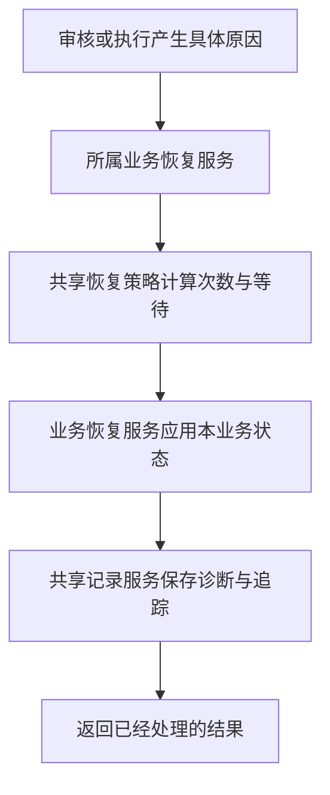

# 错误与恢复机制实施方案

日期：2026-10-04。状态：已审核并完成代码实施。实施前文档提交为 `2a13e9a`；代码保留在本地工作区。

需求依据为 [错误分类、重试与恢复](../server/docs/design/errors-and-recovery.md)。该文件暂时保留当前内容；本文件负责修改范围、具体实现选择、步骤和验收。项目安排见 [推进计划](01-project-roadmap.md)，接口协作见 [接口评估](02-api-boundary-review.md)。

## 1. 交付结果与范围

完成后，对话和反思任务能够保存具体失败原因，正确选择修正、重试、暂缓、忽略或终止。管理查询能够解释每次尝试的原因、实际处理动作、等待时间、次数耗尽及修正提示。关闭完整模型捕获后仍可查询这些记录。

本次交付包括后端执行、审核、错误分类、持久诊断、现有管理响应、数据库迁移、必要测试、接口参考和前端生成类型。管理页面的具体布局与交互由前端任务实现。本次保留当前供应商与模型路由、调用预算、业务审核要求、原持久快照和已批准产物。

部分成功图的补充运行、新的人工重试操作、活动、日记、认识刷新及账户体系继续按各自任务安排。已有失败图重启入口保持正式服务和当前许可范围。

## 2. 实施顺序

| 步骤 | 修改内容 | 完成标准 |
|---|---|---|
| 1 | 集中恢复逻辑、完整契约及明确错误分类 | 已有具体错误码保持稳定；恢复计算只有一份，业务入口调用集中模块 |
| 2 | 正式恢复记录与新增数据库迁移 | 新库、旧库升级及重复初始化正确；已有任务、快照、材料和密钥保留 |
| 3 | 对话和反思的提交、队列及生命周期 | 拒绝结果、恢复决定和任务状态在同一事务保存；暂停、取消和旧租约分别处理 |
| 4 | 重试提示与真实调用统计 | 新调用仅在适用审核错误时带提示；调用准备、成功及失败的实际统计完整 |
| 5 | 管理查询、安全日志、追踪与生成契约 | 正式记录可分页查询；具体原因跨层一致；私人内容和密钥不进入运行日志 |
| 6 | 真实验证与必要回归 | 错误、等待、耗尽、原快照、事实提交及进程恢复达到第 9 节验收要求 |
| 7 | 正式设计文档整理 | `errors-and-recovery.md` 说明长期规则；实施过程与差异记录保留在任务文档 |

每一步同步验证对应规则，最后进行共同验收。以下各节确定这七步的具体实现。

## 3. 步骤一：恢复契约与错误分类

### 3.1 集中实现与入口职责

可复用的恢复逻辑集中在现有 `execution/` 中；对话和反思各用一个专门的恢复文件表达业务差异。错误发生位置负责提供具体原因，审核、提交、队列和任务处理器调用相应恢复模块。

| 逻辑 | 唯一实现位置 | 业务入口需要做什么 |
|---|---|---|
| Agent 结果解释、共同异常分类、次数耗尽、实际等待、下次时间 | `execution/recovery.py` 中的 `RecoveryPolicy`（恢复策略） | 传入完整失败、当前尝试和现有上限，取得明确恢复计划 |
| 执行事件、安全字段转换、追踪载荷和日志字段 | 新增 `execution/records.py` 中的 `ExecutionRecorder`（执行记录服务） | 传入正式租约、调用或结果对象；事务写入时传入当前数据库连接 |
| 对话审核码、业务异常、固定审核提示及任务／参与记录处理 | 新增 `modules/conversations/tasks/recovery.py` 中的 `ConversationRecovery`（对话恢复服务） | 审核拒绝和执行失败都调用同一服务 |
| 反思审核码、业务异常、固定审核提示及节点／图状态处理 | 新增 `modules/reflection/tasks/recovery.py` 中的 `ReflectionRecovery`（反思恢复服务） | 节点拒绝、图级拒绝和执行失败调用同一服务 |
| 异常捕获和任务执行分派 | 现有 `TaskDispatcher` 与 `TaskRegistry` | 使用登记好的分类函数及队列恢复入口 |

每个业务恢复文件维护自己的审核规则表，集中定义代码、类别、建议动作和提示；确实依赖合法来源、节点种类等业务条件时，在同一文件中判断。来源检查、角色登记和审核器只产生原因，不计算等待、不判定任务次数，也不组装恢复记录。

供应商请求重试继续由现有模型网关维护；当前执行内的格式和工具参数修正继续由 `agents/harness/recovery.py` 及执行循环维护。三层各自负责已有范围，持久任务恢复的共同规则集中在 `execution/recovery.py`，两种业务恢复服务复用它。

统一处理流程如下：



对话任务失败需要完成参与记录，反思必需节点失败需要结束图。这些状态处理保留在各自业务恢复服务；公共恢复策略只形成动作与时间计划，保持模块依赖方向。

两个业务恢复服务通过组合复用 `RecoveryPolicy` 和 `ExecutionRecorder`，各自使用已有存储及领域方法。应用组合处创建并注入它们；队列与提交服务持有同一个业务恢复对象。共享模块不导入对话、反思的具体实现。

提交入口的结构示例如下，具体方法签名按现有结果类型实施：

```python
error_code = self.review.check(...)
if error_code is not None:
    return self.recovery.reject(connection, lease, error_code, invocation, result, now)
```

`review.check` 识别具体原因；`recovery.reject` 集中完成规则查询、恢复计划、拒绝结果与状态保存，以及诊断记录。`connection` 是提交服务已有事务的连接，因此整次拒绝处理保持原子性。提交入口保留正常业务流程，不重复定义恢复机制。

### 3.2 共享执行契约

涉及 [失败契约](../server/src/echo_commons/agents/contracts/recovery.py)、[执行契约](../server/src/echo_commons/execution/contracts.py)、[恢复策略](../server/src/echo_commons/execution/recovery.py)、[调度器](../server/src/echo_commons/execution/dispatcher.py) 和 [处理器登记](../server/src/echo_commons/execution/registry.py)。

1. 继续使用完整的 `FailureInfo` 和 `TaskRecoveryDecision`，保持字段校验和不可变对象规则。
2. `decide_run` 返回完整恢复决定；完成或合法无提议返回无恢复决定。已有 `result.recovery` 是动作依据；没有该信息时，根据当前明确的状态、停止原因及诊断码形成决定。
3. `ExecutionOutcome` 用于报告“业务完成、需要处理恢复、恢复已处理、当前结果被忽略”。用 `recovery` 携带完整决定，用独立的安全执行观察对象携带调用统计。删除重复维护的 `error_code`、`retry_after_seconds` 等恢复字段，调用方统一读取 `recovery.failure`。
4. `Disposition` 相应表达 `completed`、`recovery_required`、`handled`、`ignored`。原 `retry` 与 `failed` 由 `RecoveryAction` 表达，避免两处分别决定同一个动作。
5. 队列入口改为 `apply_recovery`，接收租约、完整决定、安全观察及时间，委托所属业务恢复服务处理。业务恢复服务调用共享策略，返回实际采用的动作、任务状态、等待、下次时间和次数耗尽标记。
6. `repair` 只由执行循环处理。任务层收到未处理的 `repair` 表示结果契约有误，明确终止并记录 `agent_run_state_invalid`，不自动把它升级为整次任务重试。

完成或无提议仍必须经过所属业务提交与审核，处理器在事实保存或合法沉默保存后才报告业务完成。提交层已经处理恢复时返回 `handled`，调度器不再重复处理。

### 3.3 原因识别与集中分类

| 入口 | 具体修改 |
|---|---|
| 模型配置与供应商 | 保留当前网关分类、稳定代码、可重试性及建议等待；共享分类函数处理循环之前出现的已知模型配置错误 |
| 角色绑定 | 在 [角色登记](../server/src/echo_commons/modules/characters/services/registry.py) 的蓝图及目的绑定查找处使用明确的 `AgentBindingError`，代码为 `agent_binding_invalid` |
| 角色调用身份及能力 | 在 [CharacterAgent](../server/src/echo_commons/agents/character/agent.py) 的现有检查处提供明确错误；身份沿用 `invocation_identity_mismatch`，工具越权沿用 `tool_not_allowed`，输出能力不符记录契约错误 |
| 输入与输出登记 | 在已有输入类型、输出登记和投影入口识别契约不符，使用 `agent_input_contract_invalid`；保留真正的未知程序异常 |
| 对话快照身份 | 对话准备中的任务与快照身份不一致使用 `task_snapshot_identity_mismatch` |
| 反思冻结输入 | 反思准备和聚合输入不一致复用 `reflection_input_mismatch` |
| 反思来源 | 来源检查继续产生已知 `ReflectionSourceUnavailable`；反思恢复文件集中将它映射为 `reflection_source_unavailable` 和来源终止规则 |
| 未登记处理器 | `TaskRegistry.resolve` 明确报告 `task_handler_not_registered`，按配置失败结束 |
| 数据库 | 保留 `StorageError.code` 及真实可重试性，完整转换为 `persistence` 类别的决定 |
| 未知程序异常 | 使用稳定的 `execution_unexpected_error / harness / fail`，异常类名进入辅助诊断字段 |

`TaskRegistry` 的任务登记增加对应业务恢复服务的异常分类函数，由 `app/composition.py` 静态绑定。`TaskDispatcher` 作为统一异常边界调用该函数；业务分类函数复用共同的配置、存储和未知错误分类。两个任务处理器不各自增加已知异常的捕获清单或分类表。

提交事务内可识别的审核拒绝直接调用业务恢复服务，在原事务中保存决定。事务之外的已知异常进入调度器的统一边界，仍使用同一业务恢复规则。Agent 契约和执行循环不导入业务队列或数据库记录服务。

不批量把所有 `ValueError`、`KeyError` 都认定为配置问题，不从异常消息文字解析错误码。已明确分类的异常保留完整信息；`asyncio.CancelledError` 继续向外传递。

## 4. 步骤二：正式恢复记录与迁移

### 4.1 新增记录结构

新增 `task_execution_events`（任务执行事件表），使用同一份记录服务支持对话与反思的安全诊断。该表保存观察与决定，不保存消息、内心、模型完整输入输出或反思产物正文。

| 字段组 | 具体内容 |
|---|---|
| 记录身份 | `event_id`，用于稳定排序和分页；`event_kind`，表示领取、调用开始、运行结束、恢复决定、生命周期变化或旧结果忽略 |
| 任务身份 | `task_kind`、`task_id`、`attempt`、`lease_generation` |
| 对象归属 | `community_id`、`character_id`；反思增加 `graph_run_id`、`graph_execution_generation`，节点身份使用 `task_id` |
| 调用与追踪 | `invocation_id` 可以为空，`trace_id` 保存已有追踪关联 |
| 时间 | `recorded_at_utc` |
| 安全内容 | `payload_json`，由明确类型序列化，保存完整失败、实际决定、等待、下次时间、次数耗尽、真实调用统计及短修正提示 |

按任务身份及事件编号、反思图身份及事件编号建立查询索引。恢复记录通过单独的 `ExecutionRecordRepository`（执行记录存储对象）读写，位于数据库基础设施中；输入和响应使用正式类型解析，不自行解析 JSON 格式。

`ExecutionRecorder` 统一从正式对象生成事件、安全日志字段及追踪载荷，并调用存储对象。队列、提交和生命周期入口调用记录方法，不各自维护字段字典与序列化代码。事务事件记录接收调用方已有连接，不另行建立嵌套事务。

事件按实际过程追加。领取和任务状态变化在各自写事务中写入记录；调用开始记录实际调用身份和提示；运行结束保存安全统计及本次有限修正观察；恢复记录保存最终采用的动作。生命周期变化对尚未领取的任务允许 `attempt = 0`、调用身份为空，不编造执行尝试。

运行结束记录中的修正观察包含当时实际使用的错误码、类别、短提示及步骤位置。它与“本次调用开始时使用的跨尝试提示”“计划给下次调用的提示”分别保存，避免把计划提示显示为已经使用。

### 4.2 迁移与历史数据

当前数据库迁移为版本 2。新增 `0003_task_execution_events.sql`，实施时若迁移序号已被其他任务使用，顺延为下一个编号。保留已有 `0001`、`0002` 及用户数据。

本项不为任务快照增加字段，也不改变图快照、节点已绑定输入或产物。已有任务的 `last_error_code` 保留，用作当前任务的最近错误字段；新恢复历史从新版本实际运行开始记录。

旧任务没有历史记录时，返回空历史和缺失的诊断字段，继续显示已有状态及错误码。没有观测到的供应商次数保持为空；调用前明确失败且没有发送请求时可以记录零次。

验证先用真实版本 2 数据库保存社群、任务、快照及结果，再执行新增迁移，检查内容和关联保留、迁移版本增加、重复启动不重复应用迁移。用户实际数据库升级前通过现有正式导出入口备份，备份保留在工作区。

## 5. 步骤三：提交、队列与生命周期

### 5.1 一个恢复计算规则

`RecoveryPolicy` 集中计算建议动作、次数耗尽、退避和下次时间。`ConversationRecovery` 与 `ReflectionRecovery` 应用各自业务状态和失败传播，并调用同一记录服务。两种队列的异步恢复入口只负责建立事务并委托该服务；提交入口使用已有事务委托同一服务。

移出两种队列 `_reschedule` 中重复的次数和退避计算、追踪载荷组装；移出对话提交中的独立重试分支。反思领域节点的次数判定改为接受已计算的目标状态，领域层继续检查合法状态转换及租约身份，不重新运行恢复策略。

普通任务重试继续使用 `max(基础退避 × 2^(attempt - 1), 建议等待或 0)`。对话审核重试也使用该计算，删除当前独立的固定等待分支。任务次数耗尽时保留原始失败对象，将实际动作记为 `fail`，同时记录 `retry_exhausted = true`；终态不保存虚构的下一次执行时间。

过期租约恢复记录本次 `lease_expired` 原因及实际动作；此前的审核或网络错误保留在历史中。不能因为节点已有旧错误码，就把这次租约过期记成旧错误。

### 5.2 对话提交

涉及 [对话审核](../server/src/echo_commons/modules/conversations/tasks/review.py)、[对话提交](../server/src/echo_commons/modules/conversations/tasks/commit.py)、[对话队列](../server/src/echo_commons/modules/conversations/tasks/queue.py)、[队列存储](../server/src/echo_commons/modules/conversations/repositories/queue.py) 和 [对话处理器](../server/src/echo_commons/modules/conversations/tasks/handler.py)。

- 审核仍返回具体业务原因；提交入口调用 `ConversationRecovery.reject`，由该服务查询集中规则并取得恢复计划。
- 该服务在原事务中保存 rejected 或 expired 结果、应用恢复、更新任务及参与记录，并调用统一记录服务。approved 结果及正常消息保存保留原提交职责。
- 长度错误允许有限任务重试。空发言继续由现有产物类型及执行循环校验，不重复增加另一套审核入口。
- 合法沉默正常完成。暂停保持 `suspended`；成员离开和会话归档取消任务并完成相应参与记录；其他终止审核错误保留现有规则。
- 重复提交返回原结果；迟到结果保存允许的诊断，保持当前任务状态和事实不变。

### 5.3 反思节点与图级提交

涉及 [节点审核](../server/src/echo_commons/modules/reflection/tasks/review.py)、[节点提交](../server/src/echo_commons/modules/reflection/tasks/commit.py)、[图级提交](../server/src/echo_commons/modules/reflection/tasks/graph_commit.py)、[反思队列](../server/src/echo_commons/modules/reflection/tasks/queue.py)、[反思处理器](../server/src/echo_commons/modules/reflection/tasks/handler.py) 及领域节点状态。

- 删除节点审核拒绝时的 `ConflictError(error)` 路径，提交入口调用 `ReflectionRecovery.reject`。节点提交返回明确的提交结果，包含批准产物或已经保存的恢复决定。
- 模型能够修正的节点错误按有限任务重试处理；拒绝时不创建成功产物，不激活依赖成功产物的后继节点。
- 来源失效、输入身份不符及配置问题明确终止。`ReflectionRecovery` 集中负责必需节点失败传播及可选节点失败后的依赖处理，复用现有领域与存储方法，队列和提交入口不分别实现这套行为。
- 聚合节点保持确定性执行。图级拒绝结果、恢复事件和节点／图状态在同一事务保存，继续保留事实消费的保存点和回滚规则。
- 聚合与事实消费中当前通过通用 `ConflictError` 表达的具体业务原因，改为该模块明确的审核原因，避免再次保存为通用 `conflict`。
- 已保存消息、产物、图级结果或事实的执行，不因追踪投递失败再次请求模型。

### 5.4 暂缓与旧租约分别处理

涉及 [心跳](../server/src/echo_commons/execution/lease.py)、[反思执行资格检查](../server/src/echo_commons/modules/reflection/tasks/readiness.py)、两种队列及 [对话生命周期](../server/src/echo_commons/modules/conversations/tasks/lifecycle.py)。

| 实际情况 | 采用的处理 |
|---|---|
| owner、attempt、generation 不符，或租约已过期 | 停止当前执行，记录旧结果忽略；正式队列负责到期恢复，旧执行不更新当前业务状态 |
| 对话所属社群暂停 | 使用现有生命周期转为 `suspended`，释放在途执行，恢复后继续原任务 |
| 反思所属社群暂停或角色暂时不满足现有领取条件，租约仍有效 | 形成明确的 `defer`；节点使用现有 `retry_wait` 释放租约，等待现有资格恢复，保留图、快照及产物 |
| 成员离开、会话归档或图已经结束 | 采用正式取消或忽略规则，不提交迟到事实 |
| 进程关闭取消在途调用 | 取消信号向外传递；未提交执行通过持久租约恢复 |

反思这一调整只完善现有资格检查产生的暂缓处理，使用已有状态和领取条件；没有新增图级暂停状态或管理操作。暂停期间资格检查阻止再次领取，不消耗模型请求。

心跳续期和请求前资格检查都区分上述原因。有效租约下的暂缓通过明确的停止决定返回，当前调用被取消后由所属队列应用该决定；真正失效的租约继续使用 `LeaseLostError`。暂缓不触发失败传播或次数耗尽判定；后续领取仍记录真实尝试次数，原调用预算和持久任务上限不自动增加。

若运行返回暂停或取消信号，所属模块事务中读取真实业务状态后执行对应处理。与真实状态不符的停止结果记录结果契约错误，避免遗留无人处理的 `processing` 任务。

数据库暂时无法写入时，记录安全故障并保留原租约，由正式恢复继续处理；不能声称已经保存恢复决定。旧租约可以追加与自身身份绑定的诊断事件，不能因此改写新代次状态。

## 6. 步骤四：提示与调用统计

### 6.1 跨任务尝试的修正提示

涉及 [对话调用准备](../server/src/echo_commons/modules/conversations/tasks/execution.py)、[反思调用准备](../server/src/echo_commons/modules/reflection/tasks/executor.py)、[执行循环](../server/src/echo_commons/agents/harness/loop.py) 和 [提示契约](../server/docs/design/character-prompt-contracts.md)。

调用准备通过业务恢复服务取得下一次调用的提示。最近恢复决定的读取、是否适用本次尝试和图执行代次的判断，以及文字构造均集中实现；对话、反思准备文件只调用该入口并填写 `ExecutionPolicy.repair_hint`。

只有实际安排了自动重试、该决定带审核修正提示且属于当前图执行代次时，才附具体错误码和短要求。任务没有提示时明确使用空值。抽取现有修正文字的拼接函数，当前执行内修正与跨任务尝试提示共用，保持原提示外壳。

暂停、恢复等生命周期记录不覆盖尚待使用的审核提示；新的网络失败、来源失败或租约过期决定替代此前的执行恢复决定，不能继续沿用旧审核提示。失败图人工重启使用新的图执行代次，第一轮不自动继承上一代的临时修正提示。

`thought_too_long` 与 `utterance_too_long` 使用提示契约中已有的各自正文，替换当前合并长度提示。反思新增提示如下，审核通过本方案后集中加入提示契约及所属模块代码：

| 审核错误 | 新增提示正文 |
|---|---|
| `reflection_output_too_long` | 请缩短本节点输出的 JSON，使其符合长度限制。 |
| `reflection_summary_required` | 请按照本节点契约生成段摘要，本节点需要正式摘要产物。 |
| `reflection_digest_required` | 请按照本节点契约生成连续性摘要，本节点需要正式摘要产物。 |
| `reflection_evidence_unknown` | 请仅引用本次输入允许的 evidence_refs。 |
| `reflection_relationship_target_unknown` | 请仅选择本次输入允许的关系目标。 |
| `reflection_digest_coverage_mismatch` | 请将 covers_through_sequence 设置为本次冻结材料的覆盖上限。 |
| `reflection_entity_duplicate` | 请为本次输出中的每个实体使用唯一的 entity_id。 |
| `reflection_edge_target_unknown` | 请让每条关系边的 from_entity_id 和 to_entity_id 引用本次输出中已有的实体。 |
| `reflection_action_mismatch` | 请使用本节点允许的行动类型。 |

提示只指出规则，合法证据、目标和覆盖范围继续来自原输入；没有合法来源时终止，不能要求模型编造。固定提示外壳沿用现有格式。原业务提示、示例、工具协议和执行循环修正正文保持不变。

新的提示只加入本次模型请求，记录实际使用的文字。快照和前驱产物内容通过直接比较验证一致，不新增哈希或校验文件。

### 6.2 当前执行内修正与次数

涉及 [运行结果](../server/src/echo_commons/agents/contracts/run.py)、[循环状态](../server/src/echo_commons/agents/harness/state.py)、[执行循环](../server/src/echo_commons/agents/harness/loop.py) 及网关现有响应和错误。

- 当前执行内的格式或工具参数修正仍使用现有次数上限；耗尽后任务失败，不开始下一次任务尝试重置修正次数。
- 增加安全的修正观察类型，记录当次实际代码、类别、短提示及步骤，不保存临时完整模型消息。
- 模型逻辑请求次数在实际进入网关调用时计数；失败请求也计数。供应商 HTTP 尝试次数从真实响应或 `ModelGatewayError.provider_attempt` 读取，单独汇总。
- 调用准备失败时两类请求次数均为零。网关配置检查失败可能已有一次逻辑调用，供应商 HTTP 请求仍为零，两种计数分别展示。
- 整体期限取消或进程退出导致实际供应商次数无法确认时，保持未知。历史结果新增统计字段使用缺失值，不能将旧结果推测为一次请求。
- 任务处理器调用共享记录服务登记真实调用开始与运行结束，业务恢复服务或正常提交事务保存完整安全观察。执行循环返回观察对象，数据库写入由运行编排层负责；各入口不自行组装观察载荷。

完整捕获仍可用于检查真实模型请求中的提示；捕获关闭时，正式事件中实际使用的提示和安全运行观察仍然可查。

## 7. 步骤五：管理接口、日志与契约

### 7.1 复用现有管理路径

涉及 [管理路由](../server/src/echo_commons/app/management.py)、[管理响应类型](../server/src/echo_commons/app/management_schemas.py)、[对话管理查询](../server/src/echo_commons/modules/conversations/management.py)、[反思诊断](../server/src/echo_commons/modules/reflection/diagnostics.py) 和执行记录查询。

| 现有路径，均以 `/internal` 开头 | 新增响应内容 |
|---|---|
| `GET /communities/{community_id}/tasks` | 保留当前状态及 `last_error_code`；增加 `last_failure`、`last_recovery_action`、`next_attempt_at_utc`、`retry_exhausted` |
| `GET /characters/{character_id}/tasks/{task_id}` | 增加分页的 `recovery_history`，记录对话任务各次执行与处理决定 |
| `GET /communities/{community_id}/characters/{character_id}/reflection/runs` | 增加最近图失败与恢复摘要，保留现有执行代次 |
| `GET /reflection/runs/{graph_run_id}` | 增加图级恢复摘要及各节点的最近恢复摘要，不重复附上所有节点的完整历史 |
| `GET /reflection/runs/{graph_run_id}/nodes/{node_task_id}/input` | 保留输入检查内容，增加该节点分页的 `recovery_history` |
| `GET /traces/{correlation_id}` | 已有追踪载荷增加具体失败、实际动作、等待、次数耗尽和安全关联身份 |

任务及节点详情使用现有 `limit`、`cursor` 分页规则、默认值与上限，只对新增恢复历史分页，响应使用现有 `Page` 结构。游标绑定任务及读取范围，反思查询同时绑定图身份；事件明确提供图执行代次用于区分人工重启前后。

列表摘要根据当前任务状态及最近实际恢复决定形成。已完成任务的当前错误为空，历史失败仍可在详情查看。旧任务没有完整记录时新增诊断字段为空，已有错误码继续保留。

读取先复用现有社群、角色、任务及节点归属检查，再查询诊断；跨范围查询保持现有拒绝行为。公开 `/api` 响应范围保持现有契约，内部恢复材料由管理接口读取。

### 7.2 安全日志及追踪

修改 [日志字段白名单](../server/src/echo_commons/infrastructure/observability/logging.py)，增加失败类别、建议与实际恢复动作、租约代次、图与节点身份、建议及实际等待、下一次时间、次数耗尽和是否使用提示等安全字段。错误类型仍用于辅助定位。

正式恢复事件、对应追踪及运行日志字段由 `ExecutionRecorder` 根据同一已保存决定生成。状态、事件和 outbox 记录在同一事务写入，投递失败独立重试。短提示正文保存在正式诊断中；普通日志只记录是否使用及对应代码，不包含完整提示、供应商原始错误、消息或内心正文。

同步更新管理参考、OpenAPI 和前端 `schema.d.ts`。前端类型从当前完整契约重新生成，范围包含此前尚未同步的已有接口；不手工拼接生成文件。完成后检查现有请求层的类型使用，修正本次字段与参数变化造成的实际编译问题。

## 8. 修改位置汇总

| 范围 | 主要位置 | 修改性质 |
|---|---|---|
| 公共恢复机制 | `execution/recovery.py` | 唯一的持久恢复计算、结果解释、共同异常分类及提示适用规则 |
| 业务恢复机制 | 新增 `modules/conversations/tasks/recovery.py`、`modules/reflection/tasks/recovery.py` | 各自集中维护审核规则、业务异常映射和状态处理；复用公共计算与记录 |
| 统一执行边界 | `execution/{contracts,dispatcher,registry,lease}.py` | 传递完整契约，登记分类函数及统一处理异常和停止原因 |
| 调用与观察 | `agents/{character/agent,contracts/run,contracts/output,harness/runner,harness/loop,harness/state,harness/context}.py` | 提供明确原因，保留本次修正机制，返回安全观察并复用提示格式函数 |
| 对话业务入口 | `modules/conversations/tasks/{execution,handler,review,commit,queue,lifecycle}.py` 及相关存储 | 提供原因或调用集中服务；移除分散的恢复计算、提示选择和记录组装 |
| 反思业务入口 | `modules/reflection/tasks/{executor,handler,review,commit,graph_commit,aggregate,facts,queue,readiness}.py` 及领域节点 | 提供原因或调用集中服务；保留正常提交与业务不变量，移除分散恢复规则 |
| 正式诊断 | 新增 `execution/records.py`、执行事件类型、记录存储及 SQL 迁移 | 统一事件、安全字段和追踪构造；存储负责持久化与查询 |
| 应用组合 | `app/composition.py` | 创建并注入共享策略、记录服务及两个业务恢复服务，静态绑定任务分类函数 |
| 接口 | `app/management.py`、`app/management_schemas.py`、`reference/openapi.json`、`frontend/src/api/schema.d.ts` | 暴露已有正式记录与生成类型，不复制恢复判断 |
| 文档 | 错误设计、任务执行、Agent 与模型、提示契约、可观察性、故障指南、数据库与接口参考、状态和验证说明 | 记录各自的唯一职责与最终契约 |

表内源码路径均相对于 `server/src/echo_commons/`，参考和前端文件除外。新增类型仅表达本任务的失败、观察和恢复记录，不建立通用业务任务结果框架。

## 9. 步骤六：验证方案

### 9.1 规则与真实持久化

| 验证项 | 方法与断言 |
|---|---|
| 集中实现与可读性 | 代码审查确认退避、次数耗尽及记录构造各有一份实现；业务审核规则只在所属恢复文件；两个处理器没有各自的异常清单，提交及队列入口复用同一服务；不使用基于代码行数的测试 |
| 完整决定 | 使用正式契约输入验证各动作，确认错误码、类别、等待和提示跨处理入口保持一致；同时验证次数耗尽后的实际动作与原原因分别保存 |
| 具体审核原因 | 使用正式类型、真实来源和真实数据库测试审核、提交及恢复；对话和反思的具体原因不变成异常类名或 `conflict` |
| 准备阶段错误 | 实际缺失绑定、契约登记、任务输入身份不一致触发明确错误，供应商请求未发生 |
| 退避与等待 | 直接验证正式恢复计算及真实队列调度；合法建议等待参数用于验证计算规则，供应商实际建议的取得另行验证 |
| 原快照与产物 | 在领取、拒绝、重试、暂停恢复和人工图重启前后直接比较保存内容与输入产物引用 |
| 生命周期 | 使用正式社群、成员及归档服务，验证暂停、暂缓、取消、轮次完成和恢复事件；租约身份失效与资格暂时变化分别检查 |
| 图失败传播 | 真实节点状态和依赖验证必需失败、可选失败、聚合拒绝及成功产物复用 |
| 旧结果与重复提交 | 使用真实租约到期、新领取和重复提交，确认消息、产物及事实只提交一次，旧代次不能改写新状态 |
| 数据库迁移 | 实际版本 2 库升级、重复初始化、外键检查；已有业务数据和输入保持不变 |
| 捕获关闭的诊断 | 关闭调试捕获，通过 SQLite、追踪及管理 HTTP 读取完整原因和动作；跨社群与角色范围拒绝；普通日志排除私有正文及密钥 |

复用现有 `test_task_queue`、`test_task_lifecycle`、`test_conversation_commit`、`test_reflection_queue`、`test_management_api`、`test_trace_delivery` 和数据库测试。新增恢复策略及正式诊断测试覆盖新规则；不把人工构造的契约输入报告为真实模型返回。

### 9.2 实际模型、网络和进程

- 使用现有登记的真实模型路由，对话与反思分别执行正常、审核拒绝和修正重试流程。独立测试设置可以采用合法的较小长度上限，记录模型实际产物及审核结果。
- 使用独立测试登记和实际无法建立连接的网络地址触发正式 SDK 网络故障，确认任务有限重试、空修正提示及实际网络尝试；不修改用户正在使用的供应商配置和密钥。
- 通过真实缺失凭据、正式工具授权拒绝及有效的小预算验证配置、权限和预算终止，不替换网关或工具实现。
- 复用真实模型进程终止和重启测试，检查原快照、新代次、恢复记录及重复事实拒绝。
- 限流、供应商建议等待及模型随机错误以实际发生的结果登记。未实际发生的外部情形明确列为未覆盖，不伪造响应、不用预设返回替代。

审核修正链路、准备错误、真实网络重试、耗尽、原输入、生命周期和捕获关闭诊断属于必须完成的验收。不同错误码的具体审核规则可以通过正式输入直接验证，模型端到端重点验证真实拒绝到新调用修正的完整过程。

### 9.3 必要回归与生成检查

先运行受影响的非模型测试，再运行全部非模型测试；真实模型执行集中覆盖本次路径及已有对话、反思、进程恢复场景。运行静态检查及以下现有生成工具，生成后再执行其 `--check`：

- `server/tools/build_contract_reference.py`：接口、OpenAPI 和设置契约。
- `server/tools/build_database_reference.py`：实际表、索引和数据库参考。
- `server/tools/build_file_reference.py`：源码导航。
- `server/tools/check_document_links.py`：正式文档及本任务文档的本地链接。
- `server/tools/audit_prompt_preservation.py` 及提示保留测试：原固定正文保持一致，新增审核提示与批准方案一致。
- 前端 `npm run api:types` 与 `npm run typecheck`：完整接口类型和实际使用检查。
- `git diff --check`：空白格式检查。

执行时复用已有运行环境。测试数据库、捕获、日志和辅助脚本放在工作区 `.verification/errors-recovery/`，显式指定 pytest 的临时目录和缓存目录；按真实运行需要使用捕获，结束后清理本轮临时资源，保留必要证据和用户数据。

## 10. 步骤七：改写正式设计说明

代码及验收完成后，重新组织 `server/docs/design/errors-and-recovery.md`，按以下顺序说明最终规则：

1. 职责与模块边界：谁产生错误、谁分类、谁执行恢复、谁保存记录。
2. 错误信息契约：各字段含义、有效组合、稳定代码的来源。
3. 供应商重试、执行循环修正与持久任务重试：各自范围、计数和期限。
4. 恢复动作与业务状态：重试、暂缓、终止、忽略、暂停、取消和旧租约。
5. 对话、反思节点和聚合审核：错误分类、提交事务、图失败传播。
6. 冻结输入与修正提示：保持原输入、何时附提示、何时为空。
7. 正式记录、日志、追踪和管理读取：安全内容、缺失信息、范围和关联。
8. 简单的规范例子：发言超长、网络故障、来源失效与进程恢复。

正式设计中删除迁移对比、当前缺口、待修正清单、实施顺序及本轮验证过程。固定提示正文继续只在角色提示契约维护；接口字段及示例留在接口参考；当前完成程度及未覆盖验证留在状态文档。

原项目比较、附件线索和本次实际实施证据保留在本任务文档的完成记录中。完成后本方案标记为已完成，项目待办改为实际交付状态；不将任务记录用作运行规则的第二份定义。

## 11. 审核与实施边界

本方案按一个完整目标实施，最终共同交付七个步骤。重点审核集中实现与入口职责、恢复动作与状态处理、保持冻结输入、新增短提示、正式恢复历史及现有管理响应的调整。

用户已审核确认本方案，具体实现及验证结果见下方完成记录。用户数据库没有在本任务中升级，新增迁移通过独立真实数据库验证。

核查基线为当前后端提交 `0c7b9d8053b695ffde6b45f537f320a82c4a1325` 与原项目提交 `c1d8a27c78565d3a8f2271a0f11ca6b5bd9f1b4d`。当前已保留供应商重试、有限执行循环修正、持久任务次数限制及租约恢复；迁移差距集中在分类及决定的后续处理。审核提示端到端传递和完整恢复诊断也包含原项目未完成的要求。原实现依据链接暂时保留在错误文档，最终随任务记录整理。

## 12. 完成记录

集中恢复策略、对话与反思恢复服务、执行事件存储、管理分页查询及生成契约已完成。异常由登记好的分类入口处理；审核和队列复用所属恢复服务。正式设计见 [错误分类、重试与恢复](../server/docs/design/errors-and-recovery.md)。

数据库新增版本 3，保持原快照和成功产物。现有管理查询增加最近失败、实际动作、下次时间、耗尽标记及分页历史；图详情以 `node_recovery` 保存各节点概要。模型逻辑请求在进入网关时计数，失败请求计入，供应商 HTTP 尝试单独保存。

真实验证包括版本 2 数据库升级及重复初始化、正式队列和生命周期、管理 HTTP 范围与分页、捕获关闭诊断、真实 SDK 连接故障的两次任务尝试与耗尽，以及真实对话、反思、进程终止后恢复。对话和反思采用合法的一字符审核上限，实际触发拒绝，再调用携带固定修正提示；两次尝试后结束，输入内容保持相同。这项验证证明提示实际使用和有限重试，正常成功流程由正常模型测试验证。

供应商实际 429（限流）与 Retry-After（建议等待）未在本次真实请求中发生；等待计算使用正式失败契约输入验证，没有预设供应商响应。真人材料质量和管理页面布局继续由各自任务负责。

前端类型由当前完整 OpenAPI 重新生成，因此包含此前未同步的已有接口。前端类型检查通过。旧固定提示测试继续通过，新增九条提示正文按已批准方案加入提示契约。

### 实施前迁移核查

核查比较当前后端提交 `0c7b9d8053b695ffde6b45f537f320a82c4a1325` 与原项目 [echo 主分支提交](https://github.com/Weilan0811/echo/tree/c1d8a27c78565d3a8f2271a0f11ca6b5bd9f1b4d/server) `c1d8a27c78565d3a8f2271a0f11ca6b5bd9f1b4d`。用户提供的《错误修复.md》作为差异线索；以下结论根据两边源码确认。

当前仍有统一失败对象、供应商错误分类、网关重试、执行循环内修正、持久任务次数限制、心跳和过期租约恢复。主要缺口是：具体错误码在部分路径被覆盖，恢复动作被简化，修正提示和诊断信息没有完整传递与保存。

| 核查项目 | 原项目实现 | 实施前实现及恢复要求 |
|---|---|---|
| 失败信息契约 | `FailureInfo` 保存错误码、类别、动作、可重试性、等待时间与修正提示 | 契约保留；执行结果及队列入口仍需完整传递它 |
| 供应商分类与请求重试 | 区分超时、限流、临时故障、认证、额度和无效请求 | 已保留；继续使用实际供应商尝试次数和建议等待时间 |
| 输出与工具参数修正 | 在同次执行内有限修正，权限与预算错误结束 | 已保留；不能通过持久任务重试重新获得已耗尽的修正额度 |
| 运行结果的恢复决定 | `decide_agent_run` 保留已有恢复动作；暂停对应 `defer`，取消对应 `ignore` | `decide_run` 主要按运行状态选择重试或失败，其他停止结果可能进入失败；需要恢复动作区分 |
| 已定义异常的错误码 | 原调度器优先读取异常的 `.code`，并单独处理未登记的任务处理器 | 当前通用异常分支保存异常类名并终止；需要为已知错误保留具体错误码和相应规则 |
| 任务再次执行的审核提示 | `decide_review` 定义具体审核提示，设计要求传入新调用；原对话提交、调用创建没有完整使用该决定 | 属于原项目已有的实现缺口。当前对话只有合并的长度提示，反思入口缺少传递，需要完成端到端实现 |
| 恢复诊断 | 原设计要求传递类别、等待和提示，实际任务及追踪也主要保存错误码和次数 | 属于原项目已有的实现缺口；当前也需补充正式记录和管理查询 |
| 输入快照 | 原对话尝试重新构建上下文，设计允许部分来源变化后重新选择输入 | 当前冻结原任务快照；继续保留当前规则，恢复功能不重建快照 |
| 租约及图失败传播 | 有限重试、拒绝迟到结果、必需节点失败传播、复用成功产物 | 当前仍有这些机制；保留，部分成功图的补充运行仍属独立待办 |

原项目的 [恢复策略](https://github.com/Weilan0811/echo/blob/c1d8a27c78565d3a8f2271a0f11ca6b5bd9f1b4d/server/src/echo_server/runtime/recovery.py)、[调度器](https://github.com/Weilan0811/echo/blob/c1d8a27c78565d3a8f2271a0f11ca6b5bd9f1b4d/server/src/echo_server/runtime/dispatcher/dispatcher.py)、[对话执行](https://github.com/Weilan0811/echo/blob/c1d8a27c78565d3a8f2271a0f11ca6b5bd9f1b4d/server/src/echo_server/runtime/conversation/execution.py)、[对话提交](https://github.com/Weilan0811/echo/blob/c1d8a27c78565d3a8f2271a0f11ca6b5bd9f1b4d/server/src/echo_server/runtime/conversation/commit.py) 和 [持久任务设计](https://github.com/Weilan0811/echo/blob/c1d8a27c78565d3a8f2271a0f11ca6b5bd9f1b4d/server/docs/infrastructure/durable-task-runtime.md) 共同说明上述区别。恢复范围包含迁移差距和原先未完成的要求。

### 验证结果

- 全部 115 个非模型回归场景通过；随后新增的 2 个真实准备失败场景通过，总计 117 个非模型场景。准备失败涵盖实际缺失目的绑定及任务与快照身份不一致，网络请求均为零。
- 8 个真实模型、网络或进程场景通过：正常对话提交、原受众及离开后拒绝、反思私人材料、缺失凭据、真实进程终止恢复、实际网络有限重试、对话审核提示调用、反思审核提示调用。
- 静态检查、OpenAPI／数据库／源码参考生成检查、47 份正式文档的链接检查、前端生成类型与类型检查通过。
- 提示核查保留七条既有循环修正正文、循环中文正文及供应商消息序列化；原固定提示基线测试通过。新增反思审核提示按批准方案维护。
- 临时数据库、模型捕获、辅助脚本和核查输出均位于当前工作区。用户实际数据库、凭据及模型配置没有修改。
