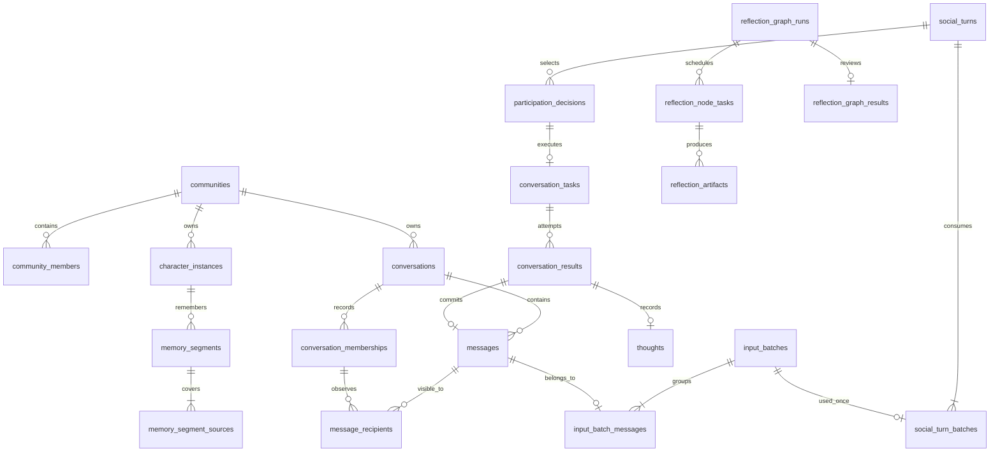

# 数据库设计

方案版本：`0.1.0`  
更新日期：2026-10-01  
状态：实施前设计  
配套文件：[运行模型](01-backend-architecture.md)、[模块归属](02-backend-file-structure.md)、[实施顺序](03-backend-implementation-plan.md)、[验收](04-backend-baseline-and-acceptance.md)

## 1. 设计范围与阅读方法

本文定义新基线的表、字段、关系、约束、索引和事务，是数据库实现的依据。表名清单不能代替这些规则。现有 SQL 尚未按本文重建；文档中的约束是实施要求，验证结果随实际实施记录。

SQLite 保存权威业务状态，角色观察没有自己的事实表。模板正文保存在人物资源中，实例保存模板及版本引用。活动表随真实活动实现，本次不创建。

字段表使用以下约定：

| 写法 | 含义 |
|---|---|
| `TEXT` | 必填文本；ID 使用实际生成的稳定标识，业务内容按字段规则校验 |
| `INTEGER`、`REAL` | 必填整数、实数 |
| 类型后附 `?` | 允许 NULL；未附问号的字段使用 NOT NULL，包括文本主键 |
| `JSON` | SQLite TEXT，CHECK(json_valid(...))；类型与内部字段由正式契约验证 |
| `0`、`[]`、`{}` 等默认值 | 仅明确写出的默认值自动填写，其余由真实操作提供 |
| `created_at_utc`、`updated_at_utc` | TEXT，统一 UTC 时间格式；出现在哪张表就在该表定义 |
| `community_id`、`character_id` | 指定事实所属社群和观察角色；实例范围使用复合外键确保一致 |

JSON 只保存无需按内部字段关联查询的完整快照、结构化产物、来源列表或小型受众集合。调度状态、任务身份、成员关系、可见接收者和消费关系使用独立字段或关联表。不得把可见性判断藏在无法约束的模型输出中。

## 2. 表的必要性与删减决定

### 2.1 分组与归属

| 组别 | 所属模块 | 保留目的 |
|---|---|---|
| 社群与玩家 | communities | 身份登记、社群归属与运行状态 |
| 角色与关系 | characters | 实例、当前可用状态、状态历史和主观关系认识 |
| 会话与任务 | conversations | 成员历史、权威消息、输入与可恢复角色执行 |
| 社交轮次 | social | 一次多人回应的来源、参与和完成边界 |
| 记忆与检索 | memory | 独立角色经历、加工结果、精确来源与真实检索 |
| 反思执行 | reflection | 已实现图的调度、节点、不可变产物和审核 |
| 追踪与迁移 | infrastructure | 独立追踪投递和数据库版本记录 |

记忆和反思中多张关联表已有正式消费者。它们分别表达多对多来源、已消费版本和节点产物，保留这些表能避免重复处理和丢失来源。保留日记与视图存储不代表其正式生成流程已经实现。

### 2.2 可以合并或删除的结构

| 原方案或旧结构 | 新结构 | 理由 |
|---|---|---|
| `community_state` | 并入 `communities` | 当前是一对一的小型运行状态，无独立历史消费者 |
| `character_availability` | 并入 `character_instances` | 可用状态与登记实例一对一，保留明确的状态版本 |
| `message_requests` | 幂等键放入 `messages` | 一次玩家请求只提交一条完整消息，原消息足以比对内容 |
| `conversation_contexts` | 快照字段并入 `conversation_tasks` | 一个任务只持有一个不可变初始快照 |
| `thought_provenance` | 元数据保留在 `thoughts` | 清除私有文本时保留同一行身份与来源，避免双份记录同步 |
| `meta` 中的结构版本 | 由 `schema_migrations` 提供 | 不重复保存同一版本；启动状态由当前进程诊断提供 |
| 通用 `agent_results` | 明确为 `conversation_results` | 当前外键只属于对话，未来活动有自己的结果结构 |
| 旧剧情、旧轮次和旧反思任务表 | 删除 | 当前有效对象已经替代它们 |

继续保留 `message_recipients`、成员区间、来源关联和反思四表。它们用于实际权限判断、恢复或提交，无法通过简单合并保持相同语义。参与记录不额外保存 task_id，节点任务不额外保存 artifact_id，通过真实唯一键查询，减少双向同步。

## 3. 主要实体关系

图只展示主要关系。ActorRef 的玩家或角色引用是带种类的业务引用；SQLite 不支持一个外键同时指向两张表，因此多态主体真实存在性在同一正式事务内校验。可确定单一表的引用使用外键，不以字符串比较代替范围检查。

## 4. 社群与玩家

### 4.1 `communities`

| 字段 | 类型与默认值 | 含义 |
|---|---|---|
| `community_id` | TEXT，主键 | 社群身份 |
| `name` | TEXT | 显示名称，不作为唯一身份 |
| `timezone` | TEXT | 实际社群时区，用于日记日期计算 |
| `world_time_utc` | TEXT | 社群当前时间 |
| `status` | TEXT，默认 `active` | active 或 paused |
| `state_version` | INTEGER，默认 `0` | 时间或暂停状态变化版本 |
| `created_at_utc`、`updated_at_utc` | TEXT | 创建和修改时间 |

时区使用成熟库校验。只在实际状态修改时递增版本，不因为模型错误改变社群状态。

### 4.2 `players`

| 字段 | 类型 | 含义 |
|---|---|---|
| `player_id` | TEXT，主键 | 玩家身份 |
| `display_name` | TEXT | 显示名称 |
| `created_at_utc` | TEXT | 登记时间 |

玩家可以参加多个社群。显示名称允许重复，示例初始化按显式 ID 检查已有内容。

### 4.3 `community_members`

| 字段 | 类型 | 含义 |
|---|---|---|
| `community_id` | TEXT，外键 | 所属社群 |
| `actor_kind` | TEXT | player 或 character |
| `actor_id` | TEXT | 真实玩家或角色身份 |
| `joined_at_utc` | TEXT | 加入社群时间 |

主键为 `(community_id, actor_kind, actor_id)`。本次没有社群退出历史功能，会话中的加入离开单独保存。角色成员必须引用属于该社群的实例；玩家成员必须引用已登记玩家。两项校验在正式加入事务内完成。

## 5. 角色与关系

### 5.1 `character_instances`

| 字段 | 类型与默认值 | 含义 |
|---|---|---|
| `character_id` | TEXT，主键 | 全局唯一实例身份 |
| `community_id` | TEXT，外键 | 固定所属社群 |
| `blueprint_id`、`blueprint_version` | TEXT | 绑定的真实模板及内容版本 |
| `availability_status` | TEXT，默认 `available` | available、offline 或 busy |
| `availability_reason` | TEXT? | 实际不可回应原因 |
| `next_check_at_utc` | TEXT? | 有实际重新检查时间时保存 |
| `availability_version` | INTEGER，默认 `0` | 可用状态变化次数 |
| `created_at_utc`、`updated_at_utc` | TEXT | 创建及修改时间 |

提供 UNIQUE(community_id, character_id) 用于实例范围外键。模板资源必须已经加载并验证。模板版本不因运行时状态变化而变化。

### 5.2 `character_state_entries`

| 字段 | 类型 | 含义 |
|---|---|---|
| `entry_id` | TEXT，主键 | 历史条目 |
| `community_id`、`character_id` | TEXT，复合外键 | 所属实例 |
| `state_kind` | TEXT | physical、mood 或 activity |
| `value` | TEXT | 当前算法使用的完整状态描述 |
| `source_kind`、`source_ref` | TEXT | 初始化或已审核事实来源 |
| `state_version` | INTEGER | 本角色该种类的版本，从 1 开始 |
| `recorded_at_utc` | TEXT | 生效记录时间 |
| `expires_at_utc` | TEXT? | 可选结束时间 |

唯一 `(character_id, state_kind, state_version)` 与 `(character_id, state_kind, source_kind, source_ref)`。最新版本决定当前值；最新值过期后不恢复旧版本。过期时间必须晚于记录时间。源自反思的身体或活动描述是角色认识，不能修改未来活动模块的棋盘、位置或合法行动。

### 5.3 `relation_evidence`

| 字段 | 类型 | 含义 |
|---|---|---|
| `evidence_id` | TEXT，主键 | 已审核关系证据 |
| `community_id`、`observer_character_id` | TEXT，实例范围外键 | 认识关系的角色 |
| `target_kind`、`target_id` | TEXT | 玩家或角色目标 |
| `evidence_kind` | TEXT | 保留现有 interaction 证据行为 |
| `source_kind`、`source_ref` | TEXT | 实际来源 |
| `occurred_at_utc`、`recorded_at_utc` | TEXT | 发生与保存时间 |

唯一 `(community_id, observer_character_id, target_kind, target_id, source_kind, source_ref)`。目标必须是同社群实际主体，且在被审核材料中出现。记录时间不能早于发生时间。

### 5.4 `relationship_state`

| 字段 | 类型与默认值 | 含义 |
|---|---|---|
| `community_id`、`observer_character_id` | TEXT，实例范围外键 | 关系认识的所有者 |
| `target_kind`、`target_id` | TEXT | 被认识的玩家或角色 |
| `relationship_type` | TEXT | stranger、acquaintance 或 friend |
| `affection`、`trust`、`attachment` | REAL? | 既有 0—100 数值 |
| `friend_qualifying_evidence_id` | TEXT?，外键 | 支持 friend 的正式证据 |
| `attitude_summary` | TEXT，默认空字符串 | 对目标的主观判断 |
| `attitude_source_refs_json` | JSON，默认 `[]` | 判断的实际依据 |
| `state_version` | INTEGER，默认 `0` | 认识变化版本 |
| `updated_at_utc` | TEXT | 更新时间 |

主键 `(community_id, observer_character_id, target_kind, target_id)`。陌生关系数值为 NULL 且没有态度依据；熟人和朋友数值齐全，朋友必须有同一关系范围的证据。态度文本与非空依据同时出现或同时缺失。保留既有关系计算，认识 A 到 B 不自动创建 B 到 A。

## 6. 会话、消息与输入

### 6.1 `conversations`

| 字段 | 类型与默认值 | 含义 |
|---|---|---|
| `conversation_id` | TEXT，主键 | 会话身份 |
| `community_id` | TEXT，外键 | 所属社群 |
| `kind` | TEXT | direct 或 group |
| `status` | TEXT，默认 `active` | active 或 archived |
| `membership_version` | INTEGER，默认 `0` | 成员区间变化次数 |
| `next_sequence` | INTEGER，默认 `1` | 下一条消息序号 |
| `created_at_utc`、`updated_at_utc` | TEXT | 创建及修改时间 |

提供 UNIQUE(community_id, conversation_id)。序号分配和消息写入在同一写事务内，不能先单独递增后另开事务。直接会话的成员规则由创建和成员服务共同检查。

### 6.2 `conversation_memberships`

| 字段 | 类型 | 含义 |
|---|---|---|
| `membership_id` | TEXT，主键 | 一次加入的独立身份区间 |
| `community_id`、`conversation_id` | TEXT，会话范围外键 | 所属会话 |
| `actor_kind`、`actor_id` | TEXT，社群成员复合外键 | 玩家或角色 |
| `joined_after_sequence` | INTEGER | 加入时最后一条序号，空会话为 0 |
| `left_at_sequence` | INTEGER? | 离开时最后一条序号 |
| `joined_at_utc` | TEXT | 加入时间 |
| `left_at_utc` | TEXT? | 离开时间 |

部分唯一索引限制同会话同主体只有一个 `left_at_utc IS NULL` 的区间。离开序号和时间同时填写，且不早于加入边界。序号资格为 `joined_after_sequence < message.sequence`，已离开时还要求 `message.sequence <= left_at_sequence`；随后检查实际消息受众。离开前经历继续可读取。

加入和离开读取当前会话序号并增加成员版本。同一主体重加入生成新 ID，即使两次加入之间没有新消息，也不能继续提交原区间任务。

### 6.3 `messages`

| 字段 | 类型 | 含义 |
|---|---|---|
| `message_id` | TEXT，主键 | 不可变发言身份 |
| `community_id`、`conversation_id` | TEXT，会话范围外键 | 所属会话 |
| `sequence` | INTEGER | 会话内递增序号，从 1 开始 |
| `sender_kind`、`sender_id` | TEXT | player、character 或受支持的 system 来源 |
| `sender_membership_id` | TEXT?，外键 | 玩家和角色必填的发送区间；系统来源不占成员区间 |
| `text` | TEXT | 一次完整发言，不能为空 |
| `visibility` | TEXT | conversation 或 recipients |
| `reply_to_message_id` | TEXT?，同会话外键 | 可见回复对象 |
| `client_message_id` | TEXT? | 仅玩家请求携带的幂等键 |
| `source_turn_id` | TEXT?，外键 | 角色回复所属轮次 |
| `result_id` | TEXT?，外键且唯一 | 已批准的对话结果 |
| `trace_id` | TEXT | 诊断来源标识，无投递完成外键要求 |
| `created_at_utc` | TEXT | 实际提交时间 |

唯一 `(conversation_id, sequence)`；玩家客户端请求使用部分唯一 `(sender_id, client_message_id)`，条件为 sender_kind = player。HTTP 玩家消息必须有客户端键。角色回复必须有批准结果和轮次，来源角色与任务实例一致。每个批准结果最多一条发言，模型沉默不插入消息。

幂等请求先按玩家与客户端键找到原消息，再比较会话、文字、回复、提及和原接收对象。相同请求返回原消息，即使发送者后来离开；不同内容报告冲突。原接收对象按历史 message_recipients 查询，不根据当前成员重建，不保存请求摘要哈希。

### 6.4 `message_mentions`

| 字段 | 类型 | 含义 |
|---|---|---|
| `message_id` | TEXT，外键 | 发言来源 |
| `actor_kind`、`actor_id` | TEXT | 被提及主体 |
| `ordinal` | INTEGER | 原有稳定显示顺序 |

主键 `(message_id, actor_kind, actor_id)`，唯一 `(message_id, ordinal)`。提及必须对应提交时的真实会话成员。提及不会自动扩大消息可见性或赋予游戏操作权。

### 6.5 `message_recipients`

| 字段 | 类型 | 含义 |
|---|---|---|
| `message_id` | TEXT，外键 | 发言 |
| `membership_id` | TEXT，外键 | 获得本条消息的真实成员区间 |

主键 `(message_id, membership_id)`。公开消息和私有消息都保存实际受众；visibility 表达输入方式，实际读取还检查此表。发送区间包括在受众中。玩家公开消息在提交时取当前所有成员，私有消息取合法接收者与发送者；角色回复取来源轮次受众中仍有效的原区间并包含发送角色。

正式消息事务检查区间属于同一会话。后续加入和重新加入不会增加历史受众；离开不删除已有接收记录。成员区间查询与受众查询共同决定角色可知材料。

### 6.6 `input_batches`

| 字段 | 类型 | 含义 |
|---|---|---|
| `input_batch_id` | TEXT，主键 | 输入批次 |
| `community_id`、`conversation_id` | TEXT，会话范围外键 | 收集空间 |
| `sender_kind`、`sender_id` | TEXT | 玩家或角色，实际采用共同 ActorRef |
| `visibility` | TEXT | 与来源消息一致的可见类型 |
| `audience_json` | JSON | 排序、去重的实际成员区间 ID 数组 |
| `status` | TEXT | collecting 或 sealed |
| `quiet_until_utc` | TEXT | 玩家安静窗口截止；角色为提交时间 |
| `sealed_at_utc` | TEXT? | 收集结束时间 |
| `origin_turn_id` | TEXT?，外键 | 角色回应的因果来源；玩家输入为空 |
| `created_at_utc`、`updated_at_utc` | TEXT | 收集时间记录 |

收集中部分唯一键为 `(conversation_id, sender_kind, sender_id, visibility, audience_json)`。JSON 使用标准序列化器生成统一排序表示，直接比较，无哈希。collecting 的 sealed_at 为 NULL，sealed 必须有结束时间。批次必须包含实际消息，创建批次与关联在同一事务完成。

玩家收到新消息时检查既有批次是否已到期：已到期先结束旧批次，再创建新批次，不能因扫描尚未运行把窗口外消息加入旧批次。角色窗口固定为 0，提交内创建 sealed 批次，不进入定时等待。批次没有任务 ID 或失败状态。

本次轮次规划只读取玩家 sealed 批次；角色 sealed 批次记录完整输出和因果来源，不自动触发连续接话。未来由明确参与策略选择角色批次，并检查连续次数与预算，无需新输入结构。

### 6.7 `input_batch_messages`

| 字段 | 类型 | 含义 |
|---|---|---|
| `input_batch_id` | TEXT，外键 | 批次 |
| `message_id` | TEXT，外键且唯一 | 精确消息来源 |

主键 `(input_batch_id, message_id)`。消息与批次必须属于同一会话、发送主体及受众，正式收集事务校验。消息顺序使用 messages.sequence 查询；不另存首尾和序号副本。角色发言一次生成的气泡没有独立消息，因此只有一次批次关联。

## 7. 社交轮次与对话执行

### 7.1 `social_turns`

| 字段 | 类型 | 含义 |
|---|---|---|
| `social_turn_id` | TEXT，主键 | 一次聊天回应安排 |
| `community_id`、`conversation_id` | TEXT，会话范围外键 | 所属会话 |
| `audience_json` | JSON | 来源共同的实际受众区间 |
| `visibility` | TEXT | 来源可见类型 |
| `observation_max_sequence` | INTEGER | 本轮观察上限 |
| `membership_version` | INTEGER | 规划时成员版本，用于记录与诊断 |
| `status` | TEXT | pending、running、completed 或 cancelled |
| `completion_json` | JSON? | 结束时参与结果概况，由决定记录派生 |
| `created_at_utc` | TEXT | 创建时间 |
| `completed_at_utc` | TEXT? | 结束时间 |

同会话 `status = running` 部分唯一。终态必须填写 completed_at 和完成概况，其他状态为空。成员版本变化不会使整轮过期，只对受影响的原成员区间处理。轮次创建和任务准备在一个事务内完成，pending 不能作为无处理入口的永久状态。

### 7.2 `social_turn_batches`

| 字段 | 类型 | 含义 |
|---|---|---|
| `social_turn_id` | TEXT，外键 | 来源轮次 |
| `input_batch_id` | TEXT，外键且唯一 | 被消费的 sealed 批次 |
| `ordinal` | INTEGER | 固定来源顺序 |

主键 `(social_turn_id, input_batch_id)`，唯一 `(social_turn_id, ordinal)`。规划事务检查同会话、同受众和观察边界，一次冻结全部来源。不根据首尾范围补入其他人的消息。取消的轮次保留消费记录，不自动重播相同输入。

### 7.3 `participation_decisions`

| 字段 | 类型 | 含义 |
|---|---|---|
| `social_turn_id` | TEXT，外键 | 所属轮次 |
| `character_id` | TEXT，实例范围校验 | 候选角色 |
| `reason_code` | TEXT | 确定性选择或未参与原因 |
| `selection_order` | INTEGER? | 被选择角色的稳定顺序 |
| `status` | TEXT | silent、selected、completed、failed 或 cancelled |
| `outcome` | TEXT? | 终态细节，如 message、silent 或 failed |
| `updated_at_utc` | TEXT | 最近处理时间 |

主键 `(social_turn_id, character_id)`。selected 与原被选择后的终态具有顺序；调度时 silent 不创建任务。被选择后模型沉默记 completed/outcome=silent。reason_code 保留初始选择依据，不用最终错误覆盖它。状态与 outcome 的合法组合由领域规则及 SQL CHECK 表达。

### 7.4 `conversation_tasks`

| 字段 | 类型与默认值 | 含义 |
|---|---|---|
| `task_id` | TEXT，主键 | 独立逻辑任务 |
| `community_id`、`conversation_id` | TEXT，会话范围外键 | 执行范围 |
| `social_turn_id`、`character_id` | TEXT，参与决定复合外键 | 唯一角色工作 |
| `membership_id` | TEXT，外键 | 准备时角色的实际成员区间 |
| `snapshot_id` | TEXT，唯一 | 初始输入身份 |
| `snapshot_schema_version` | INTEGER，初始 `1` | 快照格式 |
| `snapshot_json` | JSON | 完整不可变 ContextSnapshot，包含来源版本 |
| `status` | TEXT | pending、processing、retry_wait、suspended、completed、failed、cancelled |
| `attempt_count`、`lease_generation` | INTEGER，默认 `0` | 真实领取次数及租约代次 |
| `available_at_utc` | TEXT | 可领取时间 |
| `lease_owner`、`lease_until_utc` | TEXT? | 当前领取者与有效期 |
| `last_error_code` | TEXT? | 实际失败原因 |
| `created_at_utc`、`updated_at_utc` | TEXT | 执行时间记录 |
| `trace_id` | TEXT | 诊断关联 |

唯一 `(social_turn_id, character_id)`。processing 才能有完整租约，其他状态租约必须为空。计数非负，领取同时增加 attempt 和 generation。准备事务检查角色所属社群、会话与原成员区间。重试只能更新执行字段，不修改 snapshot_json；提交再次检查原区间仍有效。

### 7.5 `conversation_results`

| 字段 | 类型 | 含义 |
|---|---|---|
| `result_id` | TEXT，主键 | 一次真实执行结果 |
| `task_id` | TEXT，外键 | 对话任务 |
| `attempt_no`、`lease_generation` | INTEGER | 产生结果的真实尝试与租约代次 |
| `invocation_id` | TEXT，唯一 | 实际模型执行循环调用身份 |
| `output_contract` | TEXT | 明确的 character_message.v1 输出契约 |
| `payload_json` | JSON | 不可变真实 AgentRunResult，包括输出、用量和错误 |
| `status` | TEXT | pending、approved、rejected 或 expired |
| `decision_code` | TEXT? | 审核决定 |
| `created_at_utc` | TEXT | 结果生成时间 |
| `decided_at_utc` | TEXT? | 审核时间 |

唯一 `(task_id, attempt_no)`，同任务 approved 部分唯一。pending 没有决定字段；其他状态必须有决定及时间。任务范围、角色和快照通过 task_id 读取，不复制第二套范围字段。已批准沉默结果可以没有消息。模型调用失败由实际任务错误记录，不制造空结果。

## 8. 记忆、摘要和来源

本组所有直接属于角色的表保存 `community_id`、`character_id` 并引用 character_instances 的复合唯一键。子表通过所属对象外键确定范围时不再重复保存；具体约束见各节。

### 8.1 `memory_segments`

| 字段 | 类型 | 含义 |
|---|---|---|
| `segment_id` | TEXT，主键 | 角色经历段 |
| `community_id`、`character_id`、`conversation_id` | TEXT，实例和会话范围外键 | 所属角色经历 |
| `first_message_sequence`、`last_message_sequence` | INTEGER | 非空精确来源的首尾边界 |
| `status` | TEXT | sealed 或 ingested |
| `source_version` | TEXT | 实际可见材料版本 |
| `summary_text`、`summary_version` | TEXT? | 已审核段摘要及版本 |
| `sealed_at_utc` | TEXT | 段结束时间 |
| `ingested_at_utc` | TEXT? | 已处理时间 |
| `created_at_utc`、`updated_at_utc` | TEXT | 保存时间 |

唯一 `(character_id, conversation_id, first_message_sequence, last_message_sequence)`。ingested 有处理时间；摘要文本与版本一起存在。边界仅用于排序，材料以来源表为准。

### 8.2 `memory_segment_sources`

| 字段 | 类型 | 含义 |
|---|---|---|
| `segment_id` | TEXT，外键 | 经历段 |
| `source_kind` | TEXT | message 或 thought |
| `source_id`、`source_version` | TEXT | 精确材料及版本 |
| `ordinal` | INTEGER | 稳定材料顺序 |

主键 `(segment_id, source_kind, source_id)`，唯一 `(segment_id, ordinal)`。消息通过 perspective 检查该角色的经历资格；Thought 必须属于本角色。具体来源写入前按其种类查询真实表，不能把不可见消息通过范围关联加入。

### 8.3 `memory_entries`

| 字段 | 类型与默认值 | 含义 |
|---|---|---|
| `memory_id` | TEXT，主键 | 实例私有记忆页 |
| `community_id`、`character_id` | TEXT，复合外键 | 所属实例 |
| `memory_kind` | TEXT | fact、event、preference、promise、thread 或 other |
| `content` | TEXT | 角色记住的内容 |
| `confidence` | REAL，默认 `1.0` | 0—1 的认识确定程度 |
| `salience` | REAL，默认 `0.5` | 0—1 的显著程度 |
| `source_kind`、`source_ref` | TEXT | 模板预置或正式加工来源 |
| `subject_kind`、`subject_id` | TEXT | 记忆涉及的主体 |
| `visibility` | TEXT | resident、recallable 或 private，均属角色私有 |
| `content_version` | TEXT | 内容版本 |
| `occurred_at_utc` | TEXT? | 已知发生时间 |
| `recorded_at_utc` | TEXT | 保存时间 |
| `expires_at_utc`、`invalidated_at_utc` | TEXT? | 有效期与失效时间 |

提供 UNIQUE(character_id, memory_id) 供同角色记忆图引用。保留既有记忆类型与选择语义。resident 表示常驻输入，不能解释为会话公开。过期时间晚于记录时间，失效时间不早于记录时间。来源引用和涉及主体由正式创建入口验证。

### 8.4 `thoughts`

| 字段 | 类型 | 含义 |
|---|---|---|
| `thought_id` | TEXT，主键 | 私有内心记录 |
| `result_id` | TEXT，外键且唯一 | 真实批准对话结果 |
| `community_id`、`character_id`、`conversation_id` | TEXT，范围外键 | 所属实例与会话 |
| `game_day` | TEXT | 按社群时区计算的日期 |
| `content` | TEXT? | 私有文本，清除后为空 |
| `content_version` | TEXT | 已有内容版本 |
| `segment_id` | TEXT?，外键 | 已绑定的本角色经历段 |
| `created_at_utc` | TEXT | 保存时间 |
| `content_removed_at_utc` | TEXT? | 已有文本清除语义的记录时间 |

正常记录 content 非空、移除时间为空；移除后 content 为 NULL 且时间非空，身份、结果、版本和段关联继续保留。清除后不能再次向模型提供原文本。事实提交校验结果角色、会话与批准状态，段关联校验角色范围和精确来源。无需独立 thought_provenance 表和同步触发器。

### 8.5 `memory_source_coverage`

| 字段 | 类型 | 含义 |
|---|---|---|
| `community_id`、`character_id` | TEXT，实例范围外键 | 加工材料的角色 |
| `owner_kind`、`owner_id` | TEXT | segment_summary 或 diary 的实际产物 |
| `source_kind`、`source_id`、`source_version` | TEXT | 被覆盖的 message、thought 或 segment_summary |

主键 `(character_id, owner_kind, owner_id, source_kind, source_id)`。只有真实正式产物才写覆盖记录；保留 diary 枚举不增加其未实现消费者。来源元数据保留可用于判断已消费材料，不能用清除后的文本重新生成输入。

### 8.6 `memory_summary_batches`

| 字段 | 类型 | 含义 |
|---|---|---|
| `batch_id` | TEXT，主键 | 冻结的摘要批次 |
| `community_id`、`character_id`、`conversation_id` | TEXT，范围外键 | 所属角色会话 |
| `source_version` | TEXT | 排序后的实际摘要材料版本 |
| `previous_digest_id` | TEXT?，外键 | 前一连续性摘要 |
| `created_at_utc` | TEXT | 准备时间 |

唯一 `(character_id, conversation_id, source_version)`。前一摘要必须属于同实例同会话；准备时冻结，不在节点重试时重新选择。

### 8.7 `memory_summary_batch_items`

| 字段 | 类型 | 含义 |
|---|---|---|
| `batch_id` | TEXT，外键 | 摘要批次 |
| `ordinal` | INTEGER | 来源顺序 |
| `segment_id` | TEXT，外键 | 实际段 |
| `summary_version` | TEXT | 冻结时段摘要版本 |

主键 `(batch_id, ordinal)`，唯一 `(batch_id, segment_id)`。所属角色与会话在批次事务内检查。

### 8.8 `conversation_digests`

| 字段 | 类型 | 含义 |
|---|---|---|
| `digest_id` | TEXT，主键 | 连续性摘要 |
| `batch_id` | TEXT，外键且唯一 | 来源批次 |
| `content`、`content_version` | TEXT | 已审核摘要与版本 |
| `covers_through_sequence` | INTEGER | 查询与覆盖边界 |
| `created_at_utc` | TEXT | 提交时间 |

前一摘要从来源批次的 previous_digest_id 获取，避免在两张表重复维护相同链接。边界不能代替批次的精确段来源。

### 8.9 `memory_organization_consumption`

| 字段 | 类型 | 含义 |
|---|---|---|
| `segment_id` | TEXT，外键 | 已处理段 |
| `summary_version` | TEXT | 被处理版本 |
| `batch_id` | TEXT，外键 | 实际整理来源批次 |
| `outcome` | TEXT | completed 或 no_op |
| `consumed_at_utc` | TEXT | 实际消费时间 |

主键 `(segment_id, summary_version)`。消费与记忆事实提交在同一事务中，合法 no_op 仍标记消费，避免不断处理同一材料。

### 8.10 `diary_entries`

| 字段 | 类型 | 含义 |
|---|---|---|
| `diary_id` | TEXT，主键 | 现有日记对象 |
| `community_id`、`character_id` | TEXT，范围外键 | 所属实例 |
| `game_day` | TEXT | 有效日期 |
| `content`、`content_version` | TEXT | 日记内容与版本 |
| `source_window_kind`、`source_window_ref` | TEXT | 明确日期窗口来源 |
| `created_at_utc` | TEXT | 保存时间 |

唯一 `(character_id, game_day)`。保留正式存储和既有类型，不实现 diary_compose 的自动调度与事实提交。

### 8.11 `memory_views`

| 字段 | 类型 | 含义 |
|---|---|---|
| `community_id`、`character_id` | TEXT，范围外键 | 所属实例 |
| `view_kind` | TEXT | core_memory 或 state_summary |
| `content`、`content_version` | TEXT | 现有派生视图与版本 |
| `source_refs_json` | JSON | 精确来源引用 |
| `source_snapshot_version` | TEXT? | 已有有效来源版本检查 |
| `updated_at_utc` | TEXT | 更新时间 |

主键 `(character_id, view_kind)`。视图是加工结果，不替代原记忆和状态事实；view_refresh 的正式消费者保持未完成。

## 9. 记忆图与全文检索

### 9.1 `memory_entities`

字段：`entity_id TEXT` 主键，`community_id TEXT`、`character_id TEXT` 实例范围，`entity_kind TEXT`、`canonical_name TEXT`，`created_at_utc TEXT`、`updated_at_utc TEXT`、`invalidated_at_utc TEXT?`。提供 UNIQUE(character_id, entity_id) 供同角色关联引用。实体是该角色记忆中的索引对象，不等于公共世界人物。

### 9.2 `memory_entity_aliases`

字段：`alias_id TEXT` 主键，`character_id TEXT`、`entity_id TEXT` 同角色复合外键，`alias_text TEXT`、`normalized_alias TEXT`，`created_at_utc TEXT`、`invalidated_at_utc TEXT?`。未失效别名使用部分唯一 `(character_id, normalized_alias)`，供实际名称查询；保留标准化规则，不创建同列重复普通索引。

### 9.3 `memory_entry_entities`

字段：`character_id TEXT`、`memory_id TEXT`、`entity_id TEXT`、`role TEXT`、`created_at_utc TEXT`。主键 `(character_id, memory_id, entity_id, role)`，记忆与实体分别使用同角色复合外键，供从实体寻找实际记忆页。

### 9.4 `memory_edges`

字段：`edge_id TEXT` 主键，`character_id TEXT`，`from_entity_id TEXT`、`to_entity_id TEXT` 同角色复合外键，`edge_kind TEXT`，`confidence REAL` 默认 1.0、范围 0—1，`source_memory_id TEXT?` 同角色记忆外键，`created_at_utc TEXT`、`invalidated_at_utc TEXT?`。有来源边唯一 `(character_id, from_entity_id, to_entity_id, edge_kind, source_memory_id)`；无来源边另设对应四列部分唯一，避免 SQLite 的 NULL 使去重失效。记忆边不能成为独立世界事实。

### 9.5 `memory_search_documents`

字段：`document_id INTEGER` 主键，`community_id TEXT`、`character_id TEXT` 实例范围，`conversation_id TEXT?`，`source_kind TEXT` 为 memory_entry 或 message，`source_id TEXT`、`source_version TEXT`，`occurred_at_utc TEXT?`，`searchable INTEGER` 默认 1 且只允许 0/1，`updated_at_utc TEXT`。唯一 `(character_id, source_kind, source_id)`，保存来源到全文行的映射。

### 9.6 `memory_search_fts`

FTS5（SQLite 全文检索）虚拟表，字段为 `tokenized_text` 和 `display_text UNINDEXED`；rowid 对应 memory_search_documents.document_id。分词使用既有成熟库。两张索引表在同一索引事务更新，查询先限制角色、有效版本与来源资格，再返回文本。Thought 不进入这套对外检索展示。

全文表及 SQLite 自动创建的内部表不单独视为业务事实表。全部检索投影可以根据角色可见消息和有效记忆重建；重建不能取得曾经不可见的消息。记忆图来自正式整理产物，保留其来源，不能声称现有系统已经实现无来源重建全部记忆图。

## 10. 反思运行

保留现有四种持久对象和图算法。需要复用已有来源版本、输入与产物摘要时，仅保留会实际改变复用、审核或消费决定的计算，不新增逐字段校验文件。

### 10.1 `reflection_graph_runs`

| 字段 | 类型与默认值 | 含义 |
|---|---|---|
| `graph_run_id` | TEXT，主键 | 真实图运行 |
| `community_id`、`character_id` | TEXT，实例范围外键 | 反思主体 |
| `graph_kind`、`graph_version` | TEXT | 实际注册图及版本 |
| `context_snapshot_id` | TEXT | 图初始输入身份 |
| `snapshot_schema_version` | INTEGER，初始 `1` | 图快照格式 |
| `snapshot_json` | JSON | 完整图材料与内部信息，支持重启恢复 |
| `snapshot_fingerprint` | TEXT | 既有快照重复或过期判断 |
| `source_scope_json`、`source_scope_fingerprint` | JSON、TEXT | 已冻结精确来源与复用判断 |
| `topology_node_keys_json`、`required_node_keys_json`、`registered_node_keys_json` | JSON | 已有图拓扑及节点资格 |
| `status` | TEXT | pending、running、retry_wait、completed、partial、failed、cancelled |
| `execution_generation` | INTEGER，默认 `0` | 图恢复执行代次 |
| `created_at_utc`、`updated_at_utc` | TEXT | 时间记录 |
| `started_at_utc`、`completed_at_utc` | TEXT? | 执行与结束时间 |
| `last_error_code`、`trace_id` | TEXT? | 真实错误与诊断来源 |

唯一 `(character_id, graph_kind, graph_version, context_snapshot_id, source_scope_fingerprint)`。终态 completed、partial、failed、cancelled 有结束时间；partial 保留可选节点失败时的有效产物。快照持久化在本表，不新增通用快照表。

### 10.2 `reflection_node_tasks`

| 字段 | 类型与默认值 | 含义 |
|---|---|---|
| `node_task_id` | TEXT，主键 | 节点工作 |
| `graph_run_id` | TEXT，外键 | 所属图 |
| `node_key`、`node_kind` | TEXT | 图中节点及算法类型 |
| `dependency_keys_json` | JSON | 实际前置节点 |
| `activated` | INTEGER | 0/1，已有条件节点激活状态 |
| `node_input_fingerprint` | TEXT | 冻结输入与实际依赖产物的版本判断 |
| `input_artifact_refs_json` | JSON | 已确认依赖产物 |
| `output_contract_kind`、`output_contract_version` | TEXT | 正式节点输出契约 |
| `status` | TEXT | pending、processing、retry_wait、skipped、completed、failed |
| `attempt_count`、`lease_generation` | INTEGER，默认 `0` | 领取与租约代次 |
| `available_at_utc` | TEXT | 可执行时间 |
| `lease_owner`、`lease_until_utc` | TEXT? | processing 的完整租约 |
| `last_error_code` | TEXT? | 真实节点错误 |
| `created_at_utc`、`updated_at_utc` | TEXT | 保存时间 |

唯一 `(graph_run_id, node_key)`。输出产物通过 node_task_id 与 attempt 查询，不保存反向 artifact_id。只领取已满足依赖与激活条件的节点，重试保持图快照和依赖输入一致。

### 10.3 `reflection_artifacts`

| 字段 | 类型与默认值 | 含义 |
|---|---|---|
| `artifact_id` | TEXT，主键 | 不可变节点产物 |
| `graph_run_id`、`node_task_id` | TEXT，同图节点复合外键 | 真实执行来源 |
| `invocation_id` | TEXT? | 模型节点真实调用；确定性节点为空 |
| `attempt` | INTEGER | 实际尝试，从 1 开始 |
| `node_input_fingerprint` | TEXT | 产物所使用输入 |
| `output_contract_kind`、`output_contract_version` | TEXT | 已验证输出格式 |
| `payload_json` | JSON | 真实产物 |
| `content_fingerprint` | TEXT | 既有不可变重复判断 |
| `evidence_refs_json` | JSON | 精确依据 |
| `audit_json` | JSON，默认 `{}` | 既有审核信息 |
| `created_at_utc` | TEXT | 保存时间 |

唯一 `(node_task_id, attempt)`。产物只能属于该节点的图。接受产物时检查实际租约、输入与输出契约；不使用新身份重新提交同一过期产物。

### 10.4 `reflection_graph_results`

| 字段 | 类型 | 含义 |
|---|---|---|
| `result_id` | TEXT，主键 | 图级审核结果 |
| `graph_run_id` | TEXT，外键且唯一 | 所属图 |
| `aggregate_fingerprint` | TEXT | 已有聚合重复与审核判断 |
| `payload_json` | JSON | 完整图级候选 |
| `status` | TEXT | pending、approved、rejected、expired、skipped |
| `decision_code` | TEXT? | 正式决定 |
| `created_at_utc` | TEXT | 产生时间 |
| `decided_at_utc` | TEXT? | 审核时间 |

pending 无决定字段；其他状态有决定和时间。图结果、记忆消费、状态与关系更新共同提交，避免部分事实已写入而图仍等待重复处理。

## 11. 追踪与迁移

### 11.1 `trace_outbox`

字段：`trace_id TEXT` 主键，`correlation_id TEXT`、`kind TEXT`、`entity_type TEXT`、`entity_id TEXT`、`payload_json JSON`、`created_at_utc TEXT`；`status TEXT` 默认 pending，允许 pending/processing/failed；`attempt_count INTEGER` 默认 0；`available_at_utc TEXT`；`lease_owner TEXT?`、`lease_until_utc TEXT?`、`last_error_code TEXT?`。processing 才有完整租约。

业务提交只写待投递记录，不等待追踪历史完成。载荷按既有允许字段生成，普通追踪不保存密钥和私有原文。

### 11.2 `traces`

字段：`trace_id TEXT` 主键，`correlation_id TEXT`、`kind TEXT`、`entity_type TEXT`、`entity_id TEXT`、`payload_json JSON`、`created_at_utc TEXT`。投递事务插入 traces 并删除对应 outbox，重复投递按 trace_id 返回已有记录。追踪没有指向每种业务实体的多态外键，不阻止业务恢复。

### 11.3 `schema_migrations`

字段：`version INTEGER` 主键且大于 0，`applied_at_utc TEXT`。最大已应用版本是唯一结构版本来源；应用版本从安装包读取。迁移器创建版本表，随后在同一迁移事务执行初始 SQL 并写入版本 1。不另外保存 meta.schema_version。

## 12. 索引与跨表约束

主键和唯一约束同时提供实际查找索引，不再对相同列重复添加普通索引。以下是额外索引依据；实施时通过正式查询与 SQLite 查询计划验证。

| 索引范围 | 服务的实际查询 |
|---|---|
| conversations(community_id, created_at_utc, conversation_id) | 社群会话列表 |
| conversation_memberships(conversation_id, actor_kind, actor_id, joined_after_sequence) | 当前及历史成员资格 |
| message_recipients(membership_id, message_id) | 某角色已获消息集合 |
| messages(result_id) 唯一、messages(sender_id, client_message_id) 部分唯一 | 结果去重与玩家请求幂等 |
| input_batches(status, sender_kind, quiet_until_utc, created_at_utc) | 到期收集与待规划来源 |
| input_batches 的 collecting 范围部分唯一 | 同主体同受众只有一个收集中批次 |
| social_turns(conversation_id) 的 running 部分唯一 | 聊天执行中轮次限制 |
| conversation_tasks(status, available_at_utc, created_at_utc, task_id) | 正式任务领取 |
| conversation_results(task_id, attempt_no) 唯一与 approved 部分唯一 | 尝试结果与重复批准检查 |
| character_state_entries(character_id, state_kind, state_version DESC) | 每种状态最新版本 |
| relation_evidence(observer_character_id, target_kind, target_id, occurred_at_utc) | 关系依据读取 |
| memory_segments(character_id, conversation_id, first_message_sequence) | 角色经历排序 |
| memory_segments(status, sealed_at_utc, segment_id) | 待处理段 |
| memory_entries(character_id, visibility, salience DESC, recorded_at_utc DESC)，未失效部分 | 常驻及候选记忆 |
| memory_entries(character_id, source_kind, source_ref) | 来源查找 |
| thoughts(character_id, game_day, created_at_utc) 与 thoughts(segment_id) | 日期与段材料读取 |
| memory_source_coverage(character_id, source_kind, source_id) | 已覆盖来源判断 |
| memory_entry_entities(character_id, entity_id, memory_id) | 实体到记忆页 |
| memory_edges 的角色与起点/终点部分索引 | 既有图查询 |
| memory_search_documents(character_id, searchable, source_kind) | 限定私有检索范围 |
| reflection_graph_runs(status, updated_at_utc, graph_run_id) | 现有图恢复 |
| reflection_node_tasks(status, available_at_utc, created_at_utc) | 全局节点领取 |
| reflection_node_tasks(graph_run_id, status, activated, available_at_utc) | 图内依赖执行 |
| reflection_artifacts(graph_run_id, created_at_utc, artifact_id) | 图产物聚合 |
| trace_outbox(status, available_at_utc, created_at_utc) | 独立追踪投递 |
| traces(correlation_id, created_at_utc, trace_id) | 实际调用来源链 |

跨表约束落实方式：

- 表直接引用社群、实例、会话时使用相应复合外键；为这些引用提供同列 UNIQUE。直接业务实体引用尽量使用同范围复合外键，例如回复对象、参与决定与同图节点。
- 多态 ActorRef、来源和 JSON 中的成员区间由正式事务读取具体表校验，不增加通用主体总表或事件总表。
- 消息的实际受众、发送区间、批次消息和轮次批次必须处于同会话；任务的成员区间必须属于任务角色。需要同时验证状态和来源的规则由正式提交服务执行。
- 所有计数非负，消息序号大于 0，日期有效，终态时间与状态相符；JSON 格式及枚举使用 SQL CHECK。图内算法和玩法规则不写成大量数据库触发器。
- 存储端口只允许调用方事务内的业务写入，HTTP 与 Agent 无直接 SQL 入口。验证使用真实事务尝试非法引用及正式服务尝试非法业务操作。

## 13. 状态与事务

### 13.1 状态推进

| 对象 | 合法推进 |
|---|---|
| 输入批次 | collecting → sealed；角色直接创建 sealed |
| 社交轮次 | pending → running → completed；取消进入 cancelled；无回应者直接 completed |
| 参与决定 | 未选中为 silent；selected → completed/failed/cancelled |
| 对话任务 | pending/retry_wait → processing → completed/retry_wait/failed；暂停进入 suspended；离开或归档进入 cancelled |
| 反思图 | 保留 pending/running/retry_wait 与 completed/partial/failed/cancelled 的现有流程 |
| 反思节点 | pending/retry_wait → processing → completed/retry_wait/failed；无需执行的节点为 skipped |

取消或失败不会删除来源记录。社群暂停时释放执行租约并挂起相关对话任务，恢复时检查原成员区间，再执行原快照。模型请求级重试、执行循环修正和持久任务尝试分别计数。

### 13.2 必须原子完成的写入

| 事务 | 同时处理的记录 |
|---|---|
| 创建角色 | 实例、社群成员、初始状态、正式预置记忆 |
| 加入或离开会话 | 成员区间、会话成员版本、受影响的批次边界及任务取消 |
| 玩家消息 | 身份与幂等检查、序号分配、消息、受众、提及、批次关联、追踪待投递 |
| 轮次准备 | 到期批次、来源消费、受众、参与决定、角色任务与完整快照 |
| 对话结果提交 | 租约和成员复查、批准结果、完整消息、受众、角色零窗口批次、Thought、参与状态与轮次完成 |
| 模型沉默提交 | 批准结果、任务与参与完成，不插入空消息或空批次 |
| 经历归段 | 角色可见消息及自身 Thought 的精确关联、段与来源版本 |
| 反思事实提交 | 图级决定、摘要或记忆、来源覆盖与消费、正式状态和关系更新 |
| 检索投影更新 | 来源映射和全文行，来源事实仍独立保留 |
| 追踪投递 | 历史追踪写入、待投递记录删除 |

模型调用不在数据库写事务中。任务领取用短事务保存租约，释放事务后调用模型，再开提交事务。未来活动行动事务只更新自己的事实与必要来源，不等待聊天轮次结束。

## 14. 历史、归档与清除

- 会话归档结束输入收集并取消未完成角色任务，保留消息、成员区间、轮次和记忆来源。归档会话不建立新回应。
- 成员离开关闭区间，取消该原区间的未完成任务；已提交消息、过去经历和关系证据继续存在。重新加入使用新 ID。
- 运行事实不设置大范围 ON DELETE CASCADE；本次没有硬删除社群、角色或会话的公开操作。不能通过清理角色顺便删除其他参与者共同经历。
- 私有 Thought 清除文本保留来源身份；检索投影失效或重建不能恢复已清除文本。原文清除采用已有明确入口，不增加自动保留期限任务。
- 来源版本更新或内容失效时，检索检查版本并更新投影；同一次任务继续遵守保存的快照和正式来源策略。
- 追踪、捕获及临时数据库由实际开发或运维操作管理，不为本次方案增加无人使用的清理框架。

## 15. 初始 SQL 与实施验证

`infrastructure/database/sql/0001_initial.sql` 是唯一初始业务结构入口，内部顺序为：社群与玩家、实例与状态、会话与成员、输入与轮次、任务与结果、消息与受众、关系、记忆、反思、追踪，以及各组必要索引。SQLite 可以创建引用稍后建立表的外键，全部表建立后再执行真实数据写入。迁移版本表由迁移器先创建。

分节注释说明组别和关键约束。初始文件只创建有效对象，不重播历史 ALTER、旧表创建再删除或旧编号演进。SQL 长度由有效定义决定，不通过合并不同语义或动态生成框架追求行数减少。

生成并验证新结构后删除旧 0001 至 0016。新默认路径为 `server/data/echo-commons.sqlite3`，既有实验数据库不被读取、修改或删除。新基线建立后的真实结构变更新增迁移文件。

实施验证包括：空 SQLite 原子初始化、重复启动、结构版本一致、外键检查、真实非法关联、并发领取与结果唯一性、成员重加入、私有检索、三种真实反思图、迁移失败事务回滚及发布包内 SQL 可加载。未来活动独立任务规则通过首款真实玩法验证，本次不伪造活动验收通过。

数据库字段以本文为唯一设计定义。其他文档描述流程并引用本文；实施完成后将实际结构说明写入 `server/docs/database-design.md`，记录真实验证结果。
