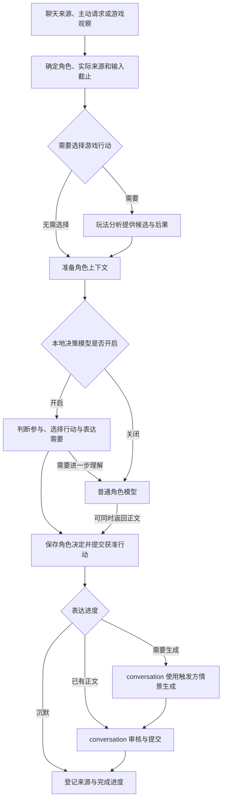

# 角色主动对话、决策模型与 Activity 实施计划

更新日期：2026-10-19。状态：U01～U05 均待实施；U04 按 U04.1～U04.7 分别交付。本文记录 `feat/activity` 分支的修改范围、实施顺序、已有数据处理和验收要求，实际能力以代码和所属状态文档为准。单元代号只用于本计划与交付记录，正式接口、文件和架构说明使用业务名称。

## 1. 阅读方式与目标

本分支完成四组工作：conversation（会话模块）的主动对话入口；可开关的本地决策模型接入；social（社交调度模块）的角色回应判断；Activity（角色活动能力）的观察、角色决策、游戏行动、局内交流和经历接入。前三组分别交付，作为 Activity 的前置能力。

先阅读第 3 节的实施单元，再按各单元的实现、数据处理和验收要求推进。组织方式沿用 [04 号方案](04-experience-and-character-quality-plan.md)和 [05 号计划](05-gameplay-foundation-implementation-plan.md)。每个单元完成自己的真实验证与必要恢复，再进入下一单元；最后的联合验收检查完整系统。

本分支的完整交付结果：**角色能够主动发起对话、根据自己的人设与交流决定是否接话，并在五子棋中观察局面、选择行动、边玩边说。启用本地决策模型时使用低成本判断；关闭时由普通角色模型完成判断与表达。两条路径都保留角色对行动的选择权，支持真实保存、重启恢复和有依据的活动记忆。**

继续采用一个业务后端、一个端口和一个 SQLite 数据库。首个完整玩法为已经交付的自由五子棋；飞行棋、Kingdomino（多米诺王国）的规则与界面由游戏开发线负责，实际交付后通过相同边界接入并分别验收。本分支不提前实现进阶道具、事件卡、观战、换人、悔棋和计时。

### 1.1 文档分工

| 内容 | 权威说明 |
|---|---|
| 本分支实施单元、顺序、完成状态与验收 | 本文 |
| 已交付的共同基础与正式调用入口 | [05 号计划](05-gameplay-foundation-implementation-plan.md)、[共同基础交接](gameplay/共同基础交接.md) |
| 分支职责、共享文件与后续游戏 | [规则与并行计划](gameplay/并行开发计划.md)、[共同基础与文件结构](gameplay/共同基础与文件结构.md) |
| 游戏身份、生命周期、观察、机会、动作和回执 | [游戏与角色活动接口](gameplay/游戏与角色活动接口.md) |
| 活动协调、提交恢复和经历来源 | [角色活动设计](../server/docs/design/activity-integration.md) |
| 现有接话链、消息与会话规则 | [会话与社会轮次](../server/docs/design/conversation-and-social.md) |
| 角色上下文、提示和模型执行 | [角色提示契约](../server/docs/design/character-prompt-contracts.md)、[角色 Agent 与模型](../server/docs/design/agents-and-models.md) |
| 案例、决策接口与玩法分析依据 | [决策模型游戏案例调研](gameplay/决策模型游戏案例调研.md) |
| 当前实现及实际验证范围 | [后端状态](../server/docs/status.md)、[前端状态](../frontend/docs/status.md) |

本文规定本轮目标。所属单元实施时同步正式设计与状态文档；旧设计中的单选 80%／20% 抽样、只由玩家消息触发局内交流等要求按本文更新。调研结论不代替本项目的中文质量、部署性能和真实对局验收。

### 1.2 已确认的设计边界

1. 主动对话由外部触发方提供请求和情景正文。conversation 扩展现有“眼前的情境”及任务入口，继续组织人设、状态、关系、记忆和历史。事件含义与情景正文由触发方准备。
2. 主动请求的业务材料保持简单：指定角色、指定会话和情景。请求编号、来源关联、读取截止等属于运行信息；不要求调用方额外提供一套交流情景分类、交流目的分类或意愿评分。
3. social 负责资格、候选顺序、参与判断的安排、额度和停止；conversation 负责表达生成、审核、消息提交及通知；Activity 负责游戏观察、行动判断、局内意图和执行协调。
4. 本地玩法分析器提供候选与后果。存在真实行动选择时，由角色模型选择；本地决策模型关闭后使用普通角色模型。不得以本地引擎能够完成整局为由改为全程托管。
5. 唯一合法行动可以直接执行，执行结果仍能触发角色反应。行动数量不决定事件是否值得交流，取消单选行动的 80%／20% 抽样。
6. 模块职责分别维护，模型调用可以联合完成。关闭本地模型时，一次普通角色调用可以返回行动、简短内心、意图变化和可选正文；正文仍由 conversation 审核提交。
7. 人格、聊天、实际局面和有效约定共同进入角色判断。采用有限近期原文与既有记忆；不逐轮调用模型压缩聊天，也不增加一套情绪数值系统。
8. 游戏、消息、私有内心和长期记忆分别保留正式来源。模型内部推理、角色实际生成的内心、分析器估计和已经执行的事实分别处理。

## 2. 已确认的现状与实施依据

以下为重写计划时对当前工作树文档与源码的核查结果。表中缺口均属于后文待实施内容。

| 项目 | 当前依据 | 本轮需要完成 |
|---|---|---|
| 共同游戏基础 | 05 号 U01～U06 已交付；应用已有游戏、参与、查询和角色观察入口 | 复用真实服务接入角色执行 |
| 角色活动模块 | `modules/activities/` 只有资格、观察和契约等基础文件 | 增加策略接入、任务、角色判断、协调、提交与恢复 |
| 游戏观察 | `CharacterGameObservation` 包含真实参与、视图、事件与 `ActivityObservation` | 转为可冻结、可恢复的任务输入，持久跟踪实际来源 |
| 行动机会 | `ActionOpportunity` 已提供机会、参与区间、版本、阶段和合法动作 | 按真实机会创建角色任务，提交时继续检查游戏资格 |
| 情景提示 | `conversations/tasks/prompt.py` 的 `situation` 已使用 `public_facts`，主要展示参与者信息 | 保留现有内容，加入触发方提供的情景正文与主动任务指导 |
| 上下文准备 | `ConversationContext.prepare` 依赖 `SocialTurn`、消息输入和根输入 | 提取共同准备步骤，让主动请求也能使用相同角色材料 |
| 对话执行和审核 | `ConversationExecution` 与 `ConversationReview` 绑定 `social_turn` 来源 | 支持真实主动请求；整理表达准备、审核和保存的复用入口 |
| 消息与内心来源 | 角色消息要求对话结果与社会轮次，`thoughts` 引用 `conversation_results` | 新增真实来源及约束，保留旧记录和旧任务语义 |
| 群聊候选 | `RuleBasedParticipationPolicy` 在规划流程中同步选择候选 | 保留资格与候选顺序，将本地参与判断安排为事务外任务 |
| 群聊额度 | 每条接话链默认最多三条正式角色消息、六次角色任务 | 明确一次角色尝试与实际模型请求的区别，防止拆分判断重复扣减 |
| 局内消息 | `game` 消息跳过普通输入批次，普通任务派发拒绝游戏类型 | 接入局内输入与 Activity 协调，复用 social 的参与机制 |
| 模型登记 | 已有文本模型登记、路由、凭据、额度与用量设施；尚无专用决策协议 | 接入真实本地决策后端及明确的关闭路径 |
| 后台执行 | 已有 `TaskRegistry`、`TaskDispatcher`、租约、恢复与应用生命周期 | 注册实际新任务，不另建通用工作流引擎 |
| 活动经历 | 当前归段和内心读取主要围绕聊天消息 | 增加游戏事件和无配套发言的真实内心消费者 |

现有工作区的文档改动继续保留。数据库迁移编号按实施时最新版本分配；共享入口、游戏公开协议和生成类型的修改按分支分工协调。

## 3. 实施单元与顺序

共 **11 个交付单元**：U01～U03 是前置修改，U04 拆为七个 Activity 子单元，U05 完成整体验收。依次实施，不要求并行开发。

| 顺序 | 单元 | 完整交付 | 前置条件 | 状态 |
|---|---|---|---|---|
| 1 | U01 conversation 主动入口与表达复用 | 主动请求、情景输入、真实任务来源、生成与提交复用 | 05 号共同基础 | 待实施 |
| 2 | U02 本地决策模型接入 | 真实协议、配置开关、模型路由、额度、用量和关闭流程 | U01 的调用边界 | 待实施 |
| 3 | U03 social 智能参与判断 | 两种配置下的接话、持久判断、额度与主动发言后的接话 | U01、U02 | 待实施 |
| 4.1 | U04.1 玩法分析与五子棋候选 | 成熟分析器接入、公开观察转换、真实候选与资源管理 | U01～U03、正式游戏接口 | 待实施 |
| 4.2 | U04.2 活动观察与角色上下文 | 输入截止、相关聊天、人物投影、本局意图和来源 | U04.1 | 待实施 |
| 4.3 | U04.3 活动任务与角色行动 | 两种模型路径、单选执行、正式行动提交与任务恢复 | U04.2 | 待实施 |
| 4.4 | U04.4 局内接话与行动协调 | 复用 social、来源合并、同角色协调和生命周期 | U03、U04.3 | 待实施 |
| 4.5 | U04.5 行动表达与 conversation 协作 | 联合正文、按需生成、真实回执、独立表达恢复 | U01、U04.4 | 待实施 |
| 4.6 | U04.6 游戏事件与主动交流 | 自己及对手行动的观察、关键事件与安静期间的交流机会 | U04.5 | 待实施 |
| 4.7 | U04.7 活动内心与游戏经历 | 正式来源、无聊天归段、摘要、长期整理和检索 | U04.6 | 待实施 |
| 5 | U05 联合验收与交接 | 两种配置整局、质量与成本、升级安装、恢复与正式文档 | U01～U04.7 | 待实施 |

U01 独立验证主动对话，U02 独立验证真实决策接口，U03 完成普通群聊验证。U04.1～U04.3 完成真实角色行动，U04.4～U04.6 完成边玩边说，U04.7 接入记忆。各单元必要的错误处理、迁移和文档随所属实现完成。

### 3.1 完整运行流程

普通群聊由 social 安排候选，主动对话由触发方提供请求和情景，游戏行动由正式机会指定角色。三类入口复用角色材料与执行设施，Activity 统一协调本局同一角色的行动和交流。

纯交流跳过行动提交；唯一合法行动通过游戏服务直接执行，其实际结果继续产生观察来源。普通角色模型已经给出正文时直接审核，已确定表达需要时直接生成，两者都不重复调用参与判断。后续游戏变化和玩家新消息由下一份实际输入处理。

## 4. U01：conversation 主动入口与表达复用

### 4.1 修改结果

外部业务能够指定角色、会话并提供情景，请求角色主动发起一次对话。conversation 使用既有人设、状态、关系、记忆与聊天历史，加入情景并生成正式发言或合法沉默。

同一模块提供表达准备、审核和保存能力，供后续联合角色调用复用。正常玩家输入回应保持原业务流程。

### 4.2 实现要求

1. 在 `modules/conversations/` 提供内部主动请求入口。业务材料为目标角色、会话和情景正文；社群、请求编号、真实来源关联等沿用现有运行边界。当前范围为已有会话和实际成员，入口不隐含创建会话或添加成员。
2. 触发方负责情景内容及角色可见性；conversation 检查自己的成员、会话与执行资格。情景作为完整正文接入，不在会话模块识别游戏事件、计算戏剧性或建立情景分类器。
3. 共同上下文准备从 `SocialTurn` 读取步骤中整理出来，主动请求使用同一人物、关系、历史和记忆读取规则。增加可选情景正文，扩展现有 `situation` 段落，保留原参与者信息和普通回应的提示顺序。
4. 主动入口加入明确任务指导：根据眼前情景主动展开交流。普通回应保持自己的指导。角色输出继续使用现有内心、正文、可选回复目标和沉默语义，主动发言允许没有回复目标。
5. 主动请求持久保存输入与真实来源；任务派发、执行、审核、取消、诊断和管理读取支持这一来源。主动调用不要求虚构玩家消息或 `SocialTurn`。
6. 整理可复用的表达准备、审核与连接内提交方法。生成与保存分别可用，后续已有正文可以直接审核提交；同一套成员、受众、长度、回复目标、索引和通知规则用于所有来源。
7. 情景正文纳入实际输入预算并随快照保存。重试读取原内容；必要输入超出预算时明确报告，由触发方重组，不截断成另一件事。
8. 主动发言后的后续接话经明确的生命周期接口交给 social，U03 完成主动来源的接话链。主动请求自身的生成、保存与恢复在本单元真实可用。

### 4.3 已有数据与恢复

新增迁移扩展任务和消息的真实来源约束，保留已有对话结果、社会轮次、消息与内心。旧冻结快照按原契约读取；增加情景字段时明确默认值与版本处理，不能改变旧输入的含义。

请求重复提交取得原任务或原结果；任务执行失败按现有有限恢复。归档、退出、暂停和旧租约仍然阻止无资格提交。生成成功与正式消息保存成功分别登记。

### 4.4 验收与文件范围

- 使用真实角色、SQLite 和文本模型，在没有新玩家输入时调用内部入口，生成并保存主动消息；不插入占位玩家消息。
- 原私聊、群聊的消息输入、上下文、沉默、回复编号和正式提交通过相关回归。
- 核查情景确实出现在模型输入，角色开启话题，历史最后一句玩家发言仅作为实际背景。
- 真实重复请求、重启、会话归档和成员退出后，任务与来源处理正确。
- 已生成表达通过相同审核和提交方法保存，不重复调用文本模型。

主要文件范围：`modules/conversations/{contracts,services,tasks,repositories}/`、`agents/contracts/context.py`、`resources/prompts/conversation/`、新增迁移及对应真实测试。所有 `modules/`、`agents/`、`resources/` 路径均相对 `server/src/echo_commons/`。

## 5. U02：本地决策模型接入

### 5.1 修改结果与配置语义

本地决策模型作为可选的角色判断能力接入。开启时处理参与、候选选择和有限的后续处理判断；关闭时由普通角色模型承担对应任务，仍可完整运行群聊与 Activity。

实现一个明确开关及对应模型登记、连接、超时和输入上限。关闭时不要求本地服务在线、不创建其客户端、不发出其请求。本地推理仍有机器和运行成本，用量与延迟按真实执行记录。

### 5.2 实现要求

1. 沿用现有配置、模型登记和独立凭据管理；决策协议放在 `infrastructure/models/`，角色与任务语义由所属业务模块维护。实现实际采用的一个后端协议，不同时建设多个供应商框架。
2. U02 实施前落实可运行的模型、推理接口、部署地址和设备，记录实际版本与能力。可用接口和模型资料见专题调研；未落实真实服务时，本地路径保持未验证，不用替代服务完成验收。
3. 普通文本生成与选项判别使用各自协议。请求明确包含角色材料、状态、聊天或情景、候选与问题，返回的候选身份只能从本次输入映射。
4. 提供明确的“进一步理解”结果，允许正常流程进入普通角色模型。网络失败、协议错误和配置缺失使用错误恢复；不把失败伪装成角色主动选择升级，也不自动执行随机行动。
5. 高频路径限制额外长推理生成，实际参数按采用模型的支持范围设置并冻结。一次请求包含多个问题时，遵守真实协议的依赖语义；独立问题不能读取彼此尚未产生的答案。
6. 模型概率仅作为供应商返回信息，不直接解释成胜率、人物情绪或发言概率，不单凭概率接近就转入复杂理解。
7. 新调用进入现有并发、期限、取消、执行记录和应用关闭流程。记录实际后端、输入输出、耗时与可获得用量；本地服务未提供 token（文本计量单位）或费用时保持缺失。
8. 每个逻辑判断确定并保存开关、路由、模型与预算，恢复沿用原执行方式。修改配置影响新任务；旧任务需要转换执行方式时，通过明确恢复操作重新准备。

### 5.3 已有数据与验收

原文本模型登记、凭据和任务继续有效。新配置省略时默认关闭；不得在升级时启用未部署的本地服务。原有真实调用记录保持原值。

- 真实服务完成中文候选选择、沉默和进一步理解，验证候选映射及结构校验。
- 关闭本地服务并关闭开关，普通角色调用正常，未产生本地连接或请求。
- 使用真实服务停止、错误配置、无效响应的实际记录等可达输入检查错误分类与有限恢复，不替换网关返回结果。
- 并发等待、任务取消、超时、实际用量和退出关闭通过相关检查。
- 交付所用模型、设备、协议、参数与实测限制；中文反话、承诺和隐含意图列入内容验证。

主要文件范围：`infrastructure/models/`、现有配置类型与示例、`agents/contracts/`、`execution/model_budget.py`、应用组装及模型真实验证。公开用户接口不暴露密钥。

## 6. U03：social 智能参与判断

### 6.1 修改结果

规则继续负责资格和候选顺序；角色根据人设、关系、相关聊天或触发情景判断参与。开启本地模型时，先完成低成本判断，再按需生成正文；关闭时，一次普通角色调用完成发言或沉默及正文。

主动请求产生的正式角色消息可以开启后续接话链。链条保留真实主动来源，不依赖一条不存在的根玩家消息。

### 6.2 实现要求

1. 复用 `Eligibility`、提及与回复优先、参与次数和最近发言顺序。规则排序仅决定候选尝试顺序，不能当作人物意愿评分。
2. 本地模型读取该候选角色自己的上下文，输出参与、沉默或进一步理解。关闭时继续逐个安排候选角色，由普通回应调用完成相同的参与职责，不固定增加主持人调用。
3. 将模型判断安排为持久任务。规划写事务只保存资格、来源和任务；调用在事务外完成，结果保存时复核安排与成员资格。
4. 一次候选尝试覆盖其判断、进一步理解与表达子步骤。默认三条正式消息和六次候选尝试继续约束接话链；子步骤与供应商重试分别记录真实请求，不能重复占用一次候选额度。
5. 参与已确定后，正文生成读取同一来源和实际决定，不再次执行相同筛选。正文阶段仍可因材料无法成立而返回真实沉默，后续按实际结果推进。
6. 主动消息开启的链条使用真实请求情景及后续消息作为输入。候选只读取自己有资格观察的材料；初始角色不因自己刚发出的消息立即再次被选中。
7. social 通过分发协议将普通回应交给 conversation、局内回应交给 Activity；本单元完成分发契约，实际局内协调在 U04.4 交付。模型调用实现不写入候选排序函数。
8. 继续支持失败后换人、候选耗尽、额度用完、成员变化、暂停和新玩家输入。主动来源没有根玩家输入时，按真实来源和当前成员判断有效性。

### 6.3 已有数据与验收

既有链条保持创建时的额度、来源和原任务语义。新判断阶段与候选尝试关系通过迁移保存；不回算历史参与意愿，不为旧角色消息补建主动触发。

- 两种配置下真实多人群聊完成提及、非提及参与、沉默、连续接话与停止。
- 同一角色的判断和表达共用来源；另一角色获得后续新消息，私有内心互不泄漏。
- 主动发言后其他成员能够自然参与，链条没有虚构玩家消息，能够正常结束。
- 本地判断沉默、进一步理解和表达失败分别正确推进，六次候选额度不因步骤拆分失真。
- 新输入、退出、暂停和重启后，不出现重复发言或旧安排继续提交。

主要文件范围：`modules/social/`、conversation 的分发与生命周期接口、模型任务注册、参与提示、迁移、社交管理读取及真实集成测试。

## 7. U04：Activity 实现

Activity 按以下七个子单元依次实施。每个子单元完成自己的验证与文档，正式五子棋服务始终作为真实依赖。

### 7.1 U04.1：玩法分析与五子棋候选

#### 修改结果与实现要求

1. 在宿主提供玩法分析适配，通过公开 `GameView`、规则版本和行动机会取得输入。游戏包保留规则、合法行动、随机结果和权威状态；分析器输出仅为建议。
2. 五子棋接入成熟 Rapfi 引擎，固定实际引擎、权重、自由规则配置和安装方式，完成真实协议验证；依赖依据见[专题调研](gameplay/决策模型游戏案例调研.md)。分析器子进程由应用管理资源与退出，不新增业务 HTTP 服务。
3. 同一分析实现提供候选、后果和评价，角色模型从中选择。分析器中立选择可以用于棋力对照；正式角色路径不自动采用其第一名。
4. 候选保留有实际区别的进攻、防守、风险和有效明确建议。候选编号映射到正式动作，并保存观察版本、分析版本与实际资源预算。
5. 正式规则能够计算的直接结果、搜索估计和未知信息分别表示。未取得的引擎信息保持缺省；不额外让文本模型逐项编写分析结果。
6. 候选数量受输入预算限制，但不能把分析器只返回一项当成游戏唯一合法行动。低成本选择无法表达的合法建议进入进一步理解，普通角色模型可提出候选之外的正式动作，再由游戏规则检查。
7. 分析只使用角色可见信息，预览不修改棋局、不消耗正式随机结果。需要游戏补充公开预览或分析能力时，与游戏开发线约定正式接口，宿主不导入内部规则或查询游戏表绕行。
8. 后续游戏复用候选契约与运行流程，分别提供玩法分析；不要求飞行棋实现五子棋级搜索，也不预先训练通用桌游策略。

#### 数据、恢复与验收

候选属于本次任务输入，保存其实际依据；不建立持续更新的第二份棋盘。分析失败记录真实原因并有限恢复，不伪造候选或随机成功。

- 真实引擎分析合法公开位置，坐标、颜色、自由规则和正式合法动作一致。
- 检查立即获胜、防守、边界、长连及明确建议的候选差异和实际支持信息。
- 验证分析期限、进程失败、资源回收和应用关闭；记录真实分析开销。
- 普通文本模型与本地决策模型使用同一份候选依据，输入差别可检查。

主要文件范围：`modules/activities/` 的玩法支持、`infrastructure/game_analysis/`、应用生命周期、依赖安装说明和真实分析测试；游戏公开接口变更由所属开发线维护。

### 7.2 U04.2：活动观察与角色上下文

#### 修改结果与实现要求

1. 复用 `application.game_observations`，在同一读取边界取得参与、视图、机会与事件；按实际参与区间记录事件位置和待处理来源。
2. 行动快照组合角色共同上下文、游戏观察、候选、近期聊天与本局意图，固定游戏版本、事件读取上限、会话消息上限和来源引用。共同人物读取复用现有准备能力。
3. 本地判断使用任务所需的紧凑人物投影；普通角色调用保留需要的完整材料。稳定投影按人设来源版本复用，短人设可以直接使用，不强制每局先调用一次模型生成简报。
4. 当前状态与关系继续从已有服务读取。本局意图只记录这场活动中实际形成的目标与约定，带原始来源、有效范围和版本，不自动覆盖全局性格、心情和关系。
5. 近期聊天通过程序选择原文。当前待回应消息、实际回复对象和仍有效的重要约定优先保留；较早背景使用现有摘要与检索，不逐条或逐轮重新总结。
6. 行动前遇到自然语言要求，需要由角色判断其意义。程序依据新消息安排处理，不使用关键词猜测反话、承诺或是否与游戏有关。尚未被理解的输入不能标记成已处理。
7. 保留简短角色内心的输出位置，约束知识边界、动机、关系和当前情境；不要求输出整段内部推理。原始观察、策略估计和角色判断保持各自性质。
8. 分别定义行动、观察反应和局内回应的输入，以组合复用共同字段；不使用包含大量无关可选字段的统一任务对象。

#### 数据、恢复与验收

新增输入版本及本局意图记录；保留旧人物资料和冻结快照。输入超出必要预算时明确失败；原任务恢复使用原观察和人物投影，来源变化通过新任务处理。

- 输入只含该角色可见的棋局、聊天、记忆和自身内心，原参与区间不能扩大。
- 重启后恢复相同事件位置、来源和快照，未处理消息仍然可发现。
- 固定棋盘，改变真实人物材料或对话要求，检查实际请求包含差异；行动影响由 U04.3 的真实选择继续验证。
- 人设修改更新稳定投影，当前关系和情绪变化不被旧投影遮蔽。
- 日志与诊断记录模型内部推理和角色内心的实际区别，不把输入简报写成长久事实。

主要文件范围：`modules/activities/{contracts,observation,...}`、共同上下文准备、`agents/contracts/`、活动提示、本局意图存储及对应真实测试。

### 7.3 U04.3：活动任务与角色行动

#### 修改结果与模型路径

角色能够从真实机会完成正式五子棋行动；本地模型开启、关闭均保留人物选择。

| 情况 | 正式处理 |
|---|---|
| 多个合法行动，本地模型开启 | 角色材料与候选进入本地决策；选择行动，或进入普通角色模型进一步理解 |
| 多个合法行动，本地模型关闭 | 普通角色模型形成行动、简短内心、本局意图变化和可选正文 |
| 游戏确实只有一个合法行动 | 直接通过游戏服务执行；待回应消息与行动结果保留给交流流程 |
| 当前没有行动机会 | 不提交动作，由局内回应或观察反应任务处理实际来源 |

#### 实现要求

1. 按游戏、参与区间和机会建立唯一有效逻辑任务，注册到现有执行设施。任务拥有自己的输入、租约、阶段产物、实际模型方式与游戏回执引用。
2. 不要求角色在执行时填写席位、租约和请求编号。程序从任务与真实参与关系补齐正式提交身份，候选映射经正式动作类型检查。
3. 区分合法沉默与游戏行动。需要落子时必须产生合法行动，沉默只影响表达；无需选择的自动步骤不制造虚构模型决定。
4. 本地模型的多个独立问题共用输入时，行动相关表达使用已经提供的候选后果或条件，不能假定已经知道另一个问题的选中结果。需要依赖实际行动的表达，在正式结果后处理。
5. 在短写事务中重新检查租约、社群、角色、实际参与、机会和版本，调用游戏公开方法，保存任务结果、真实内心及回执关联。模型调用和分析均在写事务外。
6. 游戏请求编号稳定，原请求重试读取原回执。机会或版本失效时结束旧决定，新机会使用新输入；不能更换棋局后继续提交旧落点。
7. 正式结果与必要表达安排可在同事务保存；本子单元保存产生的完整表达材料及其阶段进度，U04.5 接入实际 conversation 消费。角色行动验证不能依赖尚未完成的表达步骤。
8. 自动行动不创建假 `AgentRunResult` 或虚构内心。关闭本地模型与本地服务失败分别处理，不隐式切换执行方式。

#### 数据、恢复与验收

新增活动任务、输入、结果和回执关联，扩展执行记录及管理查询。活动内心取得真实活动结果来源，原对话内心保持原来源。完整结果持久保存后才能表示可复用；未保存的结果按原快照有限重试。

- 两种模型路径通过真实游戏服务完成角色落子与真实整局，模型输出、正式回执和棋盘一致。
- 同一棋盘的人格、建议、认真比赛要求与承诺变体产生可解释的实际判断，人工复核；不能只根据台词或落点不同认定人格有效。
- 单选自动路径没有行动模型调用；多选不会因分析器只推荐一项而自动执行。
- 重复扫描、旧租约、旧机会、非法落点、暂停、重启和原请求恢复均不重复落子。
- 保存失败通过真实事务与正式服务验证；拒绝的行动保持未执行，不记录虚假的成功。

主要文件范围：`modules/activities/` 的任务、执行、审核、提交、存储和恢复，`agents/` 的用途与输出，`execution/`、应用组装、新迁移及真实游戏集成测试。

### 7.4 U04.4：局内接话与行动协调

#### 修改结果与实现要求

1. 将局内新消息纳入持久收集和 social 参与安排，复用窗口、候选资格、提及与回复、额度、沉默和失败后换人。游戏消息只进入局内分发，不能同时建立普通回应任务。
2. 同一角色、同一对局同时只有一份有效判断安排。尚未确定输入的接话与行动来源可以合并，使用同一份人物、聊天与游戏观察；调用开始后的消息排队。
3. 游戏轮序直接决定行动者，不以接话意愿决定谁落子。游戏行动不消耗聊天链条的发言数量或候选尝试额度。
4. 合并结果分别登记每项来源的处理情况。沉默可以完成本次回应判断；失败或动作失效不能把仍然有效的问题标记成已经回答。
5. 普通群聊保留新输入取消旧链的规则；局内新消息进入当前协调流程，不直接取消有效游戏行动。角色轮到行动时仍读取截止前实际存在的相关聊天。
6. 纯回应快照不包含行动权限；执行过程中出现的新机会由后续安排处理。已提交行动与表达的后续恢复分别登记。
7. 使用实际局内成员与参与资格；等待、开始、认输、结算、取消、归档和社群暂停按所属正式业务入口处理。结算停止行动，允许有效赛后交流。

#### 数据、恢复与验收

增加明确的来源关联和消费进度，按数据库约束防止同一机会或同一回应重复安排。重启从持久机会、消息和任务恢复，内存通知只负责唤醒。

- 玩家发言与角色行动在输入确定前合并，两种模型配置均能让聊天进入实际行动判断。
- 调用期间收到新消息，原输入不变，后续输入能够处理且没有重复回应。
- 局内消息只产生一条执行路径，普通私聊与群聊继续正常。
- 动作失效但问题仍有效、纯回应期间出现新机会、赛后聊天与归档分别正确处理。
- 所有生命周期与来源覆盖使用真实队列、数据库和游戏服务验证。

主要文件范围：conversation 的输入收集、`modules/social/` 的局内分发、`modules/activities/` 协调与来源存储、生命周期连接和集成测试。

### 7.5 U04.5：行动表达与 conversation 协作

#### 修改结果与实现要求

Activity 通过 U01 的情景和表达能力完成局内交流，不维护第二套正文提示、消息审核和保存实现。

1. 本地模型已决定表达时，Activity 根据角色实际决定与游戏回执准备情景，直接安排正文生成，不再次执行相同的参与筛选。
2. 普通角色模型联合返回正文时，conversation 接受已生成提议并审核保存，避免固定增加第二次文本调用。提示组合和输出组合复用 conversation 的表达要求，动作权限仍只属于 Activity。
3. Activity 决定何时请求交流，并负责情景正文。主动开口使用主动入口；回应已有玩家消息保留真实消息来源和回复目标。无需给 conversation 新增游戏事件分类或强制交流目的字段。
4. 行动成功与表达请求在同一短事务保存。已经有正文时，在行动成功后经 conversation 的连接内方法提交；需后续生成时，保存真实请求与回执，再独立执行表达。
5. 动作失效不发布依赖该动作的正文。正文业务审核拒绝可以保留合法行动并记录原因；数据库错误回滚当前事务，不把未提交事实记成成功。
6. 表达失败只恢复表达，不能重新选择或执行已提交行动。较晚生成的正文按真实历史回执表达，不能将旧局面说成当前局面。
7. 同角色尚待表达与新判断通过 Activity 协调，避免相互不知道的意图。表达不能自行操作棋局；产生影响后续行动的新承诺时，返回局内意图提议，由 Activity 正式接受后使用。
8. 本地角色决定可以形成表达请求；纯事件机会在 U04.6 判断后使用同一入口。模型输出内部状态不转化为 conversation 的必填业务分类。

#### 数据、恢复与验收

使用 conversation 的真实主动或回应来源及表达结果。联合输出保留原活动调用来源，消息约束增加明确活动结果关联；不为通过外键伪造一次聊天调用。已有字段与新字段的互斥关系通过新增迁移维护。

- 本地开启时，行动与按需生成的台词正确关联；关闭时，一次联合文本调用完成行动和配套台词。
- 相同表达材料只生成或提交一次；实际请求数可以检查。
- 行动成功后表达失败，重启只恢复表达，棋盘和回执保持原值。
- 行动被拒绝、正文被拒绝、会话归档及通知恢复各自保留真实结果。
- 主动评论能开启交流，回答玩家保留回复来源，情景由 Activity 准备。

主要文件范围：Activity 工作流与表达协调、U01 的 conversation 公共能力、消息与内心来源、生命周期、迁移和实际模型集成测试。

### 7.6 U04.6：游戏事件与主动交流

#### 修改结果与实现要求

角色能够感知自己和对手行动后的变化，并根据人物性格与相处主动交流；全局安静时也有参与机会。

1. 读取持久游戏事件和相应分析结果，生成角色可见观察。直接胜负、阶段变化、实际行动及可计算的战术后果由游戏事实和分析提供；意义与人物反应由角色判断。
2. 唯一合法行动完成后仍进入观察流程。对手行动也能触发反应，角色发言不受游戏轮序限制。
3. 本地模型开启时，对相关事件批次判断回应需要；关闭时，胜负、明确转折及交流间隔等可确定触发直接安排普通角色模型。两种配置都允许真实沉默。
4. 使用经过时间和实际行动进度安排安静期间的观察机会。触发与间隔属于 Activity，情景由 Activity 提供；conversation 只接收主动请求，不自行扫描棋局或管理游戏计时。
5. 行动和相应观察能够合并时共用材料。联合正文已经覆盖的事件不再重复安排相同反应；同一角色、参与区间、事件来源和回应目的保持唯一安排。
6. 重复或连续变化可批量观察，保留未处理来源；不能提前标记成已理解。普通评论受间隔和有限接话额度约束，玩家实际提问与明确结算事件有各自处理来源。
7. 已结算对局不因安静扫描无限建立新任务；取消、归档和退出按原生命周期结束无资格安排。没有新增游戏或互动来源时不不断重建同一失败任务。
8. Activity 创建主动请求后，初始消息与后续成员接话通过 U01、U03 的实际能力运行。不存在的玩家问题不进入输入，角色也无须每次都提问或庆祝。

#### 数据、恢复与验收

持久保存观察位置、最后相关交流进度与实际安排，重启能够区分未处理事件、已经表达的来源和已经结束的机会。不复制完整游戏事件正文作为第二份权威历史。

- 无人聊天的整局仍出现实际主动参与机会，记录真实发言与沉默，不要求固定句数。
- 单选获胜、普通行动后的明显转折、对手阻止计划、游戏结束均有实际可检查观察。
- 重复扫描和重启不重复庆祝；同一角色配套发言后没有相同事件的重复评论。
- 两种配置记录观察判断、正文生成与失败请求的真实数量，关闭时不连接本地模型。
- 安静触发、玩家输入与归档相遇时，运行状态和实际受众正确。

主要文件范围：Activity 事件扫描、观察反应、触发策略与存储，conversation 主动入口、social 后续接话、后台唤醒与真实整局测试。

### 7.7 U04.7：活动内心与游戏经历

#### 修改结果与实现要求

1. 游戏事件保留唯一正式记录。角色侧保存真实来源、原参与区间、时间、读取位置和覆盖；不同角色可以形成不同认识。
2. 活动模型实际产生的简短内心取得独立来源，无配套消息时也能进入该角色后续上下文。引擎自动步骤没有生成内心时保持缺省。
3. 扩展原始材料读取、可见性、经历归段和精确覆盖。只有游戏事件而没有聊天时也能处理；结束活动提供实际材料边界。
4. 近期上下文组合正式行动、自己的内心、消息与本局意图。游戏事件和聊天保持各自序号，通过实际时间和回执关联，不伪造成一条共同消息序列。
5. 简单记忆模式完成摘要与压缩；完整模式继续接入事实、认知及其既有反思。按价值和预算整理，不按每次落子启动整套反思。
6. 事实、认知和关系变化继续走所属模块。局内意图、分析估计、模型诊断和对方隐藏动机不能直接保存成客观经历。
7. 检索、依据复核、来源覆盖、管理导出和范围化清理识别真实新来源。角色离开后仍按原参与区间读取历史，重新加入不继承其他成员私有材料。

#### 数据、恢复与验收

新增活动材料、来源边界与消费者进度，通过迁移扩展所有实际受影响的来源约束。保留旧消息、内心、摘要、事实、认知与原有覆盖，不在升级时重建用户全部记忆。

- 没有聊天的真实游戏能够归段、摘要，生成的记忆可追溯到正式事件。
- 无消息的活动内心可被本人读取，其他角色无法读取；空内心不产生材料。
- 简单与完整模式分别完成实际消费者，部分失败仅恢复未完成阶段，来源不重复消费。
- 后续普通会话能够回忆真实对局，依据可读取，分析估计和既有承诺没有被写成已发生行动。
- 管理读取、导出、清理和旧库副本升级通过相关验证。

主要文件范围：`modules/memory/`、`modules/perspective/`、`modules/reflection/`、活动材料读取、消息及内心来源、管理与维护、新迁移和真实模型测试。

## 8. U05：联合验收与开发交接

### 8.1 完整流程

1. 普通私聊和群聊继续通过正式入口工作；主动请求在没有玩家输入时产生角色开场，其他角色与玩家可以继续交谈。
2. 本地决策模型开启、关闭各完成真实五子棋角色对局：邀请、开始、观察、人物行动选择、局内接话、主动评论、结算、赛后交流和结束活动。
3. 覆盖输入确定前合并、执行中插话、旧机会、重复请求、真实服务失败、动作成功但表达失败、暂停、取消、归档及应用重启。
4. 新空库安装与含真实旧业务记录的副本升级通过，旧冻结任务和来源可以正确读取或按原规则恢复，外键有效。
5. 在源码目录外安装宿主和游戏包，验证提示资源、分析器、配置、后台任务及退出回收。前端继续使用既有游戏和消息接口，真实检查棋盘与消息同步；涉及公开契约变化时由所属开发线更新生成类型。

### 8.2 人物质量与实际成本

| 维度 | 验收内容 |
|---|---|
| 行动能力 | 候选合法、局面计算有据、角色实际作出选择，系统正确性与棋力分别报告 |
| 人格参与 | 相同局面的不同人设、关系、建议和承诺变体产生合理判断，人工复核内心与行动的一致性 |
| 对话体验 | 主动开场、接话、安静专注、关键反应和赛后交流符合人物与经过，不用固定台词数量证明生动 |
| 来源与隐私 | 行动、发言、私有内心和长期认识有实际来源，参与区间与受众有效 |
| 请求数量 | 分别记录参与判断、行动判断、进一步理解、正文、人物投影和重试；联合调用只计真实请求 |
| 费用与资源 | 实际输入输出、可得缓存与费用、本地推理和分析开销，缺失值保持缺失 |
| 延迟 | 记录行动提交和表达到达的 P50／P95（中位数／95% 分位数），包含排队、分析、请求与保存 |

使用相同实际候选和事实比较两种配置，分别记录有交流与少交流的整局。需要中立引擎对照时，只作为评价输入，不替代正式角色路径。受控人物或对话变体用于内容评价，完整执行仍通过真实游戏服务。

不预先承诺固定节省比例。关闭本地模型后，每次真实多选行动仍需要普通角色模型；开启后，复杂理解和真实表达仍有成本。观察与主动交流的调用也计入整局。

### 8.3 正式文档与交接

- 活动设计更新观察、两种模型路径、来源合并、表达协调、主动触发与经历消费者。
- 会话设计与提示契约更新主动入口、情景组织、真实任务来源和后续接话；共同角色上下文保持单一说明。
- 模型与配置文档更新决策后端、开关、参数、用量和关闭方式；记录真实部署条件。
- 数据库、接口、源码导航和必要前端类型按正式工具生成，不手工修改生成文件。
- 后端状态记录逐单元实际能力和真实验证；计划交付记录只写已经完成的内容，不将未执行检查标为通过。
- 共享 `app/composition.py`、迁移编号、游戏公开能力和生成契约按[并行计划](gameplay/并行开发计划.md)协调。Activity 分支不直接改写游戏内部规则与前端玩法实现。

## 9. 共同的数据、验证与交付要求

### 9.1 数据与恢复

- 使用新增迁移，升级前通过只读备份取得副本并验证；保留用户原始消息、内心、记忆、人物资料、游戏历史和密钥。
- 所有正式写入经所属业务入口完成。SQLite 写事务只覆盖必要检查与保存；模型、分析、网络和等待均在事务外。
- 任务保存真实来源、输入与阶段结果；日志和执行追踪用于诊断，不能替代正式行动或消息。
- 同一角色本局的判断由 Activity 协调，已提交行动、待生成表达与未来来源分别记录；部分成功只恢复未完成部分。
- 不通过增加第二份棋盘、统一万能结果表、通用脚本语言或通用工作流平台来实现本轮固定流程。

### 9.2 真实验证

- 使用真实规则、分析器、模型、SQLite、队列、HTTP、推送和必要浏览器验证；不使用 mock（模拟对象）、假回复、假服务或预设成功结果。
- 规则与数据转换检查可以构造明确的合法输入；完整流程通过正式业务入口形成状态，不直接修改棋盘表制造成功。
- 失败路径采用实际支持的非法输入、约束冲突、网络中断、服务停止、事务等待和重启。未验证的服务或部署能力明确保留未验证状态。
- 文档修改执行链接、结构和差异检查；业务实现执行所属静态检查与必要真实测试。没有新问题时不无依据重复扩大验证。

### 9.3 每个单元的完成标准

1. 所属实现、提示、必要迁移、已有数据处理、失败恢复和资源生命周期完整可用。
2. 本单元正常流程和实际失败路径通过验证，模型调用与业务保存的证据能够检查。
3. 正式设计、状态、配置和必要生成参考同步；本计划更新单元状态及交付记录。
4. 独立记录变更范围、实际请求与资源开销、验证结果和仍存在的限制；不复用其他计划的同名证据目录。
5. 清理本轮临时服务、测试进程、浏览器和不再使用的目录，保留用户已有工作与业务数据。
6. 提交、推送、创建工作树和合并按用户明确授权执行；04 号历史任务中的提交安排不自动适用于本分支。

全部单元完成后，本分支交付可复用的主动对话入口、两种配置下的智能接话，以及人物持续参与决策、观察和交流的五子棋 Activity 系统。
