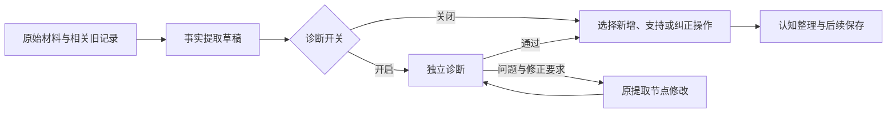
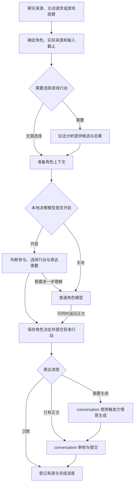

# 角色主动对话、决策模型与 Activity 实施计划

更新日期：2026-11-02。主动对话、本地决策客户端、普通群聊智能接话、私有核查和按需记忆已实现；Activity 已完成玩法分析、活动上下文、角色行动、局内协调及表达交流单元，经历消费者继续实施。本文记录 `feat/activity` 分支的工作安排、数据处理和验收要求。当前可用能力见[后端状态](../server/docs/status.md)。

## 1. 阅读方式与目标

本分支完成四组工作：conversation（会话模块）的主动对话入口、本地决策模型接入、social（社交调度模块）的角色回应判断，以及 Activity（角色活动模块）的游戏观察、行动、交流和经历。先完成前三组，再接入角色活动。

第 3 节列出实施顺序，各功能章节说明实现方法、数据处理和验收条件。组织方式沿用[体验与角色质量计划](04-experience-and-character-quality-plan.md)和[游戏基础实施计划](05-gameplay-foundation-implementation-plan.md)。每项功能完成正常流程和失败恢复的验证后，再进入下一项；最后检查完整系统。

完成后，角色能够主动开口，根据人设和聊天内容决定是否接话，并在五子棋中观察局面、选择行动、边玩边说。启用本地决策模型时，由它处理低成本判断；关闭时，由普通角色模型完成判断与表达。两种配置都让角色参与行动选择，并支持保存结果、重启恢复和形成游戏记忆。

系统继续使用一个业务后端、一个端口和一个 SQLite 数据库。角色活动首先接入自由五子棋。游戏包还包含飞行棋、Kingdomino（多米诺王国）基础玩法，其规则和界面由游戏开发线负责，角色活动使用相同接口接入并分别验收。进阶道具、事件卡、观战、换人、悔棋和计时留在对应玩法的后续计划中。

### 1.1 文档分工

| 内容 | 权威说明 |
|---|---|
| 本分支实施单元、顺序、完成状态与验收 | 本文 |
| 已交付的共同基础与调用入口 | [游戏基础实施计划](05-gameplay-foundation-implementation-plan.md)、[共同基础交接](gameplay/共同基础交接.md) |
| 分支职责、共享文件与后续游戏 | [规则与并行计划](gameplay/并行开发计划.md)、[共同基础与文件结构](gameplay/共同基础与文件结构.md) |
| 游戏身份、生命周期、观察、机会、动作和回执 | [游戏与角色活动接口](gameplay/游戏与角色活动接口.md) |
| 活动协调、提交恢复和经历来源 | [角色活动设计](../server/docs/design/activity-integration.md) |
| 现有接话链、消息与会话规则 | [会话与社会轮次](../server/docs/design/conversation-and-social.md) |
| 角色上下文、提示和模型执行 | [角色提示契约](../server/docs/design/character-prompt-contracts.md)、[角色 Agent 与模型](../server/docs/design/agents-and-models.md) |
| 案例、决策接口与玩法分析依据 | [决策模型游戏案例调研](gameplay/决策模型游戏案例调研.md) |
| 当前实现及实际验证范围 | [后端状态](../server/docs/status.md)、[前端状态](../frontend/docs/status.md) |

实现功能时同步更新设计和状态文档。唯一合法行动按规则直接执行，游戏事件也可以触发交流；相关旧设计随实现更新。中文表现、部署性能和对局体验使用本项目的模型与游戏服务验收。

### 1.2 模块职责与运行方式

1. 触发方提供角色、会话和情景正文。conversation 将情景加入“眼前的情境”，结合人设、状态、关系、记忆和聊天历史生成表达。
2. 请求编号、来源关联和读取截止用于任务运行。情景的内容和角色可见性由触发方负责。
3. social 负责资格、候选顺序、参与判断的安排、额度和停止；conversation 负责表达生成、审核、消息提交及通知；Activity 负责游戏观察、行动判断、局内意图和执行协调。
4. 玩法分析器提供候选行动和后果，由角色模型选择。本地决策模型关闭时使用普通角色模型。
5. 唯一合法行动可以直接执行，执行结果继续进入观察流程。是否发言由事件和人物反应决定。
6. 一次普通角色调用可以同时返回行动、简短内心、意图变化和可选正文。Activity 处理行动，conversation 审核和保存正文。
7. 人格、聊天、当前局面和有效约定共同进入角色判断。上下文使用近期聊天原文和已有记忆，状态与关系沿用现有数据。
8. 游戏、消息、私有内心和长期记忆分别记录来源。角色内心和分析器估计保留各自含义，业务事实以已经执行的行动和已发送的消息为准；模型内部推理用于调用诊断。

## 2. 现有能力

下表列出当前已有能力及后续工作。

| 项目 | 已有能力 | 后续工作 |
|---|---|---|
| 共同游戏基础 | 应用已有游戏、参与、查询和角色观察入口 | 通过这些服务接入角色执行 |
| 角色活动模块 | `modules/activities/` 只有资格、观察和契约等基础文件 | 增加策略接入、任务、角色判断、协调、提交与恢复 |
| 游戏观察 | `CharacterGameObservation` 包含真实参与、视图、事件与 `ActivityObservation` | 转为可冻结、可恢复的任务输入，持久跟踪实际来源 |
| 行动机会 | `ActionOpportunity` 已提供机会、参与区间、版本、阶段和合法动作 | 按真实机会创建角色任务，提交时继续检查游戏资格 |
| 情景提示 | `situation` 已展示参与者信息和触发方提供的情景；主动任务有自己的开场指导 | Activity 负责组织游戏情景 |
| 上下文准备 | `ConversationContext.prepare_for` 已供普通回应和主动请求共用 | 活动上下文复用人物材料读取 |
| 对话执行和审核 | 普通回应和主动开场统一由回应安排创建任务，已有独立的表达审核和事务内保存 | 接入活动联合调用生成的表达 |
| 消息与内心来源 | 主动消息关联开场轮次，轮次关联原请求；`thoughts` 引用 `conversation_results` | 增加活动结果和独立活动内心来源 |
| 群聊候选 | `RuleBasedParticipationPolicy` 在规划流程中同步选择候选 | 保留资格与候选顺序，将本地参与判断安排为事务外任务 |
| 群聊额度 | 每轮交流默认最多三条正式角色消息、六次角色任务 | 明确一次角色尝试与实际模型请求的区别，防止拆分判断重复扣减 |
| 局内消息 | `game` 消息跳过普通输入批次；显式主动表达检查游戏发言资格 | 接入局内输入与 Activity 协调，复用 social 的参与机制 |
| 模型登记 | 已有文本模型登记、路由、凭据、额度与用量设施；尚无专用决策协议 | 接入真实本地决策后端及明确的关闭路径 |
| 后台执行 | 已有 `TaskRegistry`、`TaskDispatcher`、租约、恢复与应用生命周期 | 注册参与判断和活动任务 |
| 活动经历 | 当前归段和内心读取主要围绕聊天消息 | 增加游戏事件和无配套发言的真实内心消费者 |

数据库迁移按现有版本顺序增加；共享入口、游戏公开接口和生成类型的修改按分支分工协调。

## 3. 实施单元与顺序

按下表依次实现。主动对话、本地决策模型和智能接话为角色活动提供基础；智能接话完成后，校准角色表达与记忆整理。角色活动分为六项工作，最后进行联合验收。

| 顺序 | 单元 | 完整交付 | 前置条件 | 状态 |
|---|---|---|---|---|
| 1 | conversation 主动入口与表达复用 | 主动请求、情景输入、任务来源、生成与提交复用 | 游戏共同基础 | 已交付 |
| 2 | 本地决策模型接入 | 协议、配置开关、模型路由、额度、用量和关闭流程 | 主动对话与表达接口 | 客户端已实现，真实服务验证通过 |
| 3 | social 智能参与判断 | 两种配置下的接话、判断保存、额度与主动发言后的接话 | 主动对话、本地决策模型 | 已实现，固定社群真实对照已完成 |
| 3.1 | 角色表达与记忆整理校准 | 个人即兴与记忆遵循、任务提示分离、相关记忆保留、可配置诊断及分步消融 | 智能接话与现有记忆流程 | 已实现，待审核；范围与验证见3.1.5 |
| 4.1 | 玩法分析与五子棋候选 | 分析器接入、公开观察转换、候选与资源管理 | 对话、模型、智能接话、表达与记忆校准及游戏接口 | 已实现并完成真实引擎及安装验证，见 7.1.1 |
| 4.2 | 活动观察与角色上下文 | 输入截止、相关聊天、人物投影、本局意图和来源 | 玩法分析 | 已实现，真实引擎、模型与安装验证通过，见 7.2.1 |
| 4.3 | 活动任务与角色行动 | 两种模型路径、单选执行、行动提交与任务恢复 | 活动上下文 | 已实现，真实整局、模型、恢复与安装验证通过，见 7.3.1 |
| 4.4 | 局内接话与行动协调 | 复用 social、来源合并、同角色协调和生命周期 | 智能接话、角色行动 | 已实现；实现记录见 7.4.2 |
| 4.5 | 局内表达与事件交流 | 共同表达保存、发布完成通知、独立恢复、事件观察与主动机会概率 | 表达接口、局内协调 | 已实现并完成真实整局与恢复验证，见 7.5.1 |
| 4.6 | 活动内心与游戏经历 | 事件来源、无聊天归段、摘要、长期整理和检索 | 局内表达与事件交流 | 待实施 |
| 5 | 联合验收与交接 | 两种配置整局、质量与成本、升级安装、恢复与文档 | 表中全部功能 | 待实施 |

主动对话、本地模型和普通群聊分别完成验证后，完成表达与记忆校准，再依次接入游戏行动、边玩边说和游戏记忆。错误处理、数据库迁移和文档随各项功能一起完成。

### 3.1 角色表达与记忆整理校准

本阶段让角色自然补充个人生活，保持已经确立的经历，并遵循共同事实。角色按照自己的记忆表达；记忆整理负责准确保存内容及其归属。两个职责分别验收，整理错误由记忆流程处理。

#### 3.1.1 表达与记忆准则

1. 角色相信并遵循提供给自己的记忆，按照原有主体和含义使用经历、听闻与认识。记忆真实性的诊断由整理流程负责。
2. 角色可以补充尚未设定、符合人设且不与现有事实冲突的个人日常。主动分享和回答问题采用相同边界；已经确立的个人经历在后续表达中保持一致。
3. 涉及他人行动、人物原话、共同经历和既有约定时使用已有依据。游戏结果、物品和已执行行动遵循系统记录。当前交流可以形成新的约定，保存时保留约定与执行结果的区别。
4. 过去的事件保持原意。新的状态、偏好、计划和认识可以继续发展，按实际变化新增记录。个人生活补充按相关性保存和检索，核心记忆继续选取重要经历。
5. 整理保留说话者、时间、否定、条件及材料原有的确定程度。清洗百科、章节和界面语言时，保留世界内的说话者归属和知情范围。

#### 3.1.2 实施单元

按下表逐项添加，每个单元单独记录修改内容、实际输入、输出质量和运行成本。

| 顺序 | 单元 | 完整交付 | 重点验收 | 状态 |
|---|---|---|---|---|
| 1 | 角色表达准则 | 统一共同契约与表达提示，明确相信记忆、个人即兴与共同事实边界 | 普通生活自然展开，已有经历保持一致，错误前提不改变既有事实 | 已实现，真实对照仍出现改口与无依据共同往事 |
| 2 | 整理上下文职责分离 | 整理节点使用专属任务规则，按节点选择人物资料与 voice（说话方式）；固定规则和示例前置，变化材料后置 | 实际整理请求不携带即兴对话指令，需要人物口吻的产物保持表达特征 | 已实现并验证 |
| 3 | 记忆整理准则 | 校准事实提取、段摘要、连续摘要、认知及核心记忆提示，保留已确认的日富美单示例 | 合法个人补充进入经历，转述、计划、否定和条件在整理后保持原意 | 额外准则未显示稳定质量收益，已恢复任务分离后的校准前提示 |
| 4 | 相关记忆输入保留 | 调整检索结果选择与预算裁剪，优先保留当前话题涉及的已定事实 | 区分未检索到与检索后被裁掉，核对最终模型输入及后续回应的一致性 | 已实现，固定预算撤除对照已完成 |
| 5 | 事实候选诊断 | 独立检查候选及依据，将问题反馈给事实提取节点修改，再交给现有事实操作审核 | 诊断定位实际问题，原写作者修正，新增、支持与纠正职责保持不变 | 已实现，默认关闭 |
| 6 | 摘要与认知诊断 | 将诊断反馈机制接入段摘要、连续压缩、认知及核心记忆整理 | 多次整理后仍保持主体、范围、条件与事实含义，诊断反馈由对应写作者处理 | 已实现，默认关闭；误报会消耗修改次数 |

新增边界示例作为明确的提示改动单独记录。调整共同指令、节点说明、示例和输入组织时，分别保存变更内容，便于判断收益来自哪里。

#### 3.1.3 诊断反馈与运行配置

提取或整理节点负责写作，诊断负责检查。诊断输出是否通过、问题位置、相关依据和修正要求，原写作者根据反馈修改完整草稿。运行编排层按工具结果的方式将反馈放回原执行上下文，安排修改与复查；诊断通过后，才将产物交给下一节点。

摘要和认知采用相同的反馈方式，分别返回各自写作者。循环在节点执行内部完成，现有工作流保留前后依赖。诊断只检查整理稿是否忠于给定材料与创作准则，材料缺失不能单独证明事件未发生。

现有 `fact_review` 继续决定新候选与旧事实的保存关系：`add`（新增）、`support`（补充支持）和 `correct`（纠正提取或归属错误）。诊断通过表示候选符合整理要求，正式保存仍由现有汇总与存储流程完成。

配置提供事实候选诊断、摘要与认知诊断两个独立开关，使用现有模型登记选择诊断模型，并设置最大修改次数。默认最多修改两次，每次修改后重新诊断。达到上限仍未通过、诊断调用失败或任务失去执行资格时，保留当前阶段结果和诊断记录，通过现有任务恢复流程处理；未通过的草稿不能进入后续正式保存。

分别记录初稿、诊断、修改、复查及失败重试的真实请求、输入输出 token（文本计量单位）和耗时。诊断开关关闭时执行对应的正常整理流程，调用数量可以独立核对。模型调用期间不持有数据库写事务。

#### 3.1.4 分步消融与验收方法

消融测试通过逐项加入或撤去改动，比较每项改动的增量效果。保留修改前的真实业务实现作为基线，按实施表的六项顺序累计添加。事实候选诊断、摘要与认知诊断分别开启比较；对最终组合中的关键单元再做单项撤除，检查其收益是否仍然存在。

采用少量固定情景，覆盖个人生活自然补充、整理后再次提及同一经历、用户说法与明确记忆冲突、缺少依据的共同往事或旧约定、转述与计划的保留，以及明确的游戏或系统结果。日常交流承担主要质量评价，错误前提作为单独的压力情景报告。

1. 比较表达准则时，固定角色、人设、可见历史、已有记忆和模型参数，进行重复生成。
2. 比较整理规则与诊断时，固定上游消息和草稿。重放已有真实错误草稿，检查诊断定位、反馈修改及通过后的实际保存。
3. 比较检索与裁剪时，固定数据库状态、查询和预算，核对候选材料与最终模型输入。已保存、已检索和实际提供给模型分别统计。
4. 最终组合通过正式入口执行表达、归段、事实与认知整理，再次提及相关经历；同时比较诊断开启与关闭，检查角色一致性和模块职责。
5. 使用真实模型、SQLite 和任务执行路径，核对诊断通过、发现问题后修正、修改上限、调用失败、重启恢复和重复提交。模型生成结果与正式保存结果分别检查。

每个单元报告目标错误、个人即兴空间、人物语气与自然程度、前后一致性，以及新增请求、费用和延迟。保持事实一致的自然表达计为成功；现在接受新请求与承认过去已有约定分别评价。对相同案例进行前后比较，展示成功与失败原文，说明判定依据和重复结果。

六项修改已经实现。真实模型对照保留了自然个人补充，但单靠提示仍会出现改口和无依据的共同往事；相关事实优先进入输入后，模型也可能忽略它。诊断能够发现并反馈部分整理问题，同时仍有误报和达到修改上限的情况，因此两个诊断开关默认关闭。未通过的草稿不会保存为正式节点产物，已通过的其他阶段按现有规则保留。

验证覆盖固定材料重复生成、同稿诊断与原写作者修正、固定预算撤除比较，以及正式对话、归段、长期整理、核心整理和再次回忆。真实恢复验证覆盖诊断连接失败后重启、保留初稿继续检查、已通过草稿复用和重复提交；修改上限与可选节点停止由完整流程验证。配置与恢复规则见[反思执行模型](../server/docs/design/reflection/execution-model.md#7-整理草稿诊断)。

主要文件范围：`resources/identity/common/agent-contract.md`、`resources/prompts/common/`、`resources/prompts/conversation/`、`resources/prompts/reflection/`、`agents/harness/`、`modules/conversations/tasks/`、`modules/memory/`、`modules/reflection/`，以及所属配置、接口和真实测试。

#### 3.1.5 最终采用方案与实施顺序

角色表达采用同次私有核查与公开发言，缺少相关旧事依据时按需检索；提示明确动作职责并精简重复说明与事实主题。整理恢复任务分离后的校准前提示。采用依据、产品取舍和已知限制分别记录在[表达决策](../server/docs/adr/0013-character-expression-and-retrieval.md)、[世界设定决策](../server/docs/adr/0014-community-world-context.md)和[整理诊断决策](../server/docs/adr/0012-memory-draft-diagnosis.md)。[实验依据](../server/docs/adr/evidence/20261027-expression-memory.md)保存同条件结果、成本、评价口径及匿名化案例。下表各单元已实现，等待代码审核。

|顺序|实现单元|范围与职责|验收重点|
|---|---|---|---|
|1|表达结果与私有核查|Agent支持直接消息或私有核查加消息；conversation提取原消息对象审核和提交，完整私有结果按执行契约保存|核查不公开、不成为正式事实；沉默、主动开场、旧结果恢复与原消息接口正常|
|2|上下文与来源展示|初始记忆和查询结果提供一致来源，精简重复事实主题，显示社群当地时间；固定任务文字前置|正文与来源不丢失、引用资格明确、输入预算涵盖完整请求|
|3|社群世界设定|现有社群模块增加用户维护的世界观及社群规则，迁移旧社群为空，设定进入冻结上下文|更新与版本、任务恢复、角色反思无法改写；不混入游戏规则|
|4|按需查询与执行预算|复用现有原生memory_search和执行循环；表达最多三次生成、两次查询，最后一次保留提交机会|已有依据、遗漏找回、重复查询、话题切换、空白与错误输出、失败恢复和成本|
|5|整理提示与既有能力处理|恢复已测试的校准前共同规则与五类节点说明；保留任务分离、单示例、相关事实优先及默认关闭的诊断|个人日常、说话者与时间、否定、计划、源材料引用，以及否认后找回更正的写入|
|6|正式验证与文档|同步所属模块契约、配置和状态；使用SQLite、真实模型和工具检查完整路径|两种参与配置、主动接口、冻结输入、重复提交、权限及记忆再召回|

角色表达继续相信给定记忆。social负责参与机会与轮次，conversation负责表达审核、发布和通知，memory提供有权限的检索，reflection负责整理及可选诊断。核查与正文在同一次生成中完成，只有需要新材料时发生查询往返，不增加常驻独立审核调用。

整理对照覆盖五类节点、每类两份材料、各重复三次。两组的任务分离、人物资料、示例与材料相同，仅共同规则和节点说明变化。额外准则没有显示跨材料稳定收益；恢复校准前版本属于成本与维护选择，不宣称总体质量显著提高。保留既有记忆及数据结构，程序通过与文本质量分别记录。

提示回退只恢复95c5c36版本的resources/prompts/reflection/common.md，以及nodes目录下fact_extract.md、segment_summary_plan.md、continuity_compress.md、cognition_reflect.md、core_memory_view.md六份文本。保留后续任务分离代码与单示例，不整笔撤销包含这些能力的历史提交。为时间归属另加的提示或材料组织变更单独标记并验证。

实现使用迁移29保存社群设定和私有核查。新任务采用扩展输出契约，旧冻结任务继续读取原契约。真实模型验证原生检索、核查后的消息发布、重复提交和成员变化；SQLite与接口验证引用资格、私有记录隔离、输入预算、社群版本和旧数据升级。测试结果与接口细则见[后端状态](../server/docs/status.md)及所属模块文档。

### 3.2 完整运行流程

普通群聊由 social 安排候选，主动对话由触发方提供请求和情景，游戏行动由正式机会指定角色。三类入口复用角色材料与执行设施，Activity 统一协调本局同一角色的行动和交流。

纯交流跳过行动提交；唯一合法行动通过游戏服务直接执行，其实际结果继续产生观察来源。普通角色模型已经给出正文时直接审核，已确定表达需要时直接生成，两者都不重复调用参与判断。后续游戏变化和玩家新消息由下一份实际输入处理。

## 4. conversation 主动入口与表达复用

### 4.1 目标

外部模块指定角色、会话并提供情景，请求角色主动发起一次对话。conversation 结合人设、状态、关系、记忆和聊天历史，生成发言或选择沉默。

表达准备、审核和保存分别可用，供活动联合调用复用。玩家输入继续通过原流程安排角色回应。

### 4.2 实现要求

1. 在 `modules/conversations/` 提供内部主动请求入口，接收目标角色、已有会话和情景正文。社群、请求编号和来源关联用于定位和恢复任务。角色须已加入目标会话。
2. 触发方负责解释事件、组织完整情景，并保证内容对角色可见。conversation 检查会话、成员和执行资格，再使用情景生成表达。
3. 共同上下文准备从 `SocialTurn` 读取步骤中整理出来，主动请求使用同一人物、关系、历史和记忆读取规则。增加可选情景正文，扩展现有 `situation` 段落，保留原参与者信息和普通回应的提示顺序。
4. 主动入口加入明确任务指导：根据眼前情景主动展开交流。普通回应保持自己的指导。角色输出继续使用现有内心、正文、可选回复目标和沉默语义，主动发言允许没有回复目标。
5. 主动请求保存输入和自身来源；任务派发、执行、审核、取消、诊断和管理查询都通过这个来源关联原请求。
6. 整理可复用的表达准备、审核与连接内提交方法。生成与保存分别可用，后续已有正文可以直接审核提交；同一套成员、受众、长度、回复目标、索引和通知规则用于所有来源。
7. 情景正文纳入输入预算并随快照保存，重试使用原内容。完整情景超出预算时，报告输入超限，由触发方重新组织。
8. 主动请求交给 `TurnPlanner` 建立开场安排，固定请求指定的角色。消息发布后沿用群聊接话链，指定角色沉默时结束开场；后续参与意愿优化见“social 智能参与判断”。

### 4.3 已有数据与恢复

数据库迁移扩展任务和消息的来源约束，保留已有对话结果、回应安排、消息与内心。旧快照按原格式读取，新增情景字段使用明确的默认值。

重复请求返回原任务或结果。执行失败按原恢复规则重试；提交时检查会话、成员、社群状态和租约。模型生成完成与消息保存完成分别记录。

### 4.4 验收与文件范围

- 使用角色实例、SQLite 和实际文本模型，直接提供情景，生成并保存主动消息。
- 原私聊、群聊的消息输入、上下文、沉默、回复编号和正式提交通过相关回归。
- 核查模型输入中的情景和聊天历史，确认角色根据情景开启话题，历史作为背景使用。
- 检查重复请求、重启、会话归档和成员退出后的任务状态与来源。
- 直接使用已有生成结果完成审核和保存，核对模型请求次数。

主要文件范围：`modules/conversations/{contracts,services,tasks,repositories}/`、`agents/contracts/context.py`、`resources/prompts/conversation/`、新增迁移及对应真实测试。所有 `modules/`、`agents/`、`resources/` 路径均相对 `server/src/echo_commons/`。

### 4.5 交付记录（2026-10-19）

主动入口保存角色、已有会话、情景和请求编号，返回任务编号，并支持调用方事务。表达审核与保存复用现有流程。接口和职责见[主动对话与表达复用](../server/docs/design/conversation-and-social.md#14-主动对话与表达复用)。

普通群聊使用共同交流轮次。玩家消息、角色发言和主动请求进入同一轮，每名角色按自己的可见消息和观察进度获得参与机会。等待中的主动任务在实际安排时准备上下文；生成期间的新消息供后续安排读取。达到额度或无人继续参与时结束本轮。

迁移 25 删除旧候选队列、逐条角色触发和根消息依赖，保留消息、结果、内心和任务身份，结束未完成的旧调度任务。管理接口提供共同轮次和成员观察进度，等待任务的上下文为空。公开接口及通知按受众和成员区间展示主动开场的等待、生成与结果状态。

真实模型验证包含玩家输入与主动开场共用轮次、后续接话、沉默、生成期间收到新消息、重复提交、事务回滚和角色退出。通过正式消息入口和任务执行核对数据库记录、轮次额度及实际调用。游戏事件与行动表达的协调继续由 Activity 实现。

## 5. 本地决策模型接入

### 5.1 目标与配置

本地决策模型负责是否参与、候选选择和是否需要进一步理解的判断。开启时使用本地模型，关闭时由普通角色模型承担这些任务。两种配置都支持群聊和角色活动。

配置中提供开关、模型登记、连接地址、超时和输入上限。关闭时跳过本地客户端的创建和请求。本地推理的计算资源、用量和延迟按实际运行记录。

### 5.2 实现要求

1. 沿用现有配置、模型登记和独立凭据管理。决策协议放在 `infrastructure/models/`，角色和任务规则由所属业务模块维护，按选定服务的协议实现连接。
2. 接入前确定可运行的模型、推理接口、部署地址和设备，记录版本与能力。模型和接口资料见专题调研；本地路径使用实际部署服务验收。
3. 普通文本生成与选项判别使用各自协议。请求明确包含角色材料、状态、聊天或情景、候选与问题，返回的候选身份只能从本次输入映射。
4. 模型可以返回“进一步理解”，随后交给普通角色模型处理。网络故障、协议错误和配置缺失记录为调用失败，按错误恢复流程处理。
5. 高频路径限制额外长推理生成，实际参数按采用模型的支持范围设置并冻结。一次请求包含多个问题时，遵守真实协议的依赖语义；独立问题不能读取彼此尚未产生的答案。
6. 概率字段保留模型接口原本的含义。任务根据明确的选择结果执行；“进一步理解”使用独立选项表示。
7. 新调用进入现有并发、期限、取消、执行记录和应用关闭流程。记录实际后端、输入输出、耗时与可获得用量；本地服务未提供 token（文本计量单位）或费用时保持缺失。
8. 每个逻辑判断确定并保存开关、路由、模型与预算，恢复沿用原执行方式。修改配置影响新任务；旧任务需要转换执行方式时，通过明确恢复操作重新准备。

### 5.3 已有数据与验收

接入实现及配置见[本地决策模型](../server/docs/design/decision-models.md)。现有数据库保持原结构；客户端通过 `prepare()` 提供可保存的实际路由与参数，持久判断任务由后续业务模块保存。真实服务验收使用 8090 上的 `4B-AutoThink-GGUF`，测试入口为 `test_decision_models.py`。

原文本模型登记、凭据、任务和调用记录保留。省略新配置时，本地决策模型默认关闭，由普通角色模型处理判断和表达。

- 真实服务完成中文候选选择、沉默和进一步理解，验证候选映射及结构校验。
- 关闭本地服务并关闭开关，普通角色调用正常，未产生本地连接或请求。
- 使用真实服务停止、错误配置、无效响应的实际记录等可达输入检查错误分类与有限恢复，不替换网关返回结果。
- 并发等待、任务取消、超时、实际用量和退出关闭通过相关检查。
- 交付所用模型、设备、协议、参数与实测限制；中文反话、承诺和隐含意图列入内容验证。

主要文件范围：`infrastructure/models/`、现有配置类型与示例、`agents/contracts/`、`execution/model_budget.py`、应用组装及模型真实验证。公开用户接口不暴露密钥。

## 6. social 智能参与判断

### 6.1 目标

规则继续负责资格和候选顺序；角色根据人设、关系、相关聊天或触发情景判断参与。开启本地模型时，先完成低成本判断，再按需生成正文；关闭时，一次普通角色调用完成发言或沉默及正文。

主动发言与普通消息已经加入群聊共同轮次。角色按自己的可见新内容和观察进度获得参与机会，指定角色的发言安排关联原主动请求。

### 6.2 实现要求

1. 复用 `Eligibility`、提及与回复优先、参与次数和最近发言顺序，确定候选角色的尝试顺序。角色的参与意愿由模型判断。
2. 本地模型读取候选角色自己的上下文，输出参与、沉默或进一步理解。关闭时逐个安排候选，由普通角色调用决定发言或沉默，并生成正文。
3. 将模型判断安排为持久任务。规划写事务只保存资格、来源和任务；调用在事务外完成，结果保存时复核安排与成员资格。
4. 一次候选尝试覆盖其判断、进一步理解与表达子步骤。默认三条正式消息和六次候选尝试继续约束接话链；子步骤与供应商重试分别记录真实请求，不能重复占用一次候选额度。
5. 参与确定后，正文生成直接使用同一来源和已有决定。材料不足以支持发言时，正文阶段可以返回沉默，后续安排按实际结果推进。
6. 主动开场使用请求情景，后续接话使用已发布消息和各自可见的历史。候选通过共同可见性规则读取材料；初始角色不因自己刚发出的消息立即再次被选中。
7. social 通过分发接口将普通回应交给 conversation、局内回应交给 Activity。候选排序与模型执行分别实现，局内协调见“局内接话与行动协调”。
8. 按角色的可见新消息和实际观察进度继续安排参与，保留共同轮次的额度、成员变化和暂停恢复。模型选择沉默后，收到新的可见内容可以再次判断。

### 6.3 已有数据与验收

群聊继续使用现有 ConversationTask 承载一次候选尝试，social 保存该任务的参与判断阶段。上下文只准备一次，普通判断与表达、本地参与判断、已决定参与后的表达分别组织输入；沿用现有人物材料、聊天历史和预算，不增加压缩步骤。具体运行规则见[智能参与判断](../server/docs/design/conversation-and-social.md#41-智能参与判断)。

既有链条保持创建时的额度、来源和原任务语义。新判断阶段与候选尝试关系通过迁移保存；不回算历史参与意愿，不为旧角色消息补建主动触发。

- 两种配置下真实多人群聊完成提及、非提及参与、沉默、连续接话与停止。
- 同一角色的判断和表达共用来源；另一角色获得后续新消息，私有内心互不泄漏。
- 主动发言后其他成员能够自然参与，链条没有虚构玩家消息，能够正常结束。
- 本地判断沉默、进一步理解和表达失败分别正确推进，六次候选额度不因步骤拆分失真。
- 新输入、退出、暂停和重启后，不出现重复发言或旧安排继续提交。

主要文件范围：`modules/social/`、conversation 的分发与生命周期接口、模型任务注册、参与提示、迁移、社交管理读取及真实集成测试。

## 7. Activity 实现

Activity 按以下六项工作依次实现，每项完成后更新文档并验证。游戏状态和行动执行使用五子棋服务。

### 7.1 玩法分析与五子棋候选

#### 修改结果与实现要求

1. 在宿主提供玩法分析适配，通过公开 `GameView`、规则版本和行动机会取得输入。游戏包保留规则、合法行动、随机结果和权威状态；分析器输出仅为建议。
2. 五子棋接入 Rapfi 引擎，固定引擎版本、权重、自由规则配置和安装方式，验证实际协议；选型依据见[专题调研](gameplay/决策模型游戏案例调研.md)。应用负责启动和关闭分析器子进程，并回收资源。
3. 分析器提供候选、后果和评价，由角色模型选择行动。分析器自身的选择可用于棋力对照。
4. 候选保留有实际区别的进攻、防守、风险和有效明确建议。候选编号映射到正式动作，并保存观察版本、分析版本与实际资源预算。
5. 分别标明规则能够计算的直接结果、引擎搜索估计和未知信息。分析内容来自规则与引擎，未取得的信息保持缺省。
6. 候选数量受输入预算限制，但不能把分析器只返回一项当成游戏唯一合法行动。低成本选择无法表达的合法建议进入进一步理解，普通角色模型可提出候选之外的正式动作，再由游戏规则检查。
7. 分析只使用角色可见信息，预览不修改棋局、不消耗正式随机结果。需要游戏补充公开预览或分析能力时，与游戏开发线约定正式接口，宿主不导入内部规则或查询游戏表绕行。
8. 后续游戏复用候选格式和运行流程，按玩法需要提供分析。飞行棋可以使用适合其规则的简单分析，五子棋使用搜索引擎。

#### 数据、恢复与验收

候选和分析依据随任务输入保存，棋盘状态从游戏服务读取。分析失败时记录原因，并按次数上限重试。

- 真实引擎分析合法公开位置，坐标、颜色、自由规则和正式合法动作一致。
- 检查立即获胜、防守、边界、长连及明确建议的候选差异和实际支持信息。
- 验证分析期限、进程失败、资源回收和应用关闭；记录真实分析开销。
- 普通文本模型与本地决策模型使用同一份候选依据，输入差别可检查。

主要文件范围：`modules/activities/` 的玩法支持、`infrastructure/game_analysis/`、应用生命周期、依赖安装说明和真实分析测试；游戏公开接口变更由所属开发线维护。

#### 7.1.1 交付记录（2026-10-28）

`application.game_analysis` 已提供按游戏类型和规则版本注册的共同玩法分析入口。五子棋实现通过公开视图和行动机会生成正式候选，分开保存游戏规则事实、Rapfi 原始搜索估计、建议来源及资源预算；完整结果可以按正式动作类型序列化和恢复。候选数量与合法动作总数分别记录，普通模型和本地决策模型后续使用同一份依据。

Rapfi 固定官方发布版 `250615`、引擎 `0.43.01` 和配套自由规则权重。已实现安装工具、随包版本说明、分分析器配置、按需启动、进程串行复用、计算期限、有限失败重试、取消及退出回收。游戏包增加公开只读战术与动作预览，复用原落子和连线规则；Activity 不读取游戏表或复制胜负算法。运行接口、候选含义和扩展位置统一见[玩法分析设计](../server/docs/design/game-analysis.md)。

真实验证包含立即获胜、防守、边界、长连、候选之外的合法建议、非法建议、旧机会、完整序列化、共享进程、真实超时与重试上限、取消、进程终止和应用关闭。后端完整非模型回归 362 项通过，56 项模型用例未执行；补充后的分析与配置专项 20 项通过。独立游戏包 70 项通过，28 个游戏源文件的 MyPy 检查通过。相关 Ruff、生成契约及源码参考、本地文档链接和差异格式检查通过。

在源码目录外安装两个 wheel，使用真实 HTTP、SSE、SQLite 和正式公开棋局完成分析，棋盘和历史在分析前后保持一致；应用退出后分析进程已回收。实测平台为 Windows x64、Intel i7-13700HX、官方 SSE 程序；安装验证的一次首次分析耗时 488 毫秒，配置为一个线程、64 MiB 散列表和 500 毫秒搜索预算。这个单次样本包含进程准备，不代表整局延迟分布。Linux 和 macOS 的程序选择已经配置，未执行对应平台验收。

证据保存在本地 `server/data/verification/activity-4.1/`，包含专项、回归、游戏测试和安装结果。没有调用角色模型，没有新增数据库迁移。4.2 开始接入冻结上下文；角色实际选择、聊天理解、工作记忆和自动落子继续按后续单元实施。

### 7.2 活动观察与角色上下文

#### 修改结果与实现要求

1. 复用 `application.game_observations`，在同一读取边界取得参与、视图、机会与事件；按实际参与区间记录事件位置和待处理来源。
2. 行动快照组合角色共同上下文、游戏观察、候选、近期聊天与本局意图，固定游戏版本、事件读取上限、会话消息上限和来源引用。共同人物读取复用现有准备能力。
3. 本地判断使用精简的人物材料，普通角色调用保留所需的完整材料。精简材料按人设版本复用，短人设可直接使用。
4. 当前状态与关系从已有服务读取。本局意图属于局内工作记忆，记录角色仍在考虑的跨回合目标、打算及其接受的约定，附带来源、适用范围和版本。按游戏、角色及实际参与区间隔离，每次判断可以延续、修改或结束；暂停和重启可以恢复，对局结算、取消或角色退出后清除当前意图。意图只进入本局进行中的活动判断，不进入赛后交流、普通聊天、经历整理和长期检索。全局性格、心情和关系由原模块维护。
5. 近期聊天由程序选择原文，优先保留待回应消息、回复对象和有效的重要约定。较早背景使用已有摘要和检索。
6. 新消息到达后，程序安排角色理解其含义，包括反话、承诺和游戏建议。理解结果保存后，再登记输入已处理。
7. 输出保留简短角色内心，结合角色知道的信息、动机、关系和眼前情境说明判断。内心记录和模型内部推理分别处理，原始观察与策略估计保留各自来源。
8. 分别定义行动、观察反应和局内回应的输入，以组合复用共同字段；不使用包含大量无关可选字段的统一任务对象。

#### 数据、恢复与验收

新增输入版本及本局意图记录；保留旧人物资料和冻结快照。输入超出必要预算时明确失败；原任务恢复使用原观察和人物投影，来源变化通过新任务处理。

- 输入只含该角色可见的棋局、聊天、记忆和自身内心，原参与区间不能扩大。
- 重启后恢复相同事件位置、来源和快照，未处理消息仍然可发现。
- 固定棋盘，改变人物材料或对话要求，检查模型输入包含这些差异；在行动验收中检查它们如何影响选择。
- 人设修改更新稳定投影，当前关系和情绪变化不被旧投影遮蔽。
- 日志与诊断记录模型内部推理和角色内心的实际区别，不把输入简报写成长久事实。

主要文件范围：`modules/activities/{contracts,observation,...}`、共同上下文准备、`agents/contracts/`、活动提示、本局意图存储及对应真实测试。

### 7.2.1 单元 4.2 实现记录（2026-10-29）

已经提供独立的行动、局内回应和事件反应输入，固定实际参与区间、可见游戏事件、聊天截止、人物材料和工作记忆版本。共同读取复用会话上下文能力；完整输入及各准备阶段持久保存，重启与重试恢复原依据。普通角色材料保留完整人物资料，本地判断使用按资源版本复用的静态人物投影，当前状态和关系独立读取。

理解登记严格检查原输入的待处理消息与可见事件，在同一事务保存实际结果和处理位置。必要原文超出预算时明确失败，来源保持待处理。本局意图按游戏、角色和实际参与区间隔离，支持版本检查、延续、修改、结束、暂停与重启恢复；新赛后输入不携带当前意图。冻结输入保留当时依据，不自动进入普通聊天或长期记忆。接口与范围见[活动输入设计](../server/docs/design/activity-context.md)。

迁移 30 新增输入、当前工作记忆、处理位置和人物投影缓存，验证已有数据升级不变及范围清理。完整后端非模型回归 376 项通过，57 项模型用例按默认配置跳过；另选真实模型用例验证人物精简、缓存复用和聊天理解。源码目录外安装两个 wheel（Python 安装包），通过真实 HTTP、SSE、Rapfi、活动输入保存与原输入恢复。证据位于本地 `server/data/verification/activity-4.2/`。

本单元提供工作记忆规则、存储和明确清除入口。自动任务、联合行动及发言提交、结束和退出时的自动清除联动，继续由 4.3、4.4 接通。

### 7.3 活动任务与角色行动

#### 修改结果与模型路径

角色能够从真实机会完成正式五子棋行动；本地模型开启、关闭均保留人物选择。

| 情况 | 正式处理 |
|---|---|
| 多个合法行动，本地模型开启 | 角色材料与候选进入本地决策；选择行动，或进入普通角色模型进一步理解 |
| 多个合法行动，本地模型关闭 | 普通角色模型形成行动、简短内心、本局意图变化和可选正文 |
| 游戏确实只有一个合法行动 | 直接通过游戏服务执行；待回应消息与行动结果保留给交流流程 |
| 当前没有行动机会 | 不提交动作，由局内回应或观察反应任务处理实际来源 |

#### 实现要求

1. 按游戏、参与区间和机会建立唯一有效逻辑任务，注册到现有执行设施。任务拥有自己的输入、租约、阶段产物、实际模型方式与游戏回执引用。
2. 程序根据任务和参与记录填写席位、租约和请求编号，再将模型选中的候选转换为游戏动作并检查类型。
3. 区分合法沉默与游戏行动。需要落子时必须产生合法行动，沉默只影响表达；无需选择的自动步骤不制造虚构模型决定。
4. 本地模型的多个独立问题共用输入时，行动相关表达使用已经提供的候选后果或条件，不能假定已经知道另一个问题的选中结果。需要依赖实际行动的表达，在正式结果后处理。
5. 在短写事务中重新检查租约、社群、角色、实际参与、机会和版本，调用游戏公开方法，保存任务结果、真实内心及回执关联。模型调用和分析均在写事务外。
6. 游戏请求编号固定，重复请求读取原回执。机会或版本失效时结束旧决定，按新局面重新准备输入。
7. 行动结果与表达安排可以在同一事务保存。行动任务保存完整表达材料和处理进度，后续由 conversation 生成或提交消息。行动流程独立完成验证。
8. 自动步骤记录游戏执行结果，模型调用记录 `AgentRunResult` 和实际生成的内心。本地模型关闭时使用普通角色模型；本地服务故障按调用失败恢复。

#### 数据、恢复与验收

新增活动任务、输入、结果和回执关联，扩展执行记录及管理查询。活动内心取得真实活动结果来源，原对话内心保持原来源。完整结果持久保存后才能表示可复用；未保存的结果按原快照有限重试。

- 两种模型路径通过真实游戏服务完成角色落子与真实整局，模型输出、正式回执和棋盘一致。
- 同一棋盘的人格、建议、认真比赛要求与承诺变体产生可解释的实际判断，人工复核；不能只根据台词或落点不同认定人格有效。
- 单选自动路径没有行动模型调用；多选不会因分析器只推荐一项而自动执行。
- 重复扫描、旧租约、旧机会、非法落点、暂停、重启和原请求恢复均不重复落子。
- 保存失败通过真实事务与正式服务验证；拒绝的行动保持未执行，不记录虚假的成功。

主要文件范围：`modules/activities/` 的任务、执行、审核、提交、存储和恢复，`agents/` 的用途与输出，`execution/`、应用组装、新迁移及真实游戏集成测试。

### 7.3.1 单元 4.3 实现记录（2026-10-29）

已经接通持久活动任务、独立队列、角色调用、正式提交、恢复、生命周期及按角色限定的管理查询。游戏真实合法动作只有一项时自动执行，不产生模型输入、模型结果或内心；多选分别使用本地候选判断和普通角色联合输出。新增或改写意图有独立判断问题，需要进一步理解时使用同一冻结输入调用普通角色模型。本地服务故障按失败恢复，任务方式在重试与重启时保持不变。

活动提交在同一短事务保存游戏动作、正式回执、真实理解、当前意图及实际内心。完整决定先持久保存，数据库失败后复用原决定；固定请求编号和唯一任务防止重复落子。当前意图仅存于本局工作记忆，终局、取消、退出及归档时清除。迁移 31 新增任务和结果，扩展内心的独立活动来源，保留原聊天内心；真实版本 30 数据库先通过普通模型生成聊天内心，再升级验证原内容、来源和外键完整保留。

实际模型验收共 15 项通过：12 项行动测试，加两项独立人物对照及一项真实聊天内心迁移。普通配置与本地配置分别完成 21 手、25 手真实对局，角色行动、回执与棋盘一致；进一步理解、旧机会、旧租约、自动步骤、暂停恢复、实际写入失败、原决定恢复和范围清理均有真实服务验证。安装包在源码目录外通过迁移 31、HTTP/SSE、Rapfi、冻结输入及原输入恢复。完整后端非模型回归与静态检查的最终统计保存在本地 `server/data/verification/activity-4.3/report.md`。

同一棋盘的建议、挑衅、既有陪练意图和两个人物资料均进入实际判断。复核真实理解、当前意图、选项概率和动作：角色可以拒绝边角建议，也会按自己的态度接受或调整陪练打算；新增约定实际触发进一步理解。这些样本验证人物与语境进入判断的路径，不将落点差异当作人格效果的充分证据。实际文本仍出现推断未提供的上一局、将拟执行动作写成已发生等问题，表达材料保持待审核，正式发布按 4.5 接入。

整局验证同时发现并修正 Rapfi 的 `+M<n>`、`-M<n>` 强制胜负输出读取，独立保留预测结果、原文和落子距离，避免将其当作普通整数分值。扩展继续通过玩法注册表完成。实现入口见[角色行动设计](../server/docs/design/activity-actions.md)。局内接话、正式配套发言和经历消费者继续由 4.4、4.5、4.6 实施。

2026-10-30 提交前复核：完整后端非模型回归 385 项通过，72 项模型用例按默认配置排除；活动与维护专项 22 项通过。活动执行器暂停后仍在运行的调用纳入清理阻止条件，测试使用真实模型额度等待、社群暂停和维护接口验证，调用结束后才能清理。Python 静态检查、前端类型检查、生成参考和 82 份文档链接通过。记录位于本地 `server/data/verification/activity-4.3-review/`。

### 7.4 局内接话与行动协调

#### 修改结果与实现要求

1. 将局内新消息纳入持久收集和 social 参与安排，复用窗口、候选资格、提及与回复、额度、沉默和失败后换人。游戏消息只进入局内分发，不能同时建立普通回应任务。
2. 同一角色、同一对局同时只有一份有效判断安排。尚未确定输入的接话与行动来源可以合并，使用同一份人物、聊天与游戏观察；调用开始后的消息排队。
3. 游戏轮序直接决定行动者，不以接话意愿决定谁落子。游戏行动不消耗聊天链条的发言数量或候选尝试额度。
4. 合并结果分别登记每项来源的处理情况。沉默可以完成本次回应判断；失败或动作失效不能把仍然有效的问题标记成已经回答。
5. 普通群聊保留现有共同轮次规则，新消息加入当前交流；局内新消息进入当前协调流程，不直接取消有效游戏行动。角色轮到行动时仍读取截止前实际存在的相关聊天。
6. 纯回应快照不包含行动权限；执行过程中出现的新机会由后续安排处理。已提交行动与表达的后续恢复分别登记。
7. 使用实际局内成员与参与资格；等待、开始、认输、结算、取消、归档和社群暂停按所属正式业务入口处理。结算停止行动，允许有效赛后交流。

#### 数据、恢复与验收

增加明确的来源关联和消费进度，按数据库约束防止同一机会或同一回应重复安排。重启从持久机会、消息和任务恢复，内存通知只负责唤醒。

- 玩家发言与角色行动在输入确定前合并，两种模型配置均能让聊天进入实际行动判断。
- 调用期间收到新消息，原输入不变，后续输入能够处理且没有重复回应。
- 局内消息只产生一条执行路径，普通私聊与群聊继续正常。
- 动作失效但问题仍有效、纯回应期间出现新机会、赛后聊天与归档分别正确处理。
- 所有生命周期与来源覆盖使用真实队列、数据库和游戏服务验证。

主要文件范围：conversation 的输入收集、`modules/social/` 的局内分发、`modules/activities/` 协调与来源存储、生命周期连接和集成测试。

### 7.4.2 单元 4.4 实现记录（2026-11-01）

局内消息沿共同输入批次和 social 参与规则选择角色，再由 `ResponseDispatcher` 分发到 Activity。新增迁移 32，通过 `activity_task_sources` 引用原轮次、成员及精确消息范围；同一游戏参与区间只有一个有效任务。首次准备在同一短事务固定输入与来源，之后的消息排队；未固定的回应可以合并真实机会，游戏动作不等待聊天窗口。

纯回应使用独立用途及无动作字段的输出，普通棋盘变化保留原问题。普通模型返回实际理解、有效意图与可选表达；本地路径复用参与意愿问题，保存真实选择，新增或改写意图进入普通模型。理解、回应决定及正式发布分别登记；待表达关联进入后续输入，交流轮次保留原额度，游戏与新来源继续推进。

暂停恢复、最终失败后的换人和新来源、取消、退出及归档使用正式生命周期。实际提交失败时，理解、意图、来源完成与正式结果一起回滚，已保存决定可复用。等待及赛后不保存当前意图。迁移验收使用主分支 `57c637d` 和真实普通模型生成的版本 31 数据，保留原任务、真实回执、内心及待完成主动请求；旧对话任务完成后，新请求进入 Activity。

实现说明见[局内协调](../server/docs/design/activity-coordination.md)。正式消息发布、消息来源扩展、发言次数结算和表达独立恢复由 4.5 接通。

验证结果：399 项全量非模型回归及 59 项活动、会话与生命周期专项通过，合计覆盖 401 项不同的非模型用例；另有 6 项真实模型验收通过，覆盖本地沉默、待表达、进一步理解、赛后交流、旧请求完成及回应后行动。真实 SQLite 拒绝写入验证共同回滚；并发扫描、两个执行器竞争及准备未完成时的新消息使用真实队列与 Rapfi 验证。Python 静态检查、前端接口类型及类型检查、生成参考和 83 份文档链接通过。记录位于本地 `server/data/verification/activity-4.4/`。

### 7.5 局内表达与事件交流

#### 目标与职责

本单元补齐三组能力：conversation 共同表达审核与保存、活动表达发布后向 social 通知完成、事件观察与主动交流机会。独立恢复、来源登记和生命周期随这三组能力一起完成。按下表顺序实施，完成后统一验收。

| 部分 | 已有职责与本次边界 |
|---|---|
| conversation（会话） | 继续管理会话、消息、受众、聊天任务与上下文，提供共同正文生成、业务审核、保存、索引及通知；提取现有表达能力，使其接受真实活动来源 |
| social（社交调度） | 继续管理候选、轮换、交流轮次、参与安排、额度和停止；补齐待表达安排在正式发布、拒绝或最终失败后的完成通知，不增加另一套交流调度 |
| Activity（角色活动） | 继续管理角色游戏观察、分析、行动上下文、本局意图与同角色任务协调；增加事件发现、主动机会策略、表达阶段与游戏来源关联 |
| characters（角色）与 agents（智能体层） | characters 继续管理人物、状态、关系及能力；模型根据任务输入产生提议，复用现有 CharacterAgent 与执行循环，本地判断复用 DecisionGateway，不把正式消息或棋局操作移入角色模块 |
| execution（后台执行层）与游戏包 | 继续复用任务领取、租约、并发额度和恢复设施；游戏包提供正式状态、行动机会、规则校验与回执，Activity 发现并处理这些机会 |

角色发言不受游戏轮序限制。游戏动作与交流安排分别检查资格，行动不能因没有发言机会而取消。上下文准备、模型提议和正式业务提交保持各自职责。

#### 复用基础与本次缺口

| 已有基础 | 本次实施内容 |
|---|---|
| conversation 主动请求及局内分发 | 复用指定角色、情景、原受众和重复请求检查；事件策略发现机会后提交请求，沿 social 进入 Activity |
| social 群聊规则及 4.4 同角色协调 | 复用候选顺序、额度、输入固定前合并和固定后排队；仅扩展新事件来源及发布完成信息 |
| 现有聊天表达审核与保存 | 提取共同服务，消除对聊天任务及聊天结果的固定依赖，接受明确的活动结果来源 |
| 活动已保存的正文、表达意愿及 pending_expression（等待表达） | 已有正文直接审核，缺少正文时按原决定生成；正式消息成功后完成原安排并准确结算额度 |
| 原输入、完整模型结果及动作回执 | 保存可独立恢复的表达阶段；行动成功后只恢复表达，已生成正文保存失败时复用真实结果 |
| 游戏观察及玩法分析 | 增加事件批次、来源处理进度、安静期间机会和一次性概率抽取；共同使用现有模型及任务设施 |

已经形成表达决定的活动结果直接继续表达步骤，不再提交主动请求或重复进行参与判断。候选排序、轮次额度、业务审核、模型循环和后台执行继续使用已有实现；本单元不新建通用事件框架或角色执行中心。

#### 按顺序实施

| 顺序 | 具体工作 | 完成依据 |
|---|---|---|
| 1 | 明确共同表达服务的输入与完成通知，扩展活动表达及事件来源进度，完成必要迁移 | 聊天结果、活动结果与正式消息有真实关联；旧任务保留原身份；理解、回应决定和发布进度分别可查 |
| 2 | 提取共同表达审核与保存，接通联合正文、按需生成和发布后 social 完成通知 | 已有正文直接审核，已决定发言后直接生成；消息、来源完成与原轮次发言次数共同保存，其他角色继续按原规则接话 |
| 3 | 使用现有后台设施接通独立表达阶段、同角色协调、生命周期和失败恢复 | 行动成功后只恢复表达；新判断知道已有安排；最终失败结束待表达状态，暂停保留有效待办，结算不恢复当前意图 |
| 4 | 接通持久事件批次、角色可见观察及来源覆盖，复用 4.4 安排两种模型下的反应判断 | 自己和对手行动、唯一合法动作及结算均可产生观察；适合的来源在固定输入前合并；沉默及已覆盖事件不重复安排 |
| 5 | 接通主动机会概率、安静期间机会和会话共同协调，复用主动接口、候选规则与额度 | 每次机会只抽取一次；多角色不放大发言概率；玩家回应优先，已形成表达决定不重复判断；结算有独立机会 |
| 6 | 完成两种配置真实整局、失败恢复、升级安装、管理与前端检查，并更新正式文档 | 同时检验行动、回应、主动反应及后续接话，核对实际请求、费用与延迟；全部验收通过后交付本单元 |

#### 来源与处理进度

1. 复用现有活动输入、结果、消息来源和 social 轮次，按实际需要扩展。游戏事件正文继续从游戏服务读取，保存角色原参与区间、正式事件编号、读取截止和处理关联；安静机会保存实际触发范围与结束状态，不制造游戏事件。
2. 理解、回应决定和正式发布分别登记。读过某个事件不代表已经评论；选择沉默完成本次反应目的；等待表达保留原安排；正式消息保存成功后才登记已发布。失败耗尽或资格结束的机会记录终止原因，重复扫描不能无限创建相同安排。
3. 行动与观察可以合并时共用材料。配套表达明确关联所回应的事件；本次动作新产生的事件在游戏服务返回正式回执后建立关联。输入中的所有事件不能自动视为已表达，分析估计也不能代替实际结果。
4. 同一角色、原参与区间、事件或机会来源及回应目的保持唯一安排。角色已有待表达或已发布的反应时，不再次创建相同反应；其他角色仍有自己的判断机会。新的真实来源继续按协调规则处理。
5. 持久保存观察位置、最后相关交流进度及实际安排。重启按正式记录恢复，内存通知仅用于唤醒；尚未处理的来源继续可发现，不能提前登记为已理解。

#### 表达生成、发布与恢复

1. 普通角色模型同时返回正文时，复用 conversation 的私有核查、公开表达和业务审核规则，直接审核保存这份正文。本地模型决定发言后，Activity 根据已保存决定与真实回执准备情景，直接安排正文生成，不重复判断是否参与。
2. 回应玩家保留原消息来源和回复目标；事件及安静期间的主动开口沿共同主动请求和交流轮次规则进入 Activity 协调。conversation 接收明确情景与表达来源，已形成的活动决定直接进入表达步骤，不经主动入口再次安排同一判断。
3. 行动成功与表达安排在同一短事务保存。已有正文可以在行动成功后通过 conversation 的连接内方法审核提交；需要后续生成时先保存决定、真实回执和表达进度，再独立执行。模型、分析及等待均在事务外。
4. 消息正式关联实际聊天结果或活动结果，通过新增迁移维护来源约束。联合正文保留原活动调用来源，不伪造聊天调用；后续实际生成单独记录真实调用。活动内心只保存一次，生成正文不复制原内心。
5. 动作失效不发布依赖该动作的正文。正文业务审核拒绝可以保留合法行动并记录原因；数据库错误回滚当前事务。行动已经提交后，表达失败只恢复未完成表达，不能重新选择或执行动作；生成成功而保存失败时复用已保存正文。
6. 较晚生成的正文使用真实历史回执，区分当时经过和当前状态。同角色的新判断能够读取待表达安排；表达产生影响后续行动的新承诺时，向 Activity 提交意图提议，并按当前工作记忆版本检查，避免覆盖期间的新决定。表达没有棋局操作权限。
7. 当前意图只服务进行中的对局。终局、退出、取消或归档清除当前意图；赛后及延迟表达可以使用原决定与回执说明经过，不能恢复或修改已结束的当前意图。暂停或暂时不可用保留仍有效的待办，恢复时复核资格；取消、退出和归档结束失去资格的安排。
8. 正式消息、来源发布进度、适用的轮次额度和后续通知在所属事务中登记，失败不重复增加发言次数。social 增加明确的表达完成通知，按原安排处理消息成功、正文拒绝、生成后沉默、最终失败或取消；已经登记的参与判断和候选尝试不能重复计数。普通聊天也复用所属共同保存方法，继续通过原任务完成规则处理。
9. 通知恢复与正文恢复分别处理；重复完成通知不重复发送消息或增加额度。存在待表达安排时，social 的安排与发布检查共同保证原轮次剩余额度，不通过 Activity 另建发言额度。临时错误继续恢复，终止结果解除原等待状态。

#### 事件与安静期间的交流机会

1. 从持久事件和相应玩法分析取得角色可见观察。胜负、阶段变化、实际动作及可计算后果有正式事实或分析依据；事件意义与人物反应由角色判断。只使用玩法公开能力，沿现有分析器注册接口扩展。
2. 自己和对手行动都进入观察，唯一合法动作自动完成后同样处理。普通走棋允许安静，明确结算保留独立反应来源；结算后继续按真实结果、事件和聊天安排交流。
3. 新的事件主动机会通过下节策略控制是否安排判断。本地开启时调用本地判断，关闭时调用普通角色模型；两种配置都允许真实沉默。独立观察反应不提供游戏动作权限，必要分析继续通过玩法公开接口和已注册实现取得。
4. 行动判断、正式玩家回应与已形成的表达决定复用原流程，不为它们增加一次概率筛选。行动联合判断的输入提供当前交流安排、近期发言、适用额度与表达许可，由模型决定配套表达；许可和安排在判断前明确，已保存的有效决定继续审核及发布。自动单选动作没有模型表达时，其实际事件可以产生后续观察机会。
5. 事件开场正式发布后由 social 安排其他成员接话。一次参与尝试的判断、进一步理解及表达不重复占用候选额度。配套表达、待表达、明确沉默与正式消息分别关联已处理的来源，避免事件策略为相同目的再建立一份主动请求。

#### 主动机会概率与共同协调

本节只控制额外的事件与安静期间主动机会。概率决定是否提供一次判断机会，人物仍可选择沉默；结算机会不保证实际发言。下列默认参数由 `[activity_reactions]` 配置，实际实现见[局内表达](../server/docs/design/activity-expression.md)。

**形成机会。** 按同一对局的实际事件截止形成批次，连续变化可以合并。距最近正式消息或实际行动满 60 秒时形成一次安静机会；没有这些记录时从游戏开始计时，暂停时间不累计。同一段没有新消息或新行动的安静期间只形成一次，新消息或新行动开启下一段计时。批次或安静机会保存身份、状态和抽取结果；扫描与重启不重新抽取，未触发只结束本次机会，不登记虚构理解或发言。

**检查资格。** 普通主动机会仅在原会话、参与和角色有效、有适用交流额度，且距最近正式消息至少 10 秒时处理。玩家消息正在收集、存在未完成的接话安排或同会话已有主动开场待表达时，先处理已有安排，事件保持待处理并可继续合并。资格永久结束时终止机会，暂时受阻时不抽取概率。social 继续负责原轮次的额度与停止规则。

**计算概率。** 对每个可处理批次，在整个游戏会话范围共同抽取一次：

\[
P=\min\left(0.9,\;(0.05+0.55S+0.30Q)\times C\times F\right)
\]

| 参数 | 定义 | 使用范围 |
|---|---|---|
| `S` | 事件重要程度，范围 0 至 1，同批取最高值 | 普通变化为 0；新出现直接获胜威胁为 0.5；原直接获胜威胁解除为 0.75；可比较分析中新出现强制胜负预测或预测方向改变为 0.85 |
| `Q` | `min(安静秒数 / 90, 1)` | 从最近一条正式消息计时，包含玩家与角色；没有消息时从游戏开始计时，暂停期间不增加 |
| `C` | `min(距最近正式消息秒数 / 30, 1)` | 降低刚发生交流后的主动评论频率；没有消息时同样从游戏开始计时 |
| `F` | `1 / (1 + N / 2)` | `N` 为本会话最近 90 秒正式角色消息数量；待生成正文不计为已发言，但仍按资格检查限制重复安排 |

重要程度来自玩法适配提供的实际战术事实或可比较估计。判断变化时保持同一角色视角和相同分析含义；缺少依据就不使用该项。Rapfi 原始分数不直接转换为概率，不将不同分析器分值换算成共同胜率，也不为每次后台扫描重新运行分析器。正式结算单独提供一次反应判断机会，跳过上述随机抽取和普通消息间隔；已有相应决定时继续原安排。

例如，安静 60 秒、直接获胜威胁被解除时，`S=0.75`、`Q=2/3`、`C=1`。最近 90 秒没有角色消息时约为 66% 的机会；已有两条角色消息时约为 33%。相同安静程度的普通落子、没有近期角色消息时为 25%。这些数值只表示安排机会的概率。

**安排角色与执行。** 先按原参与、可见性和当前资格形成候选，无合格角色时暂缓处理。抽取成功后，按事件相关性筛选候选，复用 `social.participation.choose` 的共同排序取得一名开场角色，再将指定角色与情景交给 conversation 主动接口。当前主动接口要求调用方指定角色，不承担事件发现或自动选人。请求使用已保存的机会身份，经过 social 及 Activity 原有分发与合并机制；请求形成后不重新抽取或重新选择开场角色。其他成员通过正式开场后的 social 接话参与，不分别为每名角色抽取相同事件的开场概率。

**处理已有工作。** 新行动机会、玩家回应、普通事件评论、安静机会按此顺序考虑新工作，继续遵守 4.4 的输入固定和同角色协调规则；正在执行的模型保持原输入。已有表达决定不重新抽取、不重复请求参与；后续来源记录已有安排，所覆盖事件在实际提交时建立关联。不同对局独立处理交流，所有模型请求继续共享应用额度，不新增独立并发池。

#### 串联示例

小槿选择一枚获胜落子，同时给出“这回让我找到机会了”。游戏服务确认实际落子与结算后，系统将配套表达关联到真实回执及所回应的结算事件，经共同审核保存消息，再登记已发布和后续接话。事件扫描识别小槿已有对应安排，其他角色仍可考虑自己的反应。

如果本地模型只决定发言，系统先保存获胜回执与待表达安排，再生成正文。期间的扫描不会再次安排相同庆祝；服务中断后只恢复未完成表达。如果角色实际选择沉默，就登记这次反应已处理，之后的新消息仍可产生新的回应机会。终局已经清除当前意图，赛后表达不重新创建它。

#### 联合验收

- 本地开启时，行动选择、观察判断及按需正文正确关联；关闭时复用普通模型联合正文，事件反应允许沉默且不连接本地服务。分别统计真实请求数量、用量和耗时。
- 已有正文直接发布，玩家回应保留原消息与回复目标，主动评论能够开启后续交流；发言次数在正式保存后准确结算。
- 行动失效、正文审核拒绝、生成失败、保存失败、通知恢复及次数耗尽均保留真实结果；行动成功后重启只恢复表达，不重复动作、消息、内心或额度。
- 无人聊天的真实整局仍有主动参与机会；单选获胜、明显转折、对手阻止计划及结算有可检查观察，记录真实发言与沉默，不要求固定句数。
- 已有配套台词、待生成表达、明确沉默和已发布反应均按来源避免重复安排；连续事件可批量处理，新消息和新事件不追加到已固定输入。
- 验证概率输入、边界和上述计算示例；真实机会保存一次抽取结果，重复扫描、多个角色和重启不增加抽取次数。受阻期间不提前消费机会，概率未触发不伪造理解；已决定表达和玩家回应不重复参加概率判断。
- 覆盖旧表达未完成时的新行动、对手落子、结算、安静触发和玩家提问，以及暂停恢复、暂时不可用、退出、取消和归档；实际受众及当前意图生命周期正确。
- 新库及旧库副本升级、外键、历史待表达结果恢复、管理与导出、维护清理、源码目录外安装和现有棋盘消息同步通过检查。历史任务保留原输入与调用结果，按真实资格继续或结束。

文件安排见 7.7.6。经历归段、摘要、长期整理与检索由单元 4.6 实施。

### 7.5.1 单元 4.5 实现记录（2026-11-02）

conversation 的共同表达审核及保存已从聊天任务中提取为 `ExpressionReview`、`ExpressionService`；普通聊天与活动使用相同的消息业务。social 增加原待表达安排的完成通知和剩余消息名额检查，Activity 通过独立表达阶段复用现有队列、租约、心跳及恢复设施。消息使用真实活动结果来源，迁移 33 保留旧消息、回执、内心和待表达正文；原聊天任务仍按原入口完成。

事件及安静期间机会使用持久批次、实际随机值和角色可见来源，复用指定角色主动接口、共同候选排序与 4.4 合并规则。五子棋增加公开战术观察入口，对手回合也能读取威胁，动作预览继续要求当前行动资格。正式回执的事件编号、已有正文依据和真实沉默分别登记；本局意图仍仅服务进行中的对局。

验证包括 415 项后端非模型回归、70 项游戏包测试，以及最终连接和事件专项；6 项不同的真实模型用例覆盖两种配置整局、旧正文恢复、联合正文发布、本地判断后的正文生成、暂停及真实 SQLite 写入失败和重启。源码目录外安装通过真实 HTTP、SSE、Rapfi、迁移 33、事件发现和提示资源检查。两项真实浏览器验证覆盖角色邀请、真人九步获胜、消息同步和结束活动；前端旧能力提示已更新。记录位于本地 `server/data/verification/activity-4.5/`。

| 整局配置 | 正式角色消息 | 表达完成 | 表达最终失败 | 实际模型请求 |
|---|---|---|---|---|
| 普通模型 | 8 | 8 | 0 | 21 |
| 本地判断与按需表达 | 9 | 11，其中 2 次生成后沉默 | 1 | 27 |

两局实际经过不同，数字用于记录真实调用与结果。失败的表达任务按原上限结束，已提交动作保持成功，后续棋局及结算交流继续进行。正式设计与实现入口见[局内表达](../server/docs/design/activity-expression.md)。

### 7.6 活动内心与游戏经历

#### 修改结果与实现要求

1. 游戏事件保留唯一正式记录。角色侧保存真实来源、原参与区间、时间、读取位置和覆盖；不同角色可以形成不同认识。
2. 活动模型实际产生的简短内心取得独立来源，无配套消息时也能进入该角色后续上下文。引擎自动步骤没有生成内心时保持缺省。
3. 扩展原始材料读取、可见性、经历归段和精确覆盖。只有游戏事件而没有聊天时也能处理；结束活动提供实际材料边界。
4. 近期上下文组合正式行动、自己的内心、消息与本局意图。游戏事件和聊天保持各自序号，通过实际时间和回执关联，不伪造成一条共同消息序列。
5. 简单记忆模式完成摘要与压缩；完整模式继续接入事实、认知及其既有反思。按价值和预算整理，不按每次落子启动整套反思。
6. 事实、认知和关系变化继续走所属模块。局内意图、分析估计、模型诊断和对方隐藏动机不能直接保存成客观经历。
7. 检索、依据复核、来源覆盖、管理导出和范围化清理识别真实新来源。角色离开后仍按原参与区间读取历史，重新加入不继承其他成员私有材料。

#### 数据、恢复与验收

新增活动材料、来源边界与消费者进度，通过迁移扩展所有实际受影响的来源约束。保留旧消息、内心、摘要、事实、认知与原有覆盖，不在升级时重建用户全部记忆。

- 没有聊天的真实游戏能够归段、摘要，生成的记忆可追溯到正式事件。
- 无消息的活动内心可被本人读取，其他角色无法读取；空内心不产生材料。
- 简单与完整模式分别完成实际消费者，部分失败仅恢复未完成阶段，来源不重复消费。
- 后续普通会话能够回忆真实对局，依据可读取，分析估计和既有承诺没有被写成已发生行动。
- 管理读取、导出、清理和旧库副本升级通过相关验证。

主要文件范围：`modules/memory/`、`modules/perspective/`、`modules/reflection/`、活动材料读取、消息及内心来源、管理与维护、新迁移和真实模型测试。

### 7.7 六个单元的文件结构安排

本节列出文件安排、既有修改入口和验证范围。4.1 至 4.5 已实施，4.6 为后续经历工作。文件按所属单元实际创建，各单元继续遵守第 9.3 节的完成标准。下列服务端源码路径均相对于 `server/src/echo_commons/`；测试和其他路径从仓库根目录列出。新增 Python 包同时增加必要的 `__init__.py`。

#### 7.7.1 已确定的行为与工作记忆生命周期

- 角色可以选择较弱的合法动作。玩家原话、交流经过、人设、关系和局势共同进入理解，不按固定话术将打趣、挑衅、求情等表达转换为强制行动模式。
- 普通走棋允许安静，关键变化提供主动反应机会，玩家直接提问优先处理，长时间安静提供有限的主动交流机会；发言和沉默保留实际判断。
- 当前意图按 `game_id`、`character_id`、`participation_id` 保存，只在对局进行期间供该角色读取。角色判断提出变更，运行编排层检查并保存，不额外安排专门维护意图的模型调用。
- SQLite 可以保存可恢复的局内工作记忆。社群暂停、进程退出和网络断开保留它，恢复时重新检查真实对局与参与资格；角色退出、对局结算、取消或结束活动时删除当前意图。重新参与或重新开局采用新的范围，不继承旧当前意图。
- 生命周期清理由正式动作与参与入口触发，并在任务恢复时根据真实游戏状态复核。终局动作提交后，不再接受该决定提出的后续意图；已经生成的获准配套表达可以按真实回执完成。
- 赛后交流使用真实结果、事件和聊天。待完成表达可以使用原决定及回执说明当时经过，但不恢复或继续修改已结束的当前意图。
- 任务冻结输入和执行结果可以保留当时的意图作为判断依据。它们只供原任务恢复与管理诊断；本局工作记忆及其变更记录不作为经历归段、摘要、长期事实、认知或检索来源。实际发言、正式游戏事件及独立产生的内心继续遵守各自材料规则，不将工作记忆复制成内心材料。

#### 7.7.2 单元 4.1：玩法分析与五子棋候选

| 类型 | 拟新增或修改的文件 | 职责 |
|---|---|---|
| 新增 | `modules/activities/gameplay/contracts.py` | 定义玩法分析接口、候选动作、规则直接结果、分析估计及来源；输入采用公开视图、规则与行动机会，输出不依赖 Rapfi 字段；候选数量与合法动作数量分别表示 |
| 新增 | `modules/activities/gameplay/registry.py` | 按游戏类型和规则版本注册实际玩法分析实现，Activity 任务通过共同接口调用 |
| 新增 | `modules/activities/gameplay/gomoku.py` | 将公开五子棋视图转换为 Rapfi 输入，将原始分析转换为共同候选与依据；保留有效玩家建议的处理入口 |
| 新增 | `infrastructure/game_analysis/rapfi/contracts.py` | Rapfi 专属请求、原始分析结果和资源预算，不包含人物与聊天规则 |
| 新增 | `infrastructure/game_analysis/rapfi/protocol.py` | 实现所固定 Rapfi 版本实际使用的进程通信协议与输出读取 |
| 新增 | `infrastructure/game_analysis/rapfi/process.py` | 管理 Rapfi 子进程、串行请求、计算期限、故障与关闭，避免每手重新启动引擎 |
| 新增 | `resources/game_analysis/rapfi.toml` | 记录固定程序版本、权重、规则配置和可复现的安装资源说明，使用标准 TOML 读取 |
| 新增 | `server/tools/install_rapfi.py` | 按固定资源准备外部程序与权重，安装位置与配置一致 |
| 修改 | `app/settings.py`、`resources/config/settings.toml`、`server/config/settings.toml` | 按具体分析器组织配置；Rapfi 配置程序位置、计算时间、线程及内存预算 |
| 修改 | `app/composition.py`、`app/lifecycle.py` | 创建具体分析器并注入对应玩法实现，注册共同玩法接口，关闭时回收实际拥有的资源 |
| 新增测试 | `server/tests/infrastructure/test_game_analysis.py` | 真实引擎、坐标与规则、候选依据、计算期限、进程故障和回收 |

游戏可执行程序和权重放在配置指定的运行资源目录，源码中保存版本与安装说明。需要直接规则后果时，通过游戏包正式只读能力取得；现有 `GameView` 不提供动作预览。若必须补充预览，修改 `games/src/echo_games/{contracts,service,public}.py` 和对应玩法实现及测试，由游戏接口维护方确认接口；Activity 不导入内部规则或自行复制胜负算法。4.1 验收时记录引擎实际能提供的字段，不预设不存在的战术解释。

扩展边界设在玩法分析层。Activity 的上下文、任务、模型选择与提交只使用共同候选和依据；具体玩法负责解释公开局势和分析结果。Rapfi 的协议、原始分值、权重与进程生命周期全部保留在专属实现中。基础设施不反向依赖角色活动模块；应用组装处连接具体引擎与玩法分析实现。

飞行棋和 Kingdomino 接入时，分别新增 `modules/activities/gameplay/aeroplane.py` 与 `kingdomino.py` 并注册真实支持。简单分析可以在玩法层依据公开规则后果直接组织候选；使用新的外部引擎时，在 `infrastructure/game_analysis/` 增加该引擎的独立子目录，再注入对应玩法。共同接口不要求每个分析器使用子进程、搜索深度或棋力分值，也不将不同引擎分值转换成统一胜率。直接计算的规则后果继续来自游戏公开能力，避免复制游戏规则实现。

4.1 只交付五子棋适配和 Rapfi 实现，同时建立实际可扩展的玩法接口与注册入口。后续新增玩法不需要修改 Activity 的通用任务执行流程；其他引擎的文件、配置和资源在实际接入时增加。

#### 7.7.3 单元 4.2：活动观察与角色上下文

| 类型 | 拟新增或修改的文件 | 职责 |
|---|---|---|
| 新增 | `agents/contracts/activity.py` | 分别定义行动、观察反应和局内回应的冻结输入，组合复用共同人物材料；后续加入对应输出契约 |
| 新增 | `modules/activities/context.py` | 共同读取边界、来源截止、近期聊天选择、人物材料与分析结果组合，以及完整输入预算 |
| 新增 | `modules/activities/persona.py` | 静态人物精简、来源版本缓存和真实模型调用记录 |
| 新增 | `modules/activities/working_memory.py` | 当前意图的读取、变更检查和清除规则；只服务本局工作记忆 |
| 新增 | `modules/activities/repositories/inputs.py` | 保存实际冻结输入、材料版本和分析依据 |
| 新增 | `modules/activities/repositories/working_memory.py` | 保存当前意图及版本，按游戏、角色、参与区间读取或删除 |
| 新增 | `modules/activities/tasks/prompt.py` | 为本地判断和普通角色调用组织各自材料，保留共同来源 |
| 新增 | `resources/prompts/activity/{common,turn,reply,reaction,decision,persona}.md` | 共同边界、行动、回应、事件反应、本地判断和人物精简提示 |
| 修改 | `modules/activities/{contracts,observation}.py` | 增加连接内观察读取和精确截止，供上下文准备复用 |
| 修改 | `modules/conversations/tasks/{context,memory}.py` | 复用人物与记忆准备能力，限定原成员区间，按活动完整材料检查预算 |
| 新增 | `infrastructure/database/sql/0030_activity_context.sql` | 保存活动输入、准备阶段、理解结果、处理位置、当前意图和人物缓存 |
| 修改 | `app/{composition,settings}.py`、`modules/maintenance/repository.py` | 注册内部服务、配置和范围清理 |
| 新增测试 | `server/tests/infrastructure/test_activity_context.py`、`test_activity_working_memory.py` | 实际可见性、输入预算、原输入恢复、人物版本和工作记忆生命周期 |

4.2 建立工作记忆规则与存储；正式生命周期入口在 4.3、4.4 接通。在这些入口完成前，不声明端到端生命周期已完成。

#### 7.7.4 单元 4.3：活动任务与角色行动

| 类型 | 拟新增或修改的文件 | 职责 |
|---|---|---|
| 新增 | `modules/activities/domain/task.py` | 任务状态、执行阶段、来源身份及已完成部分；游戏生命周期仍从游戏读取 |
| 新增 | `modules/activities/repositories/{tasks,results}.py` | 保存任务、完整阶段产物、模型方式、正式回执及独立活动内心来源 |
| 新增 | `modules/activities/tasks/queue.py` | 领取、续租、暂停、有限重试和恢复，满足现有执行队列接口 |
| 新增 | `modules/activities/tasks/execution.py` | 单选直接执行、多选本地判断、普通角色联合输出与进一步理解 |
| 新增 | `modules/activities/tasks/{review,commit}.py` | 提交资格与输出检查；在短事务内执行动作、保存实际结果、更新或结束当前意图 |
| 新增 | `modules/activities/tasks/{handler,recovery}.py` | 使用现有执行设施编排任务，并按真实失败类型恢复 |
| 新增 | `modules/activities/coordination.py` | 从持久参与与行动机会发现工作，防止同一机会重复安排；4.4 增加聊天合并 |
| 新增 | `modules/activities/lifecycle.py` | 暂停、恢复、参与结束、游戏结束及会话结束时处理任务与工作记忆 |
| 新增 | `modules/activities/management.py` | 读取任务、冻结输入、阶段结果、回执及当前工作记忆，严格限定管理范围 |
| 新增 | `execution/workers/activities.py` | 执行机会扫描及活动任务，使用现有分发器和共享模型额度 |
| 修改 | `agents/contracts/{activity,invocation}.py`、`agents/factory.py`、`infrastructure/models/routing.py` | 注册活动用途、明确输出和任务路由；复用现有执行循环与记忆工具 |
| 修改 | `execution/records.py`、`infrastructure/database/execution_records.py`、`infrastructure/observability/query.py` | 执行记录正式识别活动任务，保留真实调用与用量 |
| 修改 | `app/{composition,lifecycle,management,management_schemas}.py` | 注册任务、恢复入口、后台执行和管理查询 |
| 修改 | `modules/memory/repositories/thoughts.py` | 支持独立活动结果来源，尚未接入的经历消费者留待 4.6 |
| 新增测试 | `server/tests/infrastructure/test_activity_actions.py`、`test_activity_models.py` | 真实任务与游戏整局、两种模型路径、非法动作、重复提交、暂停及重启 |

模型输出只提供行动、实际内心、意图变更和可选表达；身份、席位、租约与请求编号由程序补充。纯回应和观察反应采用各自输出类型，不提供游戏动作权限。4.3 保存完整表达材料与待处理进度，4.5 接通正式发布。

#### 7.7.5 单元 4.4：局内接话与行动协调

| 类型 | 拟新增或修改的文件 | 职责 |
|---|---|---|
| 新增 | `modules/activities/repositories/sources.py` | 分别记录消息、行动机会和事件来源及处理进度，关联一次联合决定 |
| 新增 | `infrastructure/database/sql/0032_activity_coordination.sql` | 扩展活动任务、结果及精确来源关联，支持纯回应与同角色安排唯一性，保留原记录 |
| 新增 | `modules/social/dispatch.py` | 通过共同回应请求和预留引用选择会话任务或活动来源，兼顾原有待完成请求 |
| 修改 | `modules/activities/{contracts,context,coordination,lifecycle}.py`、`modules/activities/repositories/{tasks,results,inputs}.py`、`modules/activities/tasks/{queue,execution,readiness,review,commit,recovery}.py` | 合并尚未冻结的来源，执行独立纯回应，按来源目的提交结果；原输入和阶段恢复保持明确 |
| 修改 | `modules/social/{contracts,planner,lifecycle,judgment,completion,repository}.py` | 按会话类型分发；共同候选、参与进度和额度接收真实活动结果，移除完成处理中对聊天任务表的固定依赖 |
| 修改 | `modules/conversations/services/{intake,batching,initiation}.py`、`modules/conversations/repositories/input_batches.py`、`modules/conversations/tasks/dispatch.py` | 接通所有局内输入筛选位置；局内主动请求与回应经过活动协调；普通会话继续使用现有入口 |
| 修改 | `agents/contracts/{activity,invocation}.py`、`resources/prompts/activity/{reply,turn,decision}.md` | 注册纯回应用途及明确输出，保留来源、意图更新和两种模型路径；纯回应不提供动作权限 |
| 修改 | `modules/communities/{contracts,game_participation}.py`、`app/games/{composition,events}.py` | 正式参与与游戏变化接入活动生命周期，保持同连接事务和重启可发现来源 |
| 修改 | `modules/conversations/services/conversation.py`、`app/composition.py` | 连接会话归档、社群暂停及活动任务生命周期，清除已结束范围的当前意图 |
| 修改 | `execution/workers/activities.py`、`modules/activities/management.py`、`app/management_schemas.py`、`modules/maintenance/{repository,service}.py` | 后台执行与恢复、管理查询及清理覆盖新增的来源和纯回应任务 |
| 新增测试 | `server/tests/infrastructure/test_activity_coordination.py` | 输入合并、执行中插话、来源分别完成、额度、结算与归档，补充工作记忆生命周期测试 |

游戏包保存的正式事件与当前状态用于恢复发现，内存通知只唤醒处理。真人或角色触发的终局均须结束当前意图；游戏结算后的聊天仍可继续。

#### 7.7.6 单元 4.5：局内表达与事件交流

下表按 7.5 的实施顺序组织，列出新增能力和对应修改入口。表达与事件共同使用来源和处理进度；既有任务、输入及结果按实际需要扩展，新增迁移使用实施时的最新编号。人物资料、状态、关系、共同模型执行循环及通用任务分发设施继续复用。

| 顺序 | 类型 | 拟新增或修改的文件 | 职责 |
|---|---|---|---|
| 1 | 修改 | `modules/activities/repositories/{sources,results}.py`、`modules/activities/contracts.py` | 关联事件与安静机会、表达阶段、所覆盖来源及正式发布结果，保留原参与身份和固定输入；输入和任务存储仅随所需字段扩展 |
| 1 | 新增迁移 | `infrastructure/database/sql/0033_activity_expression_and_reactions.sql` | 共同扩展消息活动来源、表达恢复和事件处理进度，保留已有聊天、活动结果及待表达材料 |
| 2 | 新增 | `modules/conversations/services/{expression,expression_review}.py` | 从聊天任务提取共同表达审核与保存业务，接受明确的聊天或活动来源 |
| 2 | 修改 | `modules/conversations/{contracts,domain/message,repositories/messages,repositories/results}.py`、`modules/conversations/tasks/{commit,review,context,prompt}.py`、`modules/conversations/services/initiation.py` | 共同审核、来源与回复目标、消息保存及真实生成结果；普通会话与活动表达复用业务规则 |
| 2—3 | 新增 | `modules/activities/expression.py` | 复用已有正文，按已保存决定与回执生成正文，安排独立表达执行并恢复未完成阶段 |
| 2—3 | 新增 | `modules/activities/repositories/expressions.py` | 保存表达阶段、租约、原结果关联及实际生成结果，复用现有队列接口 |
| 2—3 | 修改 | `modules/social/{contracts,completion,lifecycle,repository}.py` | 增加原待表达安排的完成通知，按实际消息结算发言数量；拒绝、沉默、最终失败与取消结束等待，重复通知不重复计数 |
| 3 | 修改 | `modules/activities/{coordination,lifecycle}.py`、`modules/activities/tasks/{handler,readiness,review,execution,commit,recovery}.py` 及现有队列入口 | 通过现有后台设施恢复独立表达阶段，协调新判断与原表达；保存真实事件关联，复用工作记忆检查处理意图提议 |
| 4—5 | 新增 | `modules/activities/{reactions,policy}.py` | 持久事件批次、安静机会、概率公式与参数、抽取结果和会话共同协调；提供合格候选并复用 social 排序 |
| 4—5 | 修改 | `modules/activities/{observation,context,coordination,lifecycle}.py`、`modules/activities/repositories/sources.py`、`modules/activities/tasks/{execution,commit,prompt}.py` | 事件来源与截止、尚未固定时合并、独立观察反应、结算交流及表达覆盖，避免重复安排 |
| 2—5 | 修改 | `agents/contracts/{activity,invocation}.py`、`infrastructure/models/routing.py`、`resources/prompts/activity/` | 扩展所需表达及观察用途、输入输出和提示；传入交流许可及已有安排，复用共同执行循环与表达要求 |
| 3—5 | 修改 | `execution/workers/activities.py`、`app/{composition,lifecycle,settings}.py`、两份 `settings.toml` 及必要模型路由配置 | 注册表达与反应执行，接入后台扫描、资源关闭、间隔与预算，复用现有模型设施 |
| 5 | 复用及必要连接 | `modules/social/{participation,planner}.py`、`modules/conversations/services/initiation.py`、`modules/social/dispatch.py` | 复用候选排序、指定角色主动请求、局内分发、轮次和额度；事件策略只提供机会与候选，不复制这些规则 |
| 6 | 修改 | `modules/activities/management.py`、`modules/conversations/{management,export}.py`、`app/management_schemas.py`、`modules/maintenance/{repository,service}.py` | 管理查询、真实来源导出、私有材料隔离及新增记录的范围清理 |
| 2—6 | 新增测试 | `server/tests/infrastructure/test_activity_expression.py`、`test_activity_reactions.py`、`test_activity_exchange_models.py` | 联合正文、按需生成、发布完成通知、只恢复表达、概率计算及一次性抽取、来源覆盖、重启及两种配置整局 |

静态检查、已有会话与社交回归、升级副本和源码目录外安装随对应步骤验证；最终统一记录本单元的实际行为、模型请求和交付结果。

#### 7.7.7 单元 4.6：活动内心与游戏经历

| 类型 | 拟新增或修改的文件 | 职责 |
|---|---|---|
| 新增 | `modules/activities/experience.py` | 通过公开游戏服务提供角色原参与区间内的正式事件与结束边界；不提供当前意图作为经历来源 |
| 新增 | `modules/perspective/activities.py` | 组合游戏参与、可见性和来源边界，供角色经历读取使用 |
| 新增 | `modules/memory/services/experiences.py` | 组合消息、正式游戏事件和自身活动内心，供归段与上下文消费，保持各自编号与位置 |
| 修改 | `modules/perspective/{contracts,reader}.py`、`modules/memory/{contracts,domain/sources,domain/memory}.py` | 增加真实经历来源与范围，保留旧聊天材料语义 |
| 修改 | `modules/memory/repositories/{thoughts,segments,coverage,provenance,organization,search}.py` | 独立内心读取、游戏事件引用、精确覆盖、摘要来源及检索依据 |
| 修改 | `modules/memory/services/{sealing,ingestion,batches,organization,continuity,indexing,retrieval,view_materials}.py` | 无聊天归段、预算、简单与完整模式消费、部分恢复及后续检索 |
| 修改 | `modules/reflection/contracts/context.py`、`modules/reflection/contexts/{sources,segment,summaries}.py`、`modules/reflection/tasks/{projection,review,facts,aggregate}.py` | 游戏材料展示、来源复核、整理与保存，区分正式事实和角色主观认识 |
| 修改 | `modules/conversations/tasks/context.py` | 普通会话可以读取已正式整理的游戏经历，不读取活动当前工作记忆 |
| 修改 | `modules/memory/management.py`、`modules/conversations/export.py`、`modules/maintenance/{service,repository}.py`、`app/management_schemas.py` | 新来源的管理、导出和范围化清理 |
| 新增测试 | `server/tests/infrastructure/test_activity_experiences.py` | 无聊天游戏、无消息内心、来源权限、两种记忆模式、部分恢复及普通会话回忆 |

现有反思提示按新材料实际需要调整，继续复用所属节点，不新增一套游戏专用反思图。现有归段、引用和长期整理中的实际来源消费者随本单元一起修改。

#### 7.7.8 跨单元迁移、测试与文档

| 范围 | 规划 |
|---|---|
| 数据库迁移 | 在 `infrastructure/database/sql/` 按实际最新编号增加工作记忆与输入、活动任务及结果、来源进度、表达来源、观察进度、经历来源等迁移。按单元需要拆分，不提前创建空表或保留迁移编号；已有迁移保持原样 |
| 模型配置 | 修改 `resources/config/model-registry.toml` 及运行配置 `server/config/model-registry.toml` 的活动用途路由，沿用现有决策开关及凭据；分析器资源配置与人物模型路由分别管理 |
| 测试准备 | 新增 `server/tests/support/activities.py`，复用正式游戏、人物、消息、队列与模型服务准备场景；模型用例通过现有标记管理 |
| 已有回归 | 按单元修改相应游戏参与、社交调度、消息来源、任务恢复、记忆归段、反思来源、导出和清理测试，覆盖真实受影响行为 |
| 安装验收 | 扩展 `server/tools/verify_games_installed.py`，验证源码目录外的分析器资源、活动任务、实际对局及关闭；不另建重复安装验证体系 |
| 设计文档 | 同步 `server/docs/design/activity-integration.md`、会话、提示、模型、记忆和反思设计；活动设计中的旧抽样及禁止事件主动表达规则按当前计划更新 |
| 工作记忆说明 | 生命周期与消费者边界在活动设计维护唯一完整说明，记忆设计通过链接引用；不新增永久 `AGENTS.md` 规则 |
| 运行与交付文档 | 同步 `server/README.md`、测试说明、配置参考、`server/docs/status.md`、本计划和共同基础交接。数据库、接口及源码参考通过现有工具生成 |
| 前端 | 使用现有游戏与聊天接口验证棋盘和消息同步；公开契约有实际变化时生成类型，管理端按新增活动诊断接口接入。各玩法页面由所属开发线维护 |

4.1 至 4.5 已完成的文件以各单元实现记录为准。后续实施 4.6 的经历消费者，再进行第 8 节联合验收；各单元记录实际修改文件和验证结果，不提前创建后续单元的空文件。

## 8. 联合验收与开发交接

### 8.1 完整流程

1. 普通私聊和群聊继续通过正式入口工作；主动请求在没有玩家输入时产生角色开场，其他角色与玩家可以继续交谈。
2. 本地决策模型开启、关闭各完成真实五子棋角色对局：邀请、开始、观察、人物行动选择、局内接话、主动评论、结算、赛后交流和结束活动。
3. 覆盖输入确定前合并、执行中插话、旧机会、重复请求、真实服务失败、动作成功但表达失败、暂停、取消、归档及应用重启。
4. 新空库安装与含真实旧业务记录的副本升级通过，旧冻结任务和来源可以正确读取或按原规则恢复，外键有效。
5. 在源码目录外安装宿主和游戏包，验证提示资源、分析器、配置、后台任务及退出回收。前端继续使用既有游戏和消息接口，真实检查棋盘与消息同步；涉及公开契约变化时由所属开发线更新生成类型。

### 8.2 人物质量与实际成本

| 维度 | 验收内容 |
|---|---|
| 行动能力 | 候选合法、局面计算有据、角色实际作出选择，系统正确性与棋力分别报告 |
| 人格参与 | 相同局面的不同人设、关系、建议和承诺变体产生合理判断，人工复核内心与行动的一致性 |
| 对话体验 | 主动开场、接话、安静专注、关键反应和赛后交流符合人物与经过，不用固定台词数量证明生动 |
| 来源与隐私 | 行动、发言、私有内心和长期认识有实际来源，参与区间与受众有效 |
| 请求数量 | 分别记录参与判断、行动判断、进一步理解、正文、人物投影和重试；联合调用只计真实请求 |
| 费用与资源 | 实际输入输出、可得缓存与费用、本地推理和分析开销，缺失值保持缺失 |
| 延迟 | 记录行动提交和表达到达的 P50／P95（中位数／95% 分位数），包含排队、分析、请求与保存 |

使用相同实际候选和事实比较两种配置，分别记录有交流与少交流的整局。需要中立引擎对照时，只作为评价输入，不替代正式角色路径。受控人物或对话变体用于内容评价，完整执行仍通过真实游戏服务。

整局成本包含行动判断、观察、主动交流、正文生成和重试。关闭本地模型时，多选行动由普通角色模型完成；开启时，分别统计本地判断、进一步理解和表达生成的开销，按实测结果比较两种配置。

### 8.3 正式文档与交接

- 活动设计更新观察、两种模型路径、来源合并、表达协调、主动触发与经历消费者。
- 会话设计与提示契约更新主动入口、情景组织、真实任务来源和后续接话；共同角色上下文保持单一说明。
- 模型与配置文档更新决策后端、开关、参数、用量和关闭方式；记录真实部署条件。
- 数据库、接口、源码导航和必要前端类型按正式工具生成，不手工修改生成文件。
- 后端状态记录逐单元实际能力和真实验证；计划交付记录只写已经完成的内容，不将未执行检查标为通过。
- 共享 `app/composition.py`、迁移编号、游戏公开能力和生成契约按[并行计划](gameplay/并行开发计划.md)协调。Activity 分支不直接改写游戏内部规则与前端玩法实现。

## 9. 共同的数据、验证与交付要求

### 9.1 数据与恢复

- 使用新增迁移，升级前通过只读备份取得副本并验证；保留用户原始消息、内心、记忆、人物资料、游戏历史和密钥。
- 所有正式写入经所属业务入口完成。SQLite 写事务只覆盖必要检查与保存；模型、分析、网络和等待均在事务外。
- 任务保存真实来源、输入与阶段结果；日志和执行追踪用于诊断，不能替代正式行动或消息。
- 同一角色本局的判断由 Activity 协调，已提交行动、待生成表达与未来来源分别记录；部分成功只恢复未完成部分。
- 游戏状态由游戏服务维护，任务按现有后台执行机制运行，结果保存在所属模块。

### 9.2 真实验证

- 使用真实规则、分析器、模型、SQLite、队列、HTTP、推送和必要浏览器验证；不使用 mock（模拟对象）、假回复、假服务或预设成功结果。
- 规则与数据转换检查可以构造明确的合法输入；完整流程通过正式业务入口形成状态，不直接修改棋盘表制造成功。
- 失败路径采用实际支持的非法输入、约束冲突、网络中断、服务停止、事务等待和重启。未验证的服务或部署能力明确保留未验证状态。
- 文档修改执行链接、结构和差异检查；业务实现执行所属静态检查与必要真实测试。没有新问题时不无依据重复扩大验证。

### 9.3 每个单元的完成标准

1. 所属实现、提示、必要迁移、已有数据处理、失败恢复和资源生命周期完整可用。
2. 功能的正常流程和实际失败路径通过验证，模型调用与业务保存结果可以检查。
3. 正式设计、状态、配置和必要生成参考同步；本计划更新单元状态及交付记录。
4. 独立记录变更范围、实际请求与资源开销、验证结果和仍存在的限制；不复用其他计划的同名证据目录。
5. 清理本轮临时服务、测试进程、浏览器和不再使用的目录，保留用户已有工作与业务数据。
6. 提交、推送、创建工作树和合并按用户明确授权执行。

全部单元完成后，本分支交付可复用的主动对话入口、两种配置下的智能接话，以及人物持续参与决策、观察和交流的五子棋 Activity 系统。
