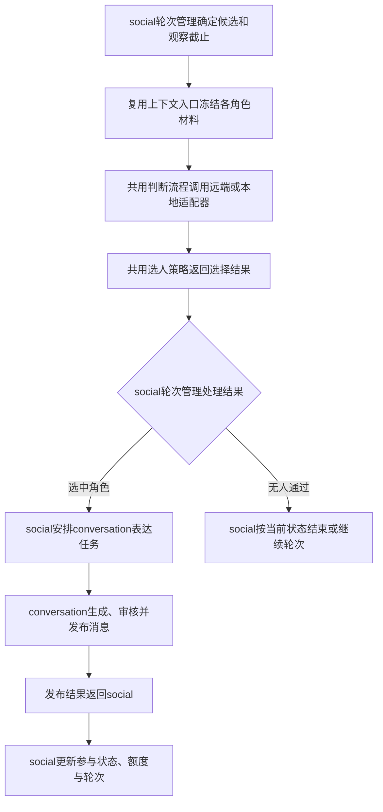

# 公开发布前的模型配置、生图与接话实施计划

更新日期：2026-11-20。状态：正在实施，进度见第6节。

## 1. 目标与阅读方式

用户配置一个主力文本模型即可使用聊天和角色创作。增强模型默认关闭，生图独立配置。群聊默认使用远端规则选人，用户主动开启意愿选人后，才为候选角色分别调用判断模型。

本计划承接接话实验和现有模型基础，安排公开发布前的修改范围、实施顺序与验收。当前业务规则以[配置参考](../server/docs/reference/configuration.md)、[角色与模型](../server/docs/design/agents-and-models.md)、[会话与社会轮次](../server/docs/design/conversation-and-social.md)为准。实现时同步更新对应设计、接口和状态文档。

本轮交付包括配置能力、供应商适配、接话模式、参与分布修正、Quickstart（快速开始）教程和公开内容检查。自动校准暂不实施，角色表达与记忆提示保持现有任务职责。验收使用现有材料和真实调用记录，不再组织多人对话盲评。

## 2. 现状与修改依据

| 项目 | 当前实现 | 本轮修改 |
|---|---|---|
| 文本模型 | 已有模型注册表、任务路由、凭据引用和OpenAI兼容网关 | 保留这些基础，集中管理三家供应商参数和客户端创建 |
| 主力与增强模型 | 默认主力为DeepSeek Flash，增强为GLM，增强开关开启 | 主力由用户指定，增强默认关闭；关闭时所有文本任务使用主力 |
| 生图 | 网关、请求参数与任务结果采用APIMart结构 | 增加统一图片契约和DashScope、MiniMax、APIMart适配 |
| 群聊接话 | social先选候选，conversation任务中安排参与判断或普通回应 | 明确三种模式；意愿选人先收集候选分数，再安排表达 |
| 本地判断 | 已有StartLux协议和本地配置，同时服务活动判断 | 群聊模式独立选择，继续复用现有本地客户端 |
| 分数与阈值 | 本地使用选项概率，MiniMax实验使用JSON自评意愿 | 推荐配置保存对应阈值，未知远端模型使用统一默认值 |
| 发言分布 | 当前规则包含候选尝试、最后发言等排序 | 意愿选人增加缓慢、有上限的参与修正 |
| 用户教程 | 快速开始要求按当前开发配置准备多家密钥 | 改为一份主力模型配置即可启动，其余能力按需配置 |

实验资料继续保留在Git忽略的独立目录。已测数字用于说明当前模型组合的取舍；Qwen和DeepSeek参与过辅助标注，相关阈值测量作为配置开发资料，不作为独立的模型优劣证据。选型分析同时记录判断质量、费用、判断等待和完整消息延迟的测量范围。

## 3. 用户配置与默认行为

### 3.1 文本模型与凭据

文本支持DeepSeek、DashScope和MiniMax。用户选择供应商、填写模型名称和对应密钥；同一家供应商可以供多个模型条目复用凭据。

| 配置 | 默认行为 |
|---|---|
| 主力模型 | 用户指定，内部沿用`light`档位 |
| 双模型开关 | 关闭 |
| 增强模型 | 开启双模型后指定，内部沿用`strong`档位 |
| 默认任务路由 | 主力模型 |
| 增强任务 | 双模型开启后，原有强化任务按既有路由使用增强模型 |
| 接话远端模型 | 主力模型；高级配置允许明确指定其他已注册模型 |
| 图片生成 | 可选，用户独立选择供应商与模型 |

关闭双模型时，增强任务解析到主力模型。用户只配置主力模型，也应通过配置检查并启动服务。开启双模型后，检查增强条目和凭据是否完整。

模型注册表保存模型、端点、凭据引用及调用参数；密钥继续保存在本地密钥文件。请求失败沿用重试和恢复流程，实际模型保持任务冻结时的选择。日志和管理详情展示实际供应商、模型名称、用途与用量。

供应商默认地址、地区差异、思考参数和输出限制由基础设施适配处理。用户填写的模型需要支持所选接口协议；示例列出已验证型号和高级参数。未知型号产生明确的兼容性错误，调用记录保留原因。

### 3.2 三种接话模式

接话使用一个互斥模式设置，建议配置值如下。正式字段在实现时统一写入配置参考。

| 模式 | 配置值 | 判断与选人 | 表达 | 默认 |
|---|---|---|---|---|
| 远端规则选人 | `remote_rules` | 沿用规则候选顺序，逐个调用普通conversation流程判断是否回应；产生有效正文后停止 | 与普通回应判断共用调用 | 是 |
| 远端意愿选人 | `remote_willingness` | 对全部合格候选分别调用远端模型判断，程序按分数筛选与抽样 | 选定后调用conversation表达 | 否 |
| 本地意愿选人 | `local_willingness` | 对全部合格候选调用本地服务，程序按分数筛选与抽样 | 选定后调用远端主力模型表达 | 否 |

远端规则选人继续提供当前普通回应任务和完整上下文。一个候选返回沉默时，按当前轮次资格与额度安排下一位。该模式不创建全体候选意愿判断批次，也不使用意愿分数修正排序。

远端意愿选人通常需要每位合格角色一次判断，再增加一次选中角色的表达调用。配置说明和管理状态明确展示这项开销；开关保持由用户主动选择。

本地模式负责意愿判断，正文仍由主力模型生成。它独立于增强模型开关，也独立于Activity使用本地决策的开关。基础设施按实际消费者创建和复用本地客户端，避免群聊模式受活动开关误控制。

任务创建时冻结模式、实际模型与观察截止。配置修改影响后续任务，已创建任务按冻结配置完成。连接失败或输出错误进入明确的恢复流程，不作为角色低意愿或沉默结果。

### 3.3 推荐配置、阈值与未知模型

远端意愿选人统一使用JSON评分任务，字段为`choice`和`willingness_score`。后者为0到1的自评意愿分数，选择流程依据分数和配置阈值运行；原始标签保留供诊断。任务指令、输出格式和字段校验保持一致。

本地客户端继续读取选项概率，并转换为同一份参与判断数据。结果保留分数来源，阈值按相应模型配置解释。

推荐参数由项目离线准备：

1. 从现有已审核材料中固定一份约50项的参数测量子集，按完整观察位置保留全部合格角色，数量允许少量浮动。覆盖强、中、弱意愿，以及直接询问、未点名兴趣、多人有动机和自然结束，包含多个全员弱意愿的位置。调用前记录选中编号、JSON评分提示和阈值选择目标。
2. DeepSeek和Qwen在同一子集上分别完成JSON阈值测量，预计新增约100次基础评分请求。MiniMax提取已有记录中相同编号的结果，三者都在该子集上重新计算阈值。
3. 保存三份推荐远端配置，包含供应商、明确的模型名称、思考设置、评分提示版本和阈值。
4. 未匹配推荐配置的远端模型，使用这三个JSON阈值的算术平均值作为默认值。实际数值在测量完成后写入配置资源。
5. 用户可以通过高级配置明确覆盖阈值，普通快速开始不要求用户填写它。

此前Qwen的0.7732来自选项概率，MiniMax的0.82来自完整验证集上的JSON自评分数。本轮推荐配置使用同一份约50项子集和同一JSON协议得到的阈值，完整405项记录仅供查阅和复用。推荐参数匹配对应的模型、思考设置和评分协议，供应商品牌本身不决定阈值。

本地推荐配置沿用对应权重的已测参数，当前训练后0.8B示例约为0.595。未知的二分类选项概率模型使用0.5起始值；远端自评分数的平均阈值不用于本地概率输出。

阈值测量仅在开发阶段执行。服务启动、配置检查和正常聊天读取静态配置，不安排自动校准或额外收费测试。

## 4. 模块职责与代码组织

### 4.1 注册表、工厂与供应商适配

复用当前模型注册表和网关。按职责集中组织以下内容：

| 职责 | 所属位置 | 内容 |
|---|---|---|
| 配置加载与模型解析 | 现有配置与模型注册模块 | 默认值、模型条目、主力与增强路由、凭据引用、推荐参数 |
| 客户端工厂 | `infrastructure/models/` | 按供应商和协议构造文本、图片、本地决策客户端 |
| 供应商适配器 | 同目录内的适配器文件或子目录 | 请求转换、参数支持、响应解析、同步或异步协议 |
| 社交轮次管理 | `modules/social/`现有轮次编排 | 开启、继续和结束轮次，检查资格、观察截止、额度与在途任务，安排判断和表达 |
| 意愿判断与选人 | `modules/social/`内的判断和策略实现 | 消费明确的候选与上下文，调用判断适配器、汇总分数并返回选择结果 |
| 人物表达 | `modules/conversations/` | 上下文组织、普通回应与表达任务、审核、发布与通知 |
| 图片任务 | `modules/assets/` | 生成任务归属、状态、资产保存和恢复 |

工厂集中对象创建。业务模块消费统一契约，供应商分支留在适配器中。文本继续复用已有OpenAI兼容实现，只有确实不同的参数和响应处理进入适配器。图片按真实协议区分处理。

公共请求和结果类型集中定义，各适配器各有明确文件。文件数量由这些职责决定，保持现有依赖方向。新增通用插件系统、自动校准框架和通用工作流引擎均不在本轮范围。

### 4.2 意愿判断与表达编排

social的轮次管理持有`SocialTurn`及交流轮次的生命周期。意愿判断与选人接收轮次管理提供的候选、冻结上下文和策略参数，返回分数、选人结果或无人通过的结果。轮次管理据此安排表达、继续寻找回应或结束交流。

远端和本地意愿选人复用同一套批次执行与选择逻辑：候选材料准备、并发控制、结果校验与保存、阈值筛选、参与修正、抽样和错误处理均共用。区别集中在判断适配器：

| 判断适配器 | 调用方式 | 返回分数 |
|---|---|---|
| 远端 | 统一JSON任务，调用选定的远端文本模型 | 模型自评意愿分数 |
| 本地 | 本地决策协议，读取选项概率 | 角色发言选项的概率 |

工厂选择适配器。两种适配器返回统一判断结果，保留角色、原始判断、分数、分数来源、实际模型、耗时与用量。阈值从对应模型配置取得。适配器负责调用与结果转换，轮次管理仍由social现有编排持有。

意愿模式的调用关系如下：



准备材料复用现有角色上下文能力。判断与表达共享来源版本和观察截止，各角色只读取自己的私有材料及可见消息。模型调用期间不持有数据库写事务。正式提交前继续检查资格、会话状态和任务是否仍有效。

候选分数收集完成后，由轮次管理创建最终选中角色的表达安排。判断和选人组件不直接创建表达任务或改变轮次状态。conversation负责表达生成、审核和发布，并通过现有结果通知将执行情况交回social。

远端规则模式仍走现有候选调度与普通回应入口。规则与意愿两类路径的角色尝试次数、实际模型请求数和已发布消息数分别记录。轮次额度与模型请求额度各按真实含义管理，一次含多名候选的判断批次会记录实际的多次API调用。

主动表达与Activity创建的情景继续使用已有conversation入口。它们的身份、可见性和来源保持原职责。当前游戏行动规则、玩法分析器和活动协调策略不在本轮重写。

### 4.3 生图统一接口

图片网关接收统一的图片请求，包括提示词、用途、尺寸、数量及当前功能使用的参考图。供应商适配器负责参数转换与能力校验。

| 供应商 | 示例与代表验收模型 | 处理要求 |
|---|---|---|
| APIMart | `gpt-image-2` | 保留提交任务、查询状态和下载结果的异步流程 |
| DashScope | Qwen Image 3.0，`qwen-image-3.0` | 支持该图像接口家族，转换请求和返回结果 |
| MiniMax | `MiniMax-H3-Image` | 支持官方图像接口，处理同步返回及有效图片结果 |

这些型号用于配置示例和本轮验收。用户仍可指定适配器支持的其他型号，参数与能力校验由所属适配器处理。

客户端返回即时结果或可查询的远端任务。执行层据此继续保存图片或查询任务，避免为同步接口创建虚构任务编号。assets模块传递业务请求，供应商原生请求体由适配器构造。

生成任务创建时冻结供应商、模型、端点和非敏感调用参数。后台恢复使用原任务配置，密钥按引用从本地读取。配置变更不会把进行中的任务交给另一家服务。

未配置生图时，普通聊天、图片上传和资源管理仍可使用。生成入口提示缺少的配置项。README列出三家已验证配置示例和模型适用的接口家族。

## 5. 发言算法与长期参与修正

### 5.1 适用范围

算法用于远端和本地意愿选人。远端规则模式保持规则候选排序。最近一条可见消息由本人发出的角色，按已经确认的资格规则排除。

模型分数决定角色能否参与和主要选择权重。长期修正只帮助持续获得模型认可、却较少取得表达机会的角色。模型判定低于阈值的角色不会因修正获得发言资格。

### 5.2 基础权重与修正

候选分数记为`s_i`，通过阈值后按以下权重计算基础选择概率`b_i`：

```text
基础权重 = exp((s_i - 最高候选分数) / T)
b_i = 本角色基础权重 / 全部候选基础权重之和
```

抽样温度`T`默认0.1。保持分数为主，例如相差0.1时，修正前的权重约相差2.72倍。

每个角色保存预期参与份额`E_i`与实际参与份额`A_i`，初始为0。一次真实发言完成后缓慢更新：

```text
E_i = 0.98 * E_i + 0.02 * b_i
A_i = 0.98 * A_i + 0.02 * 本次是否由该角色发言
修正系数 F_i = 1 + 0.1 * tanh((E_i - A_i) / 0.1)
最终选择概率 = b_i * F_i / 所有候选 b_j * F_j 之和
```

先用此前保存的份额计算本次修正，实际发布后再更新份额。这个更新速度的半衰期约为34次发言机会。修正系数始终在0.9到1.1之间。

七名角色的基础机会相当时，某人发言一次，其下一次修正约降低1.7%。长期分布偏差才会逐渐积累到接近10%的修正。模型持续给某人明显更高的分数时，该角色仍然更容易被选中。

预期份额来自模型给出的基础选择概率，实际份额来自正式发布。这样能区分“角色持续缺少动机”和“有动机但多次抽选失利”。

### 5.3 保存与更新

参与状态由social按会话和角色保存，复用已有仓库与事务设施；需要增加的持久化结构通过数据库迁移创建。

- 成功发布的角色消息只更新一次。请求重试、模型输出失败和未发布草稿不增加实际份额。
- 外部主动消息计入实际发言贡献，预期份额只从真实的意愿判断批次取得；外部主动消息不生成虚构候选分数。
- 规则模式不使用该修正。切换意愿模型或评分协议时，从新的参与统计起点开始，已有任务与消息记录保留。
- 候选集合、基础概率、修正系数、实际抽样结果和发布关联可供诊断。业务状态由social正式记录维护，调试日志用于查看过程。

该修正的目标是缓解长期抽选偏差。连续聊天是否更自然，以及实际费用和等待，按正式运行记录评价。

## 6. 实施单元与顺序

本轮分为六个单元，依次完成实现和对应验收。实验测量保留在独立目录，进入公开配置的只有整理后的参数和说明。

| 顺序 | 单元 | 完整交付 | 前置条件 | 状态 |
|---|---|---|---|---|
| 1 | U01 推荐模型参数与统一评分协议 | 约50项共同子集、三模型同协议阈值及远端默认值、本地推荐值、版本与来源说明 | 现有验证材料及MiniMax记录 | 已完成 |
| 2 | U02 文本模型配置与工厂 | 三家文本支持、主力模型、默认关闭的增强配置、集中客户端创建 | U01 | 已完成 |
| 3 | U03 多供应商生图 | 统一图片契约、三家适配、配置冻结和任务恢复 | U02 | 已完成 |
| 4 | U04 接话三种模式 | 默认远端规则模式，两种意愿模式的共用判断与选人流程，以及与轮次管理、表达的接线 | U01、U02 | 待实施 |
| 5 | U05 长期参与修正 | 有限幅度抽样、参与状态保存、发布后更新和诊断 | U04 | 待实施 |
| 6 | U06 快速开始与公开交付检查 | 配置教程、默认资源、真实代表验收、安装升级与公开内容检查 | U01至U05 | 待实施 |

### 6.1 U01：推荐参数

按第3.3节固定约50项共同子集，执行DeepSeek Flash与Qwen3.8-Flash的JSON测量；MiniMax-M3.1-Flash提取已有对应结果。测量前记录材料编号、供应商、模型、思考参数、提示版本、请求上限与预计用量；保留实际请求、响应、错误和费用。

统一采用现有阈值目标，输出各模型阈值、默认算术平均值、人工标签来源和适用配置。结果用于推荐参数配置，测量范围保持在该子集。阈值来源保存在配置开发说明，用户教程提供可直接选择的推荐项。

验收要求：三份推荐配置使用同一种分数含义；未知远端配置能明确取得默认值；本地概率默认值独立处理；启动过程读取参数，不调用模型。

实施记录（2026-11-20）：完成统一JSON输出契约、提示版本和静态推荐参数读取。固定52项、14个完整观察位置，其中强意愿4项、中意愿10项、弱意愿38项；包含7个全员弱意愿位置。DeepSeek Flash与Qwen3.8-Flash各完成52项，MiniMax复用相同编号的52项结果。阈值分别为0.85、0.85、0.86，未知远端默认0.853333；未知本地二分类概率默认0.5，训练后指定权重推荐0.594788。

阈值目标沿用强意愿遗漏、弱意愿入选、全员弱意愿启动三项错误率的最大超额，再比较错误率总和。三模型均未同时达到三项10%的目标。该小样本侧重自然结束，强意愿样本较少，参数属于开发推荐值。模型与思考设置不匹配时使用相应默认值。

验收：6项协议与参数检查通过。Qwen有一项两次返回了错误字段，保留全部原始响应；采用与提示字段一致的JSON Schema后完成。程序严格校验，不把格式错误计为沉默。请求和结果保存于忽略目录`runs/public-release-20261120`，正式资源只保存参数和协议。

费用：DeepSeek约0.2120元，Qwen成功请求约0.1585元，格式失败的两次请求另计入本轮总费用。DeepSeek按非高峰美元价格、美元兑人民币7.2估算，最终扣费以账单为准。单元提交：`feat(models): add versioned willingness scoring presets`；提交编号见Git中本单元记录。

### 6.2 U02：文本配置与客户端创建

整理现有注册表、供应商参数处理和客户端创建，完成三家配置示例。默认主力由用户填写，增强默认关闭。关闭增强时允许省略增强模型与对应凭据，原强化任务解析到主力。

任务执行详情保留请求用途、实际模型和凭据引用名称，公开页面只展示非敏感字段。配置检查说明当前有效路由和缺少的字段。

验收要求：一份主力配置覆盖普通对话、角色创作和记忆整理；三家各完成少量真实文本请求；增强开关与实际路由一致；重试不更换实际模型。

实施记录（2026-11-20）：文本客户端创建与供应商参数集中到工厂，三家模型可由`profiles.light`选择，增强默认关闭。仅保留主力条目时，原增强任务可正常解析到主力。移除开发期GLM等默认条目，MiniMax使用官方原生端点。`inspect`提供任务实际路由与凭据配置状态。

验收：13项配置、反思与决策基础检查通过。通过正式文本网关分别真实请求DeepSeek Flash、Qwen3.8-Flash、MiniMax-M3.1-Flash，均返回约定JSON；耗时约1.47秒、0.60秒、4.38秒。三次短请求估算合计小于0.001元。原始调用保存在忽略目录`runs/public-release-20261120/text-calls`。

U01提交编号：`851e856`。本单元提交信息：`feat(models): configure primary and optional strong providers`。

### 6.3 U03：生图适配

将APIMart请求体和响应结构移入所属适配器，assets消费公共图片请求和结果。实现DashScope的Qwen Image 3.0接口与MiniMax图像接口，提供可自填模型的配置示例。

验收要求：三家各完成一张真实图片的生成、保存和展示；检查异步恢复、同步结果、失败响应和配置修改后的旧任务继续处理。旧有上传与资源管理流程继续通过验证。

### 6.4 U04：三种接话模式

保留默认规则路径，将意愿模式的判断安排在最终选人之前。复用任务注册、队列、租约和恢复能力，由social轮次管理安排判断批次并持有执行状态。远端和本地意愿判断采用统一契约、共用批次与选人逻辑，仅替换调用适配器。删除被新意愿路径替代的旧编排，普通conversation判断与表达继续供规则模式使用。

上下文准备复用现有入口，保存共同观察截止，分别组织判断和表达指令。遵守每名角色自己的知情范围，并发上限使用已有模型额度设施。局内交流按Activity既有协调入口接入相同策略，正式游戏行动继续由Activity负责。

验收要求：新安装默认为`remote_rules`；默认路径没有全体候选评分请求；只有明确选择意愿模式才产生评分批次；替换远端和本地适配器后，其余流程复用；判断与选人组件不直接管理轮次生命周期；本地模式的正文仍使用主力模型；无人通过的结果由轮次管理处理；主动请求和局内交流保持来源与发布规则。

### 6.5 U05：长期参与修正

实现第5节算法和social状态保存。默认参数集中在一个策略配置中，界面使用正常语言描述，不要求用户理解公式。

验收要求：阈值外角色不会进入抽样；分数差异继续主导权重；修正不超过10%；单次发言不会导致大幅衰减；重启后状态可以恢复；重复回执不会重复更新；主动消息与意愿选人消息采用明确的贡献规则。

### 6.6 U06：文档、安装与公开检查

根README的Quickstart采用以下顺序：安装依赖、复制配置示例、填写主力供应商和模型与密钥、启动服务、发送第一条消息。增强模型、生图、意愿选人和本地服务放在可选配置步骤中。

至少包含以下内容：

- 三家文本供应商各一份完整配置示例，说明模型名称和地区端点从哪里取得。
- 双模型默认关闭，以及开启后需要填写的字段。
- 三家生图配置、已验证型号和适用的接口家族。
- 三种接话模式的调用流程与开销差异，默认模式明确标注。
- 推荐模型参数的使用方式，以及未知模型采用默认阈值。
- 密钥文件路径、配置相对路径规则、服务重启和常见错误定位。

`inspect`继续提供不收费的配置检查，展示有效模型和模式。真实连接检查由明确命令或操作触发，事先说明调用范围。

验收使用现有社群和材料，执行代表性群聊、主动消息和局内交流。记录模式、模型、判断次数、表达次数、首条可见消息等待、后续消息间隔和实际用量。分别报告判断阶段与正文生成的费用，不用单角色前向耗时代替消息延迟。

## 7. 开发数据、发行初始状态与配置

正式发行以新建空数据库为起点，安装与验收使用相同入口。当前本地数据库中的角色、会话和任务属于开发测试数据，不承担本轮原地升级兼容要求。

| 内容 | 处理方式 |
|---|---|
| 开发测试数据库及旧任务 | 可以重建；旧参与编排和任务状态不增加专门兼容逻辑 |
| 参数测量与复查材料 | 现有输入、人工标签、原始响应和报告保留在独立实验目录，供本轮复用 |
| 验收用测试社群 | 作为独立测试材料选留，按需要复制到验收环境，不作为正式发行默认社群 |
| 个人密钥 | 继续放在本地密钥文件，与数据库重建分开处理 |
| 开发配置 | 按新示例重新整理供应商、模型和模式；公开示例使用非敏感配置 |
| 正式数据库结构 | 通过仓库现有迁移入口建立，验证空库初始化与新结构下的重启恢复 |
| 公开配置与资源 | 只包含可分发的示例、推荐参数及适用说明 |

本轮不为旧测试字段、任务和实验路径增加过渡包装。实施时先列明待重建的开发库和关联文件，按确认的范围清理；仍用于参数测量、复查和验收的材料保留在非提交目录。密钥文件和实验记录按各自用途管理。

新的运行流程仍需支持正常重启和配置修改。图片与模型任务创建时冻结实际配置，进行中的任务按该配置继续执行。初始化命令保留用户已经创建的配置与密钥文件。

## 8. 联合验收、预算与交付

### 8.1 验收范围

每个单元完成主要流程和真实可达失败路径的针对性检查。公共配置、任务和图片接口稳定后执行一次相关回归，完成空库初始化、全新安装和后台重启恢复检查。

群聊验收对三种模式分别记录质量、延迟与成本，使用新算法检查强动机角色、多人都有动机、长期抽选失利和自然结束。沿用已有材料，检查正式运行记录。

### 8.2 真实调用与预算

本轮真实调用总预算上限为10元，覆盖参数准备和实施验收。参数测量使用约50项共同子集，不扩展为完整405项对照；预计文本参数测量约0.5至1元，其余费用按实际请求和生图用量累计。

| 用途 | 调用范围 | 预算预留 |
|---|---|---|
| 推荐阈值 | DeepSeek Flash、Qwen3.8-Flash各约50项；MiniMax复用相同编号记录 | 1元 |
| 文本接口与路由验收 | 三家文本接口、主力与增强路由、三种接话模式，合计约20次代表请求 | 1元 |
| 生图验收 | Qwen Image 3.0、MiniMax-H3-Image、APIMart gpt-image-2各一张，约1K分辨率 | 6元 |
| 异常重试与计费差异 | 在上述范围内按需使用 | 2元 |

生图先各生成一张。确有必要时，每家最多追加一张，总费用仍受10元上限约束。查询、下载或恢复失败时优先继续原任务，避免重复提交生成请求。调用前核对实际型号与计费规格，未返回用量的请求单独记录，供应商账单作为实际扣费依据。

测试前固定模型清单、材料编号和请求上限，保存请求、响应、重试、耗时与费用。预计新增付费调用将超过总预算时，停止新增请求并报告已完成范围。

### 8.3 公开检查与交付

公开检查覆盖当前文件、打包资源和Git历史中的凭据、个人资料、实验产物及资源许可证。发现真实凭据泄露时先处理凭据，再提出具体历史处理方案。实验社群、百科原文、训练数据、模型权重、捕获记录和个人数据库继续位于非提交目录。

数据库、模型下载和外部游戏引擎的安装说明与实际打包内容一致。公开推荐参数附测量协议和适用型号，实验材料按许可证与隐私范围单独管理。

交付内容为代码差异、各单元验收记录、配置说明、调用与费用记录、公开检查结果及仍未验证的范围。提交、推送和修改仓库可见性按用户明确指令执行。
