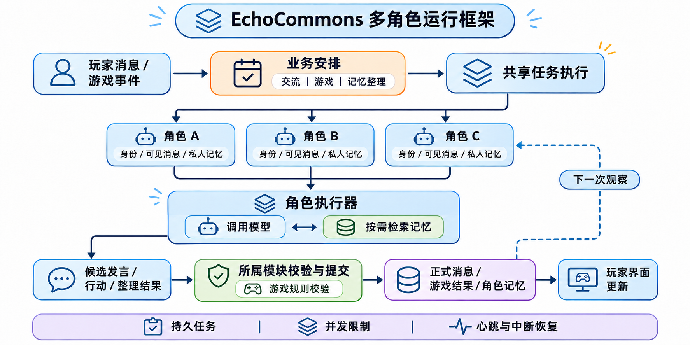
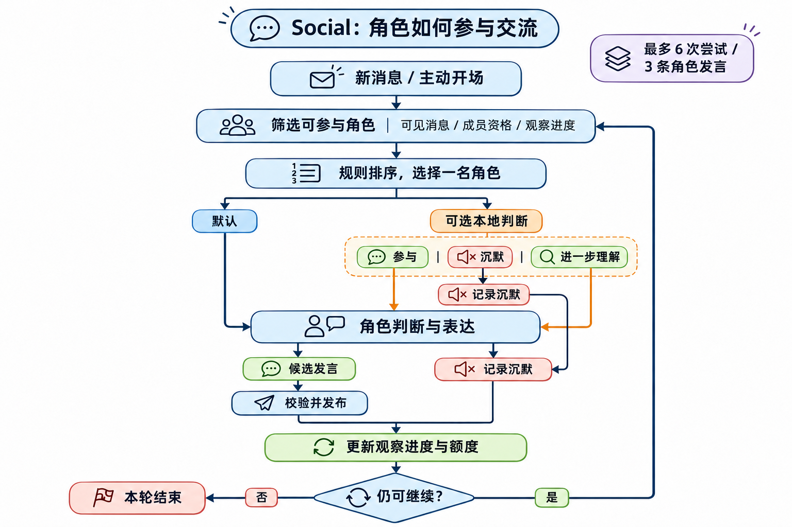
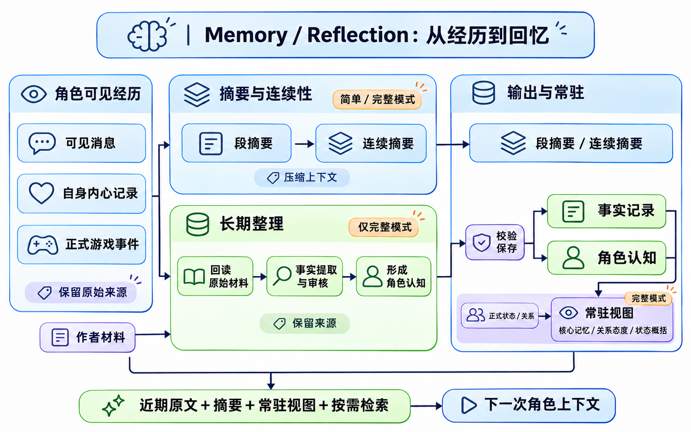

# 架构与开发指南

EchoCommons 面向玩家参与的多角色交流与游戏。每位角色拥有独立身份、状态、关系和记忆；业务模块决定何时安排任务，执行框架负责调用模型和工具，正式结果经过检查后写入数据库。

框架使用 Python 实现角色协议、工具循环、任务调度与业务提交。后端以单进程和 SQLite 为当前运行目标，多个模型请求可以并发。

安装与配置见[配置指南](configuration.md)。

## 1. 多角色任务怎样运行



一次任务经历以下过程：

1. 玩家消息、游戏轮次或待整理经历触发业务安排。
2. 业务模块检查角色资格，保存任务与本次输入快照。
3. 共享执行器领取任务，准备角色可见材料，调用模型及获准工具。
4. 模型提出候选消息、动作或记忆变更。
5. 所属业务检查结构、角色资格、来源与当前状态，在短事务中保存结果。
6. 已提交变化通过 HTTP 查询与 SSE（服务器事件推送）进入前端。

模型输出只是候选，正式游戏状态、会话消息和记忆版本由业务提交产生。工具循环可以读取允许范围内的信息，不能直接绕过业务服务改写数据库。

### 独立上下文，共享执行能力

角色输入包括人物资料、当前任务、可见消息、自身状态和关系，以及允许读取的记忆。同一模板创建的多个实例分别维护这些数据。私聊、会话加入区间和消息受众共同决定可见范围。

输入快照固定本次任务所依据的材料。重试沿用快照，提交时再次检查资格与版本；成员离开、旧任务失效等变化可以阻止迟到结果写入。

## 2. 群聊怎样决定谁接话



玩家短时间内连续发送的消息先形成输入批次，窗口结束后安排回应轮次。规则优先考虑提及对象，再结合最近发言情况选择角色。普通群聊可以额外启用本地参与判断，默认关闭。

选中角色根据自己的上下文决定发言、保持沉默或查询记忆。成功发言可以为后续角色提供新材料；沉默与失败按规则转向其他候选。轮次受消息数、任务数和新玩家输入约束，避免角色无限互相接话。

调度规则负责“安排谁获得机会”，角色生成负责“怎样回应”。消息可见性和读取进度由业务保存，不能只依靠提示词约定。

相关实现集中在 `server/src/echo_commons/modules/social/` 与 `modules/conversations/`，模型和角色协议位于 `agents/`。

## 3. 从发言到游戏行动

游戏规则由独立的 `echo_games` 包维护，宿主负责玩家身份、角色任务及局内会话。

| 部分 | 责任 |
| --- | --- |
| `games/` | 席位、局面、合法动作、结算、正式事件与存储 |
| 活动模块 | 安排角色观察与决策，协调行动与局内表达 |
| 分析服务 | 五子棋使用 Rapfi；飞行棋使用规则分析 |
| 会话模块 | 保存获准的局内发言，按受众提供消息 |

轮到角色时，活动任务读取局面与行动机会，选择动作，再由正式规则检查执行。表达与动作分别记录，允许在保留已执行动作的基础上恢复表达。游戏经历按角色实际参与区间整理，结束后可形成整局摘要。

同一角色在同一游戏参与区间的判断按顺序处理，独立表达还要保持发表次序；不同角色与不冲突的任务可以并行。任务执行完成、动作执行成功和发言保存成功具有各自条件。

五子棋与飞行棋已接入角色自动行动；Kingdomino 当前支持真人对局。角色自动表达仍有待完善的失败情况，诊断应以正式动作回执与关联任务为准。

## 4. 记忆与反思怎样分工



原始消息、角色自身思考、作者允许角色知道的材料及正式活动结果构成来源。不同来源保留各自含义：玩家说“我做完了”证明他这样说过，实际完成情况还需要正式记录支持。

| 层次 | 主要作用 |
| --- | --- |
| 原始经历与段摘要 | 保存可见经过，按场景整理近期材料 |
| 连续摘要 | 压缩多段经历，保持交流连续性 |
| 长期事实 | 保存可独立理解的信息、来源与版本 |
| 角色认知 | 保存角色的体验、理解与推断，保留必要的不确定性 |
| 核心与关系视图 | 从有效记录中选择经常需要的重点，进入常驻上下文 |

连续压缩与长期整理分别维护处理进度。长期整理可以回到原始来源检查事实，再更新相关认知，避免把摘要中的概括当成新证据。

简单模式使用作者材料和摘要；完整模式增加长期事实与认知整理。记忆搜索使用 jieba 和 SQLite FTS5，按社群、角色、时间和成员区间限定范围，返回前复核来源与版本。向量检索是可选能力，默认关闭。

对话准备阶段可进行有限的自动检索，角色也可以调用获准的 `memory_search` 工具。检索为空不代表事件从未发生，候选进入最终上下文还受到内容预算约束。

## 5. 人物创作与运行实例

人物创作分为基础人设、过去故事、人物采访，以及最终正文审核与确认。作者材料与角色实际可知内容分别处理，隐藏材料不自动进入角色记忆。

确认后产生固定人物资源，入住社群时创建独立实例。材料准备、初始关系和完整模式的长期整理由对应任务完成；准备状态决定角色能否参与会话。

扩展人物时，先区分修改模板、修改草稿和修改已运行实例的状态，避免把作者设定变化当成角色经历。

## 6. 任务持久化与恢复

`execution/` 提供队列登记、分派、模型预算、租约、心跳和后台管理。聊天、反思与游戏保留自己的任务契约、资格检查和提交规则。

默认调度份额为游戏回合、交流、后台整理 2:2:1。它分配任务领取机会；模型调用并发还受共享预算限制。等待摘要的任务可以让必要材料准备获得相应优先级。

租约记录当前执行者和代次。服务重启或执行超时后，新执行者获得新代次，旧结果不能继续提交。临时错误按预算重试，暂停、取消和最终失败由各自业务处理。已成功保存的阶段产物可以复用。

SQLite 使用短事务保存相关事实。前端断开 SSE 不改变业务执行结果，重新加载仍通过 HTTP 读取正式状态。

## 7. 项目结构

| 目录或文件 | 职责 |
| --- | --- |
| `server/src/echo_commons/` | 后端应用与角色执行框架 |
| `server/config/` | 服务设置、模型登记和本地密钥配置 |
| `server/tests/` | 业务、接口、存储和真实模型测试 |
| `server/tools/` | 安装、维护与验证工具 |
| `server/docs/` | 后端设计、接口和参数参考 |
| `server/data/` | 运行时数据库、图片、日志与引擎资源 |
| `frontend/src/` | React 页面、组件、状态与接口调用 |
| `frontend/public/` | 前端静态资源 |
| `frontend/e2e/` | 浏览器端到端验证 |
| `frontend/docs/` | 前端专项说明 |
| `games/` | 独立游戏规则包及其文档与验证工具 |
| `docs/` | 项目级指南、专题说明和展示素材 |

`server/` 和 `games/` 分别管理 Python 包，后端通过本地依赖引用游戏包；`frontend/` 独立管理 npm 依赖。

### 关键代码入口

| 位置 | 内容 |
| --- | --- |
| `server/src/echo_commons/app/` | 配置、组合、启动生命周期和 HTTP 接入 |
| `server/src/echo_commons/agents/` | 角色协议、模型输入与工具循环 |
| `server/src/echo_commons/execution/` | 共享任务执行与恢复 |
| `server/src/echo_commons/modules/` | 社群、人物、交流、活动、记忆与反思业务 |
| `server/src/echo_commons/infrastructure/` | 数据库、模型网关、诊断及传输设施 |
| `server/src/echo_commons/resources/` | 人物、提示、配置及随包资源 |
| `games/` | 独立游戏包 |
| `frontend/` | 用户端、管理界面、人物创作和游戏页面 |

## 8. 开发与验证

在 `server/` 安装依赖并运行不调用模型的测试：

```powershell
uv sync
uv run pytest -m "not model"
uv run python tools/build_file_reference.py --check
uv run python tools/build_database_reference.py --check
uv run python tools/build_contract_reference.py --check
```

需要真实模型的验证单独执行，会产生调用费用：

```powershell
uv run pytest -m model
```

可用 `ECHO_COMMONS_TEST_SETTINGS` 指定独立配置。测试身份、消息、动作和数据库结果应使用正式入口；模型输出的自然措辞允许变化，重点检查动作合法、来源有效、范围正确和结果可恢复。

前端从 `frontend/` 执行 `npm run build`。完整测试范围和安装包验证见仓库 [验证指南](../server/docs/guides/verification.md) 与 [独立游戏包](../games/README.md)；旧文档中的历史验证记录不等于本轮重新执行结果。

### 扩展入口

- 新增工具：定义输入与输出契约，登记角色能力，沿用当前任务的观察范围与预算。
- 新增玩法：先在独立游戏包实现规则、动作、事件与存储，再接入宿主参与关系、活动任务与前端。
- 新增任务：明确触发、资格、快照、候选检查、事务提交和恢复方式，再登记共享执行器。

进一步阅读可从仓库 [后端文档](../server/docs/README.md)、`server/docs/reference/` 和各业务设计文档进入。图中的运行过程用于理解职责；精确字段、错误码与当前接口以正式契约和代码为准。
