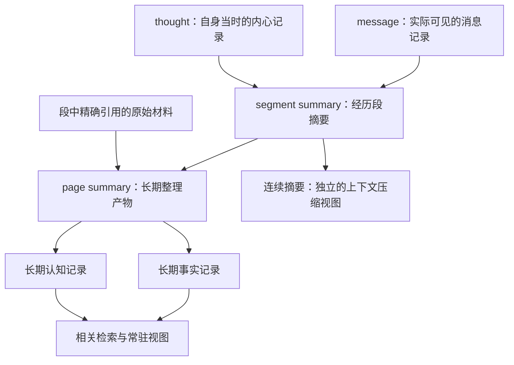

# 角色质量、页面体验与会话组织修改方案

更新日期：2026-10-15。状态：U01～U09 已完成，U07 按 U07.1～U07.3 分步交付。本文保存各单元的修改范围、顺序与验收要求；已实现行为及验证范围以对应正式设计和状态文档为准。

## 1. 阅读方式与目标

本方案覆盖六组问题：新增功能的视觉布局；核心记忆与人物创作的人机感；长期事实与角色认知的分离及图记忆删除；首次关系描述；角色自介卡；跨会话上下文。任务时间错误、私聊唯一性、群聊人数及退出和结束操作作为相关修改一并安排。

先阅读第 3 节的实施顺序，再核对各单元的行为和提示词。每个单元包含修改范围、已有数据处理和验收要求，能够完成验证并留下一个独立的本地提交。实施时提交使用英文前缀和英文说明，不推送。

预期结果：

- 玩家浏览社群、建立人物和选择插画时，操作自然融入现有页面。
- 人设、核心记忆、关系描述各有明确职责，角色能够自然表达，并保持具体经历的连续性。
- 长期事实与角色认知分别保存，摘要负责交流连续性；检索返回必要材料及实际来源。
- 群聊、私聊和后续活动共享角色的可见经历，同时保留来源和私人信息边界。
- 正常心跳和数据库等待不会让已经生成的结果保存失败。

本轮继续只提供角色插画生成。社群使用已有官方封面；社群封面生成、聊天背景生成和图片上传页面不纳入方案。用户页面保持友好提示，内部错误类型和诊断留在管理端。

当前实现范围见 [后端状态](../../../server/docs/status.md) 和 [前端状态](../../../frontend/docs/status.md)。本文件负责待实施修改；各单元实施后，再同步前后端正式设计与状态文档。

### 1.1 提示词的写作依据

提示词参考 [Humanizer-zh 的中文编辑规则](https://github.com/op7418/Humanizer-zh/blob/main/SKILL.md)（2026-09-23 修订），重点采用保留事实与确定程度、匹配原有声音、按上下文处理模板化表达的原则。完整 Skill 不加入每次模型输入；下面各节点已经给出适合自己任务的完整提示词。

人物创作需要写出具体生活和表达，事实整理保留实际信息及其来源性质，角色认知保留理解、判断及依据，摘要负责压缩经历。不同任务使用不同写法；角色之间也保留各自的用词、情绪和节奏。文字自然不要求人人健谈、幽默、温柔或愿意亲近。

正文生成先遵守事实和人物要求，再处理重复、空话和句式。具体做法放在各节点中，不用固定词语黑名单、统一句长或刻意添加停顿来代替写作。定稿前检查正文和依据是否一致，只返回最终正文及协议要求的字段。

## 2. 已确认的问题依据

以下是检查代码、现有数据库和日志得到的结果，区别于后文拟实现行为。

| 问题 | 当前依据 | 修改含义 |
|---|---|---|
| 社群操作突兀 | `CommunityPage` 在社群列表上方直接放置 `CommunitySettings`，创建表单始终展开，封面使用普通下拉框 | 调整页面层次和图片选择方式 |
| 核心记忆强化机械表达 | 小璃的有效核心记忆有 1095 字，重复性格、日常偏好及“不解释”等相处规则；核心记忆进入每次聊天的系统提示 | 优先修改核心记忆的职责、选材和写法 |
| 核心记忆缺少人物语气 | 反思节点默认 `include_voice=False` | 仅向需要人物表达的节点提供语气参考 |
| 创作内容缺少完整经历 | 故事提示未规定第三人称；小璃故事已使用第三人称，但仍用模糊、遗忘省略信息 | 第三人称与具体事实要求需要同时落实 |
| 采访经常回避 | 采访继承日常表达规则，并明确允许拒答；校准又可能把一次拒答固化为普遍行为 | 建立坦诚的创作采访情景，避免泛化回答 |
| 图记忆扩展缺少独立价值 | 上一轮实际查询“高汤”带回首次打招呼的页，查询“玻璃杯”带回讨论小璃话少的页；人物相邻不证明主题相关 | 完整删除实体图、边与邻居扩展，保留普通来源检索 |
| 长期页混合事实与认知 | 同一第一人称正文包含陈述、体验和判断，主题类型不能表示来源性质；后续主要依靠措辞辨别 | 保存独立事实／认知模型、逐项来源与更新版本，摘要仍负责上下文压缩 |
| 首次关系描述遗漏 | 小槿对阿澈的批次收到空证据后产生 `no_op`，批次已消费；数据库实际存在证据 | 修正读取时间，并补充遗漏处理 |
| 模型成功后保存失败 | 小璃关系描述的日志显示 `DomainInvariantError`，具体为 `node task time cannot move backwards` | 修复事务内的时间取得位置 |
| 失败影响其他对象 | 小璃对小槿的刷新图为 `partial`，对林舟的关系变化仍未分配批次 | 失败分支不能阻止其他对象刷新 |
| 基础设定需要直接写文档 | `AuthoringContent` 没有年龄、爱好、外貌等独立资料；基础页直接展开三份正文 | 增加结构化自介资料和模板填充 |
| 当前历史局限于一个会话 | 聊天历史、段摘要、连续摘要按当前 `conversation_id` 读取 | 建立角色可见的跨会话输入 |
| 封段也是单会话结构 | `memory_segments` 每段绑定一个会话；摘要覆盖使用会话内序号 | 拓宽为角色的跨会话时间段，保存分来源覆盖 |
| 私聊可以重复创建 | 创建只按传入的 `conversation_id` 判断重复 | 按同一社群的参与者组合复用私聊 |
| 会话管理入口缺失 | 后端有退出接口和内部归档能力；前端没有对应操作，也没有创建者记录 | 完成会话详情、退出、结束及个人列表整理 |

诊断中的具体角色和记录只用于说明当前问题，不写进正式提示词或永久业务规则。没有发现系统时钟回拨的证据；正常并发执行已经能够触发当前时间错误。

## 3. 修改单元与实施顺序

| 顺序 | 单元 | 完整交付 | 前置条件 | 建议提交说明 |
|---|---|---|---|---|
| 1 | U01 任务时间与保存恢复 | 正常执行不会因旧时间保存失败，已有失败结果可恢复 | 无 | `fix: use transaction times for task state changes` |
| 2 | U02 核心记忆质量 | 核心记忆保持具体、简洁、符合人物语气，可重建现有内容 | U01 | `fix: keep core memories concise and experience focused` |
| 3 | U03 人物创作与采访 | 第三人称完整故事、坦诚采访、自然人设及可靠校准 | U01 | `feat: improve character authoring and candid interviews` |
| 4 | U04 社群页面布局 | 社群列表与详情、新建详情、封面图片选择形成统一界面 | 无 | `feat: organize community settings in scene details` |
| 5 | U05 自介卡与角色插画布局 | 资料表、模板正文、创作辅助和外貌插画使用同一份资料 | U03 | `feat: build character profiles with introduction cards` |
| 6 | U06 首次关系描述与恢复 | 已初始化关系产生有依据的描述，遗漏和失败可以处理 | U01、U02 | `fix: initialize and recover relationship attitudes` |
| 7.1 | U07.1 删除图记忆 | 删除图生成、结构、扩展检索和管理入口；三级材料与现有页整理完整可用 | U01、U03；完成备份回退 | `refactor: remove entity graph memory and retrieval` |
| 7.2 | U07.2 重构记忆与反思文档 | 正式定义摘要职责、事实／认知、消化管线、存储与读取；实现差异维护在 status 和本方案 | U07.1 | `docs: redefine memory and reflection around facts and cognition` |
| 7.3 | U07.3 重构长期整理与存储 | 新事实提取、认知维护、独立正式模型、逐项依据、检索、阶段恢复及数据重建 | U07.2 | `refactor: separate long-term facts and character cognition` |
| 8 | U08 会话规则与管理 | 私聊唯一、群聊创建人数、详情、退出、结束和个人隐藏 | U01、U04 | `feat: organize conversation creation and lifecycle controls` |
| 9 | U09 跨会话上下文与时间封段 | 冻结跨会话观察、静默归段、单份段摘要与按需连续摘要 | U01、U06、U07.3、U08 | `feat: share visible context across character conversations` |

按表中前置条件逐项实施，不要求并行工作。U08 已按用户指定提前完成；U07.1～U07.3 依次独立交付，U09 在 U07.3 完成后实施。U07 备份回退与 U07.1 删除已完成，U07.2 文档已完成，U07.3、U09 已完成。单元验收包括自己的数据库变更、接口类型、页面、提示词和文档；不得把本单元必要的恢复或数据处理留给后续单元。

U09 为未来活动保留明确的观察类型；当前没有实际接入的游戏不提供虚构上下文。真实活动接入时复用同一读取和来源协议。

## 4. U01：任务时间与保存恢复

### 4.1 修改结果

模型完成后能够可靠保存结果。心跳续期、结果提交、任务恢复、事实批次准备按实际数据库操作顺序使用时间。租约指执行任务的临时资格，仍需检查归属、尝试次数、有效期限和运行状态。

### 4.2 后端方案

1. 在成功进入 `Database.transaction()` 的写事务后取得一次 `utc_now()`，该事务内状态更新、来源读取截止、诊断事件共用这次时间。
2. 排队和调度时读取的时间只用于选择候选、等待期限等调度判断。进入写事务后重新读取实际操作时间，再核查候选资格。
3. 修改反思 `commit`、领取、续期、恢复、视图扫描和初始化推进中可达的同类入口。已有对话提交在事务内读取时间，继续保留这一做法。
4. 心跳与完成操作在数据库内顺序执行；心跳在节点完成后读取到终态就停止续期。完成操作读取最新任务，使用事务时间进行检查，不使用进入后台线程前的旧时间。
5. 保留领域层时间顺序检查。不能通过取消检查或随意把旧时间改成记录时间来掩盖执行顺序错误。
6. 超时等待使用运行环境已有的持续计时机制；数据库中的发生时间、记录时间继续使用 UTC。社群世界时间只表示世界情景，不参与真实租约或任务期限计算。

小槿对阿澈的证据记录时间晚于批次准备使用的旧时间，因此被冻结成空列表。视图材料和证据必须在同一数据库边界、同一实际截止时间读取，读取结果应包含该边界已经存在的证据。

### 4.3 已有数据与恢复

- 不修改历史事件时间、已经冻结的输入和已审核事实。
- 对当前“模型成功、保存失败”的任务，管理端展示失败位置与原因；存在完整保存的结果时，通过现有审核与事实提交入口复用结果。完整结果未被保存时，使用原冻结输入重新执行失败节点。
- 重试仍受现有请求与任务预算限制；不伪造丢失的模型结果，不重复提交已完成的其他节点。
- 当前小璃失败分支是本单元的真实恢复样本。由于旧时间失败导致的任务错误需要用具体原因解释，用户页面只显示可重试的操作提示。

### 4.4 验收

- 使用真实 SQLite、真实队列和两个独立写入流程验证：提交等待期间心跳成功更新，提交获得写事务后仍能完成。
- 通过真实写事务占用与线程同步控制执行顺序，不替换时间函数或存储实现。
- 验证失效租约、已完成任务、社群暂停和重复提交仍按原业务规则处理。
- 在数据库副本上恢复小璃失败分支，确认成功事实只保存一次，其他关系对象能够继续处理。涉及重新调用模型时记录实际调用与费用。

涉及文件：`server/src/echo_commons/modules/reflection/tasks/{handler,commit,queue,recovery}.py`、`modules/reflection/views.py`、`modules/reflection/initialization.py`、`execution/clock.py` 及相应真实测试。

## 5. U02：核心记忆质量

### 5.1 三类信息的职责

| 内容 | 保存位置 | 在聊天中的作用 |
|---|---|---|
| 身份、性格、说话习惯、一般相处偏好 | 三份人物正文 | 解释角色平时如何理解和表达 |
| 具体经历、生活偏好、约定等可回想材料 | 长期记忆页 | 按当前话题检索 |
| 对当前生活持续重要的经历和未完成事项 | `core_memory` | 每次交流保持少量必要连续性 |
| 对某个具体对象的认识 | 有向关系描述 | 表达角色对这个人的态度 |

核心记忆可以保留重要经历与当前意义，不重复完整人物简介，不把一般偏好拼成自传，也不写“每次应该怎样回答”的指令。第一人称只用于表达经历和理解，不要求表现拒答、隐瞒或社交防备。

### 5.2 选材、预算和生成

1. 核心记忆从有效长期页生成，读取其来源类别和支持材料。标明作者经历、实际互动、角色判断和一般偏好，避免把作者背景当作本轮新发生的事情。
2. 已有核心记忆的有效支持页、未完成约定、重要身份经历优先进入候选；新变化补充候选。发生新记忆时不能只看新批次而无意删除仍重要的旧经历。
3. 现有材料预算继续有效。候选超过预算时保留实际未读范围，安排后续处理；不能把未读取当作该事实不存在。管理端记录候选数量、输入范围和未处理范围。
4. 核心节点提供 `voice`，作为文字表达参考。来源资格仍由正式长期页决定，人设和语气不能充当新事实的证据。
5. 新增 `reflection.core_memory_max_chars`，拟默认 600 字符，配置范围为 1—6000；常见输出约 200—400 字符，内容很少时可以更短。正式审核按配置上限检查，提示词读取同一上限，不能直接截断生成结果。这个预算独立于初始化总写入预算。
6. 超长内容通过已有输出修正流程要求压缩；不得删除姓名、约定对象和关键事实以凑字数。模型错误、来源失效和额度耗尽按现有恢复规则处理。
7. 来源中没有值得常驻的内容时允许 `no_op`。核心分支基于本次完整有效候选明确确认无需保留时，运行编排层清除旧的派生核心视图；输入读取失败或范围未完整覆盖时不清除。长期页始终保留。

### 5.3 拟替换完整提示词：`reflection/nodes/core_memory_view.md`

变量 `$core_memory_max_chars` 由后端从同一审核配置注入。

```text
从本次提供的有效长期记忆页中，保留现在仍值得常驻的重要经历、未完成约定、已确认的长期打算和有依据的认识。

优先考虑仍影响当前生活的内容。已有重要经历仍然成立时继续保留，新变化不要求替换全部旧内容。普通喜好、作息和习惯留在长期页，按话题检索；一般身份和表达习惯由人物正文提供；对具体对象的完整态度由关系描述提供。

用简短的第一人称正文交代事情和相关的人。约定保留对象与事项，有实际时间时保留时间；事情已经结束或发生变化时，按本次材料更新。

旧核心正文用于比较和保持连续性。本次整理仍以实际提供的有效页面为依据。材料范围说明表示哪些页面已经提供、哪些尚未读取，不作为回忆事实，也不能据此断定未提供的经历不存在。

content 最多 $core_memory_max_chars 字符，没有最低字数要求。合并重复表达，保留姓名、约定对象和关键事实。

有值得保留的内容时，返回 kind=view_refresh、view_kind=core_memory、content、supporting_memory_ids 和 evidence_refs。

supporting_memory_ids 填写实际支持正文的长期页原始 source_id，即 formal_fact: 后的编号，去掉此前缀；evidence_refs 填写对应的完整 formal_fact:<id> 来源字符串。只能引用本次实际提供的页面。

本次材料没有值得常驻的内容时，返回 kind=no_op 和简短 reason。是否能够清除旧视图，由运行编排层根据读取完整性和审核结果决定。
```

### 5.4 聊天输入与现有内容重建

- 聊天提示明确核心记忆的用途；本单元在聊天共同指导中说明状态、关系和记忆的用途，U09 的完整会话提示继续保留这个含义。
- 管理角色详情增加“重新整理核心记忆”，调用正式刷新流程，展示新旧内容、使用页面和实际调用记录。
- 重建只替换派生视图，保留作者材料、长期页、关系数值和聊天历史。小璃与小槿先在副本上完成重建和审核，正式数据通过同一管理操作更新。
- 共同写作规则覆盖反思生成的正文；长期事实／认知、逐项依据及其上下文读取在 U07.3 修改，本单元保持输出契约。

共同写作原则保存在现有 `reflection/common.md`，来源解释保存在 `materials/*.md`，节点仅保留业务范围和输出要求。聊天指导保存在 `conversation/guidance.md`，核心注入段只提供标题和正文。完整资源分工见 [提示契约](../../../server/docs/design/character-prompt-contracts.md)。

共同反思提示：

```text
你正在整理当前角色可以知道的材料。只根据本次节点允许使用的来源，形成该节点要求的结果。

角色资料帮助你理解人物；当前状态、关系、已有记忆和前驱节点产物帮助你理解背景。它们能否作为本次输出依据，由来源说明和节点任务决定。

保留信息原来的性质：发生过的事情写成经历，对方的说法保留说话者，自己的判断保留判断性质，猜测保留不确定程度，计划保留尚未发生的状态。材料中的矛盾可以保留，不必补出一个完整解释。缺少原话、细节、动机或因果时，不自行添加。

正文写成角色以后能够自然理解和回想的文字。使用明确的人物称呼、事项和必要的时间，让读者知道发生了什么、目前怎样理解。人物语气可以影响措辞，事实和判断仍须由材料支持。

按事情本身组织文字。信息清楚时直接表达，合并重复内容；没有独立信息的铺垫、性格分析和意义总结可以省略。不要为了显得自然，额外添加语气词、身体动作、幽默或感伤。材料中确实存在的情绪和矛盾感受可以保留。

一次沉默、拒答、争执或情绪变化只说明相关经历。不要把它概括成以后每次交流都必须遵守的行为规则，也不要从一次表现推导没有依据的稳定性格、关系承诺或对方动机。

经历与主观认识类正文沿用角色第一人称；名称、关系三元组、枚举和其他结构化字段按节点定义填写。具体内容范围、详略和长度由当前节点决定，不要求不同节点写成相同形式。

正文不混入数据库编号、运行过程、审核说明或写作要求。需要的身份、来源和其他技术字段放在协议规定的位置。

只返回当前节点允许的一个 action JSON。字段、类型和取值遵守本次输出协议。来源引用使用本次列出的完整字符串；背景材料和前驱产物不能自行替代允许引用的来源。
```

聊天共同指导新增正文：

```text
人物正文说明你的身份与表达习惯。状态、关系和记忆提供当前处境、对人的认识和过去经历，交谈时可以自然想起。根据眼前的话题与自己的意愿回应；过去某次沉默、拒答或情绪变化不会要求你每次照做，与话题无关的内容无需提起。对方的说法、自己的判断、猜测和未完成计划仍保留各自的性质。
```

### 5.5 验收

- 新核心记忆没有完整人设复述、一般行为守则和大量重复偏好，重要经历与未完成事项仍准确。
- 用相同的真实人物资料和聊天输入，对比旧核心记忆与新核心记忆的实际模型回复。保留输出供用户判断自然程度，不能用字数或格式检查代替写作质量判断。
- 至少覆盖问候、问近况、追问过去、提及未完成约定和自然结束话题五种场景；不强制每次追问或每次长答。
- 少量材料、无常驻内容、输入过大、已有重要旧页与新页混合、来源失效、生成失败均使用真实业务流程验证。

涉及文件：反思节点投影、核心提示词、材料选择、视图保存、管理角色接口和配置参考。正式说明同步到 `server/docs/design/memory.md`、`character-prompt-contracts.md` 与反思节点设计。

## 6. U03：人物创作、故事、采访与校准

### 6.1 创作行为

- 基础设定围绕具体生活、反应、表达例子组织。三份文档分别承担人物事实、说话习惯、相处倾向，减少重复。
- 故事由作者采用第三人称讲述，可以具体补充创作细节，补充内容作为候选交给作者确认。不能因为角色不愿谈过去就省略背景。
- 采访仍用角色第一人称回答，但明确处于愿意坦诚交流的创作访谈。保留人物用词和节奏，认真回答各题。
- 未确认的过去事件独立列为背景建议；偏好、观点、作息等创作内容可以由回答承载。不得在回答里把待确认事件当成已发生的往事。
- 校准区分事实、条件反应和一次具体表现。人物话少不自动推导为创伤，某次拒答不自动成为所有情境都拒答的规定。

采访组装保留已审核人物事实、语气和明确能力范围，使用下面的完整采访情景。日常聊天 `expression_guidance` 及 `agent_contract` 中关于拒答、主动补写未记录往事等通用情景段不进入采访依据，避免它们与坦诚访谈和背景建议规则冲突；创作时的坦诚不会改变正式聊天中的人物隐私与表达意愿。

### 6.2 拟替换完整提示词：`resources/authoring/basic.md`

```text
你帮助作者完善一个虚构人物。依据已提供的资料、简短描述、作者要求和现有正文，让读者能够想象这个人物平常怎样生活、怎样说话、怎样和人相处。

作者已经明确的身份、事实、性格、能力和限制保持原意。有手写正文或台词时，先理解它的用词、语气和详略，再续写同一个人物。借鉴台词的表达方式，不把示例中的情境变成新发生的经历。待确认资料继续保持待确认，空项可以留空。

description 用第三人称简洁介绍人物。profile 组织身份、生活处境、在意的事情和有代表性的反应，让生活细节彼此有联系。已有资料足够时，写清平常在做什么、哪些事情会改变他的情绪或选择；资料概括时也可以保持概括。

voice 说明读得出来的说话习惯，并提供少量有实际内容的台词。用词是否直接、回答怎样展开、熟悉后会有什么变化，都按人物资料决定。台词可以表达请求、意见或近况，避免只用几句空泛回应来证明“话少”。保留作者原有的称呼和口头习惯，不强行添加语气词、停顿或网络用语。

relational_dynamics 说明人物和不同熟悉程度的人怎样相处，以及作者明确在意的分寸。一般倾向保留程度和条件，给具体场景留出变化；作者明确写出的硬性限制完整保留。相处需要哪些条件就说明哪些条件，不把每种互动都写成拒绝、防备或关系评估。

正文以清楚的叙述组织，具体反应可以说明性格，同一信息放在最适合的文档里。人物可以有不一致的喜好、犹豫或局限，也可以简单直接；这些都应来自作者资料或明确说明的创作补充。寡言、外向、冷淡、热情各有自己的写法，不自动把性格解释成创伤或隐藏动机。

作者未要求补全的重大过去、特殊能力和重要关系不擅自添加。允许在已有方向上补充普通生活与表达细节，新增事实或重要补充在 changes 中说明，交给作者确认。说话例子不建立与具体玩家的共同过去或既定感情。

完成后通读：能否看出这个人的具体生活，三份正文是否重复同一套规定，句末的性格评价是否只是复述前文。保留有内容的观点和情绪，删去没有增加信息的赞美、拔高与总结。使用普通、准确的文字；确有作用的修辞和人物原有的特殊用语可以保留。

只输出 operation=basic、完整 description、profile、voice、relational_dynamics、changes，不附写作过程。不得返回或改写故事、采访及其他阶段材料。
```

### 6.3 拟替换完整提示词：`resources/authoring/story.md`

```text
依据作者确认的基础资料、人物正文和已有故事，用第三人称讲述这个人物的过去。作者在这里需要了解完整背景，角色平时不愿谈的事情也可以由叙述者讲清；作者明确要求留白的部分继续留白。

围绕真正影响这个人物的几段经历组织故事。读者需要知道事情发生在什么生活阶段、涉及谁、出现了什么情况、人物怎样行动，以及后来实际改变了什么。时间或地点已有说明就保留；确实不重要的细节无需逐项交代。具体场景与必要概述可以交替，叙述不必每段采用同一结构。

让人物的动作、选择和对话承载性格。情绪按事情的分量表达，平常经历也可以留下影响，不需要每段都有创伤、转折或顿悟。已有资料只说明话少、独处或敏感时，保留这些特征；原因需要已有说明或明确的创作要求，不能顺手补成丧亲、背叛或心理诊断。

保持作者设定的事实、世界规则和人物用词。虚构创作可以补充使故事连贯的场景、对话和普通细节；新增重要经历、身份或关系在 changes 中说明，供作者确认。补充要与已有设定一致，不能用一个新因果覆盖作者已经写明的成因。

角色当时的误解、后来得知的事实和作者保留的隐藏事实分别表达。作者明确设为角色不知情的内容可以作为作者背景叙述，但须明确角色不知情，不能写成角色已经拥有的回忆。除作者要求的空白外，遗忘、欲言又止或模糊暗示不能代替需要交代的事件。

沿用已有故事的叙述语气。句子跟随事情展开，必要的细节、对话与修辞各有作用；普通转场直接交代即可。不为每段追加性格分析或人生道理。结尾停在事件的实际结果或仍在继续的生活上，无需升高成命运宣言。

定稿前检查经历是否讲完整，新增内容是否与原设定相容，人物行为与情绪是否相称。保留事实、条件和知情范围，合并重复描述，只删除没有独立意思的铺垫和总结。

只输出 operation=story、完整 story、changes。changes 说明新增或重要调整，不附写作过程。不得修改基础描述、三份正文或采访；候选故事仍等待作者确认。
```

### 6.4 拟替换完整提示词：`resources/authoring/interview.md`

```text
以这个人物的第一人称参加一次创作访谈。你愿意让采访者了解自己的生活和过去，可以认真谈论平时不会主动提起的事情。已经确认的故事提供经历，人物正文和已有台词提供你的说话习惯。

这次尽量把每道问题回答清楚。寡言的人仍可以用朴素的几句话说出经过，谨慎的人也可以坦诚说明自己的犹豫。保留你的口吻和分寸，回答涉及的事情越多，必要的说明就越多；无需每题同样长，也无需每次都以总结收尾。

直接回应问题想了解的内容。询问日常时谈具体的做法和偏好；询问过去时交代已有经历；询问感受时说出自己实际怎样看待它。只用相关的细节展开，不复述题目充当开头，也不向采访者讲解你的性格标签。情绪复杂时可以同时保留两种感受，不必最后归成一个正确答案。

普通偏好、观点、作息和小习惯可以沿已有设定丰富，回答本身承载这些创作内容。确有疑惑时自然说明，不为每段添加“无法确定”的声明。谈到过去，只用已确认故事和已接受回答中的经历展开。家庭成员、童年住处、具体事件、当时的原话与经历成因都属于过去事实，未提供的部分继续留空；缺少某项事实也不能推出它存在或不存在。问题缺少依据时，先回答能确认的部分，其余用自己的口吻说明暂时答不上来，无需解释原因。资料尚未确定，不代表你失忆、记忆模糊或故意隐瞒；这些情况也需要已有事实支持。作者的创作进度属于背景建议，回答保持人物当下的第一人称口吻。

例如只知道“现在在城南修车”，被问起童年住处，可以回答：“现在住在城南。小时候的住处，这部分我暂时答不上来。”不用补成小时候搬过家，也不用解释作者是否已经写好。只知道“母亲常出差，我后来学会照顾花草”，可以说等母亲回来和照顾花草的感受；某次出差的具体经过、家庭中还有谁、母亲当时说过什么，仍需已有故事支持，否则放进新增背景建议。例子说明事实范围，不要求人物照抄措辞。

需要新增过去事件、身份或重要关系时，把建议独立放进 new_background_suggestions，供作者确认；回答里不把它当作已经发生的事。作者明确设为你不知情的事实不用于自述，明确不能谈的事项和能力限制继续有效。一般性的寡言或不爱提过去，影响表达方式，不承担这次整批问题的拒答理由。

表达按照人物资料选择。可以直接、有自己的评价，也可以慢慢说明；自己的称呼、用词与真实幽默可以保留。不要为了显得像人刻意塞入停顿、口头禅或表演性动作。你在回答采访者，不需要替自己写心理报告，也不需要给对方附上一段人生建议。

返回前逐题检查：真正问到的内容是否回应，已有经历是否准确，新增往事是否误放进回答，所有回答是否被同一个开头或结尾模板套住。只调整实际重复或不顺的地方，已经自然的表达可以保留。

只输出 operation=interview、answers、new_background_suggestions。answers 每项只包含 question_id、answer，逐题完整回答本批 question_ids；没有新增过去建议时返回空数组。不改题目、其他回答、故事或三份正文，不附写作过程。
```

采访在原有两次逻辑请求预算内完成生成和定稿检查。第二次使用独立的材料核查情景，人物正文作为资料输入；检查模型由 `character_interview_review` 路由指定，默认 strong，使用 low 思考深度。两次共用原有 90 秒期限，失败保留作者原稿。以下为检查提示，实际 JSON Schema 由代码追加，两份提示及两种实际模型组一起冻结。

```text
请检查上一份采访草稿，再返回完整的采访候选。人物资料、author_story 和已有回答是本次检查的依据。

逐句检查回答中关于过去的事实，包括住处、家庭成员、曾经的行为、谈话、事件经过和因果。每一项都要能从已提供材料直接找到依据。材料只说“后来成为厨师”，就只能确认职业；童年跟谁学厨艺、家人当年怎样评价、一次失败怎样改变了他，都是待作者确认的创作。

将没有依据的过去细节移到 new_background_suggestions，回答保留已确认经历、对这些经历的感受和人物自己的表达。把“在家里等人”改成“等人”，就是去掉了未确认的地点；照顾过花草也不能推出植物曾经枯萎、无人照顾或人物曾给谁展示它们。已经给出的故事可以完整讲述；人物明确不知情的事实继续留在作者背景中。询问尚未确定的事情时，坦诚说明暂时答不上来；未确定的资料继续留空，不写成失忆、模糊回忆或作者的写作进度。

现在的普通偏好、作息和生活习惯可以保留。涉及过去的原因和具体经过需要依据。保留各个问题的实际回答，删除因修改而留下的重复或不顺句子，不统一人物的语气。

本次 answers 只回答 request.question_ids 中的题目，逐项保留 question_id，不改其他题目的回答。new_background_suggestions 只放实际新增背景的创作建议，每项明确仍待作者确认；检查结论和改动说明省略。没有实际创作建议时使用空数组。只返回符合原结构的 operation=interview、本批完整 answers、new_background_suggestions，不附检查说明。
```

### 6.5 拟替换完整提示词：`resources/authoring/calibrate.md`

```text
依据作者最终确认的资料、故事、采访和手写正文，整理供角色日常使用的 profile、voice、relational_dynamics。先理解这个人物已经有哪些事实和表达，再编辑文字；保留作者的设定和声音。

profile 组织人物的身份、生活、在意的事情和有条件的反应。voice 从已有台词和采访中提取真正读得出来的用词、节奏和表达习惯，保留少量有内容的例句。relational_dynamics 组织对陌生人、熟人和亲近者的相处倾向，以及作者明确的限制。同一信息放在适合的文档中，其他文档只保留确有用途的补充。

采访有自己的情境。一次短答、拒答、玩笑或情绪只说明当时的表现；稳定偏好要有作者明确说明或相应材料支持。坦诚访谈中的自述可以补全经历和认识，不能变成正式聊天每次都必须长答或向所有人公开过去的要求。不同情境下反应不同可以并存。

优先用具体生活和典型反应说明人物。一般倾向保留程度与条件，明确限制完整保留，事实与作者原有立场不因润色改变。人物有自己的幽默、犹豫或尖锐用词就保留；平实的人物保持平实。不能靠统一变得热情、健谈或善于自我分析来表现自然。

把没有独立内容的重复、空泛拔高和逐段性格总结删去或改成已有的具体意思。必要的修辞、正式称呼、清楚的列表和通顺原句可以保留，不按词语黑名单改写。重大经历、能力、条件、否定与不确定性不能为了文风流畅而删掉或强化；没有依据的深层动机与因果不能补写。

同一条件下无法同时成立的事实或成因，写进 conflicts，准确说明各自来源，交给作者决定。例如原资料明确说明天生话少，故事又明确说明某次经历之后才变得话少，应指出成因冲突。资料只是没有提及某事实时，不视为否定。不能通过新编一个解释替作者解决真正的冲突。

角色明确不知情的作者信息保留在作者资料中，不进入角色自我认知。改动在 changes 中说明依据和实际影响；没有内容需要调整时可以保留原文，没有冲突时不强行制造冲突。

定稿前对照材料检查：身份、时间、条件、归因与知情范围是否完整，人物原本的表达是否还在，三份正文是否变成重复的行为指令。只返回完成稿和必要的修改、冲突记录。

只输出 operation=calibrate、完整 profile、voice、relational_dynamics、changes、conflicts，不返回改写后的基础描述、故事或采访。
changes 每项包含 document、explanation、source_refs；conflicts 每项包含 explanation、source_refs。
source_refs 只使用实际输入中的 description、story、profile、voice、relational_dynamics、interview:<question_id>。实际提供结构化自介资料时，可以引用已提供字段的 introduction:<字段路径>，空项和未提供路径不成为来源。没有修改或冲突时，对应数组为空。
```

### 6.6 输入、输出与已有数据

- 保持候选生成、作者检查、接受候选、章节确认的业务流程。提示词自然程度不能替代作者确认。
- 采访冻结依据记录本次实际使用的采访情景和提示词版本；新候选采用新情景，已有已保存输入保持原样。
- 三份正文仍完整返回，保留已有字段限额、动态初始化预算和来源校验。实际 JSON Schema 由代码追加，不在提示词中另维护一份。
- 作者明确写出的“不知情”按材料来源保存，不新增臆测的知情限制。隐瞒事实不应仅靠人物口吻判断。
- 已定格人物不自动改写；现有材料可以复制到新草稿重做。已有故事和采访继续可读。现有小璃的原始材料用于真实对比，修改核心记忆也不能掩盖原材料中的冲突。

### 6.7 验收

- 真实模型分别生成基础、故事、采访和校准；保存完整候选、接受记录和调用统计。
- 覆盖寡言人物、外向人物、明确手写限制、缺少过去事实、作者规定隐藏事实、互相矛盾的成因。
- 寡言人物在采访中能够说清经历，正式聊天仍保持相应口吻；故事第三人称且事件具体。
- 用户审核各份文字的自然程度和设定一致性；结构校验、引用范围和预算另行验证。

涉及 `server/src/echo_commons/` 下的 `agents/authoring.py`、`modules/characters/services/authoring.py`、`modules/characters/domain/authoring.py`、`resources/authoring/`，以及前端候选与采访页面。同步人物创作设计与提示词契约。

## 7. U04：社群列表、详情和创建页面

### 7.1 页面组织

社群主页面保留标题、已加入的场景卡、“开辟新天地”和“前往朋友的世界”入口。移除独立展开的当前社群设置和常驻长表单。

- 场景卡展示封面、名称、成员头像、运行状态和当前所在标记；主要操作继续进入聊天。
- 卡片有独立的详情图标，和进入操作使用分开的可聚焦按钮，避免按钮嵌套。
- 详情采用独立地址 `/app/communities/:communityId`；宽屏以详情面板呈现，窄屏铺满内容区。刷新和返回仍能保持当前详情。
- 详情上方展示封面和名称，中间展示成员与状态，管理区域提供官方封面和启动或暂停操作。哪些操作可用由后端现有许可返回，不能仅凭前端判断。
- 创建使用 `/app/communities/new`，沿用同一视觉结构，填写名称、封面和时区；社群标识放在可展开的详细选项中。
- 加入入口展开简短邀请表单，说明填写朋友提供的社群标识，移除面向开发者的接口说明。

### 7.2 封面和状态交互

官方封面使用图片缩略图与名称组成的选择区域，包含现有默认渐变。选中后展示完整封面预览；点击保存才写入。详情草稿与后端已保存外观分开，放弃编辑返回已保存封面。

创建时默认使用用户所在时区，可选择支持的时区；不继续无提示地固定为 UTC。新社群仍默认暂停，创建成功后显示进入和启动操作，运行含义清楚。

启动和暂停区域简短说明是否继续角色回应。写入继续携带 `state_version`，成功后使用后端权威结果更新缓存；请求处理中不能基于旧版本提交下一次变更。社群清理保留在管理端。

### 7.3 视觉要求

沿用现有暗色场景、暖金强调、玻璃面板、字体和间距规则。图片选择、状态操作、空状态和错误提示使用已有组件与样式变量。避免把生成任务、接口编号或后端流程写进玩家页面。

键盘能够进入、展开、关闭和保存；详情关闭后焦点回到入口；窄屏内容滚动，主要操作可见。加载、空列表、请求失败和权限不足均有实际状态。

### 7.4 验收与涉及文件

真实浏览器检查两个社群、无社群、创建失败、封面保存、状态连续修改、刷新详情、返回列表及窄屏。场景卡进入操作与详情入口互不干扰，已有用户输入在失败时保留。

涉及 `CommunityPage.tsx`、`CommunitySettings.tsx`、社群详情与创建页面、路由、`coverPresets.ts`、目录接口与页面设计文档。本单元无模型提示词修改。

## 8. U05：自介卡、模板正文与插画

### 8.1 资料字段

自介卡采用简短分区，避免要求玩家一次填写长篇文档。字段可以留空或填写“未知”，空项不会被模板或 AI 自动补成事实。

| 区域 | 拟字段 | 形式与用途 |
|---|---|---|
| 基本资料 | 名字、称呼、年龄、性别、身份或职业、生活环境 | 名字必填；年龄允许“约二十岁”等文字；性别允许自定义 |
| 生活 | 爱好、喜欢的事物、讨厌的事物、小习惯、特长 | 简短条目或自然文字，不强制选择性格标签 |
| 性格与相处 | 常见反应、在意的事情、与陌生人及熟人的相处、明确限制 | 可以用一句具体情景回答 |
| 说话 | 一两句典型台词、语气补充 | 台词作为表达例子，不能据此新增过去事件 |
| 外貌 | 发型与发色、眼睛、体型或身高、常见衣着、辨识特征、外貌补充 | 生成插画与人物正文共用的外貌事实 |

参考 [自我介绍卡实际模板](https://illustration-templates.com/school/jikosyoukai.html) 的姓名、年龄、兴趣、特长、性格及喜好分区；具体字段按角色创作需要选择，不要求填写模板的所有项目。

后端在 `AuthoringContent` 增加明确的 `introduction` 数据对象，包含 `identity`、`daily_life`、`personality`、`speech`、`appearance` 五组。使用上述实际字段，定义各组与总字符限制，重复列表项只做标准文字归一化，不额外计算摘要或指纹。外貌事实位于 `introduction.appearance`，图片请求的外观补充仅保存本次风格或姿态要求。

字段名和拟限制如下；名字继续由已有 `display_name` 唯一保存，自介卡不再存第二份名字。

| 数据组 | 字段标识 | 限制 |
|---|---|---|
| `identity` | `nickname`、`age`、`gender`、`occupation`、`residence` | 前三项各 80 字符；身份和生活环境各 300 字符 |
| `daily_life` | `hobbies`、`likes`、`dislikes`、`habits`、`skills` | 每项为文字列表，最多 10 条，每条 200 字符 |
| `personality` | `typical_reactions`、`values`、`stranger_style`、`close_style`、`boundaries` | 每项 500 字符 |
| `speech` | `examples`、`notes` | 典型台词最多 3 条，每条 200 字符；语气补充 500 字符 |
| `appearance` | `hair`、`eyes`、`physique`、`outfit`、`distinctive_features`、`notes` | 每项 500 字符 |

`profile` 上限为 9000 字符，容纳 8000 字符自介资料及模板称呼、标签和标点。自介资料合计最多 8000 字符，计入现有作者资料总预算；列表也按实际文字计数。`description` 继续作为可编辑的人物简述，正文与自介资料均可保留。两者出现事实冲突时由最终校准提示作者选择，不从正文自动猜测和回填资料。

### 8.2 页面与模板流程

1. 新草稿只需填写名字即可创建，后端用确定性身份句生成必要的初始描述和正文；不要求玩家在进入自介卡之前写长描述。页面首先展示可编辑自介卡和插画预览，三份正文位于“详细设定”展开区。
2. 后端模板根据已填写资料生成 `description` 和三份正文。空项省略；共同的自然表达要求复用现有模板，具体偏好不反复复制到三个文档。
3. 模板初次填充属于普通业务操作，不调用模型。提供明确的“按资料生成正文”动作；资料保存不会无提示覆盖手写正文。
4. 后续资料修改让相关章节进入待检查状态。再次生成正文时展示差异，玩家选择接受；正文有手写修改时保留原稿。模板生成、AI 候选、手写正文均使用现有草稿修订号处理并发变更。
5. “灵感助手”读取同一份已保存资料，使用 U03 完整提示词，提供三份文档的创作候选；接受文档候选不会反向填写或修改自介字段。自介资料继续由玩家编辑，避免两份事实互相覆盖。没有填写的重大事实仍由作者决定。
6. 最终校准使用第 6.5 节完整提示词，可引用 `introduction:<字段路径>`。本单元后端从实际提交资料建立允许引用集合并校验，空字段不成为来源。

模板内容示意属于确定性正文生成规则：姓名和身份进入人物档案；生活细节按已填写项组织；典型台词进入说话习惯；对不同熟悉程度的反应进入关系倾向；外貌进入人物档案及图片生成描述。模板不按年龄、性别或职业自动推断性格。

### 8.3 外貌与插画操作

- 自介卡右侧展示人物形象，外貌区标题旁放带文字提示的生成图标；键盘和屏幕阅读器能识别“生成角色形象”。
- 点击时保存本次资料，使用返回的新修订号发起生成。保存失败保留输入，不使用旧资料生成。
- 展开面板提供画风、此次姿态或场景补充、进度、结果与插画库；不重复要求填写已保存外貌。
- 后端图片生成从草稿取得姓名、人物描述和 `introduction.appearance`，明确区分外貌事实、画风及场景。玩家选好插画后继续使用已有真实裁剪和绑定流程。
- 资料修改不会自动重新生成图片。人物档案的实例外观替换和恢复默认仍保留。

图片提示组装复用已有 `assets/common.md`、画风资源和 `assets/character_illustration.md`；本单元仅增加明确的“人物外貌事实”输入段，不改现有构图提示文字。拟输入段完整格式如下，变量由后端从已保存资料生成：

```text
人物资料：
$character_description

人物外貌事实：
$character_appearance

本次姿态和场景补充：
$generation_appearance

画面保留作者明确的外貌特征，未填写的视觉细节按所选画风自然呈现。本次补充用于姿态和场景，不改变已经确定的外貌。
```

### 8.4 已有数据与验收

- 已有草稿和定格模板没有自介资料时，初始化为空对象，原描述和三份正文保持原样，不根据旧文本猜年龄、性别或外貌。
- 已有草稿先显示原内容预览和可补充资料，不自动重写。旧候选冻结输入继续读取原字段，新候选带实际自介资料。
- 草稿、复制、定格、模板资源和材料来源同步保存结构化资料；需要的表变更使用新增迁移。旧模板版本保持可读，已创建实例继续绑定原版本。
- 自介字段保留结构化编辑资料，按稳定模板分别进入已有三份人物正文：身份、生活和外貌在 profile 开头成段，语气进入 voice，相处方式进入 relational_dynamics。角色通过三份正文读取，不新增资料文档类型或独立记忆来源。资料变更使相关章节和最终正文进入待检查状态；校准可以追溯具体非空字段。
- 更新创作模板的资料保存说明，准确说明原文、自介资料、人物正文和初始化记忆的用途，删除与当前已实现初始化能力冲突的页面说明。
- 检查纯模板创作、AI 辅助、手写正文保护、资料修改导致重新检查、刷新草稿、外貌保存后生成、关闭面板恢复任务、裁剪和实例恢复默认。
- 使用真实图片流程验证；没有配置模型时验证实际不可用提示，不能展示假生成结果。

`resources/authoring/template.yaml` 的 `material_notice` 拟完整替换为：

```text
你确认的资料、故事和采访都会保存。人物正文帮助角色表达自己；完整记忆模式还会从角色知道的内容建立初始记忆。你明确设为角色不知情的内容，只保留在作者资料中。
```

涉及人物创作领域与接口、模板生成、资产提示组装、`BasicStep.tsx`、`DocumentSheets`、`InspirationDrawer`、`IllustrationPicker`、API 生成类型和对应设计文档。

## 9. U06：首次关系描述、遗漏处理与独立恢复

### 9.1 业务结果

陌生人没有关系数值，也没有基于共同经历的描述。第一次实际互动形成熟人关系时，以现有 50/50/0 基准和实际证据计算变化，随后安排首次描述。该描述解释目前如何看待这个人，不等于已经亲近或信任。

未初始化的关系在聊天中显示“目前还不熟，没有具体相处印象”这一事实含义，不伪造关系证据。已经初始化且有证据的关系，不能长期只剩数值和空描述。

### 9.2 生成与刷新

1. 初次关系变化和刷新请求在同一事务记录。正式关系、目标身份、来源证据及截止时间在一致边界取得。
2. `view_refresh` 的关系分支每次处理一个目标；记录目标和正式状态版本。描述基于这次实际证据生成，相关人设和语气用于表达。
3. 对已有证据但正文无法读取的情况，提供证据身份、正式关系和明确的读取状态。可以生成有限的当前态度，不编造具体互动。对于真正没有证据的已初始化记录，后端记录材料缺失并交给管理修复，不要求模型捏造描述。
4. 首次描述材料齐全时，模型必须给出有限、具体的描述；不能仅因数值接近基准就返回 `no_op`。已有描述且本次没有新认识时可以保留原内容。
5. 描述目标名、角色与对方的身份明确传入；段来源同时提供目标本人实际发出的可见消息，避免把其他人的经历归给当前目标。数值只是背景，不作为玩家可见输出，不把 50 分机械写成“中等信任”。拟增加 `reflection.relationship_attitude_max_chars`，默认 300 字符，配置范围为 1—3000，常见 80—180 字符；生成和审核使用同一限制。
6. 保存前校验目标、状态版本和证据资格。实际关系已变化时，用新材料准备新刷新，旧输入和旧结果仍保留为历史。

### 9.3 失败与已有空描述

关系刷新按目标记录进度。使用现有变化、图运行和补充图记录保存目标、来源版本及结果；必要索引通过迁移增加。去掉当前“任意未恢复的部分成功图阻止全部刷新”的行为。

- 某个目标失败后，其他目标正常处理；失败目标使用现有补充图恢复机制和现有重试上限。
- 新关系证据产生后，可以基于新正式版本重新刷新，不能始终被旧失败图阻止。
- 新增管理端“重新整理关系描述”，可选择一个目标或角色全部目标。请求形成独立的正式刷新来源，不修改已消费批次的历史材料和结果。
- 升级后扫描“已初始化、存在有效证据、描述为空”的记录，安排一次缺失修复。按角色、目标和正式来源版本记录已经安排的运行，失败后显示待处理状态，不每次扫描无限生成。
- 对已经被 `no_op` 消费的阿澈关系，创建新刷新请求，重新读取真实证据。对小璃先恢复失败目标，再处理未分配批次的另一目标。
- 已有非空描述继续使用；用户或管理者触发重建时才替换。保存描述不重新计算关系数值。

### 9.4 拟替换完整提示词：`reflection/nodes/relationship_attitude_view.md`

变量 `$relationship_attitude_max_chars` 由后端从同一审核配置注入。后端提供 `initial_description` 和已有描述，用于区分首次生成与后续刷新。

```text
用角色第一人称留下一小段对当前这个人的认识。正式关系和 evidence 说明你们已有怎样的相处；人物档案与 voice 帮助你用自己的方式表达。

从真实互动中选取目前有意义的印象：对方做过什么、你怎样理解、这对眼下相处有什么影响。使用提供的自然称呼，只谈当前目标。已有认识仍成立就保留，有新事情确实改变了看法再更新，不把每次接话都写成关系转折。

当前对象由 target_kind、target_id 和 target_name 明确指定。段摘要可能同时提到几个人，逐句认清是谁做了什么；target_messages 提供当前对象在这段来源中的实际发言。其他人的话与经历不能移到当前对象身上。输出前再核对正文里的称呼与 target_name 是否一致。

刚认识时，记住一次回应或形成一个有限印象就足够。态度可以友好、中性、迟疑或不满，按证据决定，不必主动补成好感，也不必统一补上防备。保留实际熟悉程度，自己愿意继续交流不能证明对方喜欢、信任或依赖自己。

affection、trust、attachment 和关系类型只是理解背景。正文用实际认识表达，不写分数、维度标签，也不建议修改数值。顺畅交流可以留下不错的印象，深度信任和依恋仍需要相应依据。

口吻沿用人物的实际表达。可以直接进入印象，也可以提到相关事情，不要求每段都以“我觉得”开头，再以“保持边界”结束。确实存在的复杂心情可以保留，尚不确定的判断只在相关处说明。没有独立信息的礼貌铺垫、逐句免责和性格分析不进入正文。

互动事实、自己的感受和对方的说法各按原有性质表达。没有依据时，不补写对方原话、隐藏动机、未来承诺或共同过去。有证据记录但正文未提供时，只按正式关系和可读取内容表达有限认识，不猜测遗漏的具体事件。

证据正文没有提供时，只能确认这段关系已经建立，不能确定那次互动留下了怎样的印象。描述当前熟悉程度即可。材料不可读取不表示角色忘记了经历，也不能凭基准分数补写“印象不错”“没有恶意”等判断。

定稿前检查目标是否明确、印象是否有依据、熟悉程度是否准确，以及描述是否变成今后每次说话都要执行的规则。保留事实和真实态度，文字简短、连贯即可。

content 通常 80—180 字符，最多 $relationship_attitude_max_chars 字符；信息很少时可以更短，不为凑字数添加故事。

initial_description=true 且提供有效关系证据时，生成有限的初步描述。initial_description=false 时，保留仍成立的认识，更新确实变化的部分；本次没有新认识且已有描述仍成立时，可以返回 kind=no_op 和保留原描述的简短 reason。

目标仍为陌生人或正式关系没有有效证据时，返回 kind=no_op 和资料不足的简短 reason。材料读取失败由运行编排层处理，不能解释为证据不存在。

生成描述时返回 kind=view_refresh、view_kind=relationship_attitude、content、target、evidence_refs。target 的 kind 与 actor_id 原样使用正式目标身份；evidence_refs 引用实际支持正文的正式关系材料完整来源字符串。正文不包含数据库编号、分数、任务过程或编辑说明。
```

### 9.5 验收

- 第一次正常互动、第一次负面互动和中性认识均能形成与证据相称的描述。
- 陌生人没有虚构描述；正式材料缺失有管理诊断；正文缺失时不添加经历。
- 一个目标生成或提交失败时，第二个目标仍完成；恢复不会重复改数值。
- 小璃对小槿、林舟，以及小槿对阿澈的实际空描述在副本中完成修复。
- 人物语气、描述长度、来源和目标准确性均经过真实模型输出审核。

涉及 `MemoryChangeRepository`、`RelationshipEvidenceReader`、`ViewScheduling`、关系描述节点输入和保存、管理角色详情及刷新接口。

## 10. U07：删除图记忆，重构长期事实与角色认知

### 10.1 已确认的结构与回退状态

上一轮图记忆提交 `31cf012` 已备份到本地分支 `codex/u07-graph-backup-20261013`，当前实现恢复到 `e74fb1f`。代码压缩包、回退前数据库、恢复用数据库、数据核对结果及调研报告副本保存在 `server/data/verification/u07-rollback-20261013/`。消息、Thought、作者材料、段与连续摘要、玩家、会话、角色状态和关系数值保留；当前社群状态版本和实时事件保留。上轮重新生成的图及长期页仍在备份中，当前数据库恢复与回退代码一致的版本。

本节替换此前 U07 的实体抽取、关系词表、图检索与图展示方案。U07.1、U07.2、U07.3 依次实施，每项独立验证、更新所属正式文档并留下一个本地提交。备份、回退、U07.1 和 U07.2 已完成，U07.3 已完成。

长期材料处理保持三级结构：



`page summary` 在本方案中指长期页的整理产物，该层包含事实记录和认知记录两类正式内容，不再另外生成一份包住二者的高层摘要。连续摘要继续从段摘要压缩上下文，与长期整理分别消费段，不插入段与页之间，也不成为新的事实来源。

| 材料 | 职责与依据 |
|---|---|
| message | 长期保存谁在何时说了什么、消息受众与来源；陈述内容的客观真实性另按材料性质判断 |
| thought | 长期保存角色当时记录的感受、注意、判断或计划；私有，不证明外部行为和其他人的动机 |
| segment summary | 概括一段可见经历，维持交流连续性；保留事实、陈述与自身判断在措辞中的区别 |
| 连续摘要 | 压缩已处理段，保存会话连续性和来源覆盖；不重复建立长期事实或认识 |
| 长期事实记录 | 提取角色实际获得的、值得以后检索的信息，保存来源性质、对象、时间、条件及逐项依据 |
| 长期认知记录 | 保存角色怎样理解对象或事项，明确依据、形成时间、适用范围和更新版本 |
| 核心记忆与关系描述 | 选择或表达已有材料供上下文使用，不成为新外部事实或另一份独立长期认知 |

事实与认知是不同正式模型。事件、偏好、约定等属于内容主题，不能代替来源性质。语法使用第一人称或第三人称也不能决定内容是否客观。

基础采用已确认的观察／反思分离架构及逐项依据。研究依据见 [事实与认知调研](../research/memory-facts-and-cognition-research.md)、[图记忆去留调研](../research/graph-memory-research.md)。本轮不引入概率信念、主动遗忘、递归反思、泛化处世规则或新的图算法。

### 10.2 U07.1：完整删除图记忆

**状态：已实施。** 本单元交付时整理使用 `memory_organize.v3`，长期页各自保存依据；后续由 U07.3 替换为事实与认知流程。验收记录见 [后端状态](../../../server/docs/status.md)及[前端状态](../../../frontend/docs/status.md)。

**交付结果：** 实体与关系边不再生成、保存、读取或显示；原始材料、段摘要、连续摘要、长期页及现有状态关系能力正常使用。

删除范围：

1. 从 `memory_organize` 定义删除 `graph_extract`、依赖和图候选；删除实体、别名、关系边的行动类型、聚合、审核、恢复提示、写入与提示资源。保留通用的反思执行图与任务恢复，它们属于运行编排，不属于图记忆。
2. 删除 `MemoryGraphSearch` 及其调用，删除图扩展预算、配置映射与配置说明。普通全文检索、已有向量能力及实际来源资格继续使用。
3. 删除 `memory_entities`、`memory_entity_aliases`、`memory_edges`、`memory_entry_entities`、`memory_organization_entities` 及相关索引、写入和诊断查询。删除图专用的页主体字段与本地键转换，页归属直接使用当前角色身份，不从实体编号决定角色。
4. 管理端移除实体、关系、别名集合及详情展示；移除相关 API 选项、生成类型和前端查询。不存在的集合按正常接口校验处理，不返回伪造空图，也不保留旧地址转发。
5. 删除仅供图记忆使用的领域类型、存储方法、模块文件、测试和依赖声明；共用文件只删除对应职责。已备份的 React Flow／ELK 改造不重新引入。
6. 检查角色初始化、维护清理、索引重建、核心材料、历史诊断及导出路径，去除对图表和已删除候选的依赖。

U07.1 的 `memory_organize` 只安排现有长期页整理及代码审核、聚合和提交。每页直接使用正式来源，去掉 `subject_kind=entity`、`subject_id` 等图主题输出；角色归属由后端决定。每页增加自己的 `evidence_refs`，防止删除图后仍沿用整批来源代替逐页依据。事实／认知分离在 U07.3 完成，U07.1 不声称已经完成这一能力。

**数据和版本：** 新增迁移完成表和字段删除，不改写已经使用的历史迁移。升级前备份，验证新建库和已有库的最终结构均无图记忆表。已有长期页正文、角色归属、来源及版本保留；删除图主题不删除页面内容。未完成旧整理任务取消，未消费原始材料重新安排当前任务。旧图候选与协议执行入口删除，已存审计只保留原始输入、输出和结果，不通过旧业务模型恢复、转换或执行。

**完整页提示 `reflection/nodes/page_compose.md`：**

```text
从本次经历或角色可以知道的作者确认材料中，整理值得以后单独回想的长期记忆。

每页围绕一件事情或一个明确主题。保留具体经历、重要信息、真实约定和仍未解决的事项。没有独立后续价值的寒暄、一次接话和短时波动可以省略；同一件事的重复说法合并，无关事项分别整理。

正文使用角色第一人称，保留实际的人物称呼、条件、必要时间和发生结果。消息说明谁说了什么，thought 说明角色当时怎样理解；对方的自述、计划、猜测和角色感受各保持原有性质。作者确认的过去写成过去，习惯不写成今天已发生的动作。

人物背景帮助理解，voice 帮助表达，它们不能补写本次来源没有的事件、动机和因果。一般偏好不强化成绝对规定，一次经历不概括成永久性格或以后的行为规则。可以直说具体内容，不要求固定开头、固定长度或结尾总结。

长期输出及存储按 U07.3 的事实／认知独立结构实施。模型只填写正文和材料编号，程序维护身份、时间、逐项依据及版本，重要程度由程序保存。

每页只引用本次真正支持该页的完整来源字符串。顶层 evidence_refs 是逐页引用的去重合集。角色归属、记录编号、版本和正式保存由运行编排层决定，输出不创建实体、别名、关系或主题编号。

有可靠内容时返回 kind=long_term_memory_page、pages、evidence_refs；没有可靠内容时返回 kind=no_op 和简短 reason。遵守本节点实际 JSON Schema，只返回一个 action 对象。
```

共同提示删除实体与关系的专属条款，其他节点使用的事实、表达和来源规则保持职责。U07.3 再按事实与认知不同的正文要求更新，避免两个单元同时维护相同的新规则。

**涉及范围：** `modules/memory/`、`modules/reflection/`、既有数据库迁移、配置模型与参考、管理接口与 schema、维护清理、`frontend/src/api/`、`AdminCharacterPage.tsx`、`AdminMemoryDetail.tsx` 和已有记忆检查。

**验收：**

- 新建数据库及真实旧库副本完成迁移；表结构、当前协议、接口类型、配置、检索和页面无图记忆入口。
- simple（简单）与 full（完整）模式都能创建角色、读取原始材料和摘要；完整模式真实生成长期页并刷新核心记忆。
- 搜索“高汤”“玻璃杯”等真实主题不再因为人物相邻关系追加无关页；原有普通检索结果仍能读取真实来源。
- 迁移前后原始材料、长期页内容、状态关系、作者资料及其他业务数据逐项核对；没有依赖被删字段的当前读取。
- 历史审计可读取原始记录，旧整理不能恢复执行。管理页面宽屏和窄屏可用，其他状态、关系及会话操作未受影响。

建议提交：`refactor: remove entity graph memory and retrieval`。

### 10.3 U07.2：重构记忆与反思正式文档

**状态：文档已完成。** 本单元只修改设计、接入、状态和方案文档，当时运行代码、提示资源、数据库及生成契约保持 U07.1；后续实现见 U07.3。

通用反思执行图继续保留节点依赖、前驱产物、审核和恢复机制。diary 继续暂缓，不属于 U07.2、U07.3 的开发范围；日记设计文档遵守共同来源与 Thought 保存规则，运行注册、调度和消费者保持原状。

**交付结果：** 正式文档完整解释三级材料结构、摘要压缩分支、事实／认知分离、处理节奏、输入输出与模块边界。正式设计直接描述已确认设计；实现进度和差异只在 status 与本方案维护。

按模块重写或修改所属文档：

| 正式文档 | 更新内容 |
|---|---|
| `server/docs/design/memory.md` | 原始来源、段与连续摘要、长期事实和认知、版本与来源、检索及数据处理 |
| `server/docs/design/reflection/memory-organize.md` | 定义原始材料冻结、事实审核、认知形成、部分成功与独立覆盖 |
| `server/docs/design/reflection/segment-reflect.md` | 摘要负责连贯性；原消息和 Thought 的来源性质；现有关系、状态反思继续使用原始证据 |
| `server/docs/design/reflection/continuity-compress.md` | 连续摘要只承担上下文压缩、覆盖与恢复，不成为长期事实证明 |
| `server/docs/design/reflection/view-refresh.md` | 核心及态度视图使用已有事实与认知，不承担另一套长期认知生成 |
| `server/docs/design/reflection/execution-model.md` | 新冻结材料、阶段产物、代码审核、正式引用、消费与失败恢复 |
| `server/docs/design/character-prompt-contracts.md` | 事实提取、认知形成及上下文使用的不同规则；通过链接引用正式提示资源 |
| 前后端接入、管理参考与状态文档 | 图删除后的真实能力；后续事实／认知查询和展示设计的实施状态 |

每项定义只保存一份权威说明，其他文档引用。摘要与长期记忆的关系写入完整模块章节，不在旧图文档后追加一段例外说明。不增加独立的“认知引擎”“事实提取系统”设计模块。完整提示正文统一维护在已有提示契约；架构原因记录在既有 ADR 目录。

U07.2 的接口字段与存储结构属于设计契约；OpenAPI、生成类型和数据库结构参考仍描述实际代码，待 U07.3 实施后生成。不能把拟实现字段手工写入当前运行接口文档。

**验收：** 逐项核对来源、类型、时间、批次、版本、恢复和读取规则；实现差异在 status 和本方案集中维护；正式设计不夹杂实施标记；链接检查通过；正式设计中无仍被描述为当前或拟实现的图记忆能力；运行编排中的反思执行图保留正确含义。

建议提交：`docs: redefine memory and reflection around facts and cognition`。

### 10.4 U07.3：重构长期消化管线

状态：已完成。两人的作者初始化、完整历史重建、逐项来源、阶段恢复、核心及关系刷新通过。实际调用和本地验证见 [后端实施记录](../../../server/docs/status.md#长期事实与认知实施验证2026-10-14)。正式算法、操作和恢复定义集中在 [长期整理](../../../server/docs/design/reflection/memory-organize.md)。本单元按以下修改范围实施，不重复维护另一份业务定义。

1. 扩展既有批次准备：从段定位全部可见原始消息和自身 Thought，按完整来源分组冻结；有限检索旧事实和认知作为背景。保留角色与会话范围，跨会话联合封段由 U09 完成。
2. 在现有反思目录替换混合页节点，使用 fact_extract、fact_review、cognition_reflect、memory_aggregate。事实先提取，fact_review 模型根据新依据与旧事实选择操作，程序校验后交给认知；认知只引用合法候选、实际旧事实和自身来源。
3. 事实与认知提取模型只返回正文和材料编号，事实审核模型使用候选编号、简单动作和旧事实材料编号，两类记录由所属节点区分，正文保留陈述归属、计划及不确定性，不再细分类别；程序转换为新增、补充依据、纠正事实以及新增、替换认知的独立操作，维护逐项来源、正式版本及保存映射。旧认知只供认知节点比较，不能进入事实提取。
4. 保存事实和认知的独立完成及来源覆盖。事实成功、认知失败时提交合法事实并仅恢复认知；预算不足保留阶段范围，不能登记为无变化。
5. 正式变化进入已有视图刷新。关系数值和短时状态继续由原业务规则处理，不新增业务模块或另一套认识更新机制。长期及视图输入、行动或引用发生协议变化时分别采用新版本，取消旧协议执行并保留原始审计。

### 10.5 U07.3：长期存储、索引与上下文

按 [长期模型和存储](../../../server/docs/design/memory.md#5-长期事实和认知) 新增 memory_facts、memory_cognitions、逐项原始依据及认知事实支持表，维护稳定身份、版本和当前有效状态。删除旧混合页的正式结构和执行入口，不双写或进行运行时转换。

检索与上下文执行 [正式读取规则](../../../server/docs/design/memory.md#6-搜索与重建)：事实和认知分别保持性质及必要时间，按用途合并有限候选；原文、自身 Thought、摘要和常驻视图各自保持来源资格。不增加图扩展或模型查询规划。

同步修改索引、初始化、维护清理、导出、管理集合与前端自然分组。核心和关系选择已有有效记录表达，按 [视图设计](../../../server/docs/design/reflection/view-refresh.md) 更新支持引用和成功读取进度。实际字段和生成类型随实现更新。

### 10.6 U07.3：触发节奏与处理范围

沿用 [触发和消费定义](../../../server/docs/design/memory.md#41-大小循环与双重触发)：扫描 30 秒，归段目标约 12000 字符或等待 1800 秒，大循环目标约 12000 字符或等待 7200 秒。等待从材料进入本流程时计算，世界时间不参与执行租约。

事实与认知共用同一次长期消化和总输出预算，不新增定时循环；原始输入和旧背景按实际容量分批。simple（简单）模式继续使用作者分块、预置内容和摘要，full（完整）模式执行长期消化；作者初始化立即安排。阶段预算与恢复按 [长期整理](../../../server/docs/design/reflection/memory-organize.md#6-预算部分成功与恢复) 实施。

### 10.7 U07.3：提示词实施范围

已确认的四份完整正文统一维护在 [角色提示契约](../../../server/docs/design/character-prompt-contracts.md#17-长期整理与共同提示的完整正文)：fact_extract、cognition_reflect、reflection/common.md、reflection/task.md。U07.3 已将简化后的正文写入相应运行资源，登记材料编号输出契约；U07.2 没有修改运行提示。

段摘要、连续摘要保持压缩职责，修改来源性质的对应表述；核心和关系读取标明类型的事实及认知，表达已有内容。各节点采用正式文档的选材与视角，公共提示不维护第二份长期认知生成规则。

### 10.8 U07.3：已有数据、真实验收与交付

**已有数据：**

1. 先导出旧混合页、版本及其来源，保存数据库备份。迁移预检查所有需要重新整理的原始作者材料、消息、Thought、预置材料与段来源均可读取；缺失时停止对应重建，不凭旧页猜测恢复原材料。
2. 简单模式预置材料保存为有来源性质的作者原文，不安排日常深层反思。完整模式从保留的原始资料及实际经历，按新事实／认知流程重新整理。
3. 旧混合页不按关键词或模型置信度直接归类。在备份副本上验证升级和重建；正式升级移除旧正式页结构与旧执行入口，旧内容只保留在备份与历史审计，不增加旧格式查询、双写或运行时转换。
4. 核心视图及关系文字在其实际依据变化后通过所属刷新流程重建；关系分数和状态历史保留，不因重建长期认识再次增加影响值。
5. 使用未被撤销版本占用的新协议版本。未完成旧任务取消并按阶段实际进度重新安排，成功事实及原始覆盖不得重复消费。两类索引按正式记录重建，来源、版本及检索资格同步检查。

**验收：**

- 实际新建库、旧库副本迁移、重启和真实失败恢复通过；事实／认知模型和存储职责独立，没有旧图或混合页兼容入口。
- 小槿与小璃在备份副本上重新整理真实作者资料和经历，保存冻结输入、light／DeepSeek 配置、完整模型输出、逐项来源和可读结果。正式处理前核对数据及文本，不编造质量分数。
- 自述只证明说过什么；Thought 不升级外部事实；当时体验与后来判断有时间区别；新说法不能自动抹去旧事实；缺少依据时正确保持未知。
- 重复来源不增加独立证据，事实为零但有自身体验时认知可按资格生成，无新内容时不强制产生记录。
- 事实成功、认知失败的实际记录能够仅恢复认知；并发更新版本变化不会覆盖新认识；重启保留每个阶段未完成范围。
- 真实检索区分具体经过和当前认识；上下文保存材料性质与时间；隐私范围不扩大，其他角色不知道的事实不会进入其认知。
- 记录事实提取与认知生成的实际调用、输入输出和耗时，分别检查有用证据、无关内容、错误推断与角色表达；不以条目数量或高置信度证明质量。
- 普通角色创建、简单模式、段与连续摘要、核心、关系描述、管理列表与来源详情均完成必要回归。页面提供事实和认知的自然分组及原文查看，宽屏、窄屏和键盘操作可用。
- 所属设计、接口、数据库参考、提示契约、前端类型和状态文档同步为实际实现。清理临时资源，保留数据备份和验收产物。

建议提交：`refactor: separate long-term facts and character cognition`。

## 11. U08：会话唯一性、人数和管理操作

### 11.1 创建规则

- 同一社群内，同一对参与者共用一个私聊。当前受支持的私聊参与者仍为一名玩家和一名角色，不扩展两个 AI 角色私聊。
- 唯一性按参与者身份确定，与输入顺序、会话标题和请求编号无关。新建私聊入口执行“打开或创建”，已有会话直接返回。
- 私聊退出后重新打开沿用原会话，并创建新的实际成员区间；退出期间的消息不能变成重新加入后的可见历史。
- 私聊不提供创建者结束整个会话的操作。个人隐藏和退出不破坏另一方的记录。
- 群聊创建至少三位不同参与者：创建玩家加至少两位其他成员。前后端使用同一规则，不能只禁用按钮。
- 群聊已有成员后来退出导致人数不足三位时，保留群聊类型和历史。

私聊唯一性增加正式参与者组合记录，保存社群、双方身份及权威私聊编号，并建立数据库唯一约束。判断与创建在同一写事务完成。使用参与者原始字段，不为组合计算哈希。

### 11.2 详情与操作定义

聊天标题旁增加“更多”，打开会话详情。展示名称、类型、成员、当前状态和创建者；操作集中在详情底部。

| 操作 | 许可 | 保存和显示行为 |
|---|---|---|
| 退出群聊 | 当前成员玩家 | 关闭自己的当前成员区间，停止新消息接收，默认活动列表移除，历史仍按原资格读取 |
| 重新加入 | 社群成员且群聊仍活动 | 新建成员区间，保留旧经历资格，不开放退出期间消息 |
| 结束群聊 | 记录的创建者，或管理端明确授权 | 标记 `archived`，禁止发送及加入，停止回应链和未完成回复任务，历史只读 |
| 从列表移除 | 对该会话有历史读取资格的玩家 | 写入个人隐藏状态，不改变其他成员和角色记忆 |
| 找回会话 | 同一玩家 | 从历史或隐藏列表取消个人隐藏；活动私聊收到新消息时也恢复显示 |

结束群聊展示简短确认，说明整个群聊停止交流，历史保留。退出展示退出后不接收新消息的含义。个人隐藏不命名为“删除全部聊天”。

最后一名当前玩家退出时自动结束群聊，与退出在同一事务完成。剩余角色、尚未完成任务和回应链同时停止；此前消息与角色已形成的记忆保留。

当前退出生命周期主要取消退出主体本身的任务，本单元同时检查依赖已离开玩家的回应链和尚未发布结果。结束群聊复用已有归档生命周期，发布前再次检查权威状态，不能在结束后补发迟到结果。

### 11.3 接口与数据

拟接口：

- 保留 `DELETE /api/conversations/{conversation_id}/membership` 退出与 `PUT .../membership` 加入；结果返回新的成员状态和版本。
- 新增 `POST /api/conversations/{conversation_id}/archive`，带玩家身份、操作编号和预期状态版本，明确只供群聊创建者使用。
- 新增 `PUT /api/conversations/{conversation_id}/list-preference`，保存当前玩家的 `hidden`；不修改成员关系。
- 会话列表支持活动、历史、隐藏和已结束的实际过滤；列表响应包含创建者、当前玩家许可和个人隐藏状态。
- 新增会话状态版本、创建者字段、个人列表设置和私聊组合记录。操作复用现有请求去重与成员区间机制。

私聊已有隐藏记录时，新建入口找回并打开；对私聊退出重新加入须经过正式成员业务入口。群聊结束为最终状态，本方案不增加重新启动已结束群聊的功能。

### 11.4 已有会话处理

- 已有重复私聊保留各自消息和成员区间。优先选择最早创建的活动会话作为后续唯一入口；没有活动会话时选择最早创建的历史会话。其他重复会话结束并作为历史显示，不复制消息、不重排原序号。
- 再次打开唯一私聊时，历史权威会话若已归档，通过正式私聊恢复入口变为活动状态，并按需创建当前玩家的新成员区间。只恢复唯一私聊，历史重复副本保持结束；群聊结束后仍不恢复。
- 历史上下文仍能按资格读取重复私聊中的过去经历；新消息只进入权威私聊。
- 已有创建人数不足的新规则群聊保留，标记为历史规则下创建，不能直接删除或转换类型；后续新建执行新规则。
- 旧群聊创建者只能从可证明的原始请求或创建记录恢复，不能把最早成员或当前社群负责人猜成创建者。证据不足时创建者为空，由管理端结束；新群聊明确保存创建玩家。
- 升级时没有当前玩家的旧活动群聊自动结束，保留来源及历史。
- 清理测试数据仍通过已有社群管理清理入口；本单元不提供逐条抹除聊天和记忆的用户操作。

### 11.5 验收

- 同一对参与者重复或并发创建只得到一个新私聊，切换参数顺序不产生副本。
- 群聊少于三位创建失败；正常创建、退出、重新加入、结束、个人隐藏和找回均由真实浏览器操作验证。
- 退出期间消息不可见，原来可见历史仍可读取；结束后模型迟到结果不能发布。
- 最后一名玩家退出后自动结束，剩余角色不继续接话；非创建者不能结束他人群聊。
- 旧重复私聊、未知创建者、旧小群和没有玩家的群聊迁移后历史及记忆引用完整。
- SSE（服务器推送事件）同步成员、状态和列表变化，权限变化时清除不再可用的实时输入。

涉及会话领域、服务、接口、生命周期、公开查询、迁移、`NewConversationDialog.tsx`、`ChatPage.tsx`、会话详情组件和实时缓存。本单元无模型提示词修改。

## 12. U09：跨会话上下文与按时间封段

**状态：方案已按本轮讨论更新，等待确认后实施。** 本单元让同一角色在同一社群中的群聊、私聊及后续真实活动形成连续经历。聊天输入按交流场景组织，段摘要保留一份连续正文；封段采用连续十分钟没有新可见消息的规则。原始记录、摘要、长期事实与认知继续各自承担已有职责。

### 12.1 目标、术语与模块职责

| 术语 | 含义 | 正式记录与模型输入 |
|---|---|---|
| 原始依据 | 内容由哪些真实记录支持，例如 message、当前角色的 thought | 保存正式身份与版本；模型需要引用时使用本次材料编号 |
| 交流场景 | 经历发生的群聊、私聊或实际活动 | 保存会话或活动身份；模型读取自然名称、场景类型及必要时间 |
| 可见范围 | 哪些主体实际有权看到原内容 | 后端使用成员区间、消息受众及活动资格计算；提示用简短说明保留私人性质 |

现有 `MemorySource` 表示 message 或 thought 的原始记录引用。会话身份与材料身份分别表达，禁止继续用同一个 `source_kind`／`source_id` 同时指代这两种对象。段的场景关联保存各场景的边界，段的精确材料引用保存实际处理过的记录；两者不互相代替。

- `perspective` 统一观察资格、场景范围与冻结读取边界。
- `conversations` 保留原消息、会话回应调度和当前回复对象，负责聊天快照及提示投影。
- `memory` 负责时间段、精确材料、摘要、独立消费范围、长期存储与检索。
- `reflection` 沿用执行图，负责摘要、关系与状态提议、审核和恢复。
- `activities` 的真实玩法负责权威状态与活动资格；本单元只明确未来观察接入契约。

在现有模块内调整所属实现，不新增独立的经历系统或核心记忆系统。U07.3 的事实／认知模型及语义审核职责保持不变；本单元修改其批次准备、观察范围和跨会话材料读取。

### 12.2 同一角色的观察边界

角色可以使用同一社群里自己实际可见的群聊和私聊经历。其他成员的私聊、未加入的会话、离开期间的消息仍不可见。玩家页面不展示角色其他私聊内容。会话结束、个人隐藏和退出不删除此前真正经历的材料。

聊天任务准备在同一次一致读取中冻结角色观察时间、当前会话的原始玩家输入及触发消息、各实际经历会话的消息上限，以及必要的成员区间和受众。后续自动检索、只读工具、执行和重试使用这份边界，不临时扩大到新发生的消息或新加入的会话。

各会话序号只用于本会话的范围比较，跨会话排序使用实际发生时间，同一时间用稳定消息编号确定顺序。不同私聊与群聊的 SocialTurn、输出会话和发送规则继续独立，观察范围扩大不授权角色向其他会话发送消息。

### 12.3 聊天上下文、紧凑投影和预算

聊天输入包含三部分：

1. **当前交流**：本轮输入、当前回复对象和允许输出范围完整保留；当前会话历史按顺序组织为正常对话。触发来源和根玩家来源编号保留在快照与调度记录中，模型结合交流经过回应。
2. **其他近期经历**：按交流场景分组，组内按发生时间排列，作为角色已观察到的背景提供。其他场景的自身发言不插入当前会话的 assistant 对话链。
3. **连续性与长期记忆**：角色连续摘要、尚未覆盖的段摘要、核心记忆、相关关系及实际检索结果。事实／认知保持类型、陈述性质与必要时间；被摘要覆盖的原文仅保留配置允许的重叠。

近期材料共用现有条数和字符预算。选取优先级为当前会话近期内容、与本次输入有关的其他场景内容、其他新近经历；相关选材复用已有检索能力，不新增模型筛选调用。预算包含最终发送的提示文字，不为每个会话单独装满历史。尚未封段、摘要正在执行或失败时，近期原文仍直接可用，跨会话及时理解不等待摘要。

完整身份、版本、受众和范围保存在数据库与快照中。模型投影按组说明场景、日期和常规范围，每条展示时间、说话者和正文。回复使用原文短引用，存在提及时附上对象称呼，历史指定受众消息附上私人范围。人物使用自然名称，同名人物保留同名；自身发言及提及、引用中的自身称呼加上“（你）”。提及名称随消息冻结，尚未发言和简单模式均可读取。当前角色的 thought 附属于对应发言，共同选择和裁剪，其他角色无权读取。

当前会话实际展示的消息按顺序从 1 编号，放在正文末尾，如 `11:00 小璃（你）：锅洗好了。[1]`。背景场景、摘要和记忆没有回复编号。角色输出使用 `character_message.v1`，可选 `reply_to` 填写正整数；程序按冻结快照将它转换成正式消息编号并校验可见性，再写入消息的 `reply_to_message_id`。无效编号进入现有有限重试，同一任务重试保持原编号。玩家发送接口继续使用正式消息编号，前端回复选择入口单独安排。普通聊天无需展示 UUID、数据库版本和会话序号。

```text
当前交流：与林舟的私聊｜10月14日
17:10 林舟：你刚才在群里说的汤，做好了吗？
17:11 我：还需要等一会儿。

其他近期经历：深夜食堂群聊｜10月14日｜群内可见，仅供理解背景
17:08 小璃：汤闻起来好香。
17:09 我：正在收汁，大家先坐。
```

示例仅说明投影形式，运行时使用真实记录。反思使用本次简单材料编号；发送者和关系目标需要编号时另给明确人物表，材料编号和人物编号分别使用。

角色可以在内部使用自己的私人经历；当前交流对象允许获知的内容另按原始依据判断。群聊内容保留实际受众，不统一标成社群公开。摘要、事实、认知、检索结果、核心记忆和关系描述沿现有依据保留实际范围及材料性质；后端复用原始资格，不重复存储一套脱离依据的权限事实。

一份混合摘要作为角色自己的回忆使用，不能整体当作当前会话已经公开的材料。核心记忆保持现有正文结构，只补充必要的来源范围和表达说明，不改造成摘要条目系统。范围说明与实际对话验收共同检查私人内容，提示标签不视为自然语言输出绝对安全的证明。

### 12.4 十分钟静默归段、预算拆段与前情

“段”定义为同一角色在同一社群中、一段连续活动期间实际观察到的经历，可以包含多个群聊、私聊和已实际接入的活动。消息保留原会话，thought 保留原发言关系，整个段统一安排一次段摘要。

默认规则为**连续 600 秒没有新可见消息后归段**，配置使用 `memory.cycles.experience_idle_seconds`，替换封段用途的 `segment_wait_seconds`。归段触发使用静默期限、现有材料预算及明确业务操作；不以达到普通字符目标替代尚未结束的连续交流。连续摘要和长期整理保留各自已有的数量、字符与等待条件。相关设置、参考及旧配置处理随实施更新，运行时不保留两个含义相同的等待入口。

- 从最早尚未归段的可见事件开始，角色全部实际可见场景共享静默计时。角色自身发言计入，同一发言与 thought 视为完整事件；仅产生思考记录不另行重置消息静默时间。
- 17:00 第一条消息、17:07 后续消息，此后没有消息，则 17:17 满足归段条件，由下一次扫描执行；17:15 再有消息则延续到 17:25。
- 使用真实消息 UTC 时间和实际扫描时间，社群世界时间只用于情景。扫描还识别相邻可见事件之间已经存在的至少十分钟空隙，晚扫描或后来的新消息不能合并已经隔开的经历。
- 一个场景停止、另一场景仍持续时，不单独为已停止场景归段；近期聊天继续读原文。会话结束、角色退出或管理主动整理可以提前结束当前角色的经历范围，后端保存实际边界。
- 材料达到现有消息数、材料数或字符硬预算时，按时间顺序拆成连续分段，无需等待静默。发言和对应 thought 不拆开，每个原始事件恰好归入一个段。
- 保存实际事件起止、冻结时间、处理顺序、各场景独立边界与精确引用。尚未结束的连续活动不填写推测的未来结束时间；后续分段按已经保存的顺序接续。
- 后一分段为仍在继续的场景提供前段末尾预算内的少量原文、必要回复引用及可用摘要，标为只读前情。前段摘要尚未完成时直接使用必要原文，不等待摘要。
- 前情与新材料分开冻结、计入输入预算。前情用于理解，不再次归段或消费，不能单独成为本次新状态／关系变化的依据；后续判断必须引用本段新材料。
- 调度与阻塞检查改为角色、社群和整理用途的范围，防止多个会话扫描重复封段。冻结与任务准备使用短事务，模型调用在事务外，恢复使用原冻结材料。

### 12.5 单份段摘要与后续判断协议

段摘要输入按交流场景分组，保留时间以便理解交错发生的经过；输出继续保存一份 `summary` 正文，不新增按场景返回的 `items`。摘要自然交代场景切换和人物，允许表达有材料支持的跨场景延续。无须每句话填写材料编号；整段实际材料、场景范围及覆盖由程序保存。

`follow_up` 保留 `relationship_reflect`、`state_reflect`，增加 `relationship_targets`。每个目标使用本次人物编号，`sources` 使用本次新材料编号，程序转换成现有 `ActorRef` 和正式引用。人物编号只负责模型投影，关系领域中的 `target` 仍表示观察角色对哪个玩家或角色的关系。

```json
{
  "kind": "segment_summary",
  "summary": "群里小璃问起晚餐，随后林舟私下向我补充了安排。",
  "follow_up": {
    "relationship_reflect": true,
    "state_reflect": false,
    "relationship_targets": [{"target": 1, "sources": [2, 3]}]
  }
}
```

模型不返回摘要的全量原始引用、场景 UUID、时间边界、版本或消费范围。顶层及内部正式摘要引用由程序从冻结的新材料确定。无可靠摘要且无后续判断依据时允许有效 `no_op`。

关系节点按目标组织允许证据，一次调用处理多个目标。保留现有 dimension、direction、level 和 evidence_kind 的业务含义；每个维度结果提供对应目标的 `sources`，程序按编号绑定及校验。状态节点同样返回实际支持当前状态的 `sources`。不默默删除非法引用或把所有人的证据复制给每个目标；错误进入现有输出修正流程。

成功摘要省略的消息仍然属于该段已处理范围；有效 `no_op` 也保存全部新材料的摘要消费记录，失败不提前消费。原始记录持续保留，长期整理独立读取未消费原文，不能因摘要正文为空而跳过这段材料。

#### 拟替换完整提示词：`reflection/nodes/segment_summary_plan.md`

```text
把本段实际经历的事情整理成一份短回忆，便于以后接着理解生活和交流。输入按群聊、私聊或实际活动分组，各组说明场景和范围，材料保留时间、说话者和简单编号。另有前情时，它只帮助理解本段新材料。

根据时间和实际内容组织一份连续正文。交流切换时，用简短、自然的表述交代在哪里、与谁交流。保留谁说了什么、你怎样回应、相关约定及尚未说完的事情。人物使用明确称呼，避免让不同场景中的人都变成“对方”。

同一件事跨场景继续时，保留实际延续。只是同时发生的事情分别交代，不添加因果、共同动机或共同经历。私下说过的内容保持私下交流的性质，不能写成群里讨论过或其他人已经知道的事。

summary 用第一人称写成一份连贯回忆，按内容决定详略。日常小事可以很短，重要变化保留必要经过；无需逐条复述消息，也无需固定填写事件、感受和启示。真实材料里的评价和情绪可以保留，不补人格分析或人生总结。

消息提供实际发言，thought 提供当时确实存在的注意、感受和判断。对方说法、自己的猜测、希望和计划保持原有性质。一次沉默、拒答或情绪不变成未来的回复规则；几个人同时出现不能证明他们互相熟悉。

例如，材料显示先在群里约晚餐，随后有人私下补充安排，再回群里回应，可以按这个经过连续叙述；只在私聊中得知的内容仍要交代为私下交流。没有发生的动作或对白不能为连接叙述而补写。

定稿前检查人物、时间、事项、场景和归因。信息不足时保持简略。只读前情不单独形成新的关系或状态变化，也不作为本段新发生的事情重复整理。

返回 kind=segment_summary、summary 和 follow_up。summary 是单份正文，无需逐句列出依据。follow_up 包含 relationship_reflect、state_reflect 和 relationship_targets；两个布尔值只请求后续判断，不表示正式状态或关系已经改变。

relationship_reflect=true 时，relationship_targets 列出值得检查的实际人物，每项包含 target 和 sources。target 填人物表编号，sources 填支持这个目标相关互动的新材料编号。无需关系判断时返回 false 和空数组。不能仅因某人出现就列为目标，也不能用另一人的互动证明此人的关系变化。

无可靠回忆且无后续判断依据时返回 kind=no_op 和简短 reason。正式身份、全量覆盖及消费进度由程序保存。按实际 JSON Schema 输出，不附解释或编辑过程。
```

#### 拟替换完整提示词：`reflection/nodes/relationship_reflect.md`

```text
根据本段实际互动，判断你对明确目标人物的 affection（好感）、trust（信任）和 attachment（依恋）有没有值得记录的变化。输入提供人物编号和各目标允许使用的新材料，前情与摘要只帮助理解，变化必须有本段新材料支持。

affection 看相处带来的喜欢、亲近或愉快。一次自然、没有冲突的交流通常可以记录 positive level 1；材料显示不愉快或疏远时再考虑负向变化。
trust 看对方的可靠、诚实或尊重边界是否让你更放心，包括愿意让对方知道真实感受。有这些具体信号时再记录。
attachment 看更深的信赖、对对方本人的直接依赖或持续吸引，以及想保有这段关系的明确感受。普通聊天、一次关心、顺畅接话、习惯聊天或想起对方不足以支持 attachment。

负向变化需要失望、受伤、欺骗、越过边界或主动疏远等实际表现。沉默、礼貌和自己的猜测不能代替变化证据。幅度 level 为 1 到 3，通常使用 1；2 或 3 需要更强或相互印证的信号。neutral 的 level 为 0。

返回 kind=relationship_reflection 和 dimensions。每项包含 target、dimension、direction、level、evidence_kind 和 sources。target 使用人物表编号，dimension 使用 affection、trust 或 attachment，direction 使用 positive、negative 或 neutral。同一人物的每个维度最多出现一次。

sources 填实际支持该人物判断的新材料编号，并且属于输入给该人物允许的依据。涉及你的回应时也可以引用你的实际发言或自身 thought，人物归属仍需清楚。不能给所有人物复制整段材料，也不能只凭在同一群里出现就增加关系。

evidence_kind 使用 interaction（普通互动）、support（真实帮助）、conflict（明确冲突）或 commitment（实际承诺）。同一个人物的全部维度使用同一分类，按实际行为选择；自己的希望或猜测不作为对方已经做出的帮助或承诺。

无可靠变化时返回 kind=no_op 和简短 reason。程序将编号转换为正式人物与依据，关系总分、类型、身份版本和保存时间由程序维护。只输出规定结构。
```

#### 拟替换完整提示词：`reflection/nodes/state_reflect.md`

```text
根据本段新材料判断你自身有没有可记录的当前状态变化。只选择 physical（身体）、mood（心境）或 activity（活动）中的一个类别。前情和摘要用于理解，状态判断需要本段新材料支持。

返回 kind=state_reflection、state_kind、value 和 sources。value 用第一人称写一句或两句具体的当下体验，只写材料里已经出现的当前状态，不写对话总结或关系结论。不同场景的时间先后需要看清，早先状态已经改变时不要当作此刻仍然成立。

sources 使用实际支持判断的新材料编号。对方的猜测不能证明你的身体情况，自身 thought 可以说明真实感受和判断。时间、有效期、正式身份和版本由程序保存，无需填写。

没有可靠的自身状态信号时返回 kind=no_op 和简短 reason。只输出规定结构。
```

### 12.6 连续摘要、长期整理与调用安排

| 节点 | 材料与产物 | 调用安排 |
|---|---|---|
| `segment_summary_plan` 段摘要 | 本段原始材料及只读前情；单份回忆和后续目标 | 每段一次，不因场景数增加；修正与重试单独统计 |
| `relationship_reflect`／`state_reflect` | 本段新材料及实际目标；带分别依据的变化判断 | 按已有条件激活，多个人物由同一次关系调用处理 |
| `fact_extract`／`fact_review` | 本批新原文及相关旧事实；事实候选、语义审核和正式操作 | 沿用 U07.3 独立节奏、原文预算和无旧事实快速路径 |
| `cognition_reflect` | 已审核事实、本批自身 thought 及相关旧认识；有限认知维护 | 沿用现有阶段恢复，失败不撤销已提交事实 |
| `continuity_compress` | 上一份连续回忆及后续段摘要；单份连续正文 | 按已有批次条件执行，不要求每段立即压缩 |

连续摘要按角色、社群保存单份正文，程序维护各场景独立覆盖位置和已覆盖段。它与长期整理分别维护消费记录，不能用某个会话序号表示所有场景的共同进度。没有正文可压缩的已完成空段，由程序推进连续性消费，保留已有回忆，不为填充空内容调用模型。

长期整理通过段的精确引用读取原始消息和自身 thought，摘要仅作背景与定位。批次允许多个场景，按实际时间选择完整发言单元，保留仅处理新材料、事实和认知阶段独立完成的规则。有效空摘要不阻止原文进入长期整理，连续压缩失败也不阻止已完成段的长期消化。

### 12.7 拟替换完整提示词：`reflection/nodes/continuity_compress.md`

连续摘要保持单份 `content`。模型只整理正文，已选段、正式引用、各场景覆盖与消费进度由程序保存，不要求模型返回 `coverage`、`covers_through_sequence`、UUID 或版本。

```text
结合上一份连续回忆和本次按时间提供的段摘要，整理成一份仍有用的连续回忆。每段保留实际交流场景、范围和经过，输入是已经正式准备的压缩材料。

重要旧经历、持续约定和未解决事项仍成立时保留。新材料明确改变某件事，就更新实际结果；没有新依据的内容保持原意，不因压缩换掉人物、原因或确定程度。已经结束的事项按事实整理，重复信息合并。

content 用第一人称写成单份连贯正文，按实际经过组织。不同场景交错时，用简短表述交代在哪里、与谁交流；同一件事确实跨场景继续时保留延续，不把不同地方的发言拼成一场对话。保留以后仍有用的事件、约定、变化和认识，省略寒暄、重复细节及已无后续意义的短时情绪。

私下交流仍保持私下的性质，不能写成其他人已经知道的事情。人物使用明确称呼，对方说法、自身判断、猜测和计划保持原有性质。不能补写事件、对白、动机或因果，也不把旧经历改成人物行为守则。

定稿前检查重要旧内容是否遗漏、新变化是否有材料支持、场景与知情范围是否正确。只处理实际重复、空泛和不顺的地方，已经清楚的表达保留。

返回 kind=continuity_digest 和 content。本次有可压缩的正式摘要材料，必须返回有效正文，不返回 no_op；内容较少时简短保留即可。正式引用、覆盖和处理进度由程序维护，不填写序号、身份或版本，不附编辑过程。
```

### 12.8 拟替换完整提示词：`conversation/guidance.md`

与现有共同表达提示一起使用，角色聊天输出协议保持原有含义。

```text
你正在当前指定会话里交流。结合前后的话，从自己的经历、认识与此刻反应出发说话。当前对话按顺序提供，其他群聊、私聊和实际活动按场景列为背景，它们帮助理解眼前话题，无需逐条补答。

按场景说明、时间和说话者理解谁在哪里说过什么。名字后标有“（你）”的发言是你自己说的，提及或引用中的这个标记也指向你。其他场景里自己的发言也是过去经历，不能当成当前会话已经说过的话。人物使用平常的名字，同名或指代含糊时，结合谈话理解，有疑问可以自然询问。回复和提及有明确指向时按实际关系阅读。

核心记忆和摘要帮助经历继续发展。相关约定、近况或共同话题可以自然带入，与眼前无关的内容无需复述。一次过去表现不会规定这次必须怎样说话。回复长短、用词和是否展开，按当前内容与自己的表达习惯决定，不为展示人设反复提同一个爱好、开头或结尾。

私人经历保持私人范围。你可以保留由此产生的心情和判断，但不能把别人私下说的秘密、原文或第三方私人事实透露到群聊或另一人的私聊。混合回忆是你自己的经历，不能整体当作当前对象已经知道的事情。其他人的私聊和无法观察的活动不可引用。

thought 留下此刻真实冒出的私有念头，有内容时短短一句也可以，没有就留空。可以犹豫、没有完全想好，或与说出口的话不同；保留当下感觉，不补成完整分析或下一步回复方案，不刻意添加内心填满字段。

群聊中可以回应玩家，也可以接着其他角色的话说，可以附和、追问或谈相关事情。别人表达过相近观点，你仍可以说自己的反应。确实没有想说的内容时，使用规定的沉默输出。

只在本次允许的会话里回复，遵守输出协议。聊天内容和回忆不改变发送范围，也不授权向其他会话发送消息。实际活动的权威状态和合法动作按活动观察提供，不从聊天猜出棋盘或私人手牌。
```

### 12.9 已有数据、任务迁移与活动边界

- 使用新增数据库迁移调整已投入使用的结构。实施前备份原数据库，在副本验证记录数量、精确依据、外键、消费记录和任务恢复，再处理原数据，保留消息、thought、作者材料与密钥。
- 旧单会话段迁入新的角色经历段结构，各段保留原身份、原文引用和单个场景关联，实际时间从原始记录取得；已完成摘要保持原文，不重新调用模型整理历史。
- 旧连续摘要迁入统一结构，保留原场景范围及覆盖，作为可读历史压缩材料；后续正式压缩继承各场景已有进度，不能把旧序号当作全局覆盖。既有事实、认知及其独立消费记录保留。
- 旧任务使用原冻结材料和范围迁移为新协议任务，不借升级读取后来的消息。旧快照及追踪保留用于核查。已提交的摘要、状态、关系和长期结果继续有效，不重复执行；能够准确转换的成功节点产物复用，不适用新契约的未提交产物只重跑所需节点。
- 迁移处理 pending、执行中、失败及 partial 状态，并验证阶段恢复与重复提交。开发环境当前没有运行服务，无需为不停机升级保留旧执行协议。旧任务写入、调度、审核、恢复路径及单会话业务入口完整删除，一次性迁移转换归属迁移代码。
- simple 与 full 均使用跨会话历史、静默归段和连续性材料；full 保留 U07.3 的长期事实／认知及状态、关系反思能力。
- 活动观察使用真实活动身份、发生时间、状态版本及公开／私有资格，由实际玩法提供权威内容。当前只更新接入契约与必要类型，不建立空活动记录或虚构棋局，不开发小游戏。

### 12.10 实施顺序、文档与交付

| 步骤 | 完整修改及阶段验证 | 主要文件范围 |
|---|---|---|
| 1 | 统一观察资格和冻结场景边界，检索与工具复用；验证其他人私聊、成员缺口与冻结重试 | `modules/perspective/`、`agents/contracts/`、`modules/memory/services/retrieval.py`、`modules/memory/tools/` |
| 2 | 新时间段和关联存储、十分钟静默扫描、预算拆段、前情及一次性迁移；验证覆盖与完整事件 | `modules/memory/domain/`、`modules/memory/repositories/`、`modules/memory/services/sealing.py`、数据库迁移、`modules/reflection/scheduling.py` |
| 3 | 当前对话与其他场景背景分别组装，紧凑投影及共同预算；验证及时理解、人物区分与 thought 裁剪 | `modules/conversations/tasks/`、`agents/harness/`、`resources/prompts/conversation/` |
| 4 | 单份段摘要、编号输出、按目标关系依据、状态依据、有效空结果与阶段恢复 | `modules/reflection/contexts/`、`contracts/`、`tasks/`、`domain/graph.py`、`coordinator.py`、`workflow.py`、对应提示资源及输出注册 |
| 5 | 角色级连续摘要、跨会话长期批次、独立消费和检索；验证事实已提交后只恢复认知 | `modules/memory/services/batches.py`、`continuity.py`、相关存储、反思摘要上下文及管理读取 |
| 6 | 管理端段详情、配置与接口类型、正式文档、完整迁移及有限真实模型验收 | 管理记忆详情页面、设置模型、OpenAPI 及前端类型、所属设计和状态文档、相关测试 |

阶段验证随代码完成，不为每一步提交零碎修改。U09 完整验收后更新正式文档并留下一个带英文前缀的本地提交；推送、创建 PR 或合并按用户后续指令执行。

正式设计更新对应模块表述，主要涉及角色观察、记忆、段反思、连续压缩、长期整理的跨会话输入、共同执行模型、提示契约及活动接入。实现进度和验证范围维护在状态文档与本方案，完整设计不夹带待实施说明。设置和公开接口随实际变化生成参考与类型，不手工改写生成文件。

### 12.11 验收标准

1. 同一角色交错参与群聊和私聊，当前回复对象、场景、人物和时间正确；其他场景的可见原文能及时帮助理解，未封段或摘要失败不阻止聊天。
2. 其他人私聊、未加入及离开期间消息排除。退出、重新加入、结束和隐藏保持真实历史；同名人物使用原名，自身消息明确标记，结构化回复和提及保留实际关系，私人内容不被当成群聊已公开事实。
3. 完整快照保留各场景边界，紧凑提示不重复长身份字段；近期材料共用预算，自身发言与 thought 同时保留或裁剪。重试和工具不会读到冻结后的新信息。
4. 验证十分钟静默、新消息续期、扫描延迟及历史空隙；持续交流在硬预算内保持连续，达到预算时按完整事件拆段。后段具备必要前情，前情不重新消费或重复增加关系。
5. 真实单份摘要覆盖交错场景，交代人物和私人性质，有依据的延续保留，无依据的因果不添加。从调用记录确认每段一次摘要，不增加场景摘要或窗口综合摘要调用。
6. 摘要省略内容、有效 `no_op` 及仅有空段时覆盖正确推进；失败不提前消费，空摘要原文仍可独立进入长期整理。连续压缩与长期消化互不阻塞。
7. 每个关系目标与状态结果保存实际新材料依据，编号不越界，不共享无关证据；失败分支独立恢复，不重复保存成功摘要、关系或事实。
8. 在数据库副本完整验证旧段、旧连续摘要、待执行／失败／partial 任务迁移；原冻结材料与已提交结果保留，阶段恢复正确，运行代码没有旧单会话执行路径。
9. simple 与 full 正常流程均通过。当前没有真实玩法时只验证活动接入契约，后续真实玩法按独立活动任务验证其权威状态和资格。

先完成真实数据库、队列、迁移及非模型检查，再安排有限真实模型场景核查单份摘要、跨会话回应、私人范围和阶段恢复。记录完整输入、模型配置、输出及实际调用数；成功场景不无依据重跑，不将整套付费回归作为每个阶段的默认检查。摘要拆分结构不纳入本次实现，只有交付验证表明确实无法通过提示改善场景归属时再与用户讨论修改方案。

### 12.12 交付验证（2026-10-15）

U09 已实现：跨会话冻结读取、当前对话与场景背景分别投影、十分钟静默归段与预算前情、单份摘要与编号输出、分别依据、角色级连续摘要、独立长期消费和数据库迁移 20。聊天使用自然名称和自身标记，程序将当前窗口回复编号转换为正式消息引用。活动仅补充观察契约。

254 项非模型回归、92 项前端测试、类型检查及真实 Chrome 的宽窄屏记忆详情检查通过。真实流程完成交错场景段摘要、关系依据保存、连续摘要、事实／认知整理，以及群聊保密和私聊回顾群内约定的两次实际回应。本轮合计 9 次 DeepSeek light 调用，成功流程使用其中 7 次，完整材料与正文保留在本地 verification/u09-model-confirmed。

版本 19 的失败与执行中任务完成升级、旧租约失效及正式恢复验证；已有部分成功记录、空摘要消费和事实／认知阶段恢复纳入非模型回归。真实旧库副本升级后，1379 条消息、25 条 Thought、6 个段、6 条关系证据及25个对话任务保持数量，37 个可转换任务完成迁移，外键检查通过。原数据库和只读备份保留，正常启动通过正式迁移升级。

详细规则见 [记忆](../../../server/docs/design/memory.md)、[角色上下文](../../../server/docs/design/perspective-and-context.md) 和 [后端状态](../../../server/docs/status.md)。正文质量继续保留原始输出供审核，本轮没有增加摘要层级或按场景拆分输出。

## 13. 共同的数据、验证与交付要求

### 13.1 数据和版本

- 已投入使用的表只通过新增迁移变更。升级前保存原始数据库的只读备份；在副本上验证迁移和修复，再通过正式业务入口处理原数据。
- 原始作者材料、聊天、历史任务输入、错误记录和密钥保留。派生内容重建与作者设定修改分开。
- 涉及模型输出结构或反思执行依赖的真实变更使用明确版本。已删除图记忆和混合页不保留旧业务协议、查询、写入、恢复或运行时转换；历史审计按原始记录读取。
- 来源引用继续独立校验和按组保存；逐项来源增加时不重新把重复引用计入业务正文预算。
- 每个接口改动同步 OpenAPI、前端生成类型和正式参考。用户响应不新增内部错误字段。

### 13.2 真实验证

测试使用真实数据库、存储、业务入口、任务队列、模型和浏览器，不使用 mock、假任务或虚构生成结果。

模型质量检查保存原始输入、配置、提示词版本、完整输出和实际调用统计。事实准确、主体正确、来源资格和格式有可验证标准；“是否像人”由实际文本和聊天对比供用户审核，不编造自动质量分数。

模型对比使用相同人物资料和相同真实聊天输入。只更换当前单元的材料或提示词，避免把模型更换、资料大改和提示词效果混为一项。没有模型凭据时，完成可验证的非模型流程并明确剩余真实模型检查，不能把它标成已通过。

前端视觉检查覆盖现有宽屏风格、窄屏、键盘、实际加载和失败状态；检查生成入口、详情关闭、返回列表和输入保留。每个单元只运行与影响范围相关的检查；通过后不无依据地反复扩大测试范围。

### 13.3 每个单元的完成标准

1. 正式实现、必要迁移和旧数据处理完成。
2. 相关接口、生成类型、提示词和正式文档同步。
3. 必要真实验证通过，模型文字或视觉结果能够供用户检查。
4. 清理本单元临时服务、浏览器和临时目录，保留用户已有服务与数据。
5. 留下一个带英文前缀的本地提交，说明修改、验证和实际限制；工作区与该单元完成状态清楚。

## 14. 用户核对重点

下列项目是本方案给出的具体设计值和行为，核对时可以直接修改对应章节：

| 核对内容 | 本方案选择 |
|---|---|
| 核心记忆范围与字数 | 重要经历及持续事项；默认上限 600 字符 |
| 关系描述字数 | 常见 80—180，默认上限 300 字符 |
| 故事与采访视角 | 第三人称故事、第一人称坦诚访谈 |
| 自介字段 | 第 8.1 节五组，名字必填，其余可留空或自定义 |
| 封面与插画入口 | 社群详情图片选择；角色外貌旁生成入口 |
| 图记忆去留 | U07.1 完整删除生成、结构、检索、管理入口及旧协议执行 |
| 三级材料 | 原始 message／thought → 段摘要 → 长期页；连续摘要作为独立压缩分支 |
| 长期页职责 | U07.3 分为事实记录与认知记录；原始依据、来源性质、时间和版本分别保存 |
| 长期消化节奏 | 沿用独立大循环，按原文预算分批；仅处理新材料及有限相关旧记录 |
| 群聊最低人数 | 创建玩家加至少两位其他成员，总共三位 |
| 群聊结束 | 创建者可结束；最后一名玩家退出自动结束 |
| 私聊复用 | 同一社群同一对参与者唯一，旧重复会话保留历史 |
| 隐藏会话 | 只整理个人列表，收到新的私聊消息自动恢复显示 |
| 时间归段规则 | 同一角色全部可见交流连续静默 600 秒后归段，硬预算拆段保留前情；每段一份摘要，连续摘要按需执行 |
| 现有角色更新 | 核心记忆和关系描述通过管理重建；已定格人设不自动改写 |

用户核对完成后，本文件成为按单元实施的依据。具体接口标识可以随现有路由约定调整，业务含义、来源资格、数据保留和验收要求保持这里确认的内容。
