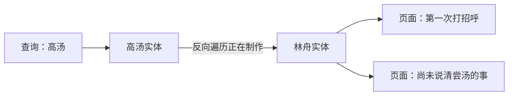
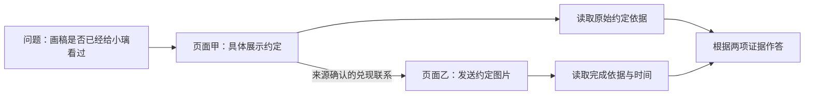

# 图记忆的用途、代价与去留

调研日期：2026-10-12。状态：暂存讨论稿，尚未修改正式设计和代码。

## 1. 判断

**当前的泛实体事实图缺少清楚的独立职责，已经出现无关记忆扩展。继续提高三元组抽取准确率，无法解决这个定位问题。**

研究支持图结构在跨材料关联、事实变化和复杂问题检索中的价值。但是，这些收益依赖完整的材料关联、查询筛选和时间处理。把文本拆成“人物—关系—物品”，再读取人物附近的全部记忆，不能获得同样的效果。

对本项目，我建议取消当前“尽量抽取人物关系和行动事实”的目标。值得继续讨论的应用只有一个：**把分散在不同记忆页中的同一件事连接起来，明确后续、兑现、撤回或纠正的依据。** 段和页继续保存经历及事实，关联只帮助找到回答当前问题所必需的其他证据。

这项用途仍需与普通页面索引、事项编号和页面更新比较。如果普通页面设计已经能完成同样的工作，应直接删除独立图记忆。已经完成 U07 和管理端绘图，均不能成为保留理由。

本轮完成论文与官方实现调研、当前代码核查及实际数据库只读检索检查。没有执行新的模型生成，没有修改数据库、提示词、业务代码、服务配置或正式方案。

## 2. 当前系统实际上在做什么

### 2.1 段、页、图和核心记忆分别是什么

| 内容 | 当前主要职责 | 容易混淆的地方 |
|---|---|---|
| 段及摘要 | 保留一段经历的语境、发言和发展 | 时间排列能说明先后，无法自行证明因果 |
| 长期记忆页 | 保存可独立读取的事实、经历、偏好、约定和待续事项 | 页面正文可以包含多人和多个物品，当前关联只保存一个明确主体 |
| 实体与实体关系 | 保存人物、地点、物品、事件及它们的关系，用于扩展页面候选 | 当前连接的是实体，没有直接表达两个记忆页之间的联系 |
| 核心记忆 | 从材料中选取少量常驻内容，放入角色上下文 | 它是派生文本；图检索返回的对象是长期记忆页，并不直接检索核心记忆 |
| 关系状态与关系描述 | 保存角色对某人的态度、数值及认识 | 图中的“认识”不能代替这些内容，也不证明对方的内心或态度 |

因此，“检索小槿，找到小槿关联的核心记忆”与当前实现存在差异：实际关联目标是 `memory_entry`（长期记忆页）。核心记忆由另一条认识刷新流程准备。

### 2.2 写入过程

当前 `memory_organize`（长期记忆整理）先执行 `graph_extract`，再执行 `page_compose`，随后共同提交。图谱输出可靠实体，页面选取一个主体，后端只按明确主体写入 `memory_entry_entities`（页面与实体关联）。

这种设计消除了凭正文包含名字就随意建立关联的问题，但也产生一个限制：一页记下“小槿答应小璃展示玻璃杯稿子”，可以只关联小璃，画稿本身没有页面关联。**主体归属与检索入口承担了不同任务，当前使用同一个字段表达两者。**

图谱和页面都是必需节点。图谱格式审核或提交失败，可以阻止这批长期页完成整理。图谱即使没有带来检索收益，仍然占用模型调用、候选预算和初始化等待时间。

实体关系还会按“起点、终点、关系类型”复用。例如，同一人物先后两次制作同一种汤，当前关系无法区分是哪一次制作。逐项来源能说明来自哪些材料，无法自行把多次行为拆成不同事件。

代码依据：

- [整理流程与约束](../../../server/docs/design/reflection/memory-organize.md)
- [页面主体与实体关系写入](../../../server/src/echo_commons/modules/memory/repositories/organization.py)
- [共同整理预算](../../../server/src/echo_commons/modules/reflection/budget.py)

### 2.3 检索过程

当前 `MemoryGraphSearch.expand`（图关联检索）大致执行以下操作：

1. 从查询包含的实体别名、直接命中页面的主体找到起点实体。
2. 最多选择三个起点，按置信度读取最多十六条相邻关系。
3. 从关系两端寻找邻居，遍历时允许两个方向。
4. 读取起点和邻居关联的长期页。
5. 将这些页面追加到全文检索结果之后，再按结果数量截取。

当前没有用查询主题筛选邻居页面，也没有按关系表达的时间范围筛选。实体起点按存储顺序限制数量；边的模型置信度参与排序，查询相关性没有参与这一步排序。模型认为一条边可信，并不说明它能回答当前问题。

`search_async`（异步检索）会先读取较大的候选集合；当前向量检索关闭时，直接截取前几个结果。全文结果足够时，图候选经常没有机会进入最终结果；全文结果较少时，无关邻居又容易被追加进来。

图关联依据目前主要是实体编号或边编号。自动准备对话记忆时，把结果转换成 `MemoryItem`（上下文记忆条目），没有保留 `association_basis`（关联依据）；模型得到页面正文，却没有得到完整的关联路径及其限制。工具搜索可以返回关联依据，但它仍不足以解释两页为什么共同支持一个结论。

代码依据：

- [图关联检索](../../server/src/echo_commons/modules/memory/repositories/graph_search.py)
- [全文、向量和图候选组合](../../../server/src/echo_commons/modules/memory/services/retrieval.py)
- [自动记忆准备](../../../server/src/echo_commons/modules/conversations/tasks/memory.py)
- [初始上下文中的检索](../../../server/src/echo_commons/modules/conversations/tasks/context.py)
- [记忆搜索工具](../../../server/src/echo_commons/modules/memory/tools/search.py)

## 3. 实际数据检查

### 3.1 方法与范围

以只读连接检查 `night-diner` 中小槿和小璃的当前数据，对每位角色执行九个查询，共十八组：小槿、小璃、林舟、高汤、玻璃杯、小璃想看什么、我答应小璃什么、林舟正在做什么、尝汤误会。

检查直接全文候选、图扩展候选、同步检索和异步检索的前五条结果。没有修改检索实现或关闭图分支来伪造对照；直接全文候选读取自实际搜索仓库。当前配置的向量检索关闭。这里只核查检索行为，没有生成对话回答或测量回答质量。

完整只读检查记录保存在 [inspection.json](../../server/data/verification/graph-memory-research/inspection.json)，检查脚本保存在 `server/data/verification/inspect_graph_memory_research.py`，均为本地验收资料。

### 3.2 页面关联并不完整

| 角色视角 | 实体 | 关系 | 其中“认识”关系 | 新生成长期页 | 与实体关联的长期页 |
|---|---:|---:|---:|---:|---:|
| 小槿 | 7 | 14 | 8 | 8 | 8 |
| 小璃 | 6 | 9 | 6 | 28 | 6 |

小槿视角中，小槿、玻璃杯稿子、高汤三个实体均没有直接关联页面。小璃关联两页，林舟关联两页，阿澈关联三页，尝汤误会关联一页。

小璃视角中，二十二页采用 `subject_kind=character`（当前角色为主体），没有建立实体关联；小璃实体本身和窗台上玻璃杯的画稿也没有直接关联页面。这些页面仍能通过普通检索读取。

因此，图里有一个物品，并不意味着这个物品能引出相关经历。与此同时，给一个人物关联过多页面，又会产生与当前问题无关的候选。两种问题可以同时存在。

### 3.3 高汤检索已经出现主题偏离

小槿查询“高汤”时，全文检索得到两条消息。图扩展再增加两页：

| 额外页面 | 图关联路径 | 与当前查询的关系 |
|---|---|---|
| 林舟第一次主动发消息、互相加油 | 高汤 ← 林舟正在制作高汤 → 林舟关联页 | 没有解释高汤，是无关扩展 |
| 林舟表示稍后解释尝汤的事情，但谈话被打断 | 同一路径 | 与汤的话题有关，但无法回答制作状态、配方或发生时间 |

两页都以 `works_on`（正在制作）的边编号作为扩展依据。高汤没有直接关联页，检索转而读取林舟名下的页面。

来源合法、人物身份正确，仍然不能证明查询相关。这是本次实际检索中已经出现的问题。

### 3.4 玻璃杯检索也增加了无关页面

小槿查询“玻璃杯”时，全文已经找到玻璃杯原始消息、展示画稿的约定页和相关段摘要。图扩展额外加入了“小璃说话冷淡，后来澄清自己只是话少”的页面。

原因是直接命中的约定页以小璃为主体，图检索又读取了小璃关联的另一页。共同人物没有提供对玻璃杯问题的额外帮助。

### 3.5 图的作用目前主要表现为候选增加

十八组异步检索中，十六组的前五条没有增加图独有结果。发生增加的两组正是小槿查询“高汤”和“玻璃杯”，分别增加两页和一页。

这组检查说明当前样本中的干扰风险，没有证明所有图检索都无用，也没有测量回答是否被这些页面误导。“没有新增结果”还可能来自全文结果先占满数量上限，不能据此评价所有图算法。

上轮 U07 验收覆盖了结构、身份、来源和界面，但缺少“是否找到了额外的必要证据”“是否增加无关材料”这两项验收。因此，U07 的检查通过不能证明图记忆具有产品价值。

## 4. 用户提出的例子怎样判断

### 4.1 “小槿认识小璃”和“小璃认识小槿”

从事实含义看，两个人互相认识与单方面知道某人可能有区别。例如，小槿知道一位作家，这位作家未必知道小槿。在需要表达这种不对称知识时，方向有意义。

当前系统把 `knows`（认识）用于普通聊天人物，并在检索中遍历两个方向。对同一对人物添加两条互相指向的边，通常不会增加可读取页面。它们会占用关系候选、模型输出和管理显示空间。

同时，小槿视角里的“小璃认识小槿”只能表达小槿根据可见经历知道的内容，不能读取小璃的私有认识。小璃对小槿的真实态度另有所属模块。

本项目没有明确提出单独查询“谁知道谁的存在”的需求。普通相识记录应保留在真实经历和关系认识中，不应成为默认的图扩展依据。

### 4.2 检索小璃会不会带出太多页面

会。人物名字只能确定讨论对象，无法确定要讨论的是画稿、天气、第一次见面还是某个约定。随着经历增加，一个人物会连接越来越多页面；“认识”还可能把候选扩展到更多人物。

有限数量可以限制输入长度，却无法保证相关性。当前图检索也没有用“小璃＋画稿＋约定”这类共同主题条件筛选页面。

只为按人物查找页面，普通页面的参与人物索引即可完成。这个职责可以保留，独立的实体事实图没有因此获得必要性。

### 4.3 “林舟正在制作高汤”是否应该成为长期记忆

一件短时行为可以成为长期保留的历史经历。例如：“那次聊天时，林舟说自己重新熬了一锅汤。”未来回忆当时发生了什么，它仍有用。

需要限制的是它表达的时间和用途：

- 回忆那次经历时，可以说“当时在制作”。
- 判断现在状态时，需要当前观察或有明确有效时间的记录。
- 询问制作结果时，需要后续完成、取消或失败的证据。

当前 `works_on` 的显示是“正在制作”，边只保存系统创建时间和失效标记，没有事实发生时间、有效区间和自动处理完成状态的流程。创建时间也可能是作者旧故事被整理的时间。未来把它当作当前状态使用会产生错误。

当前自动检索通常传递页面正文，未直接把这个三元组写入对话上下文，所以本轮确认的是错误扩展及管理显示含混。尚未确认角色已经据此说出“林舟现在还在熬汤”。两者应分别记录。

### 4.4 高汤没有关联页，这条边有什么用

目前它可以反向引出林舟关联的页面，实际已经引出了打招呼的经历。它也能用于管理展示。但这些用途没有证明它对回忆高汤有帮助。

即使给高汤补上关联页，若页面正文和索引已经能直接检索相关经历，仍需要说明额外图关系解决了什么。给实体补齐页面关联，只解决可达性，不会自行解决价值和相关性。

## 5. 研究与应用提供了什么证据

以下只采用论文、作者项目和官方文档。论文成绩来自各自的模型、数据和预算；它们提供设计依据，不代表本项目已经取得同样收益。

### 5.1 Microsoft GraphRAG：跨大量材料的整体问题

GraphRAG（使用图索引的检索增强生成）把文档中的实体和关系组织成图，再生成图中各组材料的摘要，用于“这些材料有哪些共同主题”等整体问题。论文讨论约百万 token（模型文本单位）的语料。官方局部检索也组合实体、关系和原文片段，并在固定上下文预算内排序筛选。[论文](https://arxiv.org/abs/2404.16130)、[官方局部检索](https://microsoft.github.io/graphrag/query/local_search/)。

**本项目判断：** 日常角色回复主要面对具体经历和眼前交流，没有引入图分组摘要的明确需求。现有段、连续摘要和核心记忆已经承担多个整理层次。照搬整体 GraphRAG 会增加整理开销与职责重复。可借鉴候选必须筛选和保留原文的做法。

这里论文中的 community 指图中的聚类分组，与项目里的玩家社群含义不同。

### 5.2 HippoRAG 2：借结构找到缺失的证据段落

HippoRAG 2（图辅助联想检索系统）指出，孤立实体匹配会丢失语境。它把原始段落加入图，查询关联三元组与段落，过滤候选后通过图传播给段落排序。消融实验中，三个多材料问题数据集的平均前五条段落召回从完整系统的 87.1 降至去掉段落节点后的 81.0。[方法与实验](https://arxiv.org/html/2502.14802v1)。

**本项目判断：** 这支持“结构用于找到额外必要证据”，无法支持“找到某个人以后读取全部相邻记忆”。静态公开知识问答也不同于角色不断变化的主观经历。段落、问题相关性和结果排序是收益条件；这些条件需要与普通全文、语义检索公平比较。

### 5.3 Zep／Graphiti：会变化的事实需要时间

Zep 的 Graphiti（时序知识图引擎）保存原始经历、实体、事实和来源，区分系统记录时间与事实有效时间，并处理相互矛盾的新旧事实。检索有混合搜索与结果重排。论文 LongMemEval 测试中，GPT-4o 从完整历史基线 60.2% 提升到 71.2%；比较对象是完整历史输入，没有单独证明图边优于同预算的段页检索。[论文](https://arxiv.org/html/2501.13956v1)、[官方实现](https://github.com/getzep/graphiti)。

**本项目判断：** 它正面说明了“正在制作”为什么需要时间解释，也说明了有效实现包含大量维护责任。若本项目只是回忆过去一件事，带时间的经历页就能承担职责。为几个暂时状态引入完整时序图，成本不合理。

### 5.4 A-Mem：记忆笔记之间建立联系

A-Mem（由智能体整理的记忆笔记系统）以笔记为主要单位，先找相近旧笔记，再让模型判断联系，并更新旧笔记的语境、关键词和标签。论文通过移除连接生成、记忆演化来分析贡献，也报告过多检索内容可能降低效果。其描述的读取主要按笔记向量排序，不能把整个系统成绩归因于图遍历。[方法与消融](https://arxiv.org/html/2502.12110v1)。

**本项目判断：** 记忆页作为节点更接近我们的需求。但“含义相似”由语义索引承担即可，泛化连接会重复这项职责。只借鉴跨页存在明确发展关系的部分；不采用模型自由重写旧经历的流程，以保留角色当时看到、相信和误解的内容。

### 5.5 LongMemEval：评估应包含更新、时间和拒绝猜测

LongMemEval（长期对话记忆评测）考查信息提取、跨会话推理、时间推理、知识更新和缺少证据时拒绝回答。它研究普通索引、检索和阅读设计，发现粒度、事实扩展索引和时间条件都能影响结果；也发现只用提取摘要或事实替代原始材料可能损失信息。[论文](https://arxiv.org/html/2410.10813v1)。

**本项目判断：** 验收应检查必要证据是否齐全、时间是否解释正确、是否凭关联猜测。三元组数量、图是否能显示、有没有搜索结果，都不能代替这些指标。可靠的普通检索必须作为比较对象。

### 5.6 SimpleMem：页面式记忆也能处理复杂检索

SimpleMem（紧凑的长期记忆系统）把交流整理为可独立理解的记忆单元，明确人物和时间，结合语义、关键词及结构化字段进行检索，并按查询复杂度决定范围。它还包含归并抽象流程；本报告不建议因此增加本项目的摘要层次。[论文方法](https://arxiv.org/html/2601.02553v1)。

**本项目判断：** 人物标签、时间字段和语义匹配可以直接服务现有页面。只用这些能力就能解决的问题，不应再交给独立图记忆。论文使用“无损压缩”的表述，也不能据此假定自动整理绝无信息损失。

## 6. 在段页系统上，哪些用途有独立空间

### 6.1 值得讨论：跨页连接同一件事的发展

段页检索能分别找到两段经历，但两个页面可能没有共同关键词，或只有相同人物这种宽泛线索。图结构可能保存“这段后续明确回应那次约定”的联系。

下面是**假设情景，当前数据库没有展示画稿成功的记录**：

1. 页面甲：小槿答应画完玻璃杯稿子后拍给小璃。
2. 页面乙：数日后，小槿发了一张图片，说“之前答应你的，这回终于弄好了”。
3. 来源语境明确这张图片兑现的就是页面甲中的约定。

如果询问“我是不是已经给她看过了”，仅找到页面甲会错误地认为约定仍未完成。乙没有“玻璃杯”字样，又有许多其他图片交流，普通关键词或相似内容检索可能漏掉它。

联系的价值在于找到这一条完成证据，排除其他图片交流；页面乙的正文仍然说明实际发生了什么。

类似用途可以是：

| 联系 | 独立作用 | 建立所需的依据 |
|---|---|---|
| 后续 | 找到同一事件稍后的进展 | 明确指向同一件事；共同人物或时间接近均不足以证明 |
| 兑现／撤回 | 找到某个具体约定的完成或取消 | 匹配具体约定及后续行动；不能只连接两个人物 |
| 纠正 | 找到后来对旧说法的明确修正 | 保留旧说法、新说明、来源及角色得知的时间 |

因果联系也可能有价值，但“之后发生”不能证明“因此发生”。只有来源明确说明原因时，才允许表达这种联系。角色自己的猜测仍应保留为猜测，不转化成图中的客观因果。

### 6.2 这项用途仍可能不需要独立图

如果约定页已有具体事项编号，后续只需记录完成状态和原始依据，同一个事项的普通查询就足够。若某页能自然补充后续并保留版本与来源，也能解决上述问题。

只有当多个可独立读取的页面需要同时保留，而且它们之间存在不能由页面字段、事项归属或普通检索充分表达的联系时，独立跨页关联才有额外价值。

因此，不能把“持续事项”功能再包装成图记忆，也不能给每两页添加“相关”关系来制造必要性。共用人物、地点、兴趣和一般语义相似均不应成为独立建边理由。

### 6.3 本项目不应赋予图的职责

| 用途 | 应属位置或处理方式 |
|---|---|
| 再保存一遍人物、爱好、住所和工作事实 | 长期页和页面索引 |
| 根据人物名字列出所有相关页 | 参与人物索引及查询筛选 |
| 保存角色对人的好感与关系描述 | 关系状态和认识刷新 |
| 表达此刻正在制作、当前地点和游戏状态 | 当前观察、状态或活动权威模块 |
| 把所有经历再生成整体主题摘要 | 现有摘要与核心记忆职责；没有新增整理层的需求 |
| 发现文本含义相似 | 语义检索 |
| 猜测隐含因果、传播其他角色秘密 | 没有可靠依据时不生成 |
| 依据经历总结游戏攻略或行为经验 | 需有独立产品需求和效果证据，本次不扩展 |

## 7. 若保留跨页关联，需要满足的设计条件

以下是讨论方向，尚未成为实施方案。

### 7.1 记录和写入

- 原始记录、段摘要及长期页继续是事实和经历的依据。联系只记录两端页面、联系类型及支持它的具体来源。
- 人物身份、参与对象和发生时间可作为页面索引；不再自动生成泛化“认识”和短时“正在制作”事实图。
- 连接针对具体事项，保留重复发生的不同事件。“林舟制作高汤”不能合并所有制作经历。
- 纠正保留原来的认识和后来得知的说明。收到新说法不会自动证明旧说法错误，也不会覆盖客观业务状态。
- 从新材料检索少量旧页作为联系候选，再检查是否有明确依据。禁止比较全部页面的所有组合，也不为每批材料强制生成关系。
- 页面生成不应依赖可选关联的生成成功。关联产物的生成、审核和保存仍属于现有记忆整理与反思职责，不增加独立业务模块。

### 7.2 读取和上下文

- 从具体问题及直接命中页出发，只读取对该问题有意义的联系。人物名字单独出现不能触发全邻居读取。
- 新证据进入候选后，与直接结果共同检查相关性、重复来源和输入预算。仅有“边存在”不够。
- 结果包含原页面正文、发生时间、角色获知范围和简短联系依据。模型有材料可读，也知道连接表达的限制。
- 纠正和兑现问题通常需要同时保留两端证据；不能只因新页面时间较晚就删除旧经历。
- 没有可靠联系时，使用正常页面检索，允许没有结果。图联系不能扩大角色可见范围。
- 游戏规则、活动结果和当前状态以所属业务模块为准。记忆联系只表达角色知道的经历。

这些条件会改变图的模型输出、写入对象、检索规则及管理展示。单纯调整关系中文标签或继续润色抽取提示词，无法实现这项定位。

## 8. 怎样决定保留还是删除

### 8.1 比较对象

使用同一批真实角色经历、同一模型、相同可见范围及上下文预算比较：

| 比较对象 | 目的 |
|---|---|
| 普通段页检索，加必要的人物、时间及事项索引 | 确定现有材料检索能做到什么 |
| 普通段页检索，加来源明确的少量跨页联系 | 单独衡量联系带来的额外必要证据和干扰 |

向量检索若接入，应同时提供给两者。不能让图版本独享语义检索、额外摘要、更强模型或更大输入预算，再把成绩归因于图。现有的泛实体图可作为诊断对象，但不应作为必须击败的唯一基线。

### 8.2 必须包含的验收问题

| 问题类型 | 要检查什么 |
|---|---|
| 单页就能回答的事实 | 关联没有增加无关页面或改变正确回答 |
| 约定与明确兑现 | 找齐具体约定和完成证据，区分相似的其他约定 |
| 旧说法与后来纠正 | 回答区分当时相信什么、后来得知什么 |
| 同一人物的多次相同行为 | 区分不同时间、对象和完成结果 |
| 只有人物重合的无关经历 | 搜索高汤不带回第一次打招呼 |
| 只有时间先后的两件事 | 不编造因果 |
| 不同角色知道的内容不同 | 私有内容和未获知的纠正不会传播 |
| 没有完成记录 | 不将新图片、新聊天或关联路径当作约定完成证据 |

既要检查模型回答，也要检查候选及最终上下文。模型偶然忽略无关页面，不代表检索已经正确。

验收记录必要证据是否完整、额外无关内容、事实和时间错误、错误因果、越过可见范围、模型调用、整理耗时及输入字符。少量样本应逐项列出材料和结果，不用一个综合分数掩盖副作用。

### 8.3 去留原则

**保留条件：** 在真实使用需要的跨页问题中，找到普通段页方案遗漏的必要证据，并改善回答；单页问题及上述失败情景没有新增错误和明显干扰；新增维护与运行成本可接受。

**删除条件：** 收益只是多返回几条、出现更多实体、画出更复杂的图；收益来自普通页面字段就能表达的信息；或新增联系持续制造错误归因、时间误读和初始化负担。

“无副作用”可以落实为这些可检查的验收要求。模型生成的联系无法承诺所有未来输入绝对零错误，因此必须限制其职责：不修改权威事实、不覆盖原经历、不扩展可见范围，也不强制参与每次检索。

目前没有进行这组跨页回答验证。根据现有证据，足以否定当前泛实体图的默认定位；尚不足以证明少量跨页联系值得长期维护。

## 9. 删除时保留什么

如果最终决定删除独立图记忆，应完整处理以下范围：

1. 从反思流程删除泛实体抽取及其必需依赖，页面整理独立获得必要人物信息和来源。
2. 删除运行中的图扩展检索、相关输出契约、候选预算和专用管理展示。
3. 按实际需要保留页面参与人物、事项和时间索引，不继续保存无人使用的泛化边。
4. 通过正式迁移处理派生图数据，保留原始作者材料、聊天、摘要、长期页、核心记忆、关系状态和来源依据。
5. 更新所属设计、接口、测试与状态文档，清理实际废弃实现。历史审核记录可以作为历史记录保留，无需维持旧图的执行入口。

U07 的正式主体识别、逐项来源、版本和写入校验中，有些直接服务长期页，应保留在记忆整理职责内。绘图依赖只在其他页面确有用途时保留。删除图能力无需撤销已经有效的页面来源改进。

## 10. 讨论结论

当前证据支持停止以三元组数量和抽取准确率推动图记忆。现有实体关系的可视化完成了，但它所服务的检索目标没有定义好，并且已出现无关扩展。

值得考虑的方向是来源明确的跨页事件发展联系。它应当只解决普通段页索引难以表达的证据关系；如果这种独立需要不存在，删除整块图记忆会让系统职责更清楚，也能减少初始化等待和上下文干扰。

下一项决策应围绕是否确有这种跨页需求展开。当前实体图已经完成的工作，不增加它被保留的理由。
