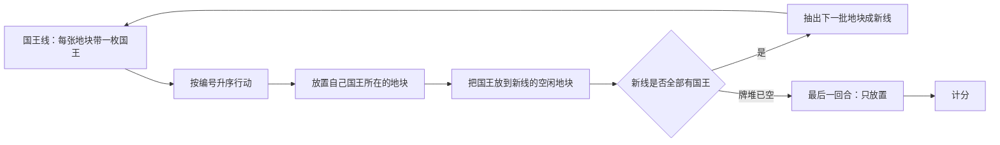

# Kingdomino 基础规则（Blue Orange 早期基础规则）

更新日期：2026-10-17。状态：规则已确定，尚未实现。本文是 `kingdomino` 玩法基础阶段的唯一规则文本；进阶事件卡规则另行确定。规则来源调查、阶段划分与分工见[并行开发计划](并行开发计划.md#2-规则来源调查)，对局标识、席位与动作契约定型见[游戏与角色活动接口](游戏与角色活动接口.md)。

## 1. 规则来源

- 唯一来源：Blue Orange 官方《Kingdomino》早期基础规则书，英文规则在 PDF 第 2–4 页，[规则书地址](https://blueorangegames.eu/wp-content/uploads/2017/04/KINGDOMINO_rules_ML.pdf)。
- 版本以该具体文件为准。官方后续版本（例如 2024 新版规则书）在人数准备与 3 人局余牌处理上与本版不同，本项目不混用；只在需要澄清本版表述时引用同一出版商的新版官方文本，并在文中标注。
- 附录可选规则（王朝、城堡居中、和谐、双人 7×7 决战）不属于基础规则，见第 10 节。

## 2. 对局标识与席位

| 项 | 值 |
|---|---|
| `game_type` | `kingdomino` |
| `ruleset_id` | `kingdomino.classic` |
| `ruleset_version` | 1 |
| 人数 | 2–4 人 |
| 席位 | `pink`、`yellow`、`green`、`blue`，即城堡与国王的四种颜色 |

- 每席：1 张起始地块（单格）+ 1 座同色城堡，城堡放在起始地块上。
- 2 人局每席取 2 枚同色国王；3、4 人局每席取 1 枚国王。
- 本局使用实际就坐的颜色席位（2–4 人，由参加者在加入时选定），未就坐颜色不参与本局（项目决定：来源只规定人数与国王数，未规定各人数使用哪几种颜色；服务允许自由选席，因此以实际就坐为准）。

## 3. 地块与地形

- 共 48 张地块，每张有两面：编号面（1–48）与地块面。
- 每张地块由 2 个正交相邻的格组成，两格分别记为 A 格与 B 格；每格一种地形，格上可有 0 枚、1 枚或多枚皇冠。
- 地形共 6 种：麦田、森林、湖泊、草原、沼泽、矿山。
- 具体 48 张地块的编号、A/B 两格地形与皇冠数是数据资源 `games/src/echo_games/kingdomino/tiles.json`。地形键沿用已交付素材命名：`field` 麦田、`forest` 森林、`lake` 湖泊、`meadow` 草原、`swamp` 沼泽、`mine` 矿山。
- 逐张清单取自用户提供的抽象地块清单图（4 列 × 12 行，共 48 张，每张两格；用颜色区分地形、用 X 的数量表示皇冠）。已与该游戏官方地块分布图核对：格级计数为麦田 26（含 5 个 1 冠）、森林 22（含 6 个 1 冠）、湖泊 18（含 6 个 1 冠）、草原 14（含 2 个 1 冠 + 2 个 2 冠）、沼泽 10（含 2 个 1 冠 + 2 个 2 冠）、矿山 6（含 1 个 1 冠 + 3 个 2 冠 + 1 个 3 冠），合计 96 格、格级皇冠 39，与逐张清单的统计完全一致。
- 编号 1–48 按该图从左到右、自上而下的阅读顺序编排，只要求在本实现内稳定（编号用于轮序），不代表实体印刷编号。

（项目决定：早期规则书英文正文对地形措辞不一致，出现 wheat fields、lakes、mountains、villages、forests、gardens；本规则采用同一出版商其他基础规则书固定的六类地形。规则文本与地块清单分别维护，清单来源与核对方式在实现时落实。）

## 4. 准备

- 洗牌：48 张地块洗匀，编号面朝外叠成牌堆。牌堆中的内容对玩家隐藏，只公开剩余数量。
- 人数与牌数：

| 人数 | 使用地块 | 排除 | 每席国王 |
|---|---|---|---|
| 2 人 | 24 张 | 随机排除 24 张 | 2 枚 |
| 3 人 | 36 张 | 随机排除 12 张 | 1 枚 |
| 4 人 | 48 张 | 不排除 | 1 枚 |

- 每名玩家把城堡放在自己的起始地块上，摆在面前。
- 抽出与「国王总数」相同数量的地块：2 人局 4 张、3 人局 3 张、4 人局 4 张。按编号升序排成一行，最小编号靠近盒子，然后翻到地块面。这一行称为第一回合的「国王线」。
- 仅第一回合的国王放置方式不同：一名玩家把全部国王握在手中随机逐一抽出，国王出现时，其主人把它放到国王线中任意一张尚无国王的地块上。每张地块最多一枚国王。3 人局 3 枚国王各占一张；4 人局最后一名玩家没有选择，必须放在剩余那张；2 人局每名玩家先后各放 2 枚。
- 国王线成形后，再抽同样数量（4 张 / 3 张 / 4 张）的地块，按编号升序排在国王线旁并翻到地块面，称为「新线」。此后棋盘上始终有国王线与新线两行。

（项目决定：来源写「从牌堆前端抽相同数量的地块并按升序摆放」，洗牌的排除方式与抽取顺序由注入随机源产生；第一回合的抽取顺序即国王放置顺序。）

## 5. 回合结构

一个回合等于处理完一条国王线。

- 行动顺序：按国王线中各国王所在地块的编号升序，编号最小者先行动。
- 每个国王的持有者依次执行两个动作：

| 动作 | 含义 |
|---|---|
| 放置（`PlaceDominoAction`） | 把该国王所在的那张地块按连接规则放入自己的王国；不能合法放置则弃置 |
| 选块（`ChooseDominoAction`） | 从新线中选一张尚无国王的地块，把该枚国王放到它上面 |

- 一个回合结束后国王线为空；把当前新线作为下一回合的国王线，再抽同样数量的地块作为新的新线。
- 2 人局每名玩家在一个回合内执行两次（两枚国王各一次），因此每人在同一回合可能出现两次行动。
- 回合数：3、4 人局 12 回合，2 人局 6 回合；每名玩家最终放置 12 张地块。
- 最后一回合牌堆已抽完、没有新线，玩家只执行放置动作（来源原文：最后一批地块排好后，每人再走最后一回合，只做放入动作）。

## 6. 连接与放置

- 目标：把地块拼成一个 5×5 的王国。
- 朝向：放置由「A 格坐标」与「B 格相对方向」表达，方向取 `right`、`down`、`left`、`up`；这四种覆盖地块的全部旋转（A、B 互换即 180 度旋转，已包含在内），不存在镜像摆放。
- 5×5 约束：整个王国（含起始地块）必须能放进一个 5×5 的方格内。本规则不固定 5×5 的具体位置：以起始地块所在格为原点，任一放置完成后，全部已占格的最小外接矩形宽和高都不得超过 5。
- 连接条件（满足其一即可）：
  - 与起始地块相连：起始地块视为万能地块，任意地形都可与它相接；或
  - 与已有地块相连，且相接处的两格中至少有一对地形相同。只算水平或垂直相接，不算斜向。
- 若能合法放置则必须放置：官方新版规则明确「只要地块能按规则放置就必须放」，2017 版未写；本项目采用必须放置，避免玩家借弃牌获利（项目决定）。
- 弃置：按连接条件或 5×5 约束都无法合法放置时，该地块被弃置，不占格也不得分。

（项目决定：5×5 约束的读法为「最小外接矩形不超过 5×5」，依据 2017 版「所有地块必须放进 5×5 网格」与官方新版「王国须包含在一个含起始地块的 5×5 方块内」。若把起始地块固定在 5×5 中心，可选规则「城堡居中」将永远成立，因此不采用固定的中心格。）

## 7. 结束与计分

- 全部地块用完并走完最后一回合后，每名玩家得到一个 5×5 王国（弃置过地块的王国可能不完整）。
- 领域：同一种地形、水平或垂直连通的若干格组成一个领域；同一地形可以有多个互不相连的领域。起始地块上的地形同样参与领域。
- 得分：每个领域的得分 = 该领域的格数 × 该领域上的皇冠总数。领域没有皇冠时得 0 分；一个领域上可以有多个皇冠。
- 玩家总分 = 自己各领域得分之和。
- 胜负：总分最高者获胜。平分时依次比较：单个领域的最大格数（不论有无皇冠）、皇冠总数；仍然平分则共同获胜。

（项目决定：来源英文写平分先比「最大的领域（格数最多）」，法文新版补充「不论该领域是否有皇冠」，本项目按补充后的读法执行。）

## 8. 阶段、机会与动作

| 阶段 | 内容 | 可用动作 |
|---|---|---|
| `seeding` | 第一回合按随机抽取顺序放置国王 | `PlaceInitialKingAction { domino_id }` |
| `placing` | 当前机会持有者放置自己国王所在地块 | `PlaceDominoAction { cell_x, cell_y, direction }` |
| `choosing` | 当前机会持有者在新线放置国王 | `ChooseDominoAction { domino_id }` |
| `finished` | 计分完成 | 无 |

- 每个机会属于国王线中某一枚国王的持有者；同一玩家有多枚国王时按编号升序依次处理。
- `PlaceDominoAction` 的 `cell_x`、`cell_y` 是以起始地块为原点的整数格坐标，指向地块 A 格；`direction` 取值 `right`、`down`、`left`、`up`，指向 B 格。
- `domino_id` 为地块编号 1–48。
- 阶段与动作视为初步约定，随实现细化；规则语义以上文各节为准。

## 9. 观察与随机

- 基础模式信息全公开：国王线、新线、各家王国、牌堆剩余数量。
- 牌堆中尚未翻出的地块内容不公开，只公开数量（项目决定：来源只要求已翻出的两行可见）。
- 随机点：洗牌与排除、第一回合的国王抽取顺序。均由游戏注入的随机源产生并随状态保存，保证重复请求与重启恢复后一致。

## 10. 不启用的可选规则

| 可选规则 | 内容 | 基础阶段处理 |
|---|---|---|
| 王朝 Dynasty | 连玩 3 局累计总分 | 不启用 |
| 城堡居中 The middle Kingdom | 城堡位于王国中心加 10 分 | 不启用 |
| 和谐 Harmony | 王国完整（无弃置）加 5 分 | 不启用 |
| 双人决战 The Mighty Duel | 2 人局用全部地块拼 7×7 | 不启用 |

来源把这些规则列为可自由组合的可选内容；基础阶段只实现主规则，不注册这些规则的标识或版本。

## 11. 项目决定汇总

| 条目 | 决定 | 依据 |
|---|---|---|
| 地形种类 | 固定六类地形 | 来源英文措辞不一致，采用同一出版商其他基础规则书的口径 |
| 地块清单 | 逐张清单取自用户提供的抽象地块图，已与官方分布图的格级计数核对一致 | 官方分布图只给格级计数、不区分逐张组合；编号顺序为本实现约定 |
| 席位颜色分配 | 本局使用实际就坐的席位 | 来源未规定各人数用哪几种颜色；服务允许自由选席 |
| 洗牌与排除 | 洗牌得到随机顺序，按人数排除前 24 / 12 张 | 来源写「随机排除」，未给具体做法 |
| 5×5 约束 | 以起始地块为原点，最小外接矩形不超过 5×5 | 2017 版与官方新版的表述 |
| 朝向表达 | A 格坐标 + B 格方向，四种旋转，无镜像 | 地块两格不等价，需要完整表达旋转 |
| 必须放置 | 只要能合法放置就必须放 | 官方新版明确，避免弃牌获利 |
| 平分补充 | 先比单个领域格数、再比皇冠总数、最后共同获胜 | 来源英文与新版法文一致 |
| 牌堆可见性 | 只公开剩余数量，不公开内容 | 来源只要求已翻出行可见 |
