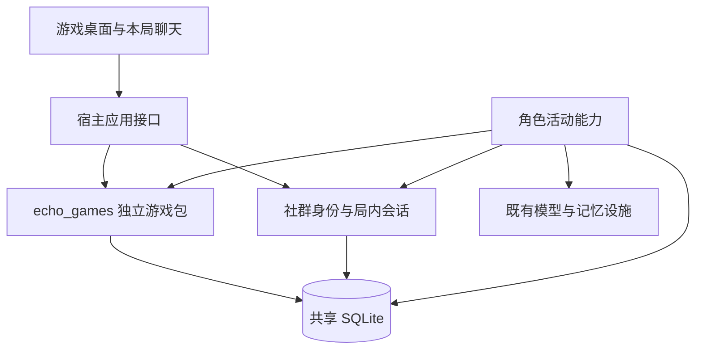

# 小游戏实现设计入口

更新日期：2026-10-17。状态：独立游戏包、真人五子棋、局内会话、实时同步、角色邀请与撤回、角色观察读取已实现。游戏包使用方法见[游戏包说明](../../games/README.md)，接口见[游戏参考](../../server/docs/reference/game-api.md)，业务入口见[共同基础交接](../archive/gameplay/共同基础交接.md)，页面验证见[前端状态](../../frontend/docs/status.md)。本文描述完整目标结构，角色自动行动、接话与游戏记忆消费仍待实现。

## 1. 运行结构

仓库顶层的 `games/` 提供独立 Python 包 `echo_games`，负责游戏规则、状态、席位、合法动作、回执、事件、结算与保存。现有 `server/` 加载游戏包，继续从原启动入口运行，共用一个进程、端口和 SQLite 数据库。

React 前端负责游戏桌面、操作输入、展示和动画。角色的 Activity（活动能力）位于社群后端，使用所属社群的身份、聊天、人格与记忆，通过游戏公开接口参与。

各模块只修改自己负责的数据。游戏包不导入社群实现，前端与角色使用同一游戏业务校验。

## 2. 设计文档分工

| 需要了解的问题 | 权威文档 |
|---|---|
| 规则来源、玩法阶段、工作树与联合验收 | [并行开发计划](../archive/gameplay/并行开发计划.md) |
| 文件路径、依赖安装、迁移、启动和共同阶段 | [共同基础与文件结构](共同基础与文件结构.md) |
| 游戏目录、对局生命周期、角色加入、内部职责与进行中五项能力 | [游戏与角色活动接口契约](游戏与角色活动接口.md) |
| 三类会话、联合决策、调用成本、恢复与记忆来源 | [角色活动能力、局内会话与游戏经历](../../server/docs/design/activity-integration.md) |
| 玩家体验与美术需求 | [产品策划](策划.md)、[素材需求](../archive/gameplay/美术.md) |

## 3. 一次角色操作经过什么

1. 从真实游戏接口取得本角色可见局势与合法操作，合并符合条件的本局接话来源。
2. 保存调用策略与实际输入；自动分支直接形成唯一合法动作，模型分支一次返回动作和可选发言。
3. 在短事务中检查任务资格，通过游戏服务执行动作，通过会话服务保存获准配套发言，再保存任务结果。
4. 提交后共用既有实时通知设施更新前端。正式事件与消息保留真实来源，角色记忆按资格读取。

局内行动决策和纯回应使用明确的输出类型。游戏只接收动作；会话只保存正式消息；角色活动模块协调它们之间的依赖。具体失败条件与抽样规则由角色活动设计统一维护。

## 4. 扩展方式

首个完整实现为五子棋。新游戏通过明确注册的规则定义接入公共运行服务，并在前端登记实际实现的场景。游戏自己的状态、动作、坐标、计分和扩展内容放在所属目录。

飞行棋道具与 Kingdomino 事件卡沿用所属游戏的基础状态与保存能力，按确定规则新增类型和处理函数。新规则不要求角色模块复制判定，也不需要提前建立脚本引擎或动态插件安装系统。
