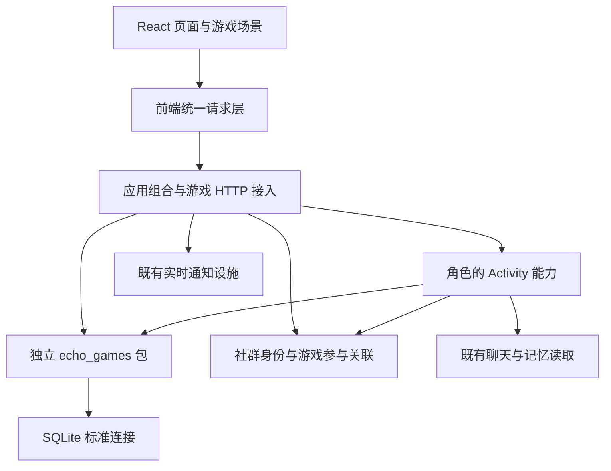

# 共同基础与文件结构

更新日期：2026-10-16。状态：独立游戏包、五子棋内部业务、真人对局参与、局内会话、游戏 HTTP、实时通知、迁移 23 与真人页面已实现；角色参与仍待接入。页面验证范围见[前端状态](../../frontend/docs/status.md)，具体完成记录见[游戏开发计划](../05-gameplay-foundation-implementation-plan.md)。下文定义共同阶段完整结构。

本文件负责共同开发阶段、文件职责、依赖关系和验收。游戏目录、生命周期、内部职责及角色参与统一见[接口契约](游戏与角色活动接口.md)，规则阶段及两条开发线见[并行开发计划](并行开发计划.md)。

## 1. 建立共同基础

先完成模块边界、公开类型、正式安装、真实数据库操作与前后端的一段完整调用，再让两个工作树分别推进。共同阶段在现有 `feat/gameplay` 中完成，验证并形成共同提交后，从该提交建立 `feat/activity`。

共同基础采用五子棋，完成真实的“创建对局 → 读取观察与机会 → 轮流落子 → 保存回执与事件 → 前端同步 → 胜负或和局结算”。具体自由规则由[开发计划](并行开发计划.md)维护，公共阶段验收完整真人对局。

五子棋规则与真人完整流程通过验收后可以作为可用入口。飞行棋与 Kingdomino 尚未实现时保持真实不可用状态。验证通过正式 API 创建对局，再使用实际页面和业务组件操作，不依赖预制成功结果。

飞行棋与 Kingdomino 的状态与动作需求在设计时共同核对，完整实现由游戏开发线完成。角色的模型决策与持久行动任务由 Activity 开发线完成，首先接入五子棋；共同阶段接通真实身份、席位、会话关联以及游戏读取能力。

不创建没有实现的规则类、测试专用游戏或假后端；未完成的任务处理器不注册到运行调度器。目录规划中列出的后续文件，在开始对应实现时创建。

## 2. 概念与依赖方向

社群维护真人与角色资格及对局关联，游戏维护实际席位占用与参与区间。Activity 是角色的一项能力，复用社群的聊天和记忆；游戏负责自己的运行与权威状态。



- `echo_games` 的依赖限于自己声明的标准库与第三方库，不导入 `echo_commons`。
- 游戏 HTTP 接入、角色 Activity 能力可以使用游戏的公开接口，不能越过游戏服务直接修改游戏表。
- 社群侧只保存对局所属社群及局内会话关联；游戏独立维护主体与席位占用、参与区间、棋盘、轮序和生命周期。
- 前端通过正式接口取得数据。场景组件接收数据与操作回调，不直接请求模型或读取数据库。
- 同一应用继续使用一个后端进程、一个端口与一个 SQLite 文件；角色与聊天继续使用既有设施。

## 3. 独立游戏包

仓库顶层增加 `games/`，Python 包名为 `echo_games`。游戏包的构建、数据文件与测试可以独立检查；宿主应用负责正式运行时的组装。

以下路径均相对仓库根目录。表内“共同阶段”表示这一阶段应创建有实际用途的实现。

| 路径 | 职责 | 创建阶段 |
|---|---|---|
| `games/pyproject.toml` | 声明游戏包、Pydantic 依赖及构建资源 | 共同阶段 |
| `games/src/echo_games/public.py` | 导出供 HTTP 与 Activity 使用的正式类型、服务和规则注册接口 | 共同阶段 |
| `games/src/echo_games/contracts.py` | 主体与参与查询、生命周期命令、观察、机会、动作、两类回执及事件分页契约 | 共同阶段 |
| `games/src/echo_games/domain.py` | 对局状态、创建者、席位占用、主体引用、参与区间与版本等业务对象 | 共同阶段 |
| `games/src/echo_games/registry.py` | 游戏定义、玩法目录与元数据、按类型和规则版本解析的显式注册表 | 共同阶段 |
| `games/src/echo_games/composition.py` | 显式组装已实现玩法，公共注册表不导入具体规则 | 已实现 |
| `games/src/echo_games/service.py` | 生命周期与五项业务接口，控制规则执行顺序，使用调用者提供的事务连接 | 共同阶段 |
| `games/src/echo_games/repository.py` | SQLite 对局、占用与参与历史、机会、动作及生命周期回执、事件读写 | 共同阶段 |
| `games/src/echo_games/errors.py` | 游戏自己的明确错误，交给宿主转换为 HTTP 或任务结果 | 共同阶段 |
| `games/src/echo_games/maintenance.py` | 所属游戏记录的范围化统计与删除，供正式测试数据清理入口调用 | 已实现 |
| `games/src/echo_games/schema.py` | 提供游戏表 SQL 资源与指定变更的执行函数，不自行提交调用者事务 | 共同阶段 |
| `games/src/echo_games/sql/` | 游戏表的正式新增与变更 SQL 资源 | 共同阶段及后续真实变更 |
| `games/src/echo_games/gomoku/models.py` | 五子棋棋盘、落子动作、观察和结果类型 | 共同阶段 |
| `games/src/echo_games/gomoku/contracts.py` | 将公共泛型具体化为五子棋类型，登记请求、状态、视图、回执与事件模型 | 已实现 |
| `games/src/echo_games/gomoku/rules.py` | 空位检查、轮流落子、连线胜利和和局 | 共同阶段 |
| `games/src/echo_games/aeroplane/models.py` | 飞行棋状态、动作、观察与结果类型 | 游戏开发线 |
| `games/src/echo_games/aeroplane/rules.py` | 飞行棋初始化、合法动作与规则执行 | 游戏开发线 |
| `games/src/echo_games/aeroplane/board.py` | 路径和格子身份等游戏规则坐标，不保存像素位置 | 游戏开发线 |
| `games/src/echo_games/kingdomino/models.py` | Kingdomino 状态、阶段、动作与观察类型 | 游戏开发线 |
| `games/src/echo_games/kingdomino/rules.py` | 地块选择、放置与行动顺序 | 游戏开发线 |
| `games/src/echo_games/kingdomino/scoring.py` | 地形区域、皇冠及平分计算 | 游戏开发线 |
| `games/src/echo_games/kingdomino/tiles.json` | 有规则来源的完整基础地块数据，使用标准 JSON 解析 | 游戏开发线 |
| `games/tests/` | 不依赖社群、模型和 HTTP 的真实规则与存储测试 | 共同阶段及所属游戏开发 |

`public.py` 只提供明确导出，不重复包装每个服务。`service.py` 接收数据库连接、访问上下文和有类型命令，调用规则与存储；模型和网络不进入这个方法。

游戏注册使用显式代码，首先注册完整实现的五子棋，后续注册实际完成的飞行棋与 Kingdomino。每局保存 game_type、ruleset_id 和 ruleset_version，通过注册表取得原规则实现；大厅目录从同一注册表读取实际可用玩法，不另存可用清单。规则定义至少提供初始化、参与者观察、合法操作、动作执行和终局结果，使用组合与 `Protocol`。不增加动态扫描、脚本引擎、插件安装系统或通用规则语言。

规则坐标与前端像素坐标分别维护：游戏提供稳定格子编号或网格坐标；前端决定它们在棋盘上画在哪里。视觉尺寸变化不修改玩法规则。

公共对局为 `Game[ConfigT, StateT]`；观察、动作、动作结果、终局结果和事件同样分别参数化。具体模型组合由所属玩法的 `GameModels` 指定，存储读取已保存的类型与规则编号后，使用该组合恢复记录。规则通过 `outcome` 提供终局结果，公共服务不访问玩法专属局势字段。实际使用说明见 [游戏包模型](../../games/README.md#公共模型与具体玩法)。

### 3.1 基础与进阶如何放置

共同模型记录 `ruleset_id` 与 `ruleset_version`，每局开始后固定。五子棋与后续游戏的状态与动作分别使用明确类型；公共层不写入 15×15 棋盘或五连判断。

进阶实现放在所属游戏下：飞行棋的道具类型、效果和库存属于 `aeroplane`；Kingdomino 的事件卡、获取与使用属于 `kingdomino`。具体文件随完整规则确定，公共层不提前创建空的 `effects/`、`cards/` 或任意脚本执行接口。

基础与进阶复用同一游戏的路径、地块、计分与保存能力。新增动作由明确类型表达，不把游戏专属字段不断塞进共同对象，也不复制整套游戏服务。

## 4. 宿主参与协调与社群关联

游戏保存 `participant_ref`、`seat_id`、`participation_id` 及其参与历史。社群模块检查主体在社群中的资格，仅保存 `community_id`、`game_id` 和局内 `conversation_id` 的关联。会话模块独立保存成员区间和消息受众。完整身份与生命周期规则由[生命周期契约](游戏与角色活动接口.md#3-对局生命周期与参与)维护。

| 路径 | 职责 | 创建阶段 |
|---|---|---|
| `server/src/echo_commons/modules/communities/game_participation.py` | 检查社群资格，转换 ActorRef 与 participant_ref，通过游戏和会话服务协调创建、加入、离开、开始和结束 | 共同阶段 |
| `server/src/echo_commons/modules/communities/game_participation_repository.py` | 只保存对局、社群、局内会话及宿主操作结果关联，不保存另一份席位占用 | 共同阶段 |
| `server/src/echo_commons/modules/communities/game_query.py` | 社群范围内的房间查询、本人参与读取、操作资格与历史游标 | 已实现 |
| `server/src/echo_commons/modules/communities/contracts.py` | 提供社群资格、身份转换和对局关联读取协议，Activity 结合游戏公开参与查询使用 | 共同阶段 |

共同阶段正式增加 `game` 会话类型，通过会话服务建立本局成员和历史读取范围。创建、加入、等待时离开、结束活动在共享 SQLite 的一个短事务中完成所属游戏变化、会话成员变化和宿主关联；失败一起回滚。

现有会话创建与成员方法内部取得事务，实施时提取接收调用者连接的实际业务方法，供原入口和游戏参与协调共同使用。原群聊与私聊继续通过所属服务检查，不从接入层直接写入会话表，不创建待绑定状态或另一个恢复框架。

开始前检查当前占用与会话成员一致，开始后固定名单。等待时离开与重新加入保留实际参与区间；进行中使用所属游戏支持的认输或退出。普通会话成员入口拒绝直接修改本局名单，局内新消息按类型进入局内协调。

创建者与操作资格、请求重复检查、取消和结束的区别以生命周期契约为准。Activity 不维护房间或名单副本，只有已实现的真实任务处理器才注册到后台执行设施。

## 5. 宿主应用的游戏接入

游戏包不依赖 FastAPI。HTTP 请求、社群身份转换与通知投影集中在宿主应用中，游戏包通过普通 Python 方法提供业务能力。

游戏查询只接受有类型的读取位置与数量，例如 `after_sequence` 和 `limit`。HTTP 游标的编码、解析及玩家范围校验复用宿主已有工具，由接入层完成；游戏包不为分页反向导入 `echo_commons.shared`。

| 路径 | 职责 | 创建阶段 |
|---|---|---|
| `server/src/echo_commons/app/games/routes.py` | 游戏 HTTP 路由，取得连接与访问上下文后调用游戏服务 | 共同阶段 |
| `server/src/echo_commons/app/games/schemas.py` | HTTP 特有字段，如 `player_id`；复用游戏状态与动作类型 | 共同阶段 |
| `server/src/echo_commons/app/games/access.py` | 验证请求身份，经宿主转换引用并查询游戏实际参与区间，生成 `SeatAccess` | 共同阶段 |
| `server/src/echo_commons/app/games/composition.py` | 构造游戏服务、实际规则注册和通知接入，返回供主应用使用的实例 | 共同阶段 |
| `server/src/echo_commons/app/games/events.py` | 将游戏提交后的通知引用投影为当前玩家可见的 SSE 数据 | 共同阶段 |
| `server/src/echo_commons/app/games/management.py`、`modules/communities/game_management.py` | 游戏会话范围的只读诊断接口与宿主结果组合，游戏记录通过游戏包公开方法读取 | 共同阶段 |
| `server/tests/infrastructure/test_games_http.py` | 真实应用与数据库的游戏接口验证 | 共同阶段 |
| `server/tests/infrastructure/test_game_realtime.py` | 游戏通知的真实 HTTP/SSE、重启、过期和事务回滚验证 | 已实现 |
| `server/tests/infrastructure/test_game_participation.py` | 社群、角色、席位与会话关联的真实验证 | 共同阶段 |

API 只负责协议与转换。新增的 `app/games` 不能承载移动、计分、角色决策或社群业务规则。

现有 `app/main.py` 只增加路由注册，`app/composition.py` 只调用游戏组装函数并保存必要实例；`app/event_projection.py`、`app/event_schemas.py` 与共同事件类型增加游戏通知支持。既有聊天、反思和人物创作的组装代码保持原职责，不借此搬迁整个后端。

### 5.1 包安装与运行入口

在 `server/pyproject.toml` 中声明 `echo-games` 依赖，并通过本地路径源指向 `../games`，开发时使用可编辑安装。继续从现有 `server/` 命令启动整个后端，不增加新的常驻服务。

`games/` 位于仓库根目录，与 `server/`、`frontend/` 同级。`server/` 负责启动和组装应用；游戏代码作为已安装的 Python 包导入。包所在目录不需要嵌套在启动目录内。

在现有 `[project].dependencies` 列表中加入 `echo-games`，并新增以下来源配置；不要替换其他已有依赖：

```toml
[tool.uv.sources]
echo-games = { path = "../games", editable = true }
```

这一方式由 [uv 本地路径依赖](https://docs.astral.sh/uv/concepts/projects/dependencies/#path)正式支持。`../games` 相对该项目配置解析，每个工作树引用自己同级的游戏包；可编辑安装使源代码修改直接用于下一次运行。

配置完成后，在该工作树的 `server/` 下继续执行 `uv sync` 和 `uv run echo-commons serve`。保留当前工作目录，还能继续使用现有 `config/settings.toml` 默认路径。

源码部署需要包含同级的 `games/`；发布安装包时同时构建并安装游戏包和宿主包。新增本地依赖后，原先只安装单个宿主 wheel（Python 安装包）的验证流程需要同步更新，不为方便打包把游戏源码复制进宿主。

两条开发线使用同一份正式安装配置与锁定文件。共同阶段验证全新环境安装、游戏包导入、宿主启动以及构建包是否包含 SQL 与地块资源；不通过修改 `sys.path` 解决包发现问题。

当前不把仓库整体改成新的构建工作区。共同阶段由一个维护者修改包配置和锁定文件，避免两条线各自组织依赖安装。

### 5.2 数据库迁移

保持现有 `infrastructure/database/migrations.py` 作为唯一正式迁移入口，使用现有迁移记录和事务规则。不要修改已经投入使用的历史 SQL。

游戏包维护游戏表 SQL 与执行函数；宿主按新增全局迁移版本明确调用对应变更，并在同一迁移事务创建社群参与关联表。调用后统一检查外键并记录版本，不复制游戏 DDL 到宿主，不引入第二套迁移框架。

游戏包的独立空库测试直接执行其正式建表资源；正式应用升级仍由宿主执行和记录。游戏自己的表不引用社群表；社群关联只引用实际游戏；实际席位占用和参与区间保存在游戏表内。迁移编号在共同阶段根据当时仓库分配，后续两条线分别申请新编号。

### 5.3 事务与通知

公共游戏操作方法接收标准 `sqlite3.Connection`。真人 HTTP 入口取得写事务后调用；角色 Activity 提交入口在同一事务复核任务租约、调用游戏、通过会话服务保存获准配套发言，再更新角色任务。

游戏服务提供通用的通知登记接口，宿主实现它并复用现有 `TransactionConnection` 与提交后唤醒机制。游戏包不导入宿主事件类，也不自行启动 SSE。

游戏状态、回执、正式游戏事件与通知引用一起提交。模型调用、浏览器动画和网络发送均不持有这次写事务。现有数据库连接与通知机制继续使用，不建立第二套连接池或后台通知服务。

## 6. 角色 Activity 能力

在现有 `server/src/echo_commons/modules/activities/` 下实现角色的活动能力。该模块不拥有游戏 HTTP 路由、棋盘表或另一份对局生命周期。

| 路径 | 职责 | 创建阶段 |
|---|---|---|
| `modules/activities/contracts.py` | 角色活动输入、GameTurnProposal、GameReplyProposal 与正式结果；复用游戏公开类型 | 共同阶段仅创建已用的读取契约；其余由 Activity 开发线实现 |
| `modules/activities/observation.py` | 将真实游戏视图转换为角色观察，关联可见聊天与记忆来源 | 共同阶段接通真实游戏读取；完整上下文由 Activity 开发线实现 |
| `modules/activities/repositories/tasks.py` | 局内决策任务、来源消费、执行方式、冻结输入、租约及完成结果 | Activity 开发线 |
| `modules/activities/tasks/coordinator.py` | 合并同一角色本局内的接话与行动来源，维护输入截止和执行后的待处理来源 | Activity 开发线 |
| `modules/activities/tasks/policy.py` | 按合法选择数量决定执行方式，保存抽样及模式调整原因 | Activity 开发线 |
| `modules/activities/tasks/queue.py` | 发现和领取真实局内决策任务，复核同一角色本局的执行资格 | Activity 开发线 |
| `modules/activities/tasks/context.py` | 保存游戏、聊天和记忆的真实冻结输入 | Activity 开发线 |
| `modules/activities/tasks/prompt.py` | 将正式输入投影为模型材料与允许动作 | Activity 开发线 |
| `modules/activities/tasks/handler.py` | 调用既有模型执行设施并处理动作提议 | Activity 开发线 |
| `modules/activities/tasks/commit.py` | 检查租约与资格，通过游戏与会话服务保存动作、获准发言和任务结果 | Activity 开发线 |
| `modules/activities/tasks/recovery.py` | 原任务、原输入的恢复和旧执行者拒绝 | Activity 开发线 |

表中 `modules/` 均相对 `server/src/echo_commons/`。队列、模型额度、租约、心跳和恢复策略继续复用现有 `execution`，不为 Activity 建立第二个调度器。

Activity 通过注入的社群资格、身份转换、对局关联读取协议与游戏公开参与查询工作，不依赖 `app/games` 的 HTTP 实现。共同阶段不注册没有真实处理逻辑的 Worker（后台执行器）；实现和测试通过后再接入现有 Supervisor（后台工作管理器）。

同一角色在本局内的接话与行动统一协调，冻结前可合并，执行期间新来源排队。局内玩家消息只建立 ActivityTask，不重复建立普通 ConversationTask；复用群聊候选选择、接话额度和参与结果推进。详细规则由[角色活动设计](../../server/docs/design/activity-integration.md)维护。

现有 `InvocationPurpose` 仅包含聊天与反思，Activity 开发线增加局内决策用途，在既有 `OutputRegistry` 分别注册行动与纯回应提议。一次模型决策同时完成动作选择、发言判定和正文；自动分支不调用模型。提示和提议处理属于 Activity，游戏只取得动作字段。

当前 `CapabilityResolver` 处理获准的只读工具。活动行动通过专用任务输出提议并由提交服务执行，不把游戏写操作塞进这份只读工具清单。活动能力是否启用与人物既有能力声明如何关联，需要在此开发线的正式契约中明确。

Activity 开发线同时修改会话提交入口，正式支持 ActivityTask 作为角色消息来源；动作与配套发言按共同事务规则执行，不伪造 ConversationTask。复用现有 `modules/memory` 和反思模块的来源读取、资格、精确覆盖与消费者，接入正式游戏事件及真实私人材料。任务快照保存实际紧凑视图，长期记忆引用原始事实，不复制整局棋谱。

对应真实检查放在现有 `server/tests/` 的活动、会话和记忆测试目录中，覆盖两类触发、四条执行路径、来源合并、抽样恢复、行动与发言依赖、真实事件来源。需要模型的路径使用正式供应商。

## 7. 前端文件结构

继续遵守现有 `src/api/` 统一请求与 `src/scenes/` 集中场景展示的约定。当前聊天页面与游戏页面复用用户布局及社群 SSE 连接。游戏桌面读取本局 `game` 会话，展示固定成员、回应进度与赛后交流；明确结束活动后保留只读历史。

| 路径 | 职责 | 创建阶段 |
|---|---|---|
| `frontend/src/api/games.ts` | 游戏类型目录、房间筛选、创建、参与管理及进行中五项能力的统一请求与查询 | 共同阶段 |
| `frontend/src/api/queryKeys.ts` | 增加包含玩家、社群与对局范围的游戏查询键 | 共同阶段 |
| `frontend/src/api/schema.d.ts` | 从正式 OpenAPI 生成游戏类型 | 共同阶段及实际接口变更 |
| `frontend/src/api/realtime.tsx` | 接入游戏通知、游戏查询初次同步及恢复 | 共同阶段 |
| `frontend/src/app/pages/GamePage.tsx` | 游戏详情路由页面，取得身份与 `game_id` | 共同阶段 |
| `frontend/src/app/pages/GamesPage.tsx` | 展示真实游戏目录与游戏卡片，进入所选游戏的对局列表 | 共同阶段接入真实五子棋目录，后续按注册结果展示 |
| `frontend/src/app/pages/GameRoomsPage.tsx` | 按所选 game_type 查询本社群对局，筛选、创建与进入实际对局 | 共同阶段 |
| `frontend/src/features/games/GameSession.tsx` | 读取正式状态、提交动作、恢复、连接棋盘与聊天侧栏 | 共同阶段 |
| `frontend/src/features/games/pendingOperation.ts`、`operations.ts` | 保存完整原请求、确认回执、刷新恢复与生成有类型的操作 | 共同阶段 |
| `frontend/src/features/games/GameControls.tsx`、`OperationNotice.tsx` | 依据正式资格显示操作、后果确认和待确认结果 | 共同阶段 |
| `frontend/src/features/games/GameRulesDialog.tsx` | 标题旁问号与当前玩法、离开、取消及结束说明弹窗 | 共同阶段 |
| `frontend/src/admin/pages/AdminGamePanel.tsx` | 游戏会话详情中的完整局势、参与区间、事件与回执分页诊断 | 共同阶段 |
| `frontend/src/features/games/sceneRegistry.ts` | 登记已实现游戏的场景、图形、说明、规则和有类型的创建参数 | 共同阶段注册五子棋，后续登记其他游戏 |
| `frontend/src/features/games/interaction.ts` | 选中、旋转、落点预览和提交等本地交互，不保存权威棋局 | 游戏开发线 |
| `frontend/src/features/chat/ConversationPanel.tsx` | 从现有聊天页面提取可复用的消息、输入与回应状态展示 | 共同阶段 |
| `frontend/src/scenes/games/gomoku/Board.tsx` | 五子棋网格、棋子、合法落点和结束结果展示 | 共同阶段 |
| `frontend/src/scenes/games/gomoku/presentation.tsx` | 五子棋目录图形、说明、规则与具体创建参数 | 共同阶段 |
| `frontend/src/scenes/games/aeroplane/Board.tsx` | 飞行棋棋盘与格子坐标到屏幕位置的展示 | 游戏开发线 |
| `frontend/src/scenes/games/aeroplane/Plane.tsx` | 飞机显示、选中与移动动画 | 游戏开发线 |
| `frontend/src/scenes/games/aeroplane/Dice.tsx` | 掷骰输入与后端结果的动画 | 游戏开发线 |
| `frontend/src/scenes/games/kingdomino/Board.tsx` | 王国网格、合法位置提示与放置预览 | 游戏开发线 |
| `frontend/src/scenes/games/kingdomino/Tile.tsx` | 地块、地形、皇冠与旋转 | 游戏开发线 |
| `frontend/src/scenes/games/kingdomino/DraftRow.tsx` | 公共地块选择和当前占领情况 | 游戏开发线 |
| `frontend/public/assets/games/activity/` | 公共、飞行棋、Kingdomino 素材，保持一份路径清单 | 共同阶段整理已有素材，游戏开发线补充 |
| `frontend/e2e/game-foundation.spec.ts` | 通过真实后端执行共同阶段已支持流程 | 共同阶段 |

请求与生成类型只通过 `src/api/` 暴露。场景收到有类型的视图、合法操作和 `onAction` 回调，发出动作意图；`GameSession` 负责真正提交并更新查询。前端组件不复制后端规则算法。

提取 `ConversationPanel` 时保留现有聊天页的功能与查询行为，只移动游戏侧栏确实需要复用的部分。原聊天页面和游戏页面都使用它，不复制另一份聊天实现，不重组全部聊天目录。

五子棋使用现有 React、SVG 与 CSS 完成点击落子和结果展示，不需要拖放库。后续飞行棋动效与 Kingdomino 拖放分别按实际实现引入 `motion` 和 `@dnd-kit/react`，职责见[前端能力与依赖](并行开发计划.md#31-前端能力与依赖)。动画由游戏事件与查询结果驱动，拖放和点选落点生成相同动作。用现有组件与样式系统实现界面，不建立第二套全局状态容器。

## 8. 共同阶段实施顺序

| 顺序 | 实际工作 | 验收结果 |
|---|---|---|
| 1 | 确定五子棋规则、类型目录、生命周期与进行中接口、内部职责及角色加入 | 用五子棋与后续游戏的已知动作检查契约，字段含义无歧义 |
| 2 | 建立独立游戏包、路径依赖与包资源；接入现有迁移入口 | 正式安装可导入；游戏可在没有社群包的环境执行自身测试 |
| 3 | 实现游戏参与区间、生命周期、game 会话及完整五子棋 | 创建、加入、离开与成员变化同事务；开始固定名单，认输或正常结算，归档后历史可读 |
| 4 | 接入类型目录、按玩法筛选房间、HTTP、OpenAPI、SSE 与页面 | 从大厅选择五子棋，创建或加入实际对局并操作，第二个客户端接到变化 |
| 5 | 接通宿主邀请角色、真实占席位与会话成员、角色观察和聊天类型分流 | 角色经同一加入服务取得实际参与记录；Activity 可读取合法视图，game 不进入普通群聊任务 |
| 6 | 完成检查、文档与共同提交，再建立第二工作树 | 双方从相同可安装、可运行的基础开始 |

共同阶段完成五子棋真人整局和角色观察读取；角色模型对局由 Activity 开发线接入，飞行棋与 Kingdomino 由游戏开发线实现。共同基础不能靠空实现或硬编码成功响应通过验收。

### 8.1 必要检查

- 在空测试数据库执行正式迁移，运行新增规则、持久化与真实 API 检查。
- 对创建、加入、离开、开始、认输、取消、结束和游戏动作重复提交，确认不重复执行；旧版本、非法主体与错误参与区间被拒绝。
- 席位占用竞争、离开再加入、原席位换人及私人历史隔离符合生命周期契约；游戏与会话写入失败一起回滚。
- 五子棋覆盖横向、纵向、两个斜向的胜利、棋盘边界、占用落点、和局及结束后拒绝继续落子；后续游戏另行检查随机操作。
- 读取与行动机会版本一致；刷新及重启后保存内容不变；事件来自真实提交并按资格读取。
- 两个真实客户端观察同一对局变化，局内聊天继续使用原会话与 SSE 连接。
- 游戏包独立安装和测试不需要 `echo_commons`；宿主能够通过正式安装的包正常启动。
- OpenAPI 生成、前端类型检查、相关测试、生产构建及真实浏览器操作通过；验证提取聊天组件后的原聊天流程。
- 已有游戏与角色数据不用于迁移试验。两条开发线的测试环境使用独立数据库。

不为未实现阶段宣称测试覆盖；模型接入后另行执行真实供应商对局验收。基础检查的执行范围及完成结果记录在所属状态文档。

## 9. 分工与共享文件

共同阶段由单一维护者完成基础配置、宿主组合入口、迁移登记、生成类型与锁定文件。共同基础通过验证并形成共同提交后，再从该提交建立第二工作树。

分开开发后：

- 游戏开发线负责 `games/`、`app/games` 的游戏 HTTP 接入、前端游戏页面和素材。
- Activity 开发线负责角色活动能力、局内协调、调用策略、模型输入与恢复，以及社会参与结果、消息来源和记忆消费者的正式接入；复用共同阶段的参与关联与 game 会话。
- 游戏动作和视图契约由游戏开发线维护，Activity 提交具体需求并检查兼容；公共字段修改与实际调用者一起更新。
- 现有迁移入口、`app/composition.py`、共享事件类型与依赖锁定文件每次明确一名维护者，另一条线同步已完成提交。
- 无需移动既有聊天、社群、反思和管理模块来建立这个结构。实现只调整与游戏接入直接相关的入口。

每个完整节点继续按已有集成分支流程联合验证，再通过 PR（合并请求）进入 `main`，最后同步回开发分支。共同基础完成后，两条线可以分别交付真人完整游戏和角色参与能力。
