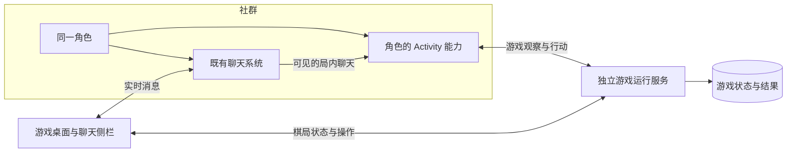

# 小游戏规则与并行开发计划

更新日期：2026-10-16。状态：05 号方案 U01～U03 已完成独立游戏包、五子棋核心、真人参与、局内会话、游戏 HTTP 与实时同步，其余实施按[共同开发计划](../05-gameplay-foundation-implementation-plan.md)推进；两款后续游戏的进阶细则待完整设计。

开工前的共同基础、具体文件职责和依赖方向见[共同基础与文件结构](共同基础与文件结构.md)；游戏目录、生命周期、内部职责、角色加入和进行中操作统一见[接口契约](游戏与角色活动接口.md)。

## 1. 开发目标

首个完整游戏采用五子棋，用它完成共同运行基础、真人整局、角色行动接入、局内聊天、保存恢复和结算验收。随后接入飞行棋与 Kingdomino，检验公共接口能否支持不同玩法。

飞行棋与 Kingdomino 均分为两个规则阶段：

| 阶段 | 飞行棋 | Kingdomino |
|---|---|---|
| 基础规则 | 采用明确来源的一套传统玩法 | 采用出版商早期基础规则，排除附录可选规则与扩展 |
| 进阶规则 | 棋盘随机刷新道具，拾取后保存并在允许时机使用 | 回合间选择事件卡；公开或私下选择、立即或保存使用待详细设计 |

基础阶段完成两款游戏、真人和角色参与以及真实运行验收。进阶阶段分别确定完整规则并实现；基础阶段只把规则版本、当前阶段和合法操作表达清楚，不提前实现未确定的道具或卡牌框架。

社群容纳真人与角色。Activity 是角色的活动能力模块，拥有这项能力的角色通过游戏提供的接口观察与行动，同时继续使用所属社群的身份、聊天与记忆系统。

游戏自己负责完整运行和权威状态。小游戏在没有角色模型的情况下也能完成真人整局。局内实时聊天由社群会话系统支持；角色的局内接话与行动统一协调，分别通过会话与游戏业务入口保存事实。

## 2. 规则来源调查

两款后续游戏基础阶段的唯一规则文本已经产出：[飞行棋基础规则](飞行棋基础规则.md)与 [Kingdomino 基础规则](Kingdomino基础规则.md)。本节保留来源调查与选择理由；具体起飞、掷骰、连接、计分等条目以这两份文件为准，不在本文件重复。

### 2.0 首个游戏：五子棋

建议采用 `gomoku.freestyle` 规则版本 1：15×15 棋盘、两个席位、黑方先行，轮流在空交点落一枚棋子；横向、纵向或两个斜向连续五枚及以上即获胜；无禁手、无交换开局。最后一枚落下后先检查胜利，再检查棋盘已满且无人获胜的和局。

[Gomocup 规则说明](https://gomocup.org/detail-information/)明确区分自由规则的“五枚及以上”和标准规则的“恰好五枚”，同时包含 15×15 自由规则比赛。本文选择自由规则，避免把不同规则混用。

游戏动作只有 `place_stone`，参数是从 0 开始的 `(x, y)`，范围为 0～14。棋子颜色来自实际席位，前端与角色均不能自行指定执子颜色。合法位置由游戏提供，落子、轮序、胜负和结算由游戏保存。

基础验收包括真人对局、角色对局、非法落子、重复请求、版本过期、重启后继续、胜负和和局，以及局内聊天。首个游戏不增加悔棋、比赛计时和竞技开局规则。

### 2.1 Kingdomino 基础规则

采用 Blue Orange 出版商提供的[早期基础规则书](https://blueorangegames.eu/wp-content/uploads/2017/04/KINGDOMINO_rules_ML.pdf)。英文规则在 PDF 第 2～4 页，版本以这个具体文件为依据；不把“最初版”解释成已经核实历史上的首次印刷文本。

实现时按该说明书核对完整地块、人数准备、初始选取、动态行动顺序、先放置再选择、连接与边界、弃置、计分和平分处理。附录将多局累计、城堡居中、完整王国奖励、双人 7×7 列为可选规则，基础模式不启用这些内容。

基础王国按公开桌面信息实现，尚未抽取的地块继续隐藏；不添加私人王国。进阶阶段如果采用秘密卡牌，再由游戏定义相应可见范围。

逐条规则已记录在 [Kingdomino 基础规则](Kingdomino基础规则.md)：人数与用牌、首轮随机放置国王、动态行动顺序、先放置再选块、连接与 5×5 边界、弃置、计分与平分处理。附录的多局累计、城堡居中、完整王国奖励、双人 7×7 在基础阶段不启用。官方新版规则书在人数准备与 3 人局余牌处理上与本版不同，本项目不混用，只以 2017 版为依据。

### 2.2 飞行棋基础规则

本次没有找到能够核实的、全行业统一的“官方首版”。具体产品的规则存在差异。例如开发者发布的[经典飞行棋说明](https://apps.apple.com/ca/app/aeroplane-chess-classic-ludo/id6815329217)采用六点起飞；另一套[厂商说明书](https://assets.kogan.com/files/usermanuals/KA15IN1GTBW_UG.pdf)的飞行棋章节采用双骰与五点起飞。厂商说明不能一概视为同一传统版本，Kogan 章节仅作为调查记录保留，不再作为规则来源。

已选定中文维基百科《[飛行棋](https://zh.wikipedia.org/wiki/%E9%A3%9B%E8%A1%8C%E6%A3%8B)》「傳統玩法」一节作为基础阶段唯一来源（revid 94493224，访问日期 2026-10-18），逐条转写记录在[飞行棋基础规则](飞行棋基础规则.md)。该来源确立了掷到 6 起飞、掷到 6 走完棋后追加掷骰、连续三次 6 返大陆、踏上本色格跳四格、虚线飞越、吃子、叠子、终点反弹与结束条件。括号内的变体规则（偶数起飞、所有棋子一同返回、叠子整叠行进）一律不采用。维基条目未给出棋盘几何细节，外圈长度、颜色循环、起飞处色序、虚线捷径格与虚线交叉格的具体位置，在该文件中逐条记为项目决定。

这项准备不需要自行发明新玩法，但需要把“传统规则”落实成可以测试的唯一规则文本。

### 2.3 飞行棋进阶规则

开发者发布的[《永远的飞行棋》产品说明](https://apps.apple.com/cn/app/%E6%B0%B8%E8%BF%9C%E7%9A%84%E9%A3%9E%E8%A1%8C%E6%A3%8B/id1006560192?mt=12)包含随机棋盘宝箱、拾取后补充、即时效果及装备攻击道具。这是已有产品案例。

其宝箱拾取即触发，装备还涉及产品自己的获取与使用机制。该说明不足以证明存在一套与本项目“随机刷新 → 拾取 → 放入库存 → 自主使用”完全一致的通行标准。当前按自定义扩展规划，稍后再定义完整规则，不整套复制该产品机制。

详细设计必须明确刷新依据、拾取条件、库存容量、使用时机、目标、消耗与效果顺序，以及道具与跳跃、碰撞、连投之间的关系。刷新优先以游戏回合或行动为依据，避免停服期间仍需处理现实时间刷新的额外规则。

### 2.4 Kingdomino 进阶规则

已有可核查的官方扩展：

- [Age of Giants（巨人时代）规则](https://blueorangegames.eu/wp-content/uploads/2018/05/KINGDOMINO-AOG_rules_UK.pdf)：加入巨人地块、皇冠遮盖与转移，开局公开两项目标。
- [The Court（宫廷）规则](https://blueorangegames.eu/wp-content/uploads/2020/03/Kingdomino-TheCourt-PP.pdf)：加入资源、建筑和人物，通过资源取得额外组件。

这两个扩展都有明确规则，但均不等同于每轮公开或私下选择事件卡、保存后自行使用的方案。如果目标改为采用其中一套官方扩展，可以按其完整规则实现；当前用户描述的事件卡方向继续作为自定义扩展保留。

另外查到 [Fantastic Era（奇幻时代）作者发布的扩展资料](https://boardgamegeek.com/filepage/200878/fantastic-era-queendomino-expansion)，属于 Queendomino 的玩家自制扩展，带有回合事件；不当作 Kingdomino 的官方标准。其[条目说明](https://boardgamegeek.com/boardgame/308769/fantastic-era-fan-expansion-for-queendomino)可用于判断是否值得进一步阅读，尚未逐条核验完整规则。

进阶详细设计需要分别决定两件事：“如何获得卡牌”与“何时产生效果”。公开竞争选牌、私人备选和秘密提交有不同的信息与冲突处理规则；即时效果、持续效果和保存后主动使用也需要各自明确时机。卡牌内容、完整选择顺序与平衡在进阶阶段确定。

## 3. 推荐架构：游戏独立负责业务，共用一个部署

游戏后端作为独立 Python 包维护，拟放在仓库顶层 `games/`，包名 `echo_games`。界面继续放在现有 `frontend/`，由游戏开发线维护。`server/` 作为应用组合入口加载游戏服务和现有社群平台，在同一进程、同一端口提供接口；角色的 Activity 能力在社群平台内部运行。

这是“模块化单体”：不同模块各自管理业务，通过明确接口合作，启动时仍作为一个应用运行。它允许游戏开发独立推进，同时保持目前单进程、SQLite 的运行方式。

不要求增加第二个服务器、第二个端口、独立账号系统或独立前端应用。React 负责页面；是否采用 Unity 或其他渲染引擎，与游戏状态由谁负责保存是两个独立选择。

图中的接口与服务在同一个应用中；Activity 直接调用游戏公开服务，不在同一进程内绕行 HTTP。HTTP 和内部调用复用同一个行动处理流程。

### 3.1 前端能力与依赖

2026-10-15 检查当前工作树：Node.js 为 22.20.0，npm 为 10.9.3，`npm ls --depth=0` 成功，声明的直接依赖均已安装。现有 React、TypeScript、Vite、Tailwind CSS、TanStack Query、Radix 和测试工具能够承担页面、输入、服务端状态与验证。浏览器原生支持 SVG，无需为显示现有矢量素材安装图形引擎。

五子棋使用现有 React + HTML/CSS + SVG 即可完成完整界面。后续飞行棋与 Kingdomino 包含进阶规则在内继续采用这套展示方式，在实现相应交互时新增以下依赖：

| 依赖 | 负责能力 | 本项目用途 |
|---|---|---|
| `motion` | React 动画、关键帧与动画序列 | 飞机沿路径移动、骰子表现、翻牌、选中反馈、道具和事件效果 |
| `@dnd-kit/react` | 拖动、放置区域与鼠标、触摸、键盘输入 | Kingdomino 地块拖放和目标区域识别，后续卡牌或道具操作 |

依据：[Motion 安装](https://motion.dev/docs/react-installation)、[SVG 动画](https://motion.dev/docs/react-svg-animation)、[动画编排](https://motion.dev/docs/react-use-animate)、[dnd-kit React 接入](https://dndkit.com/react/quickstart/)。本次查询的包声明均支持 React 18 与 19，符合当前 React 19；实际安装与集成检查在开发时执行，目前未安装新增依赖。

Motion 提供拖动动画，但不包含完整放置区域机制；棋盘拖放交给 dnd-kit，视觉动画交给 Motion。两者分别作用于明确的展示层级，避免同时控制同一元素的位置变换。

棋盘坐标和格子布局由游戏前端定义，地形、棋子与装饰使用现有素材。拖放和“选择地块 → 旋转 → 点选合法位置”都提交同一种正式动作；触屏用户可以不依赖精准拖动。前端判断落点用于操作预览，游戏服务校验并保存正式结果。

前端区分服务端当前棋局与本地展示状态。本地只保存选中、悬停、摆放预览和正在播放的动画；不把动画结束作为服务器进入下一步的条件。断线、切换页面或跳过动画后，从游戏服务恢复当前棋局。

现有 SSE（服务器推送）客户端已经存在于 `frontend/src/api/realtime.tsx`。后续补充游戏事件类型、游戏查询缓存和恢复读取，继续共用社群连接；依赖安装齐全不代表这些游戏功能已经实现。

局内聊天复用现有消息读取、发送、角色回应和实时连接。将聊天展示拆成可嵌入游戏页的组件，界面放在棋盘侧栏或窄屏抽屉，保持原来的成员与可见性规则。同一角色在同一对局的接话与行动由活动能力统一协调，可在冻结输入前合并为一次决策；普通群聊与私聊保持各自任务，共享既有模型额度。

这两款回合制桌游的动画由离散操作触发，暂定范围内没有需要持续物理模拟的玩法。道具刷新、卡牌生效和碰撞结算由游戏规则决定；物理引擎不参与规则计算。采用浏览器界面与成熟交互库可以完成这些要求。

这套方案没有 Unity 的可视化场景编辑器，棋盘布局、坐标与动画配置通过代码维护。其实际收益是聊天、游戏桌面和其他页面使用同一套组件、布局、输入与测试方式。若未来开发持续移动、复杂相机和大量实时精灵的玩法，应按届时的明确需求另行选择渲染方案；当前不为这些设想增加第二套场景系统。

## 4. 唯一的数据归属

| 内容 | 权威维护者 | 另一方如何使用 |
|---|---|---|
| 对局、规则版本、生命周期、席位占用、主体引用、参与区间、阶段和机会 | 游戏 | 宿主与 Activity 通过游戏公开服务读取 |
| 棋盘、地块、随机结果、库存、手牌、得分、结果 | 游戏 | 前端和角色按自身资格读取投影 |
| 保存、恢复、动作校验、版本与重复请求处理、正式游戏事件 | 游戏 | 所有操作者经游戏入口提交，通知引用游戏事实 |
| 真人、社群、角色身份与社群运行状态 | 现有社群及角色模块 | 应用接入处检查，向游戏提供稳定席位身份与资格 |
| 对局所属社群与局内会话关联、身份转换和社群资格 | 社群侧参与服务 | 协调游戏与会话；读取游戏占用，不保存第二份对应关系 |
| 角色行动任务、模型输入、租约与失败恢复 | 角色的 Activity 能力模块 | 游戏只接受经过授权的席位操作 |
| 聊天、记忆与反思 | 现有所属模块 | 通过正式读取接口引用游戏经历 |

同一场棋局只有一个生命周期。Activity 的“任务等待、执行、失败”表示一次角色决策的状态，不再另外保存一份游戏是否运行、轮到谁或棋盘版本。

游戏使用 `participant_ref`（主体引用）、`seat_id`（席位编号）和 `participation_id`（实际参与区间）保存占用与历史，不依赖人格、记忆、提示或模型供应商。宿主转换身份并检查社群资格，Activity 通过游戏读取真实参与记录。真人和角色接受同一游戏业务校验。

游戏包不导入 `echo_commons` 的聊天、角色、记忆和任务实现；宿主应用引用游戏包并注入所需存储与通知设施。游戏可独立测试规则和真实保存流程。进程中共享基础设施不转移数据所有权。

### 4.1 存储与事件

当前推荐继续共用一个 SQLite 文件，但游戏表及其读写实现归游戏模块负责。社群模块和 Activity 不直接修改游戏表，游戏不直接修改社群与记忆表。

游戏状态、随机结果、行动回执与游戏事实事件在游戏事务中一起保存。通知引用同事务记录，提交后唤醒前端，复用现有 SSE（服务器推送）连接。浏览器动画不决定业务结果。

游戏包通过注入的通用数据库连接和通知写入接口工作，不导入宿主的具体实现。保留现有统一迁移入口；游戏开发线提供游戏表迁移，共同基础提供社群对局关联与 game 会话迁移，Activity 开发线提供决策任务及经历接入迁移，迁移编号由应用组合处统一协调。

共用数据库意味着安装升级仍由同一应用协调。现阶段接受这一成本；不另外引入多数据库事务与跨服务消息系统。

### 4.2 角色提交与恢复

Activity 提交“角色决定做什么”，游戏决定“这一步是否仍然合法，并保存什么结果”。

沿用当前 SQLite 部署，目标由 Activity 的运行编排服务在一个短写事务内复核任务租约与席位资格，调用游戏公开业务方法保存动作，通过会话服务保存获准配套发言，再记录自己的任务结果。各模块使用同一个标准数据库连接，分别写入所属数据，一起提交或回滚；模型调用发生在事务外。

游戏不读取角色任务表，不导入 Activity 实现。相同请求重试返回游戏保存的原回执，不重复执行；旧租约的执行者在进入游戏提交前被拒绝。具体契约见[统一接口契约](游戏与角色活动接口.md#43-提交动作)。

游戏拥有的待行动机会和正式事件持久可读，Activity 可以在重启后扫描未完成机会，避免只靠内存回调安排角色任务。相同行动机会只建立一个有效逻辑任务。

## 5. 开工前需要约定的接口

游戏类型与对局的关联、目录读取、生命周期、角色加入、内部职责和五项进行中能力统一见[接口契约](游戏与角色活动接口.md)。前端通过 HTTP 使用，角色活动能力通过宿主参与服务和游戏公开方法使用。

创建、加入、等待时离开、开始、认输、取消、概要、列表和回执由游戏提供，宿主协调会话成员与结束活动。[生命周期契约](游戏与角色活动接口.md#3-对局生命周期与参与)集中定义状态、权限、请求、结果和事务。

下表用于安排契约覆盖范围，尚未提供为公开接口。

| 接口职责 | 最少应表达的内容 |
|---|---|
| 游戏类型目录 | 注册玩法、规则版本、人数与有类型配置；以 game_type 筛选实际房间 |
| 生命周期与参与 | 对局保存 game_type 和规则版本；状态、创建者、主体、席位与区间、操作资格、回执及会话协调 |
| 读取参与者视图 | 对局、席位、状态版本、当前阶段、可见棋盘与资源、结束结果 |
| 读取待行动机会 | 明确的机会编号、行动者、阶段、版本、合法动作与参数范围；允许多个行动者 |
| 提交动作 | 对局与席位、机会与预期版本、请求唯一标识、动作及参数、接入资格 |
| 读取行动回执 | 原请求对应的执行结果、版本与正式事件引用 |
| 读取正式事件与历史 | 可分页的持久位置、发生时间、实际受众、结果与来源编号 |

前端 HTTP 接口和 Activity 内部接口读取相同游戏事实；对外响应与模型输入可以分别转换。Activity 可以补充人物、相关聊天与记忆，但不得扩大游戏提供的可见范围。

社群侧维护对局与局内会话关联并转换主体身份，游戏维护实际席位占用。加入和离开通过双方服务在同一短事务保存，游戏席位与会话成员分别检查资格；局内消息通过会话业务入口提交。加入游戏不自动取得其他会话或历史私人内容的读取资格。

棋盘坐标、放置方向、卡牌目标等使用明确数据类型。合法动作可以是具体候选，也可以是动作类型与合法参数约束，不强制将所有棋盘摆法展开成巨大的列表。

需要支持阶段和多个行动机会，以表达 Kingdomino 动态轮序，以及后续可能的独立选卡。尚未确定的秘密同时选择不提前实现；如果采用，届时明确提交、公开、超时和离线处理。

基础与进阶使用不同规则标识或版本，每局开始后规则固定。基础对局不在进行中自动切换到进阶；两者复用公共实现，不复制整套游戏服务。

## 6. 两个工作树如何分工

| 开发线 | 工作树与分支 | 负责范围 |
|---|---|---|
| 游戏开发 | `.worktrees/gameplay` / `feat/gameplay` | `games/` 包、五子棋及后续两款游戏规则、真实保存与恢复、游戏 HTTP 接入、前端、素材、游戏规则文档与测试 |
| 角色活动能力 | 拟新增 `.worktrees/activity` / `feat/activity` | 社群平台内的 Activity 能力、社群侧参与关联的使用、角色任务、观察转换、模型决策、调度与恢复、既有聊天和记忆的使用，以及对应测试 |

共享文件提前指定维护者：游戏接口与事件结构由游戏开发线提供；宿主 `composition.py`、应用启动与共同任务注册由 Activity 开发线维护；前端生成类型由游戏开发线生成。游戏包安装配置、迁移登记和共同通知注册由双方在共同基础提交中先约定，后续按节点单方修改、另一方同步。

游戏开发线可以使用真人输入完成整局验收，不等待角色模型。Activity 可以先实现关联、任务和模型契约，并复用现有真实聊天与记忆读取；游戏接口完成后执行真实联调，不制作替代游戏运行的假服务。

### 6.1 基础规则阶段

1. 确定五子棋自由规则、双方内部契约与文件归属，用飞行棋和 Kingdomino 的已知需求检查公共接口。
2. 在现有游戏工作树建立游戏包、正式安装、五子棋与局内会话共同基础，整理已有方案和实际素材。共同实现通过检查后形成共同提交；未提交文件不会自动出现在新工作树。
3. 共同基础完成五子棋真人完整对局、身份与会话关联、真实观察和五项接口，再从同一共同提交建立第二工作树分别开发。游戏开发线开始飞行棋；Activity 同时完成局内接话调度、五子棋角色任务、输入和联合模型决策。
4. 首先联合验收五子棋真人与角色完整对局。游戏开发线按明确来源实现飞行棋，再接入 Kingdomino；Activity 持续使用同一接口接入，完善恢复、局内决策协调与经历来源。
5. 飞行棋与 Kingdomino 分别完成真人和角色对局，核对随机操作、动态轮序和地块摆放。两款游戏的基础规则均通过后，进入它们的进阶阶段。

### 6.2 进阶规则阶段

分别完成飞行棋道具规则和 Kingdomino 事件卡规则的完整设计，再各自实现和验收。若没有与需求一致、可核验的现成规则，则维护本项目扩展规则及其测试依据。

道具、库存、卡牌、隐藏信息和生效时机全部归游戏。Activity 从游戏取得新的观察与合法动作，更新相关模型输入和选择能力，不复制扩展规则。

局内三类会话的关系、两种触发、单选抽样与多选联合决策、来源合并、执行失败和经历保存统一见[角色活动设计](../../server/docs/design/activity-integration.md)。进阶游戏沿用同一调用策略，合法动作与隐藏信息由所属游戏提供。

## 7. 验收与分支同步

### 游戏开发验收

- 无角色模型时，真人通过真实接口创建、加入、离开等待房间、开始并完成整局，五子棋另验收认输；后续游戏按其明确退出规则验收。
- 游戏保存主体与席位占用及参与历史，加入、离开和会话成员共同提交；同席位竞争、重新加入及原席位换人的私人历史隔离正确。
- 数据由游戏服务保存，刷新、断线和进程重启后状态与随机结果正确。
- 版本过期、非行动者、重复请求、非法操作均有真实验证；重复提交不重复移动、抽取或记录事件。
- 规则有来源，完整地块及关键规则可检查；基础和进阶结果分别验证。
- 前端在桌面与窄屏均能操作，动作、等待、失败和结果清楚，动画结束与否不影响游戏推进。
- 游戏桌面内可以使用既有实时聊天，切换桌面布局不丢失会话、消息和服务端读取位置。

### Activity 验收

- 使用真实游戏接口和真实模型供应商，首先完成五子棋角色对局，再完成后续两款游戏的角色对局。
- 人物与席位关联清楚，输入只包含实际可见信息，角色只选择游戏允许的操作。
- 旧观察、失效任务、重复调度、游戏已接受但任务未记录、角色失败和重启均有明确处理。
- 局内消息只进入局内决策入口，不重复建立普通群聊任务；同一角色行动与接话在冻结前合并，执行中的新消息排队。
- 覆盖单选自动、单选模型、多选模型与玩家接话；重试不重新抽样，动作被拒绝不发布配套发言，发言业务拒绝可省略消息并提交合法动作。联合模型失败按真实任务恢复。
- 固定局内成员、断线、赛后交流、结束归档及历史读取符合规则；社群暂停停止角色新执行，真人游戏操作继续按游戏与访问资格检查。
- 活动经历有真实事件、时间、受众与来源，记忆和反思按资格读取；游戏不直接修改角色关系数值。

### 共同集成

按“真人五子棋 → 角色五子棋 → 飞行棋与 Kingdomino 基础完整运行 → 各自进阶完整运行”设置集成节点。依赖方持续合并提供方已检查的提交，不只在最后交换代码。

使用集成工作树联合运行前后端，检查既有聊天与记忆受影响的流程；通过后由集成分支创建 PR（合并请求）进入 `main`。更新本地 `main` 后，两条开发分支分别合并 `main` 并推送。保留已有工作树与未完成内容，临时集成分支在完成同步后清理。

两个开发工作树使用独立测试数据库。正式集成环境内，游戏与社群共享该环境自己的 SQLite 文件；不让两个工作树同时对同一可写数据库执行迁移或测试。按需运行服务，避免端口混用，测试结束清理临时服务与浏览器。

## 8. 文档与实施状态

[产品策划](策划.md)、[实现设计入口](代码.md)、[角色活动设计](../../server/docs/design/activity-integration.md)及相关系统设计采用同一模块边界。角色行为规则集中在活动设计，游戏类型目录、生命周期、进行中接口和角色加入统一集中在接口契约，文件归属集中在共同基础。

现有 `ActivityObservation` 继续作为角色侧观察投影，接入时明确实际游戏编号与类型转换，不承担完整游戏状态。当前公开 API 与数据库参考继续描述已实现行为；随真实实现更新接口、迁移、生成类型及状态，不提前把规划写成现有能力。

本计划定义目标方案。实际接口和已经交付的能力仍以代码与正式实现状态为准。
