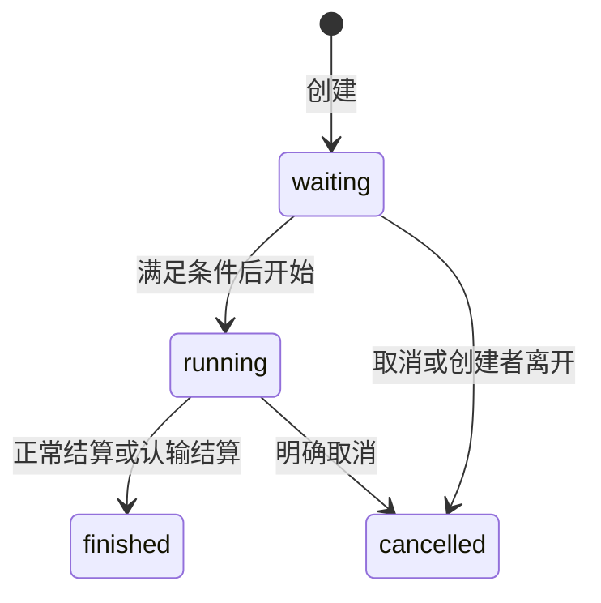
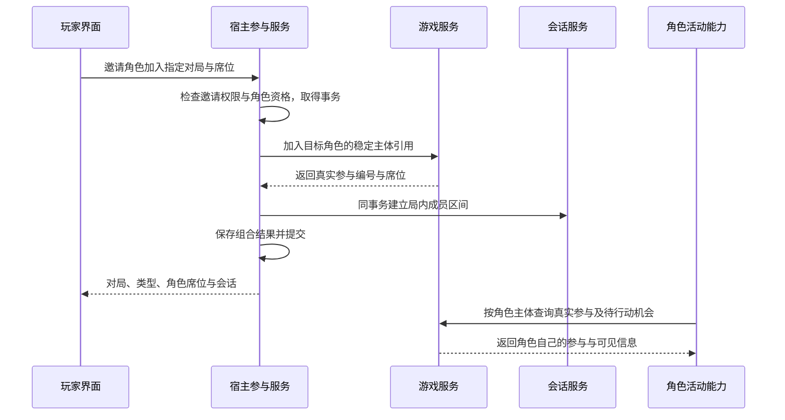
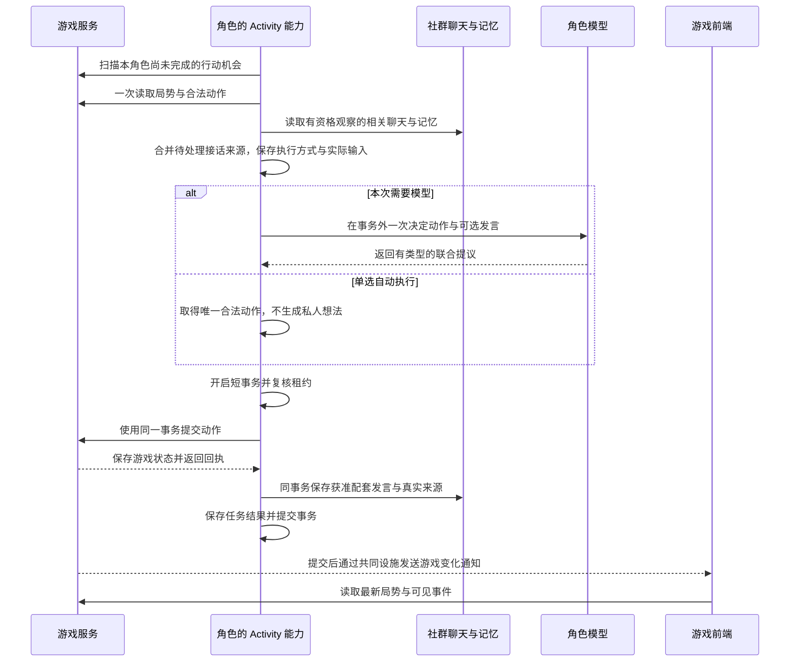

# 游戏与角色活动接口契约

更新日期：2026-10-16。状态：完整目标契约；游戏包内部的五子棋、生命周期及进行中能力已实现，实际 Python 类型与方法见[游戏包公开入口](../../games/src/echo_games/public.py)。宿主已提供真人对局参与与局内会话的 Python 业务接口；游戏 HTTP、角色邀请与活动执行尚未接入。后续接入飞行棋与 Kingdomino 基础模式；进阶规则确定后补充各游戏的数据类型与动作。

本文统一维护游戏类型目录、对局创建与参与、进行中操作和角色接入的契约。每项能力说明 HTTP 路径、内部职责、结果与调用权限；正式路径和生成类型随实现发布。规则与分工见[开发计划](并行开发计划.md)，文件职责见[共同基础](共同基础与文件结构.md)。

## 1. 共同约定

社群容纳角色，Activity 是角色的活动能力模块。游戏提供可见局势与合法操作，角色活动能力结合所属社群的聊天、人格和记忆作出选择。局内聊天通过会话服务的 `game` 类型处理。角色接话、联合决策、调用策略和经历保存统一见[角色活动设计](../../server/docs/design/activity-integration.md)。

游戏目录、生命周期和进行中五项能力共同构成完整接口。前端通过 HTTP 使用游戏，角色活动能力通过同进程的 Python 业务接口使用游戏，两者进入同一个游戏规则与保存流程。

阅读顺序：[身份与归属](#1-共同约定) → [游戏类型与大厅](#2-游戏类型目录与大厅) → [生命周期](#3-对局生命周期与参与) → [进行中操作](#4-对局进行中的五项能力) → [角色加入与执行](#5-角色如何加入与执行) → [验收](#6-实施边界与验收)。

### 1.1 对象编号

| 字段 | 含义 | 谁维护 |
|---|---|---|
| `game_type` | 玩法种类，例如 `gomoku`、`aeroplane`、`kingdomino` | 游戏定义注册表 |
| `ruleset_id`、`ruleset_version` | 该玩法采用的具体规则及版本 | 游戏定义注册表，创建后由对局固定 |
| `game_id` | 使用某种玩法与规则的一场具体对局 | 游戏 |
| `seat_id` | 对局中的一个规则席位 | 游戏 |
| `participant_ref` | 宿主由真人或角色身份转换的稳定主体引用，游戏保存其席位占用 | 宿主转换，游戏保存 |
| `participation_id` | 一次实际加入的参与区间，离开再加入时新建 | 游戏 |
| `state_version` | 当前已提交棋局的版本，每次成功改变状态后增加 | 游戏 |
| `opportunity_id` | 一次仍可执行的行动机会，如这次落子、掷骰或选棋子 | 游戏 |
| `request_id` | 一次动作提交及其网络重试的共同编号 | 前端或 Activity，在首次提交前生成并保存 |
| `receipt_id` | 已成功提交动作的持久回执 | 游戏 |
| `event_id` | 一条已经发生的游戏事实 | 游戏 |

同一席位的不同动作使用不同 `request_id`，同一动作重试使用相同编号与相同请求。请求编号的唯一范围为 `(game_id, seat_id, request_id)`。

宿主将已有 `ActorRef` 转换为稳定 `participant_ref`，游戏独立保存主体、席位与参与区间。社群侧仅保存对局所属社群及局内会话关联，不重复维护席位占用；游戏不保存聊天记录，也不导入 `echo_commons` 的角色或聊天类型。

### 1.2 身份与资格

浏览器沿用当前本地玩家选择方式，HTTP 提供 `player_id`。宿主验证身份并生成主体引用，再通过游戏服务读取实际占用与参与区间。客户端不能通过填写任意 `seat_id` 操作或读取其他席位的私人信息。

Activity 根据角色、社群和能力资格，通过游戏公开参与查询取得真实席位。宿主构造的 `SeatAccess`（席位访问上下文）包含 `game_id`、`seat_id`、`participant_ref`、`participation_id`；游戏检查绑定、参与区间、对局状态与操作资格。历史读取继续检查原参与区间和事件受众，不因同席位后来换人而转移私人历史。

`SeatAccess` 是同进程的有类型参数，不增加网络令牌系统。角色任务租约由 Activity 负责检查，游戏包不读取角色任务表。

### 1.3 数据类型

使用 Pydantic 定义请求与结果，使用 Python `Protocol` 定义游戏服务的读取与操作能力。具体对象放在游戏包的公开契约模块中，浏览器请求和角色模型输出都复用这些业务定义的规则。

游戏观察、合法操作、动作和结果按照 `game_type`、规则标识及动作 `type` 使用明确类型。五子棋定义 `PlaceStoneAction`，后续分别定义 `RollDiceAction`、`MovePlaneAction`、`ChooseDominoAction`、`PlaceDominoAction` 等；不使用一个含大量可选字段的动作对象，也不把任意 JSON 当成合法操作。

基础类型的来源由游戏包维护；HTTP 响应通过宿主应用导出 OpenAPI，前端继续从正式契约生成 TypeScript 类型。

公共结构使用泛型表达玩法数据：`Game[ConfigT, StateT]`、`GameView[ViewT, ActionT]` 和 `ActionReceipt[ActionResultT]` 等。具体玩法在所属目录指定实际类型，并通过 `GameModels` 登记完整请求与恢复模型；公共领域、契约、注册表、存储和服务不导入具体玩法。宿主在 HTTP 接入时组合实际已实现的具体类型，不能直接暴露未指定类型参数的公共模型。

### 1.4 数据归属

| 模块 | 权威内容 |
|---|---|
| 游戏包 `echo_games` | 对局状态、创建者引用、规则配置、席位、占用主体、参与历史、游戏结果、操作回执和正式游戏事件 |
| `communities`（社群模块） | 真人与角色的社群资格，以及对局所属社群、局内会话的关联 |
| `conversations`（会话模块） | 局内会话、成员区间、消息、受众、归档和历史读取 |
| 宿主参与服务 | 检查操作者资格，转换身份，协调游戏与会话的业务入口 |
| Activity（角色活动能力） | 角色接话和行动的决策任务，不维护第二份席位占用或对局生命周期 |

宿主查询游戏的席位占用，再与社群身份、名字和头像组合展示。社群关联表不保存另一份可修改的主体与席位对应。会话成员记录表达交流资格，不能替代游戏占用记录。

### 1.5 游戏身份与参与记录

#### 1.5.1 主体与席位

`participant_ref` 是宿主根据实际身份生成的稳定主体引用，例如 `player:player_alice` 或 `character:character_mio`。宿主负责与 `ActorRef` 相互转换；游戏只保存和比较完整引用，不解析其前缀、不查询社群表、不导入社群类型。不同主体不能因显示名相同而共用引用，引用不随重连改变。

`seat_id` 表示本局规则席位，例如五子棋的 `black`、`white`。游戏保存席位由哪个主体占用，两个概念分别存在。同一主体在一局最多占用一个当前席位，一个席位同一时刻最多由一个主体占用。

#### 1.5.2 参与区间与历史

每次实际加入由游戏生成 `participation_id`，记录对局、席位、主体、加入时间和实际离开或结算结果。等待时离开后重新加入产生新的参与记录；释放席位不删除原记录。席位的当前占用从这些记录读取，不在其他模块重复写入。

游戏开始时固定本局参赛记录。认输后仍保留原参赛者、席位、动作与结果，历史查询能够说明谁执黑、谁执白、谁认输。数据库不把真人或角色资料复制成游戏主体表。

示例为查询响应中的游戏部分：

```json
{
  "game_id": "game_7",
  "game_type": "gomoku",
  "ruleset_id": "gomoku.freestyle",
  "ruleset_version": 1,
  "status": "waiting",
  "state_version": 2,
  "creator_ref": "player:player_alice",
  "seats": [
    {
      "seat_id": "black",
      "occupant": {
        "participant_ref": "player:player_alice",
        "participation_id": "participation_1"
      }
    },
    {
      "seat_id": "white",
      "occupant": {
        "participant_ref": "character:character_mio",
        "participation_id": "participation_2"
      }
    }
  ]
}
```

#### 1.5.3 读取身份与资格

宿主先确认请求主体，再将其转换为 `participant_ref`，通过游戏公开查询取得真实席位和参与记录。内部 `SeatAccess` 包含 `game_id`、`seat_id`、`participant_ref`、`participation_id`；游戏按实际绑定检查，浏览器不能指定他人席位或伪造内部访问上下文。

当前局势与动作读取使用当前参与资格。历史事件、动作回执和局内消息使用各自原参与区间与发生时受众；曾经使用过同一席位不自动取得另一个主体的私人历史。重新加入不扩大过去的可见范围。游戏事件的内部受众引用实际参与记录，HTTP 游标也绑定读取主体及参与区间。

等待加入者可以在所属社群的访问资格内读取房间概要和空席位；这不提供私人游戏视图。角色同样经正式身份与能力检查，不使用邀请它的真人身份读取角色视图。

游戏公开提供 `find_participations(connection, participant_refs, game_ids)`（按主体和对局范围查询参与记录）。宿主先取得允许查询的对局范围，Activity 再由这项查询取得角色的实际席位和区间，不能直接查询游戏表或使用宿主维护的名单副本。单局概要同样通过游戏服务取得当前占用。

## 2. 游戏类型目录与大厅

### 2.1 游戏类型如何关联到对局

`game_type` 表示玩法，`game_id` 表示其中一场对局。五子棋的两场对局可以同时是 `game_type=gomoku`，分别使用 `game_7`、`game_8`；它们各自保存棋盘、参与者和结果。

每个 Game 持久保存 `game_id`、`game_type`、`ruleset_id`、`ruleset_version` 和经过类型检查的配置。创建时用这组类型与规则标识从显式注册表取得定义；后续通过 `game_id` 读取已保存标识，再取得相同规则实现，读取状态、计算合法动作和执行结算。客户端不需要每次行动重发游戏类型，也不能用动作请求把五子棋改成另一种游戏。

内部职责：`registry.resolve(game_type, ruleset_id, ruleset_version) -> GameDefinition`。准确匹配注册定义；不认识的类型或未注册规则拒绝创建，已有对局缺少原规则实现时明确报告不可继续，不默默改用最新规则。基础与进阶分别注册明确规则标识，进行中不切换。

游戏定义提供规则执行和目录元数据，两者使用同一注册来源。目录仅返回真实完成并注册的玩法和规则；前端不维护另一份可玩游戏清单，未来玩法不因写入设计文档而出现在可用目录。

### 2.2 大厅接口

| 玩家操作 | HTTP 接口 | 内部职责 | 结果 |
|---|---|---|---|
| 查看游戏种类 | `GET /api/game-types` | `GameRegistry.list_game_types() -> tuple[GameTypeView, ...]` | 注册玩法、显示名、规则版本及各规则支持人数 |
| 查看选定玩法 | `GET /api/game-types/{game_type}` | `GameRegistry.read_game_type(game_type) -> GameTypeView` | 该玩法的完整规则选项与有类型配置说明 |
| 查看该玩法的房间 | `GET /api/games?player_id=...&community_id=...&game_type=gomoku&status=waiting` | 宿主确定社群与读取范围，调用 `GameService.list_games(connection, query) -> GameSummaryBatch` | 当前请求可见的等待房间、占用及分页位置 |
| 创建该玩法的对局 | `POST /api/games` | 宿主参与服务校验身份，调用 `GameService.create_game` 并创建局内会话 | 新 `game_id`、规则标识、版本、本人席位、会话与创建结果 |
| 进入已有对局 | `GET /api/games/{game_id}?player_id=...` | 宿主检查读取资格，调用 `GameService.read_game` | 对局概要及当前请求可用操作；需要参与时再正式加入 |

`GET` 用于读取，`POST` 用于创建或提交变化。路径中的 `game-types` 表示种类目录，`games` 表示实际对局；大厅的“玩法 → 该玩法房间 → 一场对局”由类型过滤与对局关联表达。进入页面本身不自动占用席位。

目录响应的示意内容：

```json
{
  "items": [
    {
      "game_type": "gomoku",
      "display_name": "五子棋",
      "rulesets": [
        {
          "ruleset_id": "gomoku.freestyle",
          "ruleset_version": 1,
          "display_name": "自由规则",
          "min_players": 2,
          "max_players": 2
        }
      ]
    }
  ]
}
```

这是目标结构，尚未实现时不返回假目录。注册表在共同阶段登记真实完成的五子棋，其他游戏完成后按同一契约加入。

创建五子棋的请求示例：

```json
{
  "player_id": "player_alice",
  "community_id": "community_1",
  "request_id": "req_create_7",
  "game_type": "gomoku",
  "ruleset_id": "gomoku.freestyle",
  "ruleset_version": 1,
  "initial_seat_id": "black",
  "config": {}
}
```

`config` 按所选规则使用明确类型；五子棋示例没有额外配置。宿主将真人转换为创建者引用，游戏保存类型、规则、配置和初始席位；社群编号只保存在宿主关联。创建成功返回的游戏对象始终带类型与规则字段，刷新和重启也从数据库恢复这些值。

## 3. 对局生命周期与参与

### 3.1 对局状态

| 状态 | 含义 | 允许的操作 |
|---|---|---|
| `waiting`（等待开始） | 已创建，等待参与者并检查开始条件 | 加入、离开、开始或取消 |
| `running`（进行中） | 规则已初始化，参赛席位固定 | 规则允许的动作、认输或受支持的游戏退出、创建者取消 |
| `finished`（已结算） | 已有正式胜负、和局或其他规则结果 | 读取历史、赛后交流、结束活动 |
| `cancelled`（已取消） | 提前停止，保存取消原因 | 读取历史、结束活动 |



成功的创建、加入、离开、开始、认输、取消和游戏动作更新游戏版本，并保存相应操作结果和正式事件。重复请求返回原结果，不再次增加版本。结束会话使用会话版本，不为归档动作增加棋局版本。

游戏结算后局内会话可以继续赛后交流；`cancelled` 后停止安排角色的新局内决策，只保留参与者历史读取及明确结束入口。终态对局不恢复运行；再来一局创建新游戏与新会话。

### 3.2 HTTP 操作契约

内部游戏方法接收标准数据库连接、宿主验证后的操作者引用和明确类型的命令，不接收社群对象。以下路径为目标建议，公开写入均带 `player_id` 和 `request_id`，已有对局的变更另带 `expected_state_version`。

| 操作与内部方法 | 建议 HTTP 路径 | 请求要点与成功结果 |
|---|---|---|
| 创建 `create_game` | `POST /api/games` | 社群、游戏类型、规则版本、配置、创建者初始席位；返回新对局、局内会话和创建回执 |
| 加入 `join_game` | `POST /api/games/{game_id}/participants` | 目标空席位、本人或明确邀请的角色；返回真实 `participation_id`、席位和新版本 |
| 等待时离开 `leave_game` | `POST /api/games/{game_id}/leave` | 指定实际参与记录；释放本人或获准撤回的角色席位，返回离开结果 |
| 开始 `start_game` | `POST /api/games/{game_id}/start` | 创建者请求；检查人数、配置、身份与会话成员后初始化棋局并返回版本 |
| 认输 `resign_game` | `POST /api/games/{game_id}/resign` | 指定实际参与记录；由所属游戏结算，返回认输结果与正式事件 |
| 取消 `cancel_game` | `POST /api/games/{game_id}/cancel` | 创建者明确请求及原因；取消对局、结束未完成行动机会，返回实际取消结果 |
| 对局概要 `read_game` | `GET /api/games/{game_id}?player_id=...` | 状态、规则、创建者、席位占用、版本、结束结果及本请求可用操作 |
| 游戏列表 `list_games` | `GET /api/games?player_id=...&community_id=...&game_type=...&status=...` | 按宿主社群范围和游戏实际参与资格过滤，返回分页概要 |
| 生命周期回执 `read_operation` | `GET /api/games/{game_id}/operations/{request_id}?player_id=...` | 读取本人发起操作的已提交结果；创建可用原请求重试取得新对局编号 |
| 结束活动 `end_activity`，宿主编排方法 | `POST /api/games/{game_id}/end` | 创建者明确结束；必要时取消对局，归档局内会话并停止相关角色任务 |

每种命令使用独立类型。创建请求的 `community_id` 留在宿主关联层，游戏收到的是规则参数与稳定主体引用。浏览器加入或撤回角色时提供角色编号，由宿主检查并转换；不允许直接传任意 `participant_ref` 代表他人操作。

等待阶段通过 `read_game` 读取房间，不返回尚未初始化的棋局。开始后通过五项接口读取真实游戏视图和机会；提前提交动作返回 `game_not_started`（游戏尚未开始）。

### 3.3 内部职责与有类型命令

HTTP 接入与角色能力端复用宿主参与服务。宿主方法取得事务、检查社群身份与角色能力、转换 `ActorRef`、调用游戏与会话服务并提交；内部调用不通过 HTTP。游戏方法接收调用者连接，只处理游戏规则、数据、回执与正式事件。

宿主参与服务公开 `create_game(requester, command)`、`join_game(requester, command)`、`leave_game(requester, command)`、`start_game(requester, command)`、`resign_game(requester, command)`、`cancel_game(requester, command)` 和 `end_activity(requester, command)`，均返回 `GameSessionOperationResult`。`requester` 是经正式入口确认的真实操作者；命令分别使用明确的宿主类型，包含实际目标主体，不能以目标角色覆盖操作者身份。

当前实现位于 `communities/game_participation.py`。创建使用 `CreateGameSessionCommand[ConfigT]`，包含社群编号与有类型的游戏创建命令；加入使用 `JoinGameSessionCommand`，包含真实目标 `ActorRef`；结束使用 `EndGameActivityCommand`，同时检查棋局版本和会话状态版本。离开、开始、认输和取消直接复用游戏包的对应命令。当前真人只能管理自己的席位，角色邀请与撤回尚未开放。

组合结果包含社群编号、对局编号、操作种类、操作完成时的会话、实际变化的成员区间，以及可空的游戏回执。`game_session_operations` 保存请求与会话结果快照，游戏回执从游戏包按原请求恢复；结束已结算对局时，游戏回执为空。

| 游戏内部职责 | 命令与结果 | 检查与保存 |
|---|---|---|
| `create_game(connection, requester_ref, command)` | `CreateGameCommand -> GameOperationReceipt` | 命令带请求编号、游戏类型、规则、配置与创建者席位；解析注册定义，创建对局和首个参与区间 |
| `join_game(connection, requester_ref, command)` | `JoinGameCommand -> GameOperationReceipt` | 命令带对局、请求编号、预期版本、目标主体引用和目标席位；检查等待状态、空席位和唯一占用，生成参与编号 |
| `leave_game(connection, requester_ref, command)` | `LeaveGameCommand -> GameOperationReceipt` | 命令带对局、请求编号、预期版本及参与编号；检查实际主体和等待状态，关闭原参与区间并释放席位 |
| `start_game(connection, requester_ref, command)` | `StartGameCommand -> GameOperationReceipt` | 命令带对局、请求编号与预期版本；检查创建者、人数和配置，固定名单并用原类型与规则初始化棋局 |
| `resign_game(connection, requester_ref, command)` | `ResignGameCommand -> GameOperationReceipt` | 命令带对局、请求编号、预期版本及参与编号；通过所属规则结算认输，保存结果和事件 |
| `cancel_game(connection, requester_ref, command)` | `CancelGameCommand -> GameOperationReceipt` | 命令带对局、请求编号、预期版本和原因；检查创建者与状态，取消对局并关闭未完成机会 |
| `read_game(connection, access)` | `GameReadAccess -> GameSummary` | 按宿主允许的读取范围返回类型、规则、状态、席位与参与信息；不返回私人棋局 |
| `list_games(connection, query)` | `GameListQuery -> GameSummaryBatch` | 查询带宿主允许的游戏范围、类型、状态和有类型分页位置；返回过滤后的概要和下一位置 |
| `find_participations(connection, participant_refs, game_ids)` | 主体引用及允许的对局范围 → 参与记录 | 为宿主和 Activity 查询实际主体、席位和参与区间，区分当前与历史 |
| `read_operation(connection, requester_ref, game_id, request_id)` | 原操作者及原请求 → `GameOperationReceipt` 或空值 | 原操作结果按原主体资格读取，重试不受后来棋局版本影响 |

创建命令包含的游戏配置按 `game_type` 和规则标识确定类型；其余命令通过 `game_id` 取得已保存类型。宿主读取当前参与记录、复核邀请权限和会话成员，不把这些社群规则搬入游戏。游戏仍检查对局与参与区间，不因宿主已经检查身份就跳过游戏校验。

`end_activity` 只属于宿主编排：必要时调用 `cancel_game`，调用会话归档和角色任务停止入口，保存实际组合结果。游戏包不增加依赖社群的结束方法。数据库写入、会话消息和角色任务均由所属模块保存。

### 3.4 操作资格

- 创建者为所属社群中的真人，创建时同时加入一个合法初始席位，游戏保存其 `creator_ref`。
- 真人可以加入自己、离开自己或为自己认输。创建者可以明确邀请具备资格的社群角色、撤回等待中的角色，或明确要求自己邀请的角色认输；普通参与者不能代表其他真人或角色操作。
- 开始、取消及结束整个活动由创建者发起，宿主检查真实资格，游戏检查当前状态与创建者引用。创建者等待时离开，同时取消房间并归档会话，避免无人维护的对局。
- 开始前，所有参赛主体仍具备参与资格，人数与规则配置有效，会话成员与当前游戏占用一致，才能切换到 `running` 并生成行动机会。
- 当前角色模型执行正式游戏行动机会，不自行创建、加入、退出或取消对局。角色的参与管理由明确的宿主入口完成。

### 3.5 退出、认输与连接状态

`leave_game` 仅用于等待阶段。进行中返回 `game_already_started`（游戏已经开始），界面提示使用该游戏支持的认输或退出操作，不把离开悄悄转换为取消整局。

五子棋认输使对手获胜，游戏记录 `reason=resignation`（认输原因），保留双方席位与棋谱。基础飞行棋和 Kingdomino 在各自规则明确支持前不开放进行中个人退出；返回 `operation_not_supported`（不支持此操作）。创建者仍可明确取消整局，不擅自删除席位、换人或安排自动接管。

关闭页面、断线、进程重启、社群暂停或模型调用失败都不自动认输、不释放席位。社群暂停停止角色新执行，游戏恢复、真人输入与历史访问按各自正式资格判断。

认输停止该角色的游戏行动任务，不自动撤销赛后交流资格。结束活动归档会话后，角色的新发言和动作均不得提交。历史、原受众与操作回执继续保留。

### 3.6 请求重复、版本与结果

创建操作以 `(requester_ref, request_id)` 唯一识别；其余生命周期操作以 `(game_id, requester_ref, request_id)` 唯一识别，操作类型和参数属于请求内容。与进行中动作回执分别使用明确类型和查询入口。

宿主先确认操作者身份及原结果的读取资格，再查询已接受请求。相同请求返回原结果，即使之后版本变化、操作者已通过该请求离开或会话已归档；编号相同但内容不同返回 `idempotency_conflict`。新操作才检查当前写入资格与版本。离开重试不能误释放后来加入者的席位。

游戏保存 `GameOperationReceipt`，包含操作者、操作类型、请求编号、版本变化、实际参与记录、正式事件引用和结果。宿主返回的 `GameSessionOperationResult` 组合游戏回执、关联会话及实际会话变化；游戏包不保存聊天成员编号或会话归档结果。

结束已结算活动只归档会话，由宿主保存真实归档操作结果，不生成不存在的游戏变更回执或游戏事件。结束未完成活动时，宿主结果引用实际取消回执和会话归档结果。结束操作的请求编号由宿主按相同身份范围记录，重试返回原组合结果。

创建成功返回 201，其余变更成功返回 200，均表示业务事务已提交。重复创建返回相同对局与原创建结果。未找到已提交回执时返回 404，调用者继续原请求重试，不据此断定请求永远不会到达。

状态或版本冲突返回 409，席位已占用返回 `seat_occupied`，重复占用多个席位返回 `participant_already_seated`，人数或配置不满足开始条件返回 `game_not_ready`。无读取资格按现有规则返回 404，已有读取资格但无该操作许可返回 403。不符合类型契约的请求沿用 422。

### 3.7 游戏与会话共同提交

当前使用同一 SQLite 文件。创建、加入、等待时离开以及结束活动由宿主参与服务控制一个短写事务：检查身份、操作重复和资格，通过游戏服务修改所属记录，通过会话服务创建、调整成员或归档，保存宿主关联与操作组合结果，提交后通知前端。

游戏、会话和社群关联各自提供接收同一连接的业务方法，不自行提交或开启嵌套事务。现有 `ConversationService.create/join/leave` 等入口自行取得事务，实施时提取实际业务步骤供共同事务复用；原普通群聊和私聊入口继续调用这些步骤。不能直接从游戏接入代码写入会话表。

任一保存失败，整个事务回滚，不留下已占席位但没有聊天成员的成功状态；重试原操作。此部署不增加待绑定状态、跨服务恢复任务或另一套协调框架。模型调用、网络和素材处理均在写事务外。

等待时加入建立新的会话成员区间，离开关闭该区间，重新加入新建区间；成员从实际加入位置获得消息，原历史资格保留。已开始的普通加入、离开和成员调整被拒绝，局内成员不能通过普通群聊成员接口绕过这些检查。

开始时固定参赛名单并在同一事务复核局内成员。进行中的取消、认输或结束活动使相关旧行动机会及任务失效，旧执行者提交时重新检查；已提交动作和消息保留。

`cancel_game` 只改变游戏及相关任务，不自动归档会话；取消后会话保留历史与结束入口，不再接受新消息。`end_activity` 在同一事务中完成必要的取消、会话归档和角色任务停止。已结算对局结束活动时保留胜负结果，不改写为取消。

局内消息入口通过注入的参与资格读取检查游戏状态和会话状态，禁止在已取消对局或已归档会话中继续发言；游戏包仍不导入会话实现。

## 4. 对局进行中的五项能力

### 4.1 读取可见观察

内部职责：`read_view(connection, access) -> GameView`。

建议前端路径：`GET /api/games/{game_id}/view?player_id=...`。

返回以下内容：

| 内容 | 字段或类型 |
|---|---|
| 对局与规则 | `game_id`、`game_type`、`ruleset_id`、`ruleset_version` |
| 状态 | `state_version`、`status`、`phase` |
| 读取身份 | `viewer_seat_id`、`viewer_participation_id` |
| 可见局势 | 有具体游戏类型的 `state` |
| 自己可以做什么 | `opportunities`，当前没有机会时为空列表 |

五子棋视图包含棋盘交点、已落棋子、执子席位、当前行动者和结束结果。棋盘尺寸与胜利规则属于五子棋类型，不写入所有游戏共用的状态对象。

后续飞行棋视图包含飞机位置、已经产生的骰子结果与当前阶段。Kingdomino 基础视图包含公开王国、当前地块行、占领情况与阶段。未抽取地块顺序不提供给前端或角色；未来的私人卡牌只返回给有资格的席位。

本接口在同一个数据库读取事务中取得局势和行动机会，返回的版本必须一致。前端不先读取棋局，再自行推断轮到谁。

`GameView` 只表达游戏事实。角色活动能力另行取得相关聊天、人格与记忆，并将游戏视图转换为模型可以理解的观察。已有 `ActivityObservation` 可用于角色侧投影，不成为游戏的存储模型。

### 4.2 读取行动机会

单个游戏的行动机会包含：

| 字段 | 作用 |
|---|---|
| `opportunity_id` | 绑定一次具体决策，完成或失效后不复用 |
| `seat_id` | 谁可以行动 |
| `expected_state_version` | 此机会对应的棋局版本 |
| `phase` | 落子、掷骰、移动、选地块、放置等明确阶段 |
| `choice_required` | 是否需要在多个合法选择中决定 |
| `legal_actions` | 当前游戏类型对应的合法动作与参数候选 |

前端已经通过 `read_view` 同时获得自己的机会，无需再请求一次。

Activity 另需两个内部读取操作：

- `list_open_opportunities(connection, seats, ...)`：查询候选席位仍待处理的行动机会，只返回安排任务所需的标识与版本。宿主取得有资格角色的主体引用及所属社群的对局范围，通过游戏公开参与查询读取实际席位，再分批查询其机会；游戏不接收社群对象，也不导入社群查询模块。
- `read_decision_input(connection, access, opportunity_id)`：在同一个读取事务中复核机会仍有效，取得一致的游戏视图、机会和规则说明。Activity 保存实际决策输入，再按调用策略选择自动执行或一次联合模型决策。

发现列表只用于安排工作，第二次读取决定真正冻结什么。以 `(game_id, seat_id, opportunity_id)` 约束同一机会只建立一个逻辑任务。重试和租约重新领取不创建新的逻辑任务。

游戏历史材料只读取到被冻结的棋局版本；相关聊天与记忆使用既有资格与冻结范围，保存实际来源引用。后续重试复用原输入，不能追加冻结之后的新游戏事件来解释旧棋局。

五子棋每次为当前席位提供一个落子机会，合法位置来自尚未占用的交点；成功落子后由游戏切换行动者或结算。后续飞行棋的掷骰和选择飞机是两个阶段；Kingdomino 的放置与选取下一块地块按官方规则分别推进，公共接口不能假定所有游戏永久按席位循环。

飞行棋掷骰是一个不需要策略选择的动作。真人可点击按钮；角色由 Activity 自动提交这个唯一动作，无需让模型生成骰子点数。没有可移动飞机时，由规则完成跳过与轮序推进。实际移动选择按角色活动设计的单选抽样或多选联合决策处理，自动规则步骤不重复抽样。

飞行棋的候选可以列出可动 `plane_id`。Kingdomino 的候选按照地块与合法 `(x, y, rotation)` 组合提供，参数组合整体校验，不能让三个独立范围产生原本非法的组合。模型投影可以按地块分组压缩表达；规则与候选仍来自游戏。不要把所有地形数据重复放进每一个候选。

基础阶段使用全局棋局版本检查。未来如果采用同时秘密选卡，需要额外明确独立机会的失效范围和提交顺序，避免一个人的秘密选择使其他人无故重选；这部分在该进阶规则确定时补充，不预先实现。

### 4.3 提交动作

内部职责：`submit_action(connection, access, command) -> ActionReceipt`。

建议前端路径：`POST /api/games/{game_id}/actions`。HTTP 接入层从 `player_id` 解析席位，转换成内部业务请求。

五子棋落子的浏览器请求示例：

```json
{
  "player_id": "player_alice",
  "request_id": "req_78b4",
  "opportunity_id": "opp_12_black_place",
  "expected_state_version": 12,
  "action": {
    "type": "place_stone",
    "x": 7,
    "y": 7
  }
}
```

角色的行动提议包含 `action`、可选发言与实际产生的简短私人材料；纯回应提议不包含游戏动作。Activity 只把 `action` 投影到游戏命令，发言交给会话服务。`request_id`、机会、版本与提交身份从正式任务记录补全，模型不能改写这些字段。

进入写事务后的处理顺序：

1. 接入层检查操作主体，游戏核对实际席位占用与参与区间；角色入口还要检查当前任务租约与能力资格。
2. 游戏查询相同请求编号的已提交回执。已成功且请求内容一致时，直接返回原回执；编号已使用而内容不同，返回 `idempotency_conflict`（重复编号对应不同操作）。
3. 对于新请求，检查对局仍可操作、机会未完成、席位正确、版本符合、动作在合法范围内。
4. 游戏执行规则，保存状态、随机结果、机会变更、回执与正式事件，登记实时通知引用。
5. 事务提交后通知前端，成功响应返回已保存回执。

相同编号重试的检查必须早于当前棋局版本检查，否则一次已经成功的落子或移动会在重试时被误报为版本过期。

骰子与抽取结果由游戏后端产生并保存。成功重试只返回原结果，不重新产生随机数。业务拒绝不推进版本、不消费机会、不生成游戏事实事件，也不创建成功回执。请求内容需要改变时，调用者生成新的请求编号。

#### 4.3.1 当前部署的事务协作

沿用当前 SQLite 部署，目标采用一个短事务完成角色决策的保存：Activity 的运行编排服务先校验租约，再调用游戏公开业务方法，由游戏写入自己的表，会话服务保存获准的配套发言，最后 Activity 更新任务结果及来源关联。

上述业务方法接收同一个标准 `sqlite3.Connection`，不自行提交或开启嵌套事务。HTTP 入口与角色入口分别负责取得事务，复用同一个游戏操作方法。游戏独立验证时，由自己的运行入口提供数据库连接与事务。

这样，检查租约、保存游戏动作与获准配套发言、记录任务完成在同一事务内发生；失败时一同回滚。游戏、会话与 Activity 分别通过自己的业务入口保存所属数据。游戏包无需导入社群服务或执行器。

模型调用与等待模型额度均发生在事务外。提交时重新检查资格；失去租约的旧执行者不能借用仍然有效的棋局版本提交迟到结果。当前方案无需为同进程模块增加远程提交协议。

#### 4.3.2 错误处理

| 情况 | 建议结果 | 调用者行为 |
|---|---|---|
| 请求类型或必填字段不符合契约 | 422 | 修正请求生成代码或模型输出 |
| 对局不可读取或身份无读取资格 | 404 | 停止当前范围读取 |
| 对局已经结束 | 409 `game_finished` | 展示结束结果，停止动作任务 |
| 行动机会已失效 | 409 `opportunity_expired` | 结束旧决策，读取新机会 |
| 棋局版本已变化 | 409 `state_version_conflict` | 重新读取，重新决定动作 |
| 当前主体不能执行该机会 | 409 `not_current_actor` | 停止旧任务或刷新前端 |
| 动作字段有效但规则不允许 | 400 `illegal_action` | 展示原因；角色按修正规则处理 |
| 同一已接受编号对应不同请求 | 409 `idempotency_conflict` | 检查调用者的编号复用错误 |

沿用现有错误响应结构。角色租约失败由 Activity 自己处理，不伪装成游戏规则错误。版本或机会失效时，不能仅替换版本号重发旧选择；新机会准备新输入。

### 4.4 查询执行回执

内部职责：`read_receipt(connection, access, request_id) -> ActionReceipt | None`。

建议前端路径：`GET /api/games/{game_id}/actions/{request_id}?player_id=...`。

成功动作的回执示例：

```json
{
  "receipt_id": "receipt_83",
  "game_id": "game_7",
  "seat_id": "black",
  "participant_ref": "player:player_alice",
  "participation_id": "participation_1",
  "request_id": "req_78b4",
  "opportunity_id": "opp_12_black_place",
  "status": "applied",
  "state_version_before": 12,
  "state_version_after": 13,
  "result": {
    "type": "stone_placed",
    "x": 7,
    "y": 7
  }
}
```

动作提交成功使用 200，表示事务已经完成，不使用“排队成功”代替游戏已执行。重复相同请求返回同一业务回执。

回执保存原操作的结果，不附带可能被误认为最新版本的完整棋局。前端收到成功后刷新 `GameView`；角色任务据回执记录完成。

网络断开而没有收到响应时，可以查询原编号的回执，也可以原样重新提交。未查询到回执不能证明此前请求永远不会到达；继续使用原编号重试，不能换编号重复执行。

回执只允许原提交主体按参与区间和正式资格读取，不能仅凭后来占用同一席位取得。HTTP 404 表示当前范围未找到已提交回执；不会凭空生成一条失败或成功记录。

### 4.5 读取正式游戏事件

内部职责：`read_events(connection, access, after_sequence, limit) -> GameEventBatch`。游戏包接收有类型的对局内读取位置。

建议前端路径：`GET /api/games/{game_id}/events?player_id=...&cursor=...&limit=50`。

游戏在动作及生命周期操作成功的事务中保存正式事件。事件至少有 `event_id`、`game_id`、对局内 `sequence`、`state_version`、`occurred_at_utc`、`type` 和有类型的 `data`。内部记录实际受众；对外读取先按资格过滤，不直接序列化所有内部字段。

五子棋事件包括 `stone_placed`、`game_finished`。后续增加 `dice_rolled`、`plane_moved`、`domino_claimed`、`domino_placed` 等，由具体游戏定义。移动事件可携带已发生的经过位置，供前端播放动画；它们必须来自实际规则结果。

作用包括动作历史、结果查询、动画以及角色经历来源。角色记忆引用正式游戏事件及其版本、受众与时间，游戏事件本身不自动冒充玩家或角色发言。

游戏内部返回 `items`、`next_sequence` 与 `has_more`。HTTP 接入层复用项目现有游标工具，将读取位置编码为绑定游戏、读取主体和参与区间的游标，对外沿用 `items`、`cursor` 与 `has_more`。游戏包不导入宿主的分页工具。

读取资格、发生时受众与后续公开规则由游戏定义，内部受众引用实际参与记录，私人事件不能直接交给其他席位或后来占用原席位的主体。经过被过滤记录时允许序号缺口；无可见记录但还有扫描内容时仍返回后续位置。

#### 4.5.1 游戏事实与实时通知

通过现有社群 SSE 通道新增拟定的 `game.changed` 通知，数据只包含有资格接收的 `game_id` 与状态版本。宿主应用根据社群对局关联与实际读取资格完成投影。生命周期变化同时刷新房间概要和所属列表；已有棋局时再读取游戏视图，并按自己的游戏事件游标补充可见事件。等待阶段不请求尚未初始化的棋局，席位与历史资格变化后清除原读取范围的缓存和游标。

游戏事件游标负责对局历史，SSE 游标负责社群通知恢复，二者分别保存。SSE 现有 24 小时保留期不限制正式游戏事件的保存期限。通知不作为记忆来源。

首次加载遵循现有“取得 SSE 位置 → 加载游戏与聊天查询 → 从原位置连接”的顺序，初始化等待范围补充游戏查询。短时断线继续订阅，超过通知保留期重新读取当前棋局和正式历史。

前端按 `event_id` 去重。错过多步时可以直接显示最新局势；重新进入页面不强制播放整局历史动画。收到重复或较旧通知时，不能用旧状态覆盖较新查询结果。

聊天仍使用原消息事件、会话查询和发送接口。游戏与聊天共用网络连接，不要求两个业务任务同时完成。

## 5. 角色如何加入与执行

### 5.1 玩家邀请角色加入

当前参与来源为玩家明确邀请角色。加入通过内部服务完成，不让模型填写真人身份，也不为加入动作额外调用模型。角色的主动参与意愿与主动加入行为尚未实现；以后需要这种触发时，仍须通过宿主资格检查和同一加入方法执行。

玩家在等待房间选择本社群角色和空席位，前端提交示例：

```json
{
  "player_id": "player_alice",
  "request_id": "req_invite_mio_7",
  "expected_state_version": 1,
  "seat_id": "white",
  "participant": {
    "kind": "character",
    "character_id": "character_mio"
  }
}
```

目标路径为 `POST /api/games/game_7/participants`。真人加入使用明确的 `kind=player` 分支，目标真人由当前请求者身份确定；两种请求使用有区分字段的类型，角色编号不与真人身份字段混用。

内部流程：

1. HTTP 接入将真实操作者与目标角色交给宿主 `GameParticipationService.join_game(requester, command)`。其他获准的内部入口也调用此方法，保留真实邀请来源，不直接调用游戏占席位。
2. 宿主检查创建者邀请权限、同社群角色、记忆准备、可用状态和活动能力，再将目标转换为 `character:character_mio`。操作者仍然是 Alice。
3. 在短事务中调用游戏 `join_game(connection, requester_ref, JoinGameCommand)`，由游戏检查状态、版本、席位，保存角色的主体引用并生成 `participation_id`。
4. 同一事务通过会话服务为角色建立本局成员区间，宿主保存组合结果。失败一同回滚，成功后通知前端。
5. Activity 通过正式主体与参与查询发现角色已加入，取得本局会话关联。等待阶段可以按玩家消息安排接话，尚未开始时不制造游戏行动任务。
6. 创建者开始对局后，游戏产生真实行动机会。Activity 扫描其角色的机会并进入第 4 节的观察、决策和动作流程，重启后仍由持久参与记录发现对局。

因此，角色加入与后续行动都有正式入口。加入时宿主检查“这个角色能否参与”，游戏检查“这个主体能否占这个席位”；加入后 Activity 使用角色自己的引用读取局势。邀请者不能据此取得角色的私人游戏信息。



### 5.2 一次完整角色行动

游戏接口只定义游戏操作。执行方式、接话合并与配套发言的依赖统一见[角色活动设计](../../server/docs/design/activity-integration.md)，下图展示接口调用位置。



同一角色在同一对局只安排一个有效决策执行；冻结前合并接话与行动，执行中的新消息随后处理。动作被拒绝不发布配套发言；纯回应按会话资格执行，不受无关棋局版本变化影响。普通群聊与私聊继续独立运行。

## 6. 实施边界与验收

本文第 2～3 节维护游戏目录与参与，第 4 节维护进行中的五项能力，第 5 节明确角色接入。共同基础实现真实真人流程和角色参与读取，角色开发线复用这些入口接入模型决策。

| 共同检查点 | 游戏开发线 | Activity 开发线 |
|---|---|---|
| 契约确认 | 生命周期、主体与席位占用、参与区间、公开类型及真实候选 | 身份转换、局内会话协调、冻结输入及提交资格检查 |
| 真人五子棋 | 真实数据库、观察与机会、完整落子规则、结算、回执、事件和前端 | 复用公共契约推进任务与模型接入 |
| 角色五子棋 | 同一游戏业务入口可供角色调用 | 真实自动与模型分支、接话合并、持久抽样、配套发言依赖、原输入恢复与迟到结果拒绝 |
| 飞行棋基础 | 随机掷骰、移动与轮序，复用已验证的公共接口 | 通过相同接口完成角色对局 |
| Kingdomino 基础 | 动态轮序、放置参数、选取和计分 | 不复制规则地读取并完成角色行动 |

必须用真实实现验证：同一次读取版本一致、旧机会拒绝、重复掷骰不改变结果、成功后丢失响应仍可取得原回执、旧租约无法提交、错误动作不改变状态、事务失败不留下半份结果、重启能发现待行动机会、事件按受众过滤，以及同一角色边聊天边游戏。

进阶卡牌与道具确定后，再扩展所属游戏的规则和动作类型。共同约定保留观察、机会、提交、回执和事件五类职责，不为尚未确定的同时秘密行动或任意脚本效果提前建立执行框架。

### 6.1 生命周期、目录与角色参与验收

游戏持久保存创建者、规则配置、状态、席位定义、参与区间、固定参赛名单、生命周期回执和结果。正式事件补充 `game_created`、`participant_joined`、`participant_left`、`game_started`、`participant_resigned`、`game_cancelled`；正常与认输结算均有 `game_finished`。事件只由实际业务变化产生，游戏和会话分别登记通知。

生命周期实施必须通过真实游戏、数据库、会话服务与 HTTP 验证：

1. 目录来自真实注册定义；按类型筛选房间，创建后能由 game_id 恢复原玩法与规则，同玩法多场对局互不影响。
2. 创建后重试返回原游戏与会话；两个真人或真人与角色都能正确占用不同席位。
3. 同席位竞争、同主体多席位、非法代表他人、未满足条件开始均被拒绝。
4. 等待阶段离开、重新加入及他人使用原席位保留各自参与区间，不互相继承私人历史或回执。
5. 开始后席位固定，普通会话成员入口不能改变名单；非行动者、过期参与记录和角色旧租约不能操作。
6. 五子棋认输产生真实胜负，其他未支持退出的游戏明确拒绝；关闭页面、断网、暂停和模型失败不改变席位。
7. 游戏与会话保存失败时一同回滚；创建、加入、离开、取消、结束及归档后的原请求重试不重复执行。
8. 读取身份来自实际主体和参与记录，私人观察、正式事件、历史、游标与动作回执按原受众检查。
9. 刷新和重启后恢复对局、席位和会话；结算后可交流，明确结束后只读，历史主体与席位不被后来参与者替换。
10. 玩家邀请真实角色后，参与编号、会话成员、Activity 发现与角色行动贯通；未经批准代表角色加入被拒绝，加入流程不伪造模型输出。

本文件为设计依据，实际接口、数据库结构与验证结果随实现更新，不能以设计检查代替功能验收。
