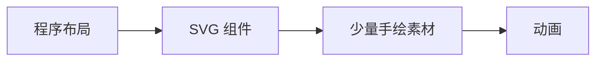

# Echo Commons Activity 游戏素材需求文档 v1.0

适用范围：本文维护飞行棋与 Kingdomino 的素材规格。开发先完成五子棋共同基础，棋盘与棋子使用 SVG 和 CSS 绘制，无需等待新增美术；后续两款游戏按本文整理素材。真实规则、文件归属与阶段见[共同基础](共同基础与文件结构.md)和[开发计划](并行开发计划.md)。

## 一、整体视觉方向

两个游戏共享同一套 Echo Commons 游戏空间风格。

关键词：

> 温暖桌游 · 手工纸板 · 轻卡通 · 桌面玩具感

参考方向：

- 《动物森友会》的柔和感
- 桌游实体组件质感
- 手绘 SVG
- 轻拟物阴影

避免：

- 写实 3D
- 强竞技电竞 UI
- 复杂粒子堆叠

目标：

让玩家感觉：

> “晚上和几个朋友坐在桌边玩了一局小游戏。”

---

# 二、通用 Activity 游戏空间素材

这些两个游戏共用。

---

## 2.1 游戏桌面背景

不交付游戏专用桌面图。项目决定 2026-10-18：两款游戏直接使用前端现有背景，不额外提供 `activity_table_bg.webp`，各自的对局桌面图本次也不使用（Kingdomino 已交付的 `kingdom_table.webp` 因此暂不接入）。确实需要独立桌面时再补。

---

## 2.2 桌面装饰

暂不交付图片素材。项目决定 2026-10-18：纸张、铅笔、杯子、台灯、闪光等装饰由前端用 SVG 与 CSS 程序绘制，只在实际需要时补手绘素材。

---

## 2.3 玩家席位 UI

用于显示玩家头像、当前行动、分数与状态。项目决定 2026-10-18：席位边框、当前行动光圈、思考气泡由前端用 SVG 与 CSS 程序绘制，与现有五子棋席位样式统一，不交付独立素材。

---

# 三、飞行棋素材需求

## 3.1 核心棋盘

由前端按规则几何程序绘制，不交付整张棋盘图。项目决定 2026-10-18：棋盘 59 个位置与颜色循环已由规则文档定稿，整张图无法单独改动某个格子，且与第八节「程序布局 + SVG 组件」的方向一致。原计划的整张 `aeroplane_board.svg` 作废。

绘制基准：viewBox `0 0 1000 1000`。

需要绘制：

- 外圈 52 格，颜色按 红 → 黄 → 蓝 → 绿 每 4 格循环
- 四色起飞处（0、13、26、39）与四座机场
- 四段归航道各 6 格与中央终点区
- 每色一格的虚线捷径格与飞越箭头
- 虚线交叉格

不要把棋子画进去，棋子单独移动。

---

## 3.2 飞机棋子

目录：

```
/aeroplane/pieces/
```

基础：

```
plane_red.svg
plane_blue.svg
plane_green.svg
plane_yellow.svg
```

规格：

128×128 SVG（已交付素材的实际尺寸；显示尺寸由前端 CSS 决定）。

要求：

- 朝向统一
- 中心点一致
- 透明边距

动画：

支持：

```
scale
rotate
translate
```

---

## 3.3 飞机状态效果

归第二阶段。基础阶段不交付护盾、加速、起飞烟雾素材，状态反馈先用程序绘制的 SVG 组件表现；下面三项留作第二阶段规格。

### 护盾

```
shield_effect.svg
```

### 加速

```
speed_line.svg
```

### 起飞烟雾

```
takeoff_cloud.svg
```

---

## 3.4 骰子

虽然飞行棋可以 CSS 实现，但建议准备。

文件：

```
dice_face_base.svg
dice_face_1.svg
...
dice_face_6.svg
```

已交付 `dice_face_base.svg` 与 `dice_face_1..6.svg`（128×128），底座与各面的外框一致，可直接做翻滚动画；原计划的 `dice.svg` 不再需要。

动画：

- 翻滚
- 停止
- 放大

---

## 3.5 飞行棋 UI

已交付 `turn_indicator.svg`、`finish_flag.svg`、`winner_badge.svg`（128×128）。

`move_hint.svg`（可落点提示）改由前端程序绘制，不交付素材（项目决定 2026-10-18）。

---

# 四、Kingdomino 素材需求

Kingdomino 最大特点：

不要画整张地图。

应该拆：

> Tile + Terrain + Decoration

因为未来事件卡、扩展玩法都会复用。

Kingdomino 的核心就是通过不同地形 tile 拼成 5×5 王国，并通过皇冠计算区域价值。[The Glass Meeple](https://theglassmeeple.com/kingdomino/?utm_source=chatgpt.com)

---

# 4.1 地块基础框架

不交付 `kingdom_tile_base.svg`。项目决定 2026-10-18：地块外框（160×80，两格）由前端程序绘制，两格地形贴图拼接在框内，与第八节「程序布局 + SVG 组件」的方向一致。

地块面只表现地形与皇冠，不表现建筑。实体上带皇冠的格子画有对应建筑（约 10 种），本项目用皇冠数量表示价值，不补建筑素材（项目决定 2026-10-18）。

---

# 4.2 地形素材

目录：

```
/kingdomino/textures/
```

已交付六类地形贴图，文件名统一为 `terrain_<种类>.svg`（即 `terrain_field.svg`、`terrain_forest.svg`、`terrain_lake.svg`、`terrain_meadow.svg`、`terrain_swamp.svg`、`terrain_mine.svg`），各 80×80，按 80×80 程序拼接。下面各小节里写的文件名按此规则替换。

基础六类：

---

## 森林

```
terrain_forest.svg
```

元素：

- 树
- 草地
- 小花

---

## 湖泊

```
terrain_lake.svg
```

元素：

- 水波
- 小鱼
- 芦苇

---

## 麦田

```
terrain_field.svg
```

元素：

- 麦穗
- 草垛

---

## 草原

```
terrain_meadow.svg
```

---

## 矿山

```
terrain_mine.svg
```

元素：

- 石头
- 矿洞

---

## 沼泽

```
terrain_swamp.svg
```

---

每个：

SVG。

建议：

```
80×80
```

程序拼接。

---

# 4.3 皇冠

不要画进地块。

单独：

```
crown_gold.svg
crown_silver.svg
```

已交付两种皇冠（64×64）：金色用于地块显示，银色用于叠加或对比场合。

用途：

- 地块显示
- 加分动画

动画：

获得皇冠：

```
scale 0
↓
scale 1.3
↓
1
```

---

# 4.4 城堡

Kingdomino 的标志元素。

需要：

```
castle_red.svg
castle_blue.svg
castle_green.svg
castle_yellow.svg
```

尺寸：

120×120。

动画：

开始：

城堡落地。

```
drop
bounce
sparkle
```

---

# 4.5 地块选择卡

玩家选择阶段：

需要：

```
tile_card_back.svg
tile_selected_frame.svg
tile_locked.svg
```

三件均已交付（160×80）。

动画：

翻牌：

```
rotateY
```

---

# 五、Kingdomino P1 提升素材

以下均为第二阶段内容，基础阶段不交付。

## 5.1 地块落地特效

不用图片。

组合：

- dust.svg
- sparkle.svg

---

## 5.2 王国完成效果

例如：

5×5 完成。

素材：

```
kingdom_complete.svg
```

效果：

- 星星
- 光环

---

## 5.3 事件卡预留

虽然第一版不做。

但是建议提前设计：

目录：

```
/kingdomino/events/
```

模板：

```
event_card_frame.svg
event_icon.svg
event_reward.svg
```

未来：

例如：

```
spring_harvest.png
dragon_attack.png
festival.png
```

---

# 六、文件结构建议

以下路径相对 `frontend/public/assets/games/activity/`。仅创建实际已有资源需要的目录，素材清单记录正式文件、用途与来源。

| 目录 | 内容 |
|---|---|
| `aeroplane/pieces/` | 四色飞机 |
| `aeroplane/ui/` | 骰子底座与六面、回合指示、终点旗、获胜徽章 |
| `kingdomino/pieces/` | 四色城堡 |
| `kingdomino/textures/` | 六类地形贴图 |
| `kingdomino/ui/` | 金银皇冠、地块选择卡三件 |

基础阶段不创建 `common/`：桌面背景沿用前端现有背景，装饰与席位 UI 由前端程序绘制（见 2.1～2.3）。事件卡目录随规则确定后再补。

---

# 七、素材优先级

## 两款游戏的基础规则素材

必须：

### 飞行棋

⭐⭐⭐⭐⭐

- 棋盘（程序绘制）
- 四色飞机（已交付）
- 骰子（已交付）
- 基础 UI（`turn_indicator`、`finish_flag`、`winner_badge` 已交付；可落点提示程序绘制）

### Kingdomino

⭐⭐⭐⭐⭐

- tile 框架（程序绘制）
- 六种地形（已交付）
- 皇冠（已交付）
- 四个城堡（已交付）
- 地块选择卡（已交付）

---

## 第二阶段

提升体验：

- 动效素材
- 音效
- 事件卡框架
- 特效

---

## 第三阶段

特色内容：

- 主题皮肤
- 节日活动
- Character 专属棋子

---

# 八、一个重要建议：不要让 AI 生整张游戏图

例如：

“生成一个漂亮 Kingdomino 棋盘”

这种很容易失败。

因为：

- 格子必须严格对应；
- SVG 动画需要拆分；
- 点击区域需要精准。

正确流程：



这也是为什么「程序布局 + 组件 + 动画」的方向要优先于单张精修图。

---

如果按照这个规范做，基础阶段实际交付的素材量已不大：

**飞行棋：14 个 SVG 素材。**

**Kingdomino：15 个 SVG 素材**（另有 1 张对局桌面图 `kingdom_table.webp`，本次不接入）。

通过动画和组合完成桌游应用的展示。美术与图像生成按组件规格提供独立素材，由前端根据真实状态组合。
