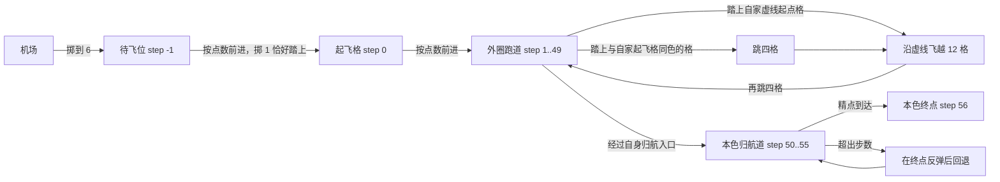

# 飞行棋基础规则（传统玩法）

更新日期：2026-10-21。状态：基础规则已实现（`aeroplane.traditional` v1，代码见 `games/src/echo_games/aeroplane`）。本文是 `aeroplane` 玩法基础阶段的唯一规则文本；进阶道具规则另行确定。规则来源调查、阶段划分与分工见[并行开发计划](并行开发计划.md#2-规则来源调查)，对局标识、席位与动作契约定型见[游戏与角色活动接口](游戏与角色活动接口.md)。

## 1. 规则来源

- 玩法来源：中文维基百科《飛行棋》条目的「傳統玩法」一节，[条目地址](https://zh.wikipedia.org/wiki/飛行棋)，引用版本 94493224（2025-01 前后），访问日期 2026-10-18。
- 棋盘来源：条目本身只描述机制，没有给出格子坐标。棋盘沿用本文第 3 节已经确定的几何，其中「同色格」「虚线捷径」等格子位置依据同一玩法在英文维基百科《Aeroplane chess》条目的配件描述（外圈 52 格均分四色、每色一个虚线捷径格、四个箭头归航区、捷径与归航区相对）确定，并逐条标注为「（项目决定）」。
- 条目标注为「部分版本」「部分規則」的括号内变体规则一律不采用，包括：掷到偶数点（2、4、6）即可起飞、三次六时本方所有棋子（含已到终点者）一起返回停机坪。条目的「創新玩法」一节属于进阶阶段内容，不在本规则内。
- 之前按 Kogan 手册编写的版本已被本文替换，原因见[并行开发计划](并行开发计划.md#2-规则来源调查)。

## 2. 对局标识与席位

| 项 | 值 |
|---|---|
| `game_type` | `aeroplane` |
| `ruleset_id` | `aeroplane.traditional` |
| `ruleset_version` | 1 |
| 人数 | 2–4 人 |
| 席位 | `red`、`yellow`、`blue`、`green`，顺序即座位与色序 |

每席 4 枚飞机棋子。本局使用实际就坐的颜色（2–4 人，由参加者在加入时选定席位），未就坐颜色的机场留空；外圈颜色循环完整保留，跳格判定只看落点是否与自家起飞格同色，与该颜色是否有人就坐无关（项目决定：条目只描述四色棋子的准备，未说明人数不足的处理；服务允许自由选席，因此以实际就坐为准）。

## 3. 棋盘与路线

条目没有给出格子坐标，以下几何为（项目决定），使规则可以直接测试。棋盘为 15×15 网格，四角各留一个 4×4 机场（红右上、黄右下、蓝左下、绿左上），外圈是绕开四角机场、去掉四个角格的矩形环：

- 外圈跑道共 52 格，顺时针编号 0–51，颜色按 红 → 黄 → 蓝 → 绿 循环，即格 `i` 的颜色是色序中的第 `i mod 4` 个颜色。每色 13 格，同色格彼此相隔 4 格；四个角格不参与跑道，因此每边 13 格、相邻两个归航入口之间正好隔 12 格。
- 四色起飞处为 0 红、13 黄、26 蓝、39 绿，彼此相隔 13 格，紧贴自家机场。颜色循环使四家起飞格都是本家颜色；跳格与飞越判定一律以「落点与自家起飞格同色」为准。
- 每色归航道 6 格，入口在自身起飞处沿行进方向后退 3 格，落在棋盘边正中：外圈最后一格（`step = 49`）的格号为红 49、黄 10、蓝 23、绿 36。每色终点 1 格，位于本色归航道之后，四色终点集中在棋盘中央。
- 机场出口设待飞位（`step = -1`）：起飞的棋子先进入待飞位，再按下一次掷骰的点数前进，掷 1 恰好踏上起飞格。
- 每色一个虚线捷径格：位于对角家归航入口之后、与自家起飞格同色，四家都取 `step = 24`；沿虚线飞越 12 格，落在 `step = 36`。四条虚线各自斜切过对角家的机场角，连成一圈。
- 虚线只承载飞越本身，不参与吃子；对角颜色配对 红↔蓝、黄↔绿 仍用于说明四条虚线的相对方位（项目决定：52 格下 12 格飞越的线段压在机场角上，那里没有可停留的跑道格）。

每枚棋子用一个整数 `step` 或 `base` 表示位置：

| 位置 | 含义 |
|---|---|
| `base` | 在机场（停机坪），未起飞 |
| `step = -1` | 在机场出口的待飞位，已起飞、尚未踏上跑道 |
| `step = 0` | 在起飞格 |
| `step = 1…49` | 在外圈，格号为 `(本家起飞处 + step) mod 52` |
| `step = 50…55` | 在本色归航道第 `step - 49` 格 |
| `step = 56` | 在本色终点，飞行完成 |

从起飞格到终点共 56 步。停在外圈时格号由 `step` 唯一确定，与自家起飞格同色的外圈格即满足 `step mod 4 = 0` 的格子（四家起飞处相位固定，该判定对四家一致成立）。

## 4. 准备

- 每名玩家取 4 枚同色棋子，全部停在各自的机场。
- 座位顺序固定为 红 → 黄 → 蓝 → 绿，行动按此顺序轮转（项目决定：条目只写「輪流擲骰子」，未指定首回合行动者与相对座位）。
- 第一回合由参加席位中色序最靠前者开始（项目决定）。

## 5. 回合流程

当前行动者在自己的回合内依次执行：

1. 掷骰：掷一颗六面骰，点数 1–6。
2. 行动：
   - 掷到 6：可以起飞一枚棋（进入机场出口的待飞位），也可以让一枚已在场上（含待飞位）的棋前进 6 格。
   - 掷到其他点数：只能让一枚已在场上（含待飞位）的棋前进相应格数；场上没有本方棋子时本回合无事发生。
3. 结算连锁：处理落点触发的跳四格、虚线飞越与吃子，见第 7、8 节。
4. 追加掷骰：本次掷到 6 时，结算完成后回到第 1 步再掷一次。
5. 三次六惩罚：同一回合内连续第三次掷到 6 时，本次行动不执行，立即受罚并结束回合，见第 9 节。
6. 交接：没有追加掷骰时，轮到座位顺序中的下一名参加者。

（项目决定：条目把「掷到 6 才能起飞」与「掷到 6 后走完棋可重掷」写在同一段，未说明同一次 6 能否既起飞又前进；本规则按「二选一」执行。）

## 6. 行动选择

- 起飞（`TakeOffAction`）：掷到 6 时，从机场取一枚棋子放到机场出口的待飞位（`step = -1`）。
  - 待飞位不属于外圈：起飞本身不前进、不占用跑道格、不参与吃子，也不触发跳四格与虚线飞越（项目决定：条目未描述起飞后的落点；先入待飞位再踏上跑道，避免「掷 1 起飞原地不动」的矛盾）。
  - 只有掷到 6 才能起飞。
- 前进（`MovePlaneAction`）：指定一枚已在场上（含待飞位）的本方棋子，按骰子点数前进。
  - 从待飞位前进 n 点落到 `step = n - 1`：掷 1 恰好踏上起飞格并按到达结算吃子，掷 6 落到 `step = 5`。
  - 前进后按第 7、8 节结算落点。

## 7. 落点结算：跳格、飞越与吃子

条目区分「踏上」（按骰子点数走到）与「跳到」（因跳格或飞越到达），两者触发的能力不同。

| 到达方式 | 落点与自家起飞格同色（普通格） | 落点是自家虚线起点格 |
|---|---|---|
| 踏上 | 可以跳四格 | 可以沿虚线飞越，飞越后可以再跳四格 |
| 跳到 | 不再跳格 | 可以沿虚线飞越，飞越后不再跳格 |

- 跳四格（`JumpFourAction`）：从前落点前进 4 格，正好落在下一个与自家起飞格同色的格。
- 虚线飞越（`FlyShortcutAction`）：从虚线起点格沿虚线飞越 12 格，落在前方与自家起飞格同色的格上。飞越只改变位置，不再额外结算对角颜色的吃子。
- 跳四格与飞越都是可选动作（条目原文用「可以」）。玩家可以选择不跳、不飞，直接结束本次移动。
- 终点除外：终点不在外圈，不触发跳格。

（项目决定：跳四格与飞越的落点同样只按「跳到」处理，因此不会自行连锁；这与条目对「跳到」的说明一致。）

## 8. 吃子与叠子

- 吃子：一枚棋到达（按点数走到或跳到）某一格时，该格上对方的所有棋子都返回各自的机场，重新等待起飞，不论数目多少。因此本规则没有 Kogan 版本里的「两枚以上阻挡」。
- 虚线飞越不额外吃子：52 格下的虚线只斜切过机场角，线段下没有可停留的跑道格，飞越的吃子只按最终落点结算（项目决定：条目提到虚线路径上的对方棋子返回机场，但该描述对应外圈穿心的旧版棋盘；本几何下不适用）。
- 叠子：同一方的多枚棋子可以停在同一格。叠放只是共用格子，仍按单枚移动，不整叠一起前进（项目决定：条目把是否「疊著行棋」交给玩家共同决定，本项目固定为不整叠移动，避免出现需要现场协商的可选项）。
- 机场与待飞位上的棋子不占用外圈格，不参与吃子。

## 9. 三次六惩罚

- 同一回合内连续第三次掷到 6 时：本次 6 不执行起飞或前进，立即受罚，本回合结束，不再追加掷骰。
- 惩罚内容：该玩家选择自己一枚仍在场上（不在机场、未完成）的棋子返回机场，重新等待起飞（俗称「三次六返大陆」）。
- 场上没有可返回的棋子时，本次只结束回合。
- 前两次六的动作照常保留（条目只要求「其中一隻棋子返回機場」，不撤销此前移动）。
- 条目括号内的扩展版本（本方所有棋子、含已到终点者一起返回）不采用。

（项目决定：条目写「该玩家其中一只棋子」，未指明是哪一枚，也未说明第三次六是否照常行动；本规则按玩家自选、且第三次六不执行处理。）

## 10. 归航道、终点与反弹

- 棋子走完外圈最后一格后继续前进即转入本色归航道；归航道是本色专属区域，对方棋子不能进入，也不存在吃子。
- 归航道共有 6 格，四色终点在棋盘中央，均由本规则独立归属。
- 反弹：在归航道上按点数前进会超过终点（`step > 56`）时，改为在终点反弹后回退：`新位置 = 112 - 目标位置`。例如在 `step = 53` 掷到 5，先到达终点再回退 2 格，落在 `step = 54`。（项目决定：条目只写「在大箭頭上超出步數時反彈」，本规则把归航道视为大箭头，并给出统一公式。）
- 正常进入外圈之外的归航道与终点不受反弹影响：外圈最后一格（`step = 49`）加最大点数也只到 `step = 55`，不会超过终点。
- 步数刚好落到终点（`step = 56`）即飞行完成，棋子翻过来放回机场以示完成，不再参与对局。

## 11. 胜负

- 首个把本方 4 枚棋子全部送到终点的玩家获胜，对局结束。
- 条目按名次继续排位（「如此類推」）；基础阶段只结算胜者，不实现后续名次（项目决定）。
- 认输、取消、结束活动属于生命周期契约，不作为规则动作。

## 12. 阶段、机会与动作

进行阶段由阶段推进，每个阶段为当前行动者产生一个机会。

| 阶段 | 含义 | 可用动作 |
|---|---|---|
| `awaiting_roll` | 等待当前行动者掷骰 | `RollDiceAction {}` |
| `awaiting_action` | 已掷骰，等待起飞或前进 | `TakeOffAction { plane_id }`（仅掷到 6）、`MovePlaneAction { plane_id }` |
| `awaiting_chain` | 落点触发跳格或飞越，等待选择 | `JumpFourAction { plane_id }`、`FlyShortcutAction { plane_id }`、`EndMoveAction {}` |
| `finished` | 已有胜负结果 | 无 |

- `plane_id` 明确指定本方的一枚棋子；`MovePlaneAction` 的步数由本次骰子结果决定。
- `EndMoveAction` 表示放弃尚可使用的跳格或飞越，结束本次移动。
- 阶段与动作视为初步约定，随实现细化；规则语义以上文各节为准。
- 掷骰、起飞、前进、跳格、飞越都按幂等请求保存：同一 `request_id` 重试返回已保存的回执，不重复执行，也不重复增加版本。

## 13. 观察与随机

- 飞行棋没有隐藏信息：所有棋子的位置、当前行动者与本次骰子结果对全部席位可见（项目决定：条目未涉及信息隐藏，棋子与骰子都是公开桌面信息）。
- 随机点只有掷骰结果，由游戏注入的随机源产生并随状态与回执保存，保证重复请求、刷新与重启恢复后结果一致。
- 四席的观察内容相同，不需要按席位裁剪的私人视图。

## 14. 项目决定汇总

| 条目 | 决定 | 依据 |
|---|---|---|
| 棋盘几何 | 15×15 网格、外圈 52 格（去掉四角）、每边 13 格、机场 4×4 居四角、起飞处 0/13/26/39、归航入口在边正中（起飞格 = 入口沿行进方向 +3 格） | 条目未给出格子坐标，需要可测试的明确几何；52 格使相邻归航入口之间正好 12 格、起飞格紧贴机场 |
| 颜色循环 | 红→黄→蓝→绿 每 4 格循环，每色 13 格，四家起飞格都是本家颜色；跳格判色以「落点与自家起飞格同色」为准 | 英文条目配件描述「52 格均分四色」，跳四格要求同色格相隔 4 格 |
| 色序与座位 | 席位与座位顺序为 红→黄→蓝→绿 | 英文条目写明轨道色序即挂架顺序 |
| 虚线捷径位置 | 四家都取 `step = 24`，飞越 12 格到 `step = 36`；起点位于对角家归航入口之后、与自家起飞格同色 | 英文条目写「捷径与自家归航区相对」；每色 13 格、飞越 12 格是条目「52 格四等分」与用户复核的取值 |
| 虚线吃子 | 飞越不额外吃子，只按最终落点结算 | 12 格飞越的线段斜切机场角，线下没有可停留的跑道格 |
| 对角颜色 | 红↔蓝、黄↔绿 | 条目只写「己方对角颜色」，用于说明四条虚线的相对方位 |
| 缺位处理 | 本局用色为实际就坐的席位，未就坐颜色机场留空，颜色循环与跳格判色不受影响 | 条目未描述人数不足；服务允许自由选席 |
| 六的行动选择 | 掷到 6 时「起飞」与「前进」二选一 | 条目两句话写在同一段，未说明可否同时 |
| 起飞与待飞位 | 起飞进入待飞位（`step = -1`），不捕获、不前进；从待飞位踏上起飞格才按到达吃子 | 条目未描述起飞后的落点；待飞位避免「掷 1 起飞原地不动」的矛盾 |
| 连锁触发条件 | 只有「踏上」触发跳格与飞越，「跳到」不再触发跳格 | 条目区分「踏上」与「跳到」 |
| 连锁可否放弃 | 跳格与飞越都是可选动作 | 条目原文用「可以」 |
| 叠子行棋 | 可叠放，但仍按单枚移动 | 条目把是否整叠交给玩家共同决定 |
| 三次六惩罚对象 | 由玩家自选一枚在场棋子返回机场 | 条目只写「其中一只棋子」 |
| 第三次六的动作 | 不执行起飞或前进，直接受罚并结束回合 | 条目未说明第三次六是否照常行动 |
| 反弹几何 | 归航道视为大箭头，超出终点按 `112 - 目标位置` 回退 | 条目只写「在大箭头上超出步数时反弹」 |
| 胜负范围 | 只结算首位完成者，不实现后续名次 | 条目给出名次排序，基础阶段不需要 |
| 括号变体 | 偶数起飞、三次六全部棋子返回等一律不采用 | 用户要求忽略括号内变体规则 |
