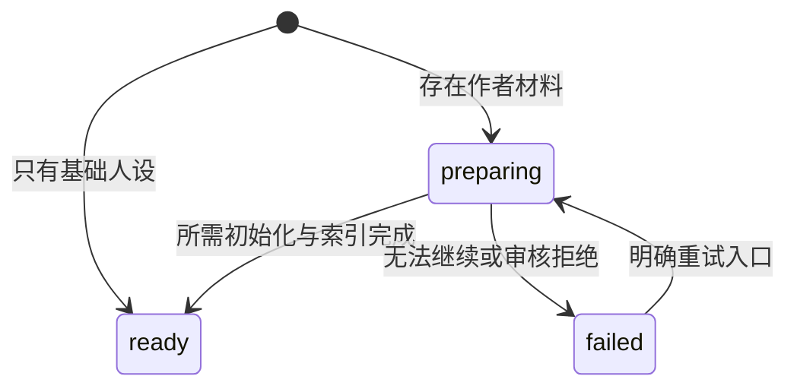

# 两条记忆路径实施计划

状态：实施中，按步骤验证并分别提交。日期：2026-10-06。

本文件用于安排记忆阶段的开发与验收，完成实施后删除。长期业务规则以 [记忆设计](design/memory.md) 和 [四种反思图](design/reflection/README.md) 为准，实际能力见 [后端状态](status.md)。本任务对应状态文档第 2、3 项，完成后再进入群聊参与判断与角色接话。

## 1. 目标与范围

交付两条实际可运行的记忆路径：简单模式能检索作者背景和已整理的聊天经历；完整模式在相同基础上维护状态、关系、长期记忆和派生认识，并利用实体关联检索。聊天自动读取少量相关材料，角色保留主动深入查询的能力。

- 实例创建选择 simple 或 full，默认 simple，创建后不可切换。人物创作与运行模式分别保存。
- 简单模式执行段摘要与连续性压缩，不安排状态、关系、长期整理和认识刷新。
- 完整模式执行 segment_reflect、continuity_compress、memory_organize、view_refresh。
- 作者故事和采访原文分块，段摘要成为正式检索来源；完整模式增加长期页和记忆图关联。
- 向量检索默认关闭，开启后使用混合检索；关闭或向量服务故障时，全文与实体关联查询仍可使用。
- 有作者材料的实例完成初始化前禁止聊天与活动；没有材料的实例直接可使用。初始化失败可重试。
- Thought 随角色输出记录保存，参与自身历史和反思，暂不自动清理，不成为普通搜索来源。
- diary 不接入运行链。保留已有数据和暂缓设计，不开发日记提示、日期调度、消费者或清理链。

本任务不实现已有实例背景重置、模式切换、RSI、主动开口、群聊连续接话或活动玩法。不修改根目录的项目推进计划。

## 2. 现有基础与需要补齐的部分

| 部分 | 当前基础 | 本任务工作 |
|---|---|---|
| 实例创建 | CharacterBootstrap 创建实例、空状态和预置记忆 | 模式、准备状态、初始化调度及使用资格 |
| 作者材料 | 固定自定义人物资源保存故事与采访 | 明确来源、实例材料副本、分块、准备进度 |
| 反思执行 | 三种主要图、冻结输入、节点与图级审核、恢复 | 模式限制、作者批次、认识刷新、部分成功补做 |
| 摘要链 | 手动封段，两个独立摘要消费者 | 自动封段和持续扫描，按模式安排消费者 |
| 查询 | jieba 分词和 FTS5，全消息与长期页来源 | 分块和摘要来源、模式过滤、语义候选、图关联和重复合并 |
| 对话输入 | ContextSnapshot 保存人设、历史、digest 和部分摘要 | 自动检索结果、版本、准备资格及恢复一致性 |
| 运行设施 | 后台执行、租约、ModelBudget 与失败记录 | 复用既有设施，不建立第二套任务执行器 |

## 3. 模块职责与调整边界

| 所属位置 | 负责内容 |
|---|---|
| `modules/characters/domain` | 实例模式、准备状态和可使用规则 |
| `modules/characters/services/bootstrap.py` | 创建入口、绑定固定资源和模式；通过记忆契约安排初始化 |
| `modules/characters/repositories` | 实例模式与准备状态的持久化 |
| `modules/memory/domain` | 作者材料、分块、初始化批次、查询范围及结果等明确类型 |
| `modules/memory/services` | 材料准备、分块、索引、检索、自动封段及材料消费 |
| `modules/memory/repositories` | 原文、分块、索引、实体关联和初始化进度的查询与保存 |
| `modules/reflection` | 四图执行政策、来源投影、审核、事实提交、ChangeSet 和补充恢复 |
| `modules/conversations/tasks` | 检查实例资格，准备并冻结自动检索结果，提交前复核资格 |
| `infrastructure/models` | 真实文本向量调用、供应商适配与使用量记录 |
| `app/composition.py`、`app/lifecycle.py` | 依赖装配和后台扫描生命周期 |
| 现有 HTTP 与管理接口模块 | 模式输入、准备进度、重试和诊断；复用领域规则 |

实例创建通过 `modules/memory/contracts.py` 扩展明确的初始化能力，不能从 characters 直接操作 memory 表。认识刷新通过明确的事实变化对象读取 characters 和 memory 的正式事实，不能从候选或日志推断变化。

可以在上述模块内拆分已有过大的服务或输入准备器，以隔离同步读取、外部向量请求和提交；保持原有业务入口与依赖方向。只有实际职责需要时新增文件，不建立通用插件框架、万能基类或平行运行编排层。Agent 只生成提议，不直接读取数据库。

## 4. 数据与执行契约

### 4.1 模式与准备状态

实例保存 `memory_mode`，取值 simple、full；保存 `memory_status`，取值 preparing、ready、failed。失败原因和初始化执行进度单独记录，不通过自由文本状态表达业务规则。

创建入口仍使用客户端提供的实例编号实现重复请求识别。同编号与同固定资源、版本、模式返回原实例和准备状态；不同绑定返回冲突。省略模式统一解析为 simple。后续编辑入口不提供模式修改字段。

创建请求完成短事务后返回实例与当前状态，后台继续准备。列表和详情可展示准备状态；公开错误提供可理解的失败分类，不包含凭据。准备中的角色不能加入会话、成为初始会话成员、获得回应任务或执行活动；资格在共同规则处检查，管理入口也遵守。若旧任务已持久化，执行与提交必须再次检查对应实例资格。

### 4.2 作者材料与分块

实例分别保存固定版本的材料副本和来源关系。每项材料包含实例归属、人物资源编号与版本、材料种类、原文和位置；采访额外保存题目编号和问题。每块绑定材料、片段编号、正文位置及来源版本。

使用已有结构化问答数据拆分采访；故事以段落和完整事件语境组织。建议每块正文最多 800 字符，长片段拆分时最多保留 100 字符相邻语境；采访问题作为片段元数据保留，另计输入预算。解析采用标准库或成熟库，不通过模型猜测来源范围。作者材料不得携带伪造的会话序号。

简单初始化完成原文副本、分块及全文索引。完整初始化在共同准备后，冻结作者材料批次进入 memory_organize，保存长期页、实体和关系，再完成必要的核心记忆刷新与全文索引。向量索引独立在后台生成，不作为 ready 的条件。作者初始化立即安排，不等待运行期间的大小循环；背景不触发针对当前玩家的关系或当日状态反思。

无长期事实时允许有明确理由的 NoOp；原始分块仍可检索。核心记忆没有适合内容时记录明确结果，不制造空白经历。成功产物在本实例重试时复用，不建立跨实例初始化缓存。

### 4.3 检索与上下文

全文索引继续使用现有 FTS5。增加 `memory.vector.enabled`，默认 false；关闭时不要求向量服务配置、不创建向量客户端、不安排向量任务。开启后通过已有 OpenAI 兼容 SDK 的真实 embeddings（文本向量生成）接口计算向量，使用独立模型配置；不能假设对话模型同时支持向量请求。供应商、模型、维度与预算明确配置，密钥沿用既有凭据管理。向量调用与生成请求共用模型并发额度、有限重试和期限设施；等待执行的聊天优先于后台索引，已开始的调用正常结束。

向量和来源元数据保存于 SQLite；在当前单进程规模内，用 NumPy 的向量运算计算候选相似程度，不引入独立向量数据库。只读取当前角色允许范围内的向量；批量索引和查询都受到数量与文本预算限制。模型选择变更后重建相应索引，不能混用不同模型或维度的向量。

开启向量时，候选分别按全文与语义排序，再采用明确的排名融合规则合并，避免直接混加不可比较的分数；关闭时仅使用全文排名。完整模式从查询明确匹配的实体及直接命中页所关联的实体出发，扩展最多一层关联页，优先选择同时涉及当前主题的内容。结果仍受来源与模式约束，同名实体不能直接合并；每条结果返回关联依据和记忆正文。不通过额外生成模型分析查询，也不把整个记忆图发送给角色。

建议默认自动检索最多 5 条、正文合计最多 4000 字符；图扩展最多选择 3 个实体、合计读取 16 条关联边。它们属于可配置的数量上限，不能突破共同输入预算。以本次需要回应的内容为主构造查询，指代不清时补充少量近期上下文；普通问候或简单附和允许跳过检索，没有合适结果时允许返回空集合，不强行填满数量。不发送完整聊天历史去计算查询向量。

合并同一正式来源的命中；长期页与原始分块的关联用于识别重复内容，近期上下文已有的相同内容不重复发送。不同事件或不同时间的变化不能仅因文本相似而删除。返回正文、来源标识、版本、材料种类及必要时间；检索正文与常驻人设、会话回顾和近期原文共同计入输入预算。

自动检索与 memory_search 复用同一服务、权限和模式规则。任务准备先固定观察范围，再执行必要的外部查询，提交快照前复核实际使用来源；外部请求期间不持有数据库写事务。重试使用已保存快照，不能重新检索并改变原任务输入。

开启后后台补建已有来源的向量索引，期间继续使用全文结果。语义调用失败按既有有限重试处理，记录真实失败并返回合法全文结果；初始化仅等待必需材料处理和全文索引，不等待向量索引。关闭后停止新请求并保留已有索引，重开时补建缺失或过期来源，模型或维度变化时重建不匹配索引。已经可聊天的实例后续索引失败，不阻断聊天或删除材料，失败记录由后台补做。

### 4.4 自动整理与恢复

自动整理采用小循环和大循环，复用材料量与最长等待时间任一达到即触发的规则。小循环积累未归段消息及自身 Thought，冻结后执行段反思；大循环积累对应消费者可按顺序选取的已审核摘要，冻结后执行连续性压缩或完整模式的长期整理。摘要审核保存后即可进入检索，无需等待大循环。

配置集中保存，以下为计划默认值；目标量负责触发，单次处理仍遵守已有硬上限。

| 配置 | 小循环 | 大循环 |
|---|---|---|
| 目标材料字符量 | 12000，包含消息与 Thought | 12000，统计新段摘要 |
| 最长等待时间 | 30 分钟，自最早待归段消息记录时起 | 120 分钟，自最早可处理摘要审核保存时起 |
| 硬上限 | 复用每段 100 条消息及材料数量、字符预算 | 复用摘要批次预算，扣除前一 digest 等必要输入 |

建议共同扫描间隔为 30 秒。持续输入不重置最早材料的计时，不用空闲时间替代最长等待时间；材料接近硬上限时也安排合法批次。世界时间不控制执行计时。扫描只读取正式记录，不调用模型。

冻结材料、登记任务后，本批移出待安排范围；未纳入本批的积压和后来的材料继续累计，保留最早时间。冻结失败不清零。模型失败重试原批次，成功审核保存后才推进消费。同一消费者已有进行中的任务时继续积累，结束后检查下一批；达到期限但没有合法材料时不创建空任务。

连续性压缩与长期整理分别保存批次和消费进度，一方执行结果不重置另一方。共同调度负责统计、触发判断和请求冻结；小循环的权限与消息完整性、大循环的连续顺序与前一 digest 由所属材料服务保证，不建立第二套执行器。暂停或进程退出时释放后台资源；重启从材料、批次、消费和租约恢复待处理范围，不依赖内存计数。

状态、关系和长期记忆正式提交时记录 ChangeSet。认识刷新跟随正式提交，合并同一目标尚未处理的变化，选择受影响的状态概括、关系态度、核心记忆分支，不建立第三套定时循环。源版本改变时重新准备当前事实，旧候选不能覆盖新认识；无变化不安排模型调用。

段反思或认识刷新部分成功后，新建关联原运行的补充任务，只执行失败分支；复用冻结输入及成功产物，已经提交的摘要、事实与消费记录不重复提交。长期整理的两个必需分支仍保持共同审核与提交，不把分支失败当作合法 NoOp。

关系消费者需要明确支持普通互动、支持、冲突与承诺等实际证据分类。分类依据来自允许材料，数值和资格仍由正式关系服务计算，不能让模型直接写入分数。

## 5. 实施步骤

### 步骤一：领域规则、数据库与接口基础

完成：模式、准备状态与共同资格规则；版本 6 迁移及作者原文恢复；创建重复识别和归属受控的重试接口。基础类型、接口参考和升级测试随本步骤提交。后台初始化与索引处理在后续步骤接入。

1. 为实例加入模式和准备状态，集中定义资格检查；补齐创建请求重复识别。
2. 增加作者材料、分块、向量索引与初始化进度所需结构，复用已有来源与执行记录，避免重复保存相同业务状态。
3. 使用新增 `0006` 迁移，不修改已完成的 `0001`～`0005`。旧实例按 full、ready 迁移，保留此前完整反思行为；新创建实例默认 simple。保留旧消息、Thought、长期记忆、预置记忆、关系、状态和密钥。
4. 为旧实例恢复可获得的固定作者材料引用；不能因缺少历史材料阻断原实例使用，也不伪造缺失内容。准备明确的旧索引重建路径。
5. 创建与读取响应加入模式、准备状态及失败信息，提供归属受控的准备重试入口；不新增模式切换接口。

### 步骤二：共同材料与检索

1. 接入固定作者材料副本、结构化分块、段摘要允许来源和全文索引。
2. 实现默认关闭的向量配置、真实网关、后台补建与重建；关闭时全文流程独立可用，外部调用和短事务分开。
3. 实现模式过滤、混合候选、来源复核、重复合并和结果预算；完整模式随后接入图扩展。
4. 将自动检索结果加入对话快照和来源版本，保持深入查询工具复用相同服务。

### 步骤三：简单路径与准备资格

1. 作者材料完成分块和全文索引后提交 ready，向量索引不阻止准备完成；无作者材料直接完成。
2. 在反思入口和节点激活处统一应用模式限制，包括管理调度。
3. 接入大小循环共同触发规则、可配置预算与等待时间、批次冻结及连续性压缩调度，保障聊天调用额度。
4. 验证准备中与失败角色不能参与聊天，简单角色不产生状态、关系或长期整理任务。

### 步骤四：完整路径与恢复

1. 扩展 memory_organize 的作者批次输入和节点投影，复用两个模型分支及正式审核保存。
2. 完成 ChangeSet、view_refresh 输入、专属提示、条件规划和事实消费者。
3. 完成记忆页与实体关联检索、初始化完成判定，以及部分成功后的补充执行。
4. 完善关系证据分类和长期整理自动调度；逐项检查来源、消费和恢复一致性。
5. 从运行注册与调度中排除 diary；保留旧数据所需的读取类型，不删除历史记录，不扩展日记执行代码。检查所有 Thought 自动清理入口，当前流程均不安排清理。

### 步骤五：验收与接入文档

完成下节验证，更新实际 HTTP、管理接口、配置、数据库参考、OpenAPI 与前端接口类型；只增加本任务相关字段和接入说明。更新源码导航、实现状态和必要的架构决定。检查安装包包含新迁移及提示资源。完成后删除本计划及其入口链接，清理本轮临时测试目录、模型捕获、构建结果和后台资源。

## 6. 验收要求

| 场景 | 必须证明的结果 |
|---|---|
| 模式与重复创建 | 默认简单，显式完整可用；创建后不能切换；同编号重复不重复初始化，不同模式绑定冲突 |
| 准备资格 | 故事或采访存在时不能提前聊天；失败可见且可重试；只有基础人设直接可用 |
| 简单路径 | 背景和跨会话段摘要可检索；不生成长期页、状态关系变化或认识刷新任务 |
| 完整路径 | 作者初始化与实际经历分别可追溯；长期页、实体、关系及认识刷新真实完成 |
| 向量开关 | 默认关闭时不要求向量服务、没有向量请求且初始化和聊天可用；开启后补建，关闭后停止请求；实际向量失败不阻断全文结果 |
| 检索质量 | 全文可找到具体名字与约定；开启向量后验证改换措辞的检索；图扩展最多一层且返回有依据、与主题相关的正文 |
| 自动使用 | 有检索内容时快照包含相关记忆；普通附和可跳过，无合适结果可为空；主动查询可取回更具体材料，输入总预算正确 |
| 可见性与冻结 | 群聊私有范围、成员离开与重新加入、其他角色 Thought、旧任务观察上限均正确；重试不读取未来内容 |
| 内容含义 | 作者家人不成为当前社群关系；习惯不成为今日事实；他人陈述、角色猜想与亲身经历保留区别 |
| 自动调度 | 分别验证材料量与时间触发、持续聊天不延后计时、配置生效；冻结仅移出本批计数，积压时间保留；两个消费者独立，空材料、重复扫描和重启不重复处理 |
| 失败恢复 | 真实调用失败不推进消费；索引失败可补做；部分成功只恢复失败分支，已提交事实不重复 |
| Thought 与 diary | 输出及 Thought 保持保存；没有自动清理；没有日记运行或日记覆盖依赖 |
| 升级与安装 | 真实版本 5 数据升级保留资料；旧实例维持完整行为；空库与索引重建一致；安装资源齐全 |

纯领域测试使用真实类型和明确材料，数据库测试使用真实 SQLite；模型与向量场景使用已配置的真实服务，不使用 mock、伪造向量或固定网关答案。供应商配置缺失时如实报告未完成的验收，不能把未执行的语义检索标记通过。

内容质量使用同一人物材料和真实互动分别评价两种模式，检查背景细节、约定、时间变化及跨会话回忆；记录调用次数、整理延迟和内容错误。结构合法与任务完成不能代替内容质量。按改动范围运行测试、静态检查、契约生成检查和文档链接检查，不要求无关前端页面重构。
