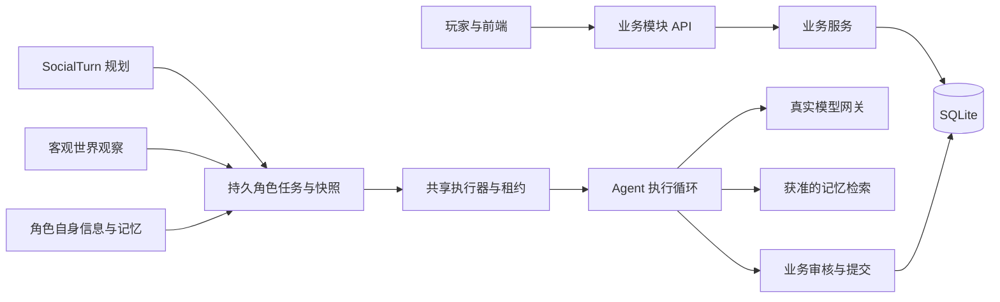

# Echo Commons 后端架构

版本 `0.1.0`。后端面向本地开发，使用单进程与 SQLite，为多名玩家及多个独立角色实例保存权威业务状态。玩家通过 HTTP 发送消息，角色通过模型提出行动，正式业务服务审核后提交事实。

## 目录与依赖

| 目录 | 实际职责 |
|---|---|
| app | 配置、组合根、生命周期、CLI、诊断和路由组装 |
| modules | communities、characters、conversations、social、perspective、memory、reflection 的业务规则、服务与存储 |
| agents | 不可变输入输出契约、角色 Agent 与模型工具循环 |
| execution | 共享预算、租约、任务分派、恢复及后台执行器 |
| infrastructure | SQLite、模型 SDK、日志与追踪 |
| shared | ActorRef、明确范围、公共错误与基础纯类型 |
| resources | 人物、声音风格、初始记忆、配置模板和示例 |

领域规则使用标准库；存储实现属于对应模块，跨模块读取通过明确端口。`app/composition.py` 是唯一组装入口，直接注入服务和端口。Agent 不访问数据库，不修改权威业务状态。

## 实际对话流程

玩家消息按同一发送者、会话与受众进入 InputBatch。安静窗口结束后，social 为同一受众建立 SocialTurn，保存每个角色的 ParticipationDecision。被选中的角色各有独立 ConversationTask；任务共享消息上限，各自持久化身份、世界观察、内部状态、记忆与能力快照。

后台执行器领取有期限和代次的租约，在模型调用期间续期。模型预算在对话与反思之间共享。输出通过正式契约与业务审核后，在短事务中保存结果、完整消息、Thought、角色零窗口批次和轮次完成状态。失败与沉默同样记录终态，成功角色的结果保留。

## 反思与拓展

已实现 segment_reflect、continuity_compress、memory_organize 的显式调度、模型节点、聚合审核及事实写入。客观材料通过 perspective 限定范围，主观状态和长期记忆由所属模块提供。反思任务拥有自己的队列与提交入口，共享执行机制。

自动反思触发、diary_compose、view_refresh、人物生成和活动玩法保持未实现。未来 ActivityTask 使用独立活动状态、队列、观察输入与审核提交；其与 ConversationTask 共享基础执行设施，聊天资格与游戏行动资格分别由所属模块决定。

细节见 [模块索引](modules/README.md)、[组合根](infrastructure/application-composition.md)、[持久任务](infrastructure/durable-task-runtime.md) 与 [数据库](database-design.md)。
