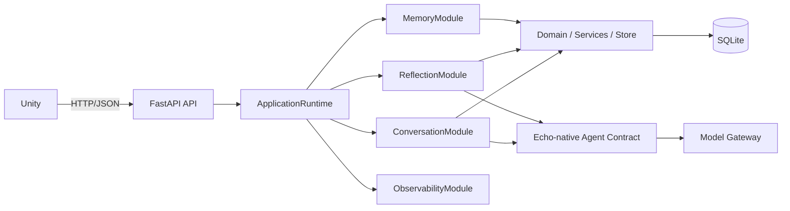
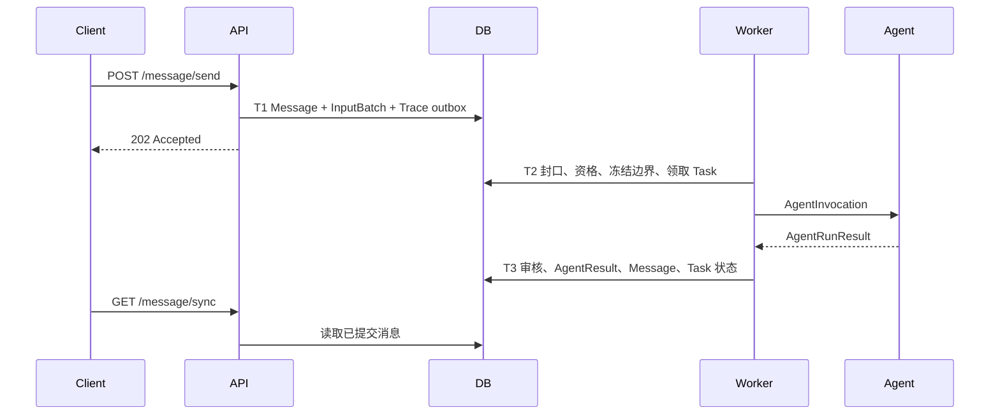

# Echo 后端实现架构

> 文档类型：As-built Architecture
> 状态：生效
> 更新日期：2026-09-20
> 适用范围：`server/`、后端公共 HTTP 契约和 Unity 服务边界

## 1. 系统边界

后端是游戏运行事实的唯一持有者。Unity 通过 HTTP/JSON 发送输入和读取结果；它不访问 SQLite，也不直接提交 Agent 输出。



服务面向本机、单账号、单进程运行。FastAPI lifespan 负责创建、启动和关闭应用组合、Conversation Worker、Reflection Worker 与数据库。

## 2. 分层

| 层 | 责任 | 禁止事项 |
|---|---|---|
| `api/` | DTO、HTTP 映射、依赖注入、错误响应 | 业务编排、SQL、Agent 调用 |
| `runtime/` | 确定性流程、事务顺序、租约、审核、事实提交 | 生成角色自然语言 |
| `agents/` | Echo-native 输入输出 Contract、Harness、Agent 实现 | Repository、数据库写入、权威事实 |
| `services/` | 上下文、Memory、Identity、Model Gateway 等共享能力 | 形成第二个主流程编排层 |
| `domain/` | 纯值对象、状态和规则 | FastAPI、Pydantic、SQLite、模型 SDK |
| `store/` | migration、连接、Repository、记录映射 | 隐式事务写入 |
| `observability/` | 日志、Trace 查询、Debug Capture | 成为业务状态依赖 |

API DTO、Domain 对象、Agent Contract、Store 记录和 Provider 模型保持显式映射。

## 3. Runtime 组合

`ApplicationRuntime` 只负责组合和公开应用入口。业务依赖按模块分配：

- `ConversationModule` 管理消息、输入批次、会话任务、角色回复上下文和 T1/T2/T3；
- `ReflectionModule` 管理 GraphRun、NodeTask、Artifact、图级审核和反思事实；不同反思图通过各自的来源构造器准备任务输入，共用快照组装器；
- `MemoryModule` 管理段、Thought、记忆、日记、记忆图和检索；
- `ObservabilityModule` 管理 Trace outbox、Trace 查询和 `ReflectionRunView`；
- `RuntimeControls` 只保存 Settings、Agent、时钟、Worker 身份和唤醒状态。

服务接收对应模块端口。Reflection 服务不能访问无关的 ConversationTask、InputBatch 或会话执行 Repository。组合规则见[应用组合](infrastructure/application-composition.md)。

## 4. Conversation 主路径



模型调用期间不持有 SQLite 写事务。T3 会重新检查来源、任务租约、资格和 Proposal 合法性。

## 5. Reflection 主路径

封口的 `MemorySegment` 由 `schedule_segment_reflection(segment_id)` 创建 GraphRun 和根 NodeTask。已提交的段摘要由 `schedule_memory_organization(trigger)` 冻结为 `SummaryBatch`，再创建 `memory_organize` GraphRun。Reflection Worker 只领取 NodeTask。

单段反思和批次整理分别拥有 `SegmentSnapshotPayload`、`MemoryOrganizationSnapshotPayload`；`SnapshotBuildContext` 只保存时间和调用方事务连接。两类任务的材料处理留在各自构造器，公共组装器只负责身份、状态、常驻记忆和不可变快照。

```text
GraphRun
  → GraphContextSnapshot
  → NodeTask / NodeInput
  → AgentInvocation / ReflectionNodeOutput
  → Artifact
  → ReflectionBatch
  → ProposalEnvelope
  → Reviewer
  → ChangeSet
  → Memory / State / Relationship facts
```

图运行状态、节点 lease、Artifact、图级审核和事实提交各有明确 owner。旧反思任务和旧批次表不进入运行时代码。完整规则见[Reflection 模块](modules/reflection.md)。

## 6. Agent 与模型边界

Echo-native Harness 是唯一 Agent Loop。Agent 只接收不可变 Contract，返回结构化结果；Runtime 负责 ID、时间、来源、版本、预算、审核和事实提交。

Model Gateway 是 Provider SDK 的唯一入口。Gateway 负责请求转换、错误分类和用量归一化；Prompt 顺序和工具循环由 Harness 负责。

## 7. 持久化和可观测性

SQLite 是权威持久层，migration 从 `0001` 到 `0016` 按顺序执行。反思最终运行表为四张图运行表，旧表由 `0015_reflection_runtime_rebuild.sql` 删除，`0016_reflection_partial_status.sql` 补充可选节点 partial 状态。

Trace 先进入 `trace_outbox`，由 Worker 物化到 `traces`；日志和 Debug Capture 都是可选诊断能力。Trace 不保存玩家原文、Prompt、完整角色输出、密钥或内部路径。详见[持久化与事务](infrastructure/persistence-and-transactions.md)和[可观测基础设施](infrastructure/observability.md)。

## 8. HTTP 入口

- `POST /message/send`：接受玩家消息，返回 `202` 和 Trace 关联。
- `GET /message/sync`：按账号游标读取消息。
- `GET /conversations/{conversation_id}/messages`：按会话游标读取消息。
- `GET /health`、`GET /health/live`、`GET /health/ready`：服务和 Worker 状态。
- `GET /internal/reflection/runs/{graph_run_id}`：本地工作台读取图运行诊断视图。

## 9. 维护规则

整体结构变化更新本文；单模块行为更新模块文档；长期边界变化新增或更新 ADR；当前完成度只更新 [implementation-status.md](implementation-status.md)。文档不得维护另一套与代码不同的旧新双轨结构。
