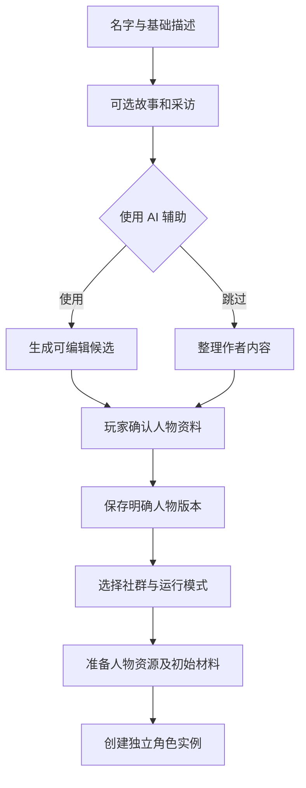

# 自定义角色、人设层次与重置

状态：未实现的设计草案。更新日期：2026-10-05。

## 1. 目标与决定状态

让普通玩家用少量文字创建可运行人物，也让作者能够认真创作重要人物。用户填写内容不要求遵守现有文件格式，后端负责转换与保存。

已确认的规则：

- 人设复杂度与角色智能度独立组合，运行模式见 [角色模式](02-character-modes-and-memory.md)。
- 人设按基础人设、过去故事、日常采访材料逐步丰富，角色无需填写所有层次才能运行。
- 提供默认模板和 AI 辅助；重要人物可由作者填写，普通试用人物可授权 AI 生成。
- 创建前自由编辑；创建后背景故事与初始经历固定。修改或追加需要重置记忆并重新初始化，创建时明确提醒。
- 不实现背景增量合并、冲突修补或旧经历自动迁移。

下文详细流程是基于这些规则的设计建议。仍未确定的业务选择集中列在第 7 节；字段名、路径和数据库迁移需在实施设计中确定。

## 2. 人设内容及填写引导

| 层次 | 需要表达的内容 | 玩家如何填写 | 后端用途 |
|---|---|---|---|
| 基础人设 | 身份、性格、动机、表达和相处方式 | 建议必填名字和一段描述；提供可选问题和示例 | 生成每次任务需要的稳定人物资料 |
| 过去故事 | 重要经历、人物、转折、愿望与遗憾 | 自由故事或引导问题，创建前可省略 | 重要背景进入档案，具体经历作为初始化材料 |
| 日常采访 | 喜好、习惯、生活细节和具体反应 | 按主题展示少量问题，允许跳过 | 形成偏好、习惯及具体回忆材料 |

基础描述示例：林夏平时安静，熟悉以后喜欢开玩笑。玩游戏认真，输了会嘴硬，但不会责怪队友。

建议的基础引导包括：平时在做什么；开心、生气或紧张时怎样表现；想得到什么、害怕什么；如何对待陌生人和熟悉的人；一句有代表性的台词；哪些设定必须保留，哪些可以让 AI 补充。

采访按日常作息、兴趣习惯、重要经历、人际关系、游戏与竞争、愿望与顾虑分组。回答允许没有、记不清或不愿意说。默认模板提供问题与内容结构，缺失项保留空缺，不自动填满身世。问卷完整题库单独维护，不在代码中散落。

人设丰富程度按实际内容表达，不强制生成三个互斥档位。作者可以只补充一段故事，也可以只回答几个采访问题。

## 3. 创建流程

1. 保存作者输入的草稿，区分原始内容与 AI 候选，避免生成请求直接覆盖作者文字。
2. 用户决定辅助范围，可以只整理表达，也可以授权补充故事或采访。明确设定必须保留，发现明显矛盾时展示问题，不能静默选一个版本。
3. AI 返回有明确字段的候选。用户查看人物介绍和说话示例，编辑并确认最终内容。示例台词用于说明风格，不进入正式聊天历史。
4. 后端保存确认的人物版本，实例绑定这个版本。模板和实例的现有边界见 [身份设计](../design/identity-and-communities.md)。
5. 实例化检查社群资格，并按运行模式准备所需资源及初始记忆。复杂材料的消化见 [初始记忆流程](02-character-modes-and-memory.md#5-初始记忆准备流程)。

AI 失败或用户没有接受结果时，候选不能成为人物正式设定。未填写故事或采访的角色可以依靠基础人设运行。

## 4. 输入怎样变成人物资源

| 资源 | 内容与边界 |
|---|---|
| profile | 稳定身份、性格、动机和理解人物必需的重要背景 |
| voice | 表达习惯、语气、节奏及示例台词 |
| relational_dynamics | 亲近、信任、冲突和边界倾向；不填写对具体玩家的初始关系分数 |
| 作者材料 | 原始故事及采访回答，保留材料来源，供初始化反思使用 |
| agent_contract | 项目共同规则，由后端提供 |
| capabilities | 正式实现与运行策略允许的工具，由后端决定 |

例如“搬家多次，因此很在意稳定关系”可进入 profile；具体搬家经历保留在作者材料中。原始故事保留全文，常驻档案控制篇幅，检索记忆承载具体细节。档案与记忆使用同一确认来源，不分别生成互相冲突的背景。

资源编号、版本、日期、文件引用及 self 的实例转换由程序处理。当前合法资源结构见 [人物资源参考](../reference/character-resources.md)，用户无需手工填写 YAML 元数据。

建议数据库保存自定义人物的正式内容与版本，文件作为作者导出格式。预置文件和自定义人物需通过共同读取入口提供明确版本；接入时沿用现有角色上下文、名称读取和任务绑定，避免聊天与反思分别读取不同人设。

## 5. 数据归属与读取

| 对象 | 保存内容 | 更新方式 |
|---|---|---|
| 创作草稿 | 作者原文、AI 候选及编辑结果 | 创建前自由修改 |
| 人物版本 | 经确认的人设资源及作者材料引用 | 作为实例绑定的明确版本保存 |
| 角色实例 | 社群、人物版本和运行模式 | 经正式业务操作创建或重置 |
| 实例经历 | 消息关联、摘要、私有内心、状态、关系与记忆 | 从该实例实际观察和反思产生 |

同一人物的两个实例分别保存经历，甲的关系变化不改变乙。任务保存本次实际使用的人物内容与版本，普通重试继续使用原输入。

建议记录创建者和编辑资格。公开卡片提供名字、头像与公开简介；完整人设、秘密背景和初始记忆的可见性需单独定义。其他角色只能依据允许的身份、消息和来源认识这个人物。

## 6. 修改背景与重置流程

已确认：创建后故事与初始经历变化必须重置初始化。流程建议如下：

1. 作者准备新版本，现有角色继续绑定旧版本，直到正式重置完成。
2. 展示受影响实例及清除范围。用户明确确认后开始重置操作。
3. 阻止该实例继续接受新执行，并取消或使旧任务失效，防止旧结果重新写入。
4. 按新版本准备初始化产物。模型调用在数据库写事务之外执行。
5. 使用明确重置边界处理旧经历，再保存新版本绑定与初始内容。恢复运行时只读取新阶段允许的材料。

仅删除长期页会残留旧段摘要、连续性摘要、私有内心、状态和关系，因此建议统一重置这些实例数据。初始化失败时需要可诊断、可重试，不能把缺少必需材料的实例展示为准备完成。

建议保留公共聊天供玩家查看，重置角色的上下文和检索不再读取旧经历。其他角色保留自己的经历，修改模板不自动重置其他实例。具体数据删除、诊断保留和重置事务设计仍需确定。

建议创建提醒：创建后修改背景故事或初始经历，需要重置角色已经积累的记忆。最终提示必须按正式确定的清除范围撰写，不能先承诺尚未确定的聊天保留行为。

## 7. 需要确定的剩余选择

- 完整重置是否包含状态、关系、私有内心，以及公共聊天如何保留并划定新经历边界。
- 修改基础性格、说话风格是否同样必须重置；哪些纯展示字段允许独立修改。
- 创建者与社群管理者的编辑资格、人物共享及私有人设可见范围。
- 活动进行中能否重置，以及旧活动任务和参与身份如何处理。
- 初始化的准备状态、失败后旧实例能否恢复、正式启用时机与重置请求幂等规则。

这些问题影响正式接口与事务，应在对应实施前确定。背景增量合并不再作为备选方案。

## 8. 交付与验收

先交付原始材料、人设整理、AI 辅助确认、人物保存与独立实例创建。作者材料保存和材料可供模型检索分别验收；尚未消化的故事不宣称为已生成初始记忆。

使用真实数据库与模型验证：少量输入可创建；跳过可选材料可运行；失败候选不改正式版本；同模板两实例经历独立；重启后人设可读取；任务使用明确版本；重置后旧任务不能提交；旧经历不会经上下文或搜索重新进入角色。涉及尚未确定的重置行为，先完成规则设计再执行验收。
