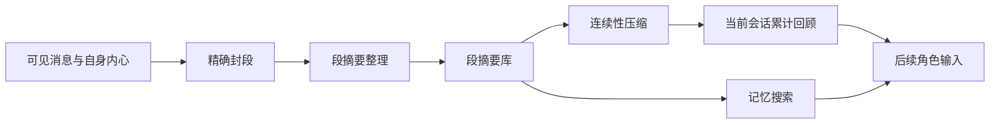
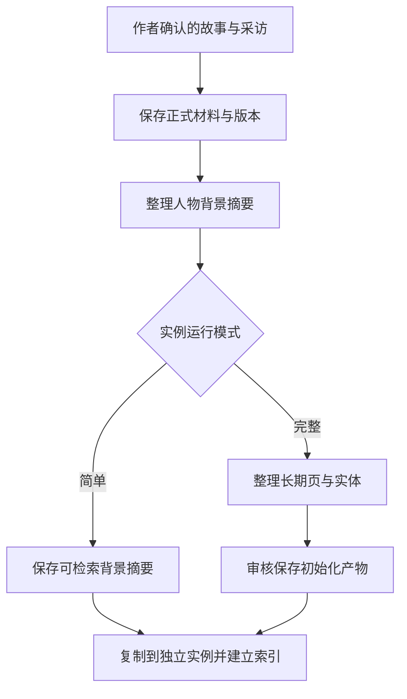

# 角色运行模式与初始记忆

状态：未实现的设计草案。更新日期：2026-10-05。

## 1. 目标与决定状态

角色运行模式决定经历处理与反思能力，人设复杂度决定作者提供多少人物内容。两者独立。下表为已确认方向，后续流程为详细设计建议；剩余选择集中列在第 7 节。

| 模式 | 处理能力 | 主要检索材料 |
|---|---|---|
| 简单角色 | 段摘要整理与连续性压缩；省略长期记忆整理及关系维护 | 自己的段摘要库 |
| 完整角色 | 应用现有完整反思设计，包括状态、关系、长期整理、日记和认识刷新 | 按正式来源规则读取摘要及长期记忆等材料 |
| 智能角色 | 未来实验性设计 RSI 结构 | 随未来学习设计确定 |

人设篇幅不决定运行模式。简单角色也能聊天和参加游戏，依据人设及当前观察回应。完整模式不能把日记和认识刷新宣称为已实现。未来 RSI 的学习目标、评价、修改对象和训练方法没有定案，当前不实现或公开可用入口。

## 2. 两种当前模式的处理职责

| 流程 | 简单模式 | 完整模式 |
|---|---|---|
| 可见消息与自身内心归段 | 使用正式来源规则 | 使用正式来源规则 |
| 段摘要整理 | 执行 | 执行 |
| 关系与状态反思分支 | 不安排 | 按允许材料及节点条件安排 |
| 连续性压缩 | 执行 | 执行 |
| 长期页及实体整理 | 不安排 | 执行 |
| 日记与认识刷新 | 不安排 | 按完整设计接入；当前未实现 |
| 游戏规则与观察 | 使用所属活动规则和可见输入 | 使用所属活动规则和可见输入 |

简单角色仍可在消息中表现情绪并对游戏作出反应。关闭状态反思意味着不持续生成该类状态事实，关闭关系维护意味着不因反思更新关系分数。初始化是否保留现有空状态记录与默认陌生关系读取，需要在实际接入时确定。

模式限制由程序执行。即使摘要模型建议继续分析关系，简单模式也不能安排关系节点；管理入口同样遵守限制，不能绕过自动调度政策创建被禁止的流程。具体拓扑调整与任务策略保存属于实施设计，不建立另一套平行任务执行器。

## 3. 简单模式的经历链

段摘要保存本次发生的事件、具体人物、重要约定及角色当时的感受，并关联原始来源。连续性压缩从前一累计摘要和新段摘要生成新的回顾；两者各自保留职责，不能用累计摘要替代所有历史段。

保存、索引和材料处理进度必须一致。摘要审核失败不能推进已经完成的覆盖；压缩失败不删除已保存段摘要，也不重复生成段摘要。自动封段和摘要调度采用材料与调用预算，没有新材料时不创建空任务。

段摘要用于跨会话回忆，累计回顾用于当前会话的连续性。摘要遗漏的细节可能无法通过摘要搜索找回；关键约定、人物身份及实际结果需要内容质量验证。原始业务记录是否保存与是否允许模型查询分别决定。

## 4. 摘要检索的接入要求

当前 memory_search 正式接入 message 与 memory_entry，段摘要尚未进入索引及允许来源。已有对话上下文直接读取部分段摘要，不等于摘要已可搜索。

需要完成以下流程：

1. 摘要提交时保存来源身份、版本、角色归属和覆盖，并建立搜索索引；重建索引使用相同正式来源。
2. 查询先确定本角色允许的摘要，再进行全文搜索和排序；索引命中不能扩大读取权限。
3. 检查观察时刻、当前会话冻结上限、精确来源范围及重置边界。包含本次输入之后消息的摘要不能进入旧任务。
4. 返回摘要正文和正式引用，模型实际获得哪些材料可追溯；版本变化按现有任务搜索契约处理。

简单模式以摘要作为检索经历的来源。是否仍允许查询原消息、如何检索背景摘要及避免多种来源重复占用返回名额，需确定明确政策。没有命中只表示没有找到，不能证明经历从未发生。

## 5. 初始记忆准备流程

当前 memory_preload 将作者已写好的记忆条目直接复制到实例，没有从故事和采访执行反思。新的材料消化应使用专属输入，复用模型调用、预算、审核和保存设施；不能把背景伪装成聊天消息来使用现有段反思。

建议步骤：

1. 保存材料身份、所属人物版本、作者填写或 AI 生成的来源，以及用户确认结果。保留原文，避免只保存模型提炼内容。
2. 冻结本次明确材料范围，整理事件、偏好、习惯、重要人物及未完成事项。输出必须引用允许材料，缺失的细节保持缺失。
3. 简单模式形成有正式作者来源的背景摘要。它与会话段摘要分别标识，不能使用虚构会话序号；两者共同供后续检索。
4. 完整模式进一步生成长期页及实体关系，选择少量经常需要的核心内容。核心记忆选择与认识刷新如何衔接，待正式设计。
5. 审核身份、来源、内容及引用，再保存产物。实例化时复制为独立材料，将 self 转换为实例身份，并建立索引。

初始化不得给当前玩家增加关系分数。故事中的家人或朋友不是自动加入社群的成员，是否登记为背景实体需定义。采访回答“通常七点起床”是习惯，不能生成“今天七点已经起床”的状态。

建议允许同人物版本、同模式复用经审核的初始化产物，实例分别保存副本。复用身份与版本规则需确定，不将一次角色实例的经历复制给另一个实例。

创建时没有故事或采访材料则无需制造背景初始化任务。需要处理的材料未成功完成时不得宣称准备完成；准备失败、重试和启用语义与 [创建流程](01-custom-characters.md) 一起设计。

## 6. 模式、人物版本与任务

建议模式绑定角色实例，同一人物可创建简单实例与完整实例。任务保存所使用的策略，恢复和重试沿用原任务输入；人物篇幅变化不能自动改变模式。

创建后的背景变更遵守重置初始化。模式切换独立于背景编辑，目前没有确定无损切换规则。实施时需要明确是否允许切换、旧任务如何处理、已有长期记忆是否仍可搜索及是否补做历史材料，不擅自清除或补造经历。

## 7. 需要确定的剩余选择

- 简单模式是否允许搜索原消息，背景摘要采用什么正式来源和存储结构。
- 初始材料如何拆分、怎样选核心内容，以及初始化产物可否跨实例复用。
- 角色模式的确切保存位置、切换规则和旧任务策略。
- 初始化材料的审核失败、分支部分成功及正式启用语义。
- 摘要内容质量标准与长期页质量标准分别如何评价。

RSI 只记录未来方向，当前不编写尚未讨论的学习循环、模型微调或能力升级结构。

## 8. 实施顺序与验收

| 工作 | 前置条件 | 验收重点 |
|---|---|---|
| 模式与摘要检索 | 现有实例、段摘要、压缩和搜索设施 | 简单模式不安排禁止节点；摘要可搜索且范围正确；重建与正常索引一致 |
| 自动封段及调度 | 模式策略及消费规则 | 无材料不运行，失败不推进，重复不重复消费，聊天额度受到保障 |
| 作者材料初始化 | 正式材料来源、人设版本、审核与保存契约 | 可追溯，背景和实际交流分开，副本独立，重复初始化及恢复正确 |
| 完整反思完善 | 对应已保存事实与专项设计 | 部分成功补做、关系证据分类、认识刷新、日记及真人内容质量 |

人设保存和 AI 辅助可以先实现。简单模式无需等待完整长期记忆质量完善；初始化反思无需等待日记或主动生活。具体开发顺序统一见 [后端状态](../status.md#41-开发顺序与依赖)。
