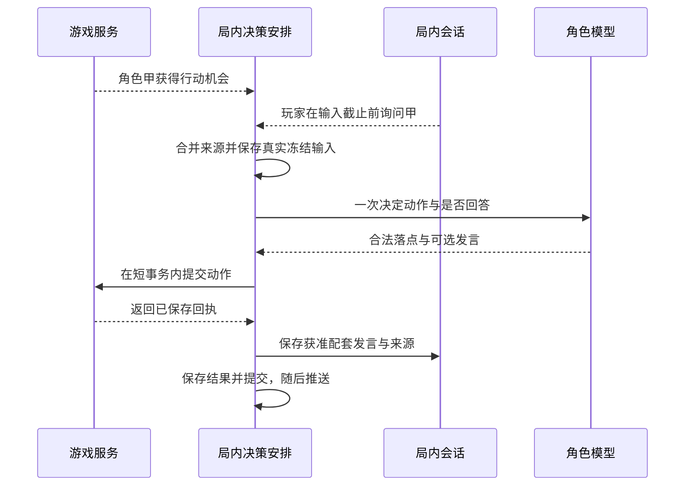

# 角色活动能力、局内会话与游戏经历

更新日期：2026-10-17。状态：角色邀请、等待时撤回、实际参与查询和角色观察读取已实现；活动决策、局内接话与经历消费者尚待开发。会话支持普通群聊、私聊和 `game` 局内类型，实际能力见[实现状态](../status.md)。下文同时记录已实现基础及后续执行目标。

本文是角色活动行为、局内会话、调用策略与经历保存的权威设计。游戏目录、生命周期、角色加入及进行中业务方法见[统一接口契约](../../../docs/gameplay/游戏与角色活动接口.md)，阶段与文件职责见[共同基础](../../../docs/gameplay/共同基础与文件结构.md)和[并行计划](../../../docs/gameplay/并行开发计划.md)。

## 1. 概念与业务归属

社群容纳真人与角色。Activity 是角色参与活动的能力模块，使用所属社群的身份、聊天、人格和记忆；独立游戏包负责规则、对局生命周期、席位、棋局、随机结果、合法动作、结算和持久化。

游戏与角色能力通过正式接口合作，共用当前应用的进程、端口、SQLite 和必要基础设施。游戏不导入角色、会话或模型实现；角色不能直接修改游戏表。

| 对象 | 保存什么 | 权威维护者 |
|---|---|---|
| Game / 游戏参与记录 | 对局、规则、创建者、主体引用、席位占用、参与区间、轮序、版本和结果 | 独立游戏包 |
| GameEvent / ActionReceipt | 已发生的游戏事实与动作提交结果 | 游戏包 |
| 宿主对局关联 | 所属社群、对局与局内会话，不重复保存席位占用 | 社群侧参与服务 |
| Conversation / Message | 会话类型、交流资格、正式发言与受众 | 会话模块 |
| ActivityTask | 一次角色局内决策、触发来源、执行方式、冻结输入、租约和结果引用 | 角色活动能力模块 |
| Thought | 角色实际留下的简短判断、意图和感受 | 私人原始材料及记忆模块 |
| MemorySegment / Fact / Cognition | 有来源的经历材料、摘要、长期事实和认识 | 记忆与反思模块 |

ActivityTask 的执行状态表示角色决策进展。棋局是否结束由 Game 决定，局内交流是否结束由 Conversation 决定，不在角色任务中维护第二份游戏生命周期。

## 2. 三类会话与局内范围

目标会话类型为 `direct`（私聊）、`group`（普通群聊）、`game`（游戏局内聊天）。前两类保持[已有规则](conversation-and-social.md)，`game` 随真实对局建立，不能通过普通群聊入口创建一份没有对局的局内会话。

每场对局对应一份独立的局内会话，绑定 `game_id` 和所属社群。相同参与者再来一局时创建新的对局与局内会话；日常私聊和普通群聊继续保留各自身份与历史。

### 2.1 参与者与可见性

- 参与者来自游戏保存的实际席位占用与参与区间。等待时通过正式加入、离开入口同步会话成员，开始后固定，基础范围不提供进行中换人或观战入口。
- 断线、刷新或重启不改变席位和会话成员。主动结束参与经明确业务入口处理，不把网络连接状态当作离开。
- 会话服务保存成员、受众与历史区间，游戏保存主体引用与实际占用；宿主在同一短事务调用双方服务，不直接跨模块写表。原席位换人或重新加入不继承其他参与区间的私人历史。
- 局内公开发言对本局成员可见。棋盘、隐藏地块、后续私人道具或手牌按游戏自己的观察资格读取；聊天成员身份不自动授予隐藏游戏数据。
- 历史读取保留实际参与和受众依据。普通群聊的自由加入、私聊的组合唯一规则不套用于局内会话。

### 2.2 结束规则

对局状态、创建者权限、等待时离开、进行中认输、取消与结束活动的规则统一见[生命周期契约](../../../docs/gameplay/游戏与角色活动接口.md#3-对局生命周期与参与)。游戏结算停止动作，局内会话可继续赛后交流；创建者明确结束后归档会话并停止新决策。取消的对局不再安排新局内决策或接受新消息，保留历史与结束入口。

认输或取消使相关旧行动机会与任务失效，已提交事实保留。结束未完成活动时，在同一短事务取消对局、归档会话并停止角色任务；已经结算时保留原结果。重新打开历史只读，不恢复旧棋局。

游戏结束后尚有配套发言提交时，使用提交前的原会话资格检查；归档后的新生成不能发布。结束棋局和结束交流分别记录各自事实，不删除历史来表达结束。

### 2.3 角色加入对局

当前由玩家明确邀请角色，宿主参与服务检查真实邀请者、社群资格和角色准备及活动能力，通过游戏加入方法保存角色主体与席位，并在同一事务建立本局会话成员。内部调用流程、请求例子与各服务职责统一见[角色加入契约](../../../docs/gameplay/游戏与角色活动接口.md#51-玩家邀请角色加入)。

Activity 从持久参与查询取得角色自己的参与编号、席位和会话关联；等待时不安排游戏行动，开始后由真实机会安排决策。加入本身不额外调用模型，未来主动加入需要明确触发与资格后复用同一宿主入口。

当前 `CharacterGameEligibility` 统一检查角色的社群成员、记忆准备和可用状态，并确认目标游戏已注册正式观察与事件读取。候选、邀请、开始和当前角色观察复用这套规则。观察采用游戏公开视图与事件，支持范围随实际注册定义提供；只读工具筛选器 `CapabilityResolver` 保持原职责，没有新增模型用途、输出提议或后台执行任务。

`Application.game_observations` 提供 `participations`、`observe` 和原参与区间的 `events`。`observe` 在同一只读事务读取真实席位、概要、可见视图、合法机会和分页事件，返回 `CharacterGameObservation`；其中 `ActivityObservation` 使用实际游戏编号、角色身份、状态变化时间和版本，正文包含游戏类型、规则、参与编号及带正式来源编号的事件。等待阶段视图为空，已撤回区间不能读取当前局势；原事件仍按自己的受众读取。读取只形成内存中的投影，尚未写入记忆或安排执行。具体交接见[共同基础交接](../../../docs/gameplay/共同基础交接.md)。

## 3. 目前的两种局内触发

| 触发 | 谁被安排 | 可以产生什么 |
|---|---|---|
| 玩家在局内发言 | 按群聊参与机制选择有资格的角色 | 正式回应或合法沉默；合并行动机会时可同时行动 |
| 轮到角色执行游戏操作 | 游戏指定的当前行动者 | 合法动作，以及可选的配套发言 |

固定轮序约束游戏行动。其他参与者仍能随时发言，玩家消息触发的接话无需等待该角色成为游戏行动者。当前不增加局势变化自动触发的角色主动发言；未来主动性以新的明确触发来源使用同一决策入口。

### 3.1 复用群聊机制的范围

局内消息复用输入收集、候选资格、提及与回复优先、接话排序、接话链额度、沉默、失败后换人和停止规则。已存在的额度适用于玩家消息引起的局内接话链；游戏行动机会由游戏另行提供，不消耗这条接话链的游戏行动数量。

`game` 类型只进入局内调度入口。普通群聊调度器不再为同一局内消息额外建立 ConversationTask；局内被选中的角色通过 ActivityTask 执行，结果回传给接话参与进度。群聊和私聊的现有任务流程保持自己的规则。

不能直接复用普通群聊“新玩家输入取消整条旧链”的行为来终止有效游戏行动。局内新消息先进入待处理来源；候选与接话额度复用，取消、合并和输入截止按下节执行。

### 3.2 同一角色、同一对局的协调

同一角色在同一对局只保留一个正在产生有效决定的执行安排，不同时发起相互不知道的局内回应调用与行动调用。不同角色、不同对局或日常会话仍可按各自资格执行，共享模型额度。

- 尚未冻结和执行的接话来源与行动机会可以合并，形成一次模型决策。角色在一份上下文中选择动作并决定是否回答玩家。
- 模型已经开始执行时，输入保持不变。新消息排队；本次结束后重新判断是否仍需安排回应，避免对同一来源重复回答。
- 合并只吸收截止前真实存在的来源，并保存精确消息编号、行动机会和接话安排引用。不同来源是否已处理分别登记。
- 纯回应任务冻结时没有行动机会，结果只能发言或沉默；期间新出现的行动机会随后正式安排，不允许事后把游戏动作塞进旧回应结果。
- 来源已经被某次有效决策回应后，不再为同一角色重复安排同一来源。合法沉默与明确失败继续遵守接话进度规则。

同一角色本局内的互相观察通过共同输入实现，不通过不断取消和重建任务实现。

## 4. 按合法选择数量控制模型成本

| 情况 | 处理 |
|---|---|
| 没有角色可执行操作，规则可以直接结算或推进 | 游戏按具体规则处理，不调用模型，不制造无意义角色任务 |
| 一个合法选择，且没有合并的玩家接话需求 | 持久安排一次抽样：80% 直接执行，20% 调用一次模型决定发言并返回该动作 |
| 多个合法选择 | 一次模型决策同时选择动作、判断是否发言及生成正文 |
| 玩家发言触发接话 | 采用既有参与选择与模型回应机制，不受上述 20% 限制 |
| 单选行动与玩家接话在执行前合并 | 使用一次联合模型决策，不能因原先抽中自动执行而丢失接话需求 |

“一次”表示一次逻辑模型决策，输出修正、供应商错误和任务恢复仍使用既有有限重试规则。不能分别调用发言判定模型、动作模型和正文模型来完成同一决定。

### 4.1 抽样、自动步骤与恢复

抽样属于 Activity 的调用策略。按实际行动决策机会执行，保存本次执行方式与选择原因，领取重试和进程恢复沿用原结果，不重新抽样。

合并玩家接话后需要模型时，保存模式调整及其真实来源，不重新抽签。游戏骰子与抽牌属于游戏随机规则，分别在游戏中保存，不受调用策略概率改变。

规则自动步骤不重复触发抽样。例如飞行棋先正式生成并保存骰子结果，再针对实际可移动飞机评估选择；掷骰、逐格动画、自动结算不分别制造同一行动的多次发言机会。具体游戏明确哪些步骤自动执行、哪些属于角色决策。

多个选择时不以轻量策略默默替代角色模型；单选模型分支失败也不擅自改成自动成功。保留既有恢复流程与实际失败状态。

## 5. 决策输入与模型输出

### 5.1 共同上下文

本次输入包含：当前实际可见棋局、规则与合法动作、相关已发生游戏事件、实际局内聊天、自身先前已提交动作与发言、自身私人材料以及有资格读取的人格和记忆。

冻结游戏版本、事件读取上限、会话消息上限与实际来源引用。没有完成的提议只表示意图，执行结果以正式游戏回执为准。后续重试复用原输入，不追加新局势来解释旧决定。

模型需要恢复原输入时，只有 `game_id` 和旧版本号未必足以重建视图。当前直接保存该次实际使用的紧凑游戏视图及来源引用，复用已有冻结输入机制；不另存持续更新的角色棋盘，不为完全去重建立棋局重播框架。

### 5.2 明确的输出类型

行动决策使用 `GameTurnProposal`：必须有合法游戏 `action`，允许 `speech` 为空，并可返回实际产生的简短 `thought`。纯回应使用 `GameReplyProposal`：允许发言或沉默，不包含游戏动作字段。

`speech` 是否为空同时表达发言判定与正文结果，不再加另一份可能矛盾的发言布尔值。角色是否可以跳过操作由游戏规则决定，不能用聊天沉默代替五子棋合法落子。

示意输出：

```json
{
  "kind": "turn",
  "action": {"type": "place_stone", "x": 7, "y": 7},
  "speech": {"utterance": "这里可不能让给你。"},
  "thought": "我想先守住这一边。"
}
```

模型不填写请求编号、角色身份、席位、任务租约或正式来源编号。这些由运行编排层从任务补全。纯回应与行动决策注册各自明确的输出类型，游戏包只接收游戏动作。

自动分支不产生模型调用或虚构 AgentRunResult；保存真实自动操作、策略原因与游戏回执。没有模型生成的内心记录保持缺省，不事后补写角色当时的想法。

## 6. 执行、配套发言与失败

沿用当前 SQLite 部署，目标使用同一个短写事务：Activity 复核租约和资格，游戏服务执行并保存动作，会话服务保存获准配套发言，Activity 保存决策结果及正式来源关联，提交后通知玩家。

各模块只写所属数据，接受同一个标准数据库连接；游戏包不读取角色任务或会话表。模型调用、等待额度、网络发送和浏览器动画都在写事务外。

- 动作被版本、机会或资格检查拒绝时，本次配套发言不发布，旧决策按失效处理；新机会准备新的输入。
- 发言的业务审核没有通过时，可以省略该发言并保存实际拒绝原因，合法动作仍可执行。
- 数据库错误回滚本次事务中的变化，不能把未提交的动作或消息记成成功。
- 联合模型调用失败时，没有可直接保存的联合提议，按原输入恢复；不承诺这一分支仍能无条件推进棋局。
- 纯回应按会话资格和来源处理，不因无关棋局版本更新就自动失效；会话归档、成员资格和租约仍须复核。

配套发言绑定其实际游戏回执和 ActivityTask 来源。消息是角色自己的正式发言，不伪装成玩家或系统，也不通过伪造 ConversationTask 保存。会话模块需正式支持活动决策来源。

单选自动操作无需等待无关聊天。其他角色的聊天失败不会撤销已经提交的棋局；不同玩家已接受的动作不因推送失败重复执行。

## 7. 持久化、主观材料与长期记忆

| 内容 | 保存位置与用途 |
|---|---|
| 完整棋局与正式游戏事件 | 游戏保存，支持对局恢复、历史与真实事实查询 |
| 局内全部正式发言 | 会话保存，支持实时交流、历史与消息来源 |
| 角色实际输入、策略抽样、提议、执行结果引用 | Activity 保存，支持任务恢复和判断来源检查 |
| 实际产生的简短判断、意图和感受 | 角色私人原始材料，支持后续上下文与反思 |
| 值得以后回想的信息与认识 | 既有摘要、长期事实和认知流程按资格、价值与角色模式选择保存 |

完整游戏事件不逐条复制成角色消息，也不要求每一步生成一段主观观察。角色可见的正式事件可以成为经历材料；角色是否调用过模型不替代游戏的可见性规则。

任务输入的保存用于保留当时依据，不自动成为长期记忆。Thought 表达角色实际留下的主观内容，不能证明对方隐藏动机，也不能把行动意图写成已经发生的游戏事实。

### 7.1 经历来源与整理

经历材料统一引用实际消息、正式游戏事件和自身私人材料，保存来源身份、版本、时间与实际受众。当前会话与游戏没有共同消息序号，分别保存来源位置并用实际动作、发言和决策引用关联。

补充游戏事件与活动私人材料的正式来源读取后，才能接入归段、摘要和长期整理。实现需要更新原始材料读取、资格、精确覆盖与消费者，不能只增加一个来源名称。

游戏结果、关键动作和有意义交流可被选入回忆，普通每步操作保留在游戏历史供按需读取。摘要用于压缩与定位；长期事实继续引用实际原始依据。多个角色可以引用同一个可见事件，形成各自的认识。

按既有简单与完整记忆模式运行：简单模式执行摘要与压缩；完整模式继续运行有依据的长期事实、认知及相应反思。新事件可以成为实际经历范围与预算的一部分，结束活动提供明确的材料边界，不按每一手棋强制启动一轮反思。

模型超时、租约失败和存储错误用于执行诊断，不自动成为角色焦虑、关系变化或外部世界经历。自动行动没有产生的 Thought 不作为来源补造。

## 8. 例子与共同验证

五子棋是首个完整游戏。两人固定落子顺序，双方仍能在本局会话发言。空位较多时，角色一次模型决策给出落点与可选配套发言；只剩一个合法位置时执行既定单选策略。



实现必须验证：

1. 三类会话明确分流，局内消息不重复触发普通群聊任务。
2. 真实主体与席位绑定、等待时加入离开、两人局内会话、开始固定成员、断线、认输、取消、赛后交流、归档及历史隔离符合规则。
3. 玩家接话、单选自动、单选模型、多选模型四条实际路径；模式与抽样结果跨重试保持。
4. 本局同一角色的行动和接话合并，开始执行后的新消息排队，来源不重复消费。
5. 固定行动资格、旧机会、旧租约、重复请求、实际失败与事务回滚。
6. 动作失败不发布配套发言，发言业务拒绝不伪造游戏失败，纯回应不操作棋局。
7. 联合上下文只含真实可见材料；隐藏状态不泄漏，快照、事件和消息来源可追溯。
8. 正式经历来源接入后，摘要、事实与认知各自按模式和精确覆盖处理，不把全部棋谱或主观猜测当长期事实。

自动分支通过真实游戏与任务路径验证零模型调用；模型分支使用真实供应商，不使用假服务或替代回复。模型棋力和游戏执行正确性分别评价，不以一次获胜作为角色接入成功的唯一依据。
