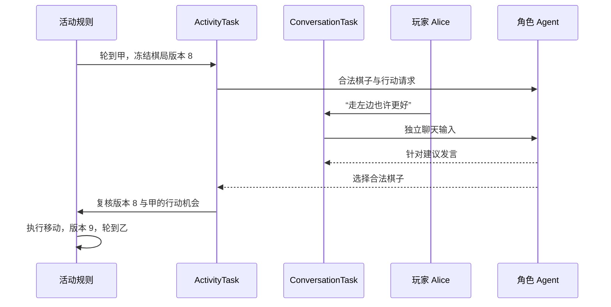

# Activity 接入与独立活动任务

## 1. 活动边界

Activity（活动）是社群内拥有自己规则和权威状态的进行中活动。本文定义活动与共同执行、观察、通信及记忆体系的接入规则；实际能力见 [实现状态](../status.md)。

活动拥有 activity_id、社群、类型与规则版本、参与者、生命周期、权威状态版本及自己的结果来源。可关联会话，但活动和会话不互相作为唯一身份；聊天结束不自动删除棋局。

## 2. 职责和对象归属

| 对象或规则 | 所属 | 职责 |
|---|---|---|
| ActivityState / Rules | activities 领域与存储 | 棋盘、轮到谁、合法动作及结果 |
| ActivityObservation | perspective 读取接口 | 角色可见棋局、私有手牌和公开历史 |
| ActivityTask / Queue | activities 任务层 | 行动机会、输入、租约、审核和提交 |
| ActivityInvocationInput | activities 输入契约 | 自身信息、观察、记忆、合法动作、状态版本 |
| ConversationTask | conversations 任务层 | 针对发言回应，保存聊天及 Thought |
| ReflectionNodeTask | reflection | 根据实际经历整理自身信息 |
| Dispatcher / ModelBudget | execution | 共享执行与模型额度 |

通用 InvocationInput 保留共同身份，不用大量可选活动字段扩充对话快照。活动行动和发言分别形成任务、调用及结果。活动消费者定义真实来源后，反思才能读取活动经历。

Activity.status 描述玩法本身的运行，ActivityTask.status 描述一次行动任务，活动中的 current_actor 描述当前行动机会。ConversationTask 和 SocialTurn 继续使用聊天自己的状态及完成规则。共享调度器不将这些字段合为一种状态，详见 [对象生命周期](object-lifecycles.md)。具体活动状态枚举和超时后的轮序规则由各玩法定义。

## 3. 运行模型与提交

活动规则判断当前合法行动者，为角色建立 ActivityTask；玩家从活动业务入口提交操作。活动任务读取冻结活动版本、当前行动机会、角色视角、自身状态关系和记忆。模型仅输出允许动作提议。

活动提交复核租约、参与身份、活动未结束、版本及行动机会仍有效，再由规则执行并更新权威状态与结果记录。旧版本操作明确拒绝，新的行动机会准备新的输入；不能把普通重试变成自动使用新棋局。所有改变在活动事务完成，网络调用在事务之外。

聊天按 SocialTurn 独立运行。活动行动成功可产生公开事件或聊天通知，但事件的具体消息身份、可见性和触发策略必须由正式桥接规则定义，不能伪装成玩家发言或要求聊天生成同时完成。

玩家活动操作通过 HTTP 业务入口提交。状态变化与对应事件引用同事务保存，提交后使用 [统一 SSE 通道](realtime-communication.md)通知在线玩家。活动负责事件含义与玩家投影，公开棋局和私有数值分别按实际观察规则发送。活动消息与状态通知复用连接和恢复位置，不要求聊天任务与活动任务共同完成。客户端重新读取当前活动状态后，仍须使用活动版本提交操作。

## 4. 四人飞行棋例子

Alice、Bob、角色甲、角色乙按固定顺序行动；四人共享一个聊天会话。

其他三人可以发言，活动入口仍拒绝他们操作棋子。聊天任务和活动任务可以同时等待共享模型额度，各自心跳，分别完成。活动成功不等待聊天；聊天沉默或失败不阻止棋局推进。

若甲的旧操作到达时棋局已经版本 9，则拒绝旧活动结果；甲的聊天发言按会话受众规则独立审核。活动失败、超时及跳过如何影响固定顺序，由具体飞行棋规则明确，不能由通用执行器擅自决定。

## 5. 验证要求

活动实施必须验证固定轮序、非行动者拒绝、随时聊天、双方并发和独立失败、棋局私有信息、过期操作、重启原输入、结果幂等及反思精确来源。共享设施只复用调度、租约、模型和读取契约；业务归属始终可以从 task_id 找到所属活动或会话。

活动事件必须验证实际受众过滤、私有信息隔离、重复操作不重复记录事件、断线补充与超期重新同步；网络断开不暂停已经接受的活动行动。
