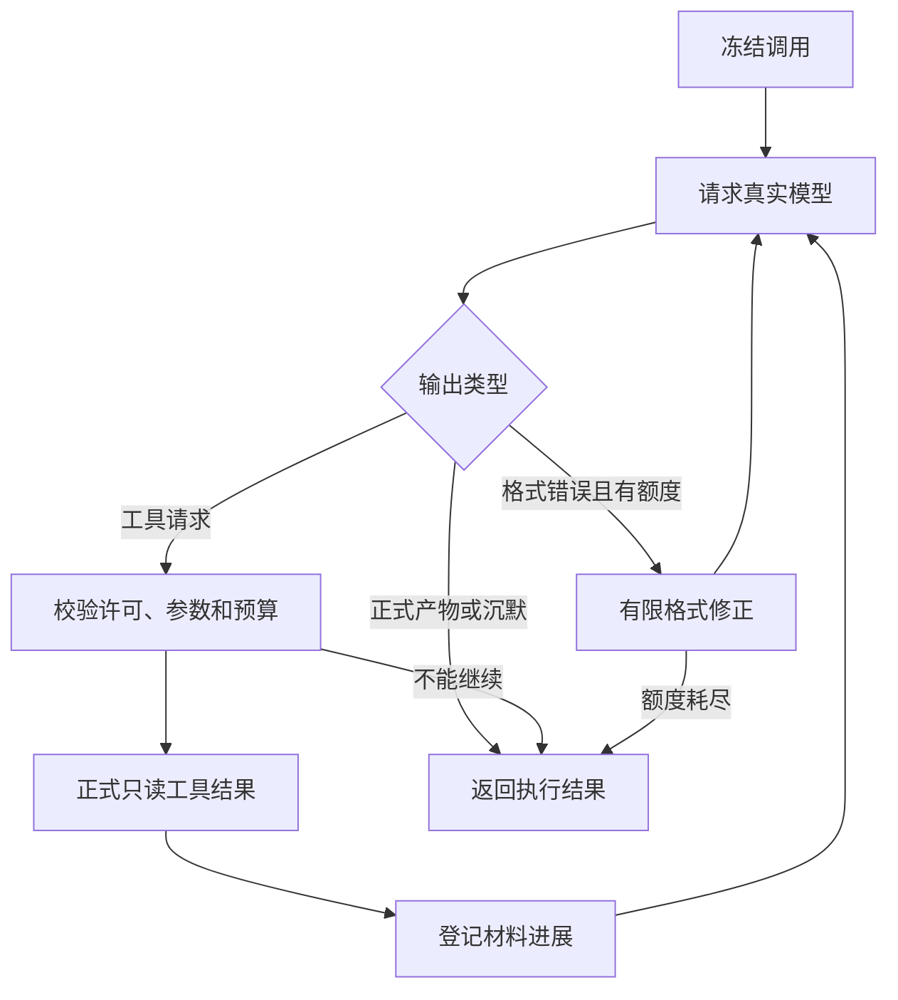

# 角色 Agent 与真实模型执行

## 1. 角色和一次调用

CharacterAgent 根据实例及模板绑定身份和能力。AgentInvocation（一次调用）冻结任务身份、社群角色范围、输入引用、输出契约、模型配置、预算和追踪关系。角色长期状态来自正式上下文，不藏在共享 Agent 对象的可变属性中。

| 对象 | 责任 |
|---|---|
| InvocationInput | 公共元数据和具体任务输入；对话、反思分别定义具体类型 |
| InvocationScope | 社群、实例、任务与调用用途 |
| ActionSpace | 本任务允许输出的契约和工具 |
| ExecutionPolicy | 路由、工具许可、步骤、请求、修正和期限 |
| PromptContext | 投影后的模型消息及工具定义 |
| AgentRunState | 本次工具进展、修正计数、用量和停止状态 |
| AgentRunResult | 正式产物、失败分类、用量及恢复建议 |

调用范围与输入范围、快照身份、输入版本、任务和追踪必须一致。输出契约属于动作空间；工具许可同时受实际实现、模板能力和任务策略限制。公开工具定义与执行授权使用同一结果。

Agent 不领取数据库任务，不直接修改事实。持久队列准备输入并领取；Agent 生成行动提议；业务审核与提交决定最终效果。

AuthoringAgent 负责人物创作，以草稿材料生成基础、故事、采访或文档校准候选。创作服务负责冻结输入、保存结果及复核作者接受；Agent 不能直接修改草稿。创作与聊天、反思共用模型并发额度，操作范围与预算见 [人物创作](custom-character-authoring.md#8-ai-候选执行与接受)。

角色采访使用明确的草稿输入，与聊天共用角色规则、三份正文和身份组装，再加入采访情境与专用输出。CharacterAgent 继续检查正式实例身份；采访使用作者材料作为来源，不建立社群角色调用范围。共同表达与情境组合见 [提示契约](character-prompt-contracts.md#14-情境提示设计)。

## 2. 提示与输出

对话的 system（系统消息）按下表顺序组合。各段落使用同名标签包装，空的可选段落省略，相邻段落以两个换行分隔。提示资源及三个组装文件的职责见 [角色提示契约](character-prompt-contracts.md)。

| 顺序 | 段落标签 | 内容 |
|---|---|---|
| 1 | response_contract | 对话输出规则与结构示例 |
| 2 | agent_contract | 共同身份说明及任务绑定的共同规则资源正文 |
| 3 | character_profile | 人物设定资源正文 |
| 4 | character_relational_dynamics | 关系表达资源正文 |
| 5 | character_voice | 语气资源正文 |
| 6 | conversation_guidance | 共同自然表达指导及聊天 Thought 要求 |
| 7 | current_state | 当前状态的自然语言表达 |
| 8 | relationship_state | 按目标身份组织的关系状态与态度 |
| 9 | continuity_memory | 核心认识、状态概括、常驻记忆、连续性摘要和段摘要 |
| 10 | recalled_memory | 本次检索获得的记忆 |
| 11 | situation | 可见环境、事件及不确定性说明 |
| 12 | conversation_history | 历史消息、自身 Thought 与本轮输入的阅读说明 |

系统消息之后，按时间顺序加入最近历史消息，再加入本轮输入消息。当前角色自己的历史消息使用 assistant（助手消息）；存在对应 Thought 时正文使用含 thought、utterance 的 JSON，没有 Thought 时使用实际发言文字。玩家及其他角色的消息使用 user（用户消息），同时提供真实发送者身份、显示名称及正文。其他角色的 Thought 不进入输入。

反思请求依次提供共同反思输出规则、角色身份、节点允许的自身状态与关系及记忆、适用的关系维度说明、实际材料情境与来源、前驱产物背景，最后提供允许来源列表及当前节点完整任务要求。前述说明使用 system，最后的节点任务说明使用 user。各节点的职责、判断要求和示例集中在对应 Markdown 资源中；字段选择见 [逐节点输入矩阵](reflection/execution-model.md)。反思身份使用共同规则、人物设定和关系表达，不使用 voice 或对话专用发言指导。

提示契约同时规定角色表达、事实来源、三维关系判断、工具协议与格式修正文字。请求同时包含适用的业务正文和字段说明。角色与目标标识取自本次任务输入。AuthoringAgent 独立生成创作候选，CharacterAgent 经 Harness 执行聊天和反思，二者共用模型网关和并发预算。

OutputRegistry 唯一登记输出解析器。文本使用标准 JSON 解析并由正式类型校验。对话使用 character_message.v1，反思使用 reflection_node.v1。明确沉默或无提议是合法终态；空字符串不充当发言。

## 3. 工具与执行循环

memory_search 使用角色及 ToolReadPolicy 确定读取范围。多工具调用逐项验证授权与预算。工具参数错误交给模型有限修正；读取失败形成稳定失败信息；未授权请求不能通过修正扩大权限。

工具进展键为来源种类、身份及版本。新材料使连续无进展计数清零；重复或空结果增加计数，达到登记上限停用该工具，模型仍可用已有材料结束。disabled_tools、repair_counts 和工具观察属于本次执行，下一次持久任务尝试建立新执行状态。

## 4. 预算与三层重试

步骤、模型请求、工具调用、格式修正及总期限分别计数。HarnessPolicy（执行循环策略）与调用预算取实际允许上限。反思默认最多四步、四次模型请求，总期限 300 秒；准确设置见 [配置](../reference/configuration.md)。

| 层次 | 处理对象 | 不改变的业务边界 |
|---|---|---|
| 供应商网关重试 | 限流、网络错误及供应商期限 | 实际路由和请求语义 |
| Harness 修正 | JSON、字段、工具参数等有限修正 | 输入事实、身份和授权 |
| 持久任务重试 | 整次执行的可重试失败 | 原持久快照与来源 |

计数分别记录；真实网络尝试不能被一次模型步骤掩盖。不可重试配置错误结束任务；暂停等业务变化通过任务机制处理；取消停止在途调用。恢复不能自动换模型、增大预算或重新抓取当前事实。

错误码、类别、恢复动作、等待和修正提示的传递规则，见 [错误分类、重试与恢复](errors-and-recovery.md)。固定提示正文继续由角色提示契约维护。

AgentRunResult 的 completed 表示调用获得正式提议，no_proposal 表示没有提议；retryable 表示可由所属任务决定再次尝试，failed 表示调用失败，suspended 和 cancelled 表达明确停止原因。结果不替代 ConversationTask、ReflectionNodeTask 或图级审核状态；最终事实是否保存，由对应业务提交决定，见 [对象生命周期](object-lifecycles.md)。

## 5. 网关、路由与生命周期

ModelRegistry 读取 TOML 中的供应商、模型、逻辑档位、任务路由和生成参数。light、strong 是配置组，实际供应商由登记决定。凭据通过独立文件引用，不复制到快照或日志。

OpenAICompatibleGateway 使用正式 SDK，转换消息、工具与输出格式，标准化普通或流式响应的文本、工具调用、结束原因及用量。记录真实输入、输出、缓存及总量，缺失用量依供应商响应处理，不能编造。

对话与反思共用 ModelBudget，默认并发 3。等待额度时保持租约心跳，请求前复核执行资格；具体业务提交仍由各任务完成。应用退出统一关闭 SDK 客户端。缺少必要登记或密钥明确报错；初始化及只读检查不需要请求模型。

完整提示和工具正文仅进入明确启用的调试捕获。普通日志记录标识、次数、耗时和停止原因。模型返回正常文本不能证明业务提交成功。

## 6. 完整例子

甲收到“还记得我们上次讨论的棋盘吗”。模型请求 memory_search，正式检索返回甲有权读取的旧材料，带来源及版本。第二次请求输出 Thought 和完整 utterance。AgentRunResult 返回给对话任务，提交层检查租约和原受众后保存。乙即使使用同一模板，也不能获得甲的工具结果。

新任务类型复用执行循环，提供自己的输入投影、动作空间和审核。未来活动的行动不会因为使用同一模型成为对话输出的一部分，见 [活动接入](activity-integration.md)。
