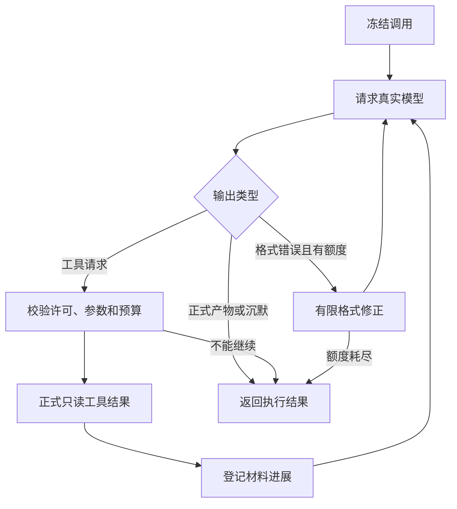

# 角色 Agent 与真实模型执行

本地选项判断通过独立的 `DecisionGateway` 接入，共用模型登记、并发额度与本地调用捕获。协议、配置和恢复要求见[本地决策模型](decision-models.md)。

## 1. 角色和一次调用

CharacterAgent 根据实例及模板绑定身份和能力。AgentInvocation（一次调用）冻结任务身份、社群角色范围、输入引用、输出契约、模型配置、预算和追踪关系。角色长期状态来自正式上下文，不藏在共享 Agent 对象的可变属性中。

| 对象 | 责任 |
|---|---|
| InvocationInput | 公共元数据和具体任务输入；对话、反思分别定义具体类型 |
| InvocationScope | 社群、实例、任务与调用用途 |
| ActionSpace | 本任务允许输出的契约和工具 |
| ExecutionPolicy | 路由、工具许可、步骤、请求、修正和期限 |
| PromptContext | 投影后的模型消息及工具定义 |
| AgentRunState | 本次工具进展、修正计数、用量和停止状态 |
| AgentRunResult | 正式产物、失败分类、用量及恢复建议 |

调用范围与输入范围、快照身份、输入版本、任务和追踪必须一致。输出契约属于动作空间；工具许可同时受实际实现、模板能力和任务策略限制。公开工具定义与执行授权使用同一结果。

Agent 不领取数据库任务，不直接修改事实。持久队列准备输入并领取；Agent 生成行动提议；业务审核与提交决定最终效果。

活动按需正文使用 `activity_expression` 用途，复用 CharacterAgent、模型执行循环及共享额度。输入包含原依据、实际动作回执和生成时观察，输出仅有表达与可选局内意图提议；消息由 conversation 共同服务提交，进度由 Activity 保存，轮次完成由 social 处理。已有联合正文直接审核，不增加模型调用，详见[局内表达](activity-expression.md)。

主动对话和普通回应都使用 `conversation_reply` 模型路由，以 `social_turn`（回应安排）记录调用来源，沿用相同的角色权限和输出格式。主动开场的安排关联原请求，提示包含触发方提供的情景，并引导角色开始交流。消息发布后由 social 安排其他角色接话，调用方法见[主动对话与表达复用](conversation-and-social.md#14-主动对话与表达复用)。

AuthoringAgent 负责人物创作，以草稿材料生成基础、故事、采访或文档校准候选。创作服务负责冻结输入、保存结果及复核作者接受；Agent 不能直接修改草稿。创作与聊天、反思共用模型并发额度，操作范围与预算见 [人物创作](custom-character-authoring.md#8-ai-候选执行与接受)。

角色采访使用草稿中的身份、三份正文、已确认故事和已有回答，以坦诚的采访情境和专用输出生成候选。日常聊天的通用扮演契约和表达指导不进入采访；过去事实只从已确认材料读取，新增往事作为独立建议供作者确认。CharacterAgent 继续检查正式实例身份；采访不建立社群角色调用范围。具体组合见 [提示契约](character-prompt-contracts.md#14-情境提示设计)。

## 2. 提示与输出

对话的 system（系统消息）按下表顺序组合。各段落使用同名标签包装，空的可选段落省略，相邻段落以两个换行分隔。提示资源及三个组装文件的职责见 [角色提示契约](character-prompt-contracts.md)。

| 顺序 | 段落标签 | 内容 |
|---|---|---|
| 1 | response_contract | 对话输出规则与结构示例 |
| 2 | agent_contract | 共同身份说明及任务绑定的共同规则资源正文 |
| 3 | character_profile | 人物设定资源正文 |
| 4 | character_relational_dynamics | 关系表达资源正文 |
| 5 | character_voice | 语气资源正文 |
| 6 | conversation_guidance | 共同自然表达、聊天 Thought 要求及状态、关系、记忆使用指导 |
| 7 | community_environment | 社群当地时间、世界观和社群规则 |
| 8 | current_state | 当前状态的自然语言表达 |
| 9 | relationship_state | 按目标身份组织的关系状态与态度 |
| 10 | continuity_memory | 核心认识、状态概括、常驻记忆、连续性摘要和段摘要 |
| 11 | recalled_memory | 本次实际检索的事实与认知，分别保留来源性质、记录版本和必要时间 |
| 12 | situation | 可见环境、事件及不确定性说明 |
| 13 | conversation_task | 主动开场任务说明，仅主动请求使用 |
| 14 | conversation_history | 历史消息、自身 Thought 与本轮输入的阅读说明 |
| 15 | evidence_sources | 本次提供的可引用来源编号，仅扩展表达契约使用 |

系统消息之后，其他会话按场景提供背景，当前会话按序号提供历史和本次输入。消息使用简短时间、发送者称呼及正文，提及使用冻结的公开名称，回复使用原文短引用。同名人物保留原名，自己的发言及相关称呼加上“（你）”。当前角色自己的消息使用 assistant（助手消息），对应 Thought 作为自身私有念头附在发言后；玩家及其他角色消息使用 user（用户消息）。其他角色的 Thought 不进入输入。当前会话展示回复编号，转换规则见 [对话输出规则](character-prompt-contracts.md#2-对话输出规则)。模型结合交流经过回应，本次考虑的消息编号保留在任务快照中。群聊调度采用纯规则，只有选中角色执行既有聊天模型调用；接话规则见 [会话设计](conversation-and-social.md)。

反思请求将固定规则、节点要求、基础输出结构和对应示例放在前面，角色资料、背景与本批材料随后提供，实际来源和输出预算放在末尾。完整顺序见[反思提示组装](character-prompt-contracts.md#16-反思提示组装)，字段选择见[逐节点输入矩阵](reflection/execution-model.md)。连续性压缩只提供名称、第一人称要求、来源和压缩规则；其他反思身份使用共同规则、人物设定和关系表达；认知、核心记忆与关系态度提供 voice 参考，反思不使用对话专用发言指导。

提示契约同时规定角色表达、事实来源、三维关系判断、工具协议与格式修正文字。请求同时包含适用的业务正文和字段说明。角色与目标标识取自本次任务输入。AuthoringAgent 独立生成创作候选，CharacterAgent 经 Harness 执行聊天和反思，二者共用模型网关和并发预算。

OutputRegistry 唯一登记输出解析器。文本使用标准 JSON 解析并由正式类型校验。对话使用 character_message.v1，反思契约由各节点的正式类型定义。明确沉默或无提议是合法终态；空字符串不充当发言。

## 3. 工具与执行循环

memory_search 使用角色及 ToolReadPolicy 确定读取范围。多工具调用逐项验证授权与预算。工具参数错误交给模型有限修正；读取失败形成稳定失败信息；未授权请求不能通过修正扩大权限。

工具进展键为来源种类、身份及版本。新材料使连续无进展计数清零；重复或空结果增加计数，达到登记上限停用该工具，模型仍可用已有材料结束。disabled_tools、repair_counts 和工具观察属于本次执行，下一次持久任务尝试建立新执行状态。

## 4. 预算与三层重试

步骤、模型请求、工具调用、格式修正及总期限分别计数。HarnessPolicy（执行循环策略）与调用预算取实际允许上限。反思默认最多四步、四次模型请求，总期限 300 秒；准确设置见 [配置](../reference/configuration.md)。

模型条目增加 `context_window_tokens` 和 `token_counter`。网关在每次调用前检查完整消息、工具及输出预留；未知分词器使用明确配置的 UTF-8 字节上界，匹配的 OpenAI 编码可使用 tiktoken。新聊天固定实际模型条目和上下文预算，恢复沿用同一选择；工具结果和格式修正后的新增输入仍需通过网关检查。普通聊天的材料分配与摘要等待见[共同上下文](perspective-and-context.md#4-历史裁剪与自身思考)。

正式对话每次执行最多三次模型请求、两次工具调用，最后一次请求停用工具，供角色提交当前结果。默认输出上限4096token，显式对话配置可覆盖。每次请求的消息、工具定义和工具协议数据合计最多48000字符，超出时返回input_budget_exhausted（输入预算耗尽）。模型请求失败交给现有任务恢复机制，执行循环内关闭供应商重试；用量按实际请求记录。

| 层次 | 处理对象 | 不改变的业务边界 |
|---|---|---|
| 供应商网关重试 | 限流、网络错误及供应商期限 | 实际路由和请求语义 |
| Harness 修正 | JSON、字段、工具参数等有限修正 | 输入事实、身份和授权 |
| 持久任务重试 | 整次执行的可重试失败 | 原持久快照与来源 |

计数分别记录；真实网络尝试不能被一次模型步骤掩盖。不可重试配置错误结束任务；暂停等业务变化通过任务机制处理；取消停止在途调用。恢复不能自动换模型、增大预算或重新抓取当前事实。

错误码、类别、恢复动作、等待和修正提示的传递规则，见 [错误分类、重试与恢复](errors-and-recovery.md)。固定提示正文继续由角色提示契约维护。

AgentRunResult 的 completed 表示调用获得正式提议，no_proposal 表示没有提议；retryable 表示可由所属任务决定再次尝试，failed 表示调用失败，suspended 和 cancelled 表达明确停止原因。结果不替代 ConversationTask、ReflectionNodeTask 或图级审核状态；最终事实是否保存，由对应业务提交决定，见 [对象生命周期](object-lifecycles.md)。

## 5. 网关、路由与生命周期

ModelRegistry 读取 TOML 中的供应商、模型、逻辑档位、任务路由和生成参数。light、strong 是配置组，实际供应商由登记决定。凭据通过独立文件引用，不复制到快照或日志。

OpenAICompatibleGateway 使用正式 SDK，转换消息、工具与输出格式，标准化普通或流式响应的文本、工具调用、结束原因及用量。记录真实输入、输出、缓存及总量，缺失用量依供应商响应处理，不能编造。

ModelRequest 可以提供 reasoning_effort（思考深度），网关在实际请求中使用该值。采访的材料检查使用 low，其余调用保持模型登记的默认参数。参数必须由任务在申请时确定并冻结，重试继续使用原值；GLM 参数范围见 [供应商说明](https://help.aliyun.com/zh/model-studio/glm-zhipu)。

对话与反思共用 ModelBudget，默认并发 3。等待额度时保持租约心跳，请求前复核执行资格；具体业务提交仍由各任务完成。应用退出统一关闭 SDK 客户端。缺少必要登记或密钥明确报错；初始化及只读检查不需要请求模型。

完整提示和工具正文仅进入明确启用的调试捕获。普通日志记录标识、次数、耗时和停止原因。模型返回正常文本不能证明业务提交成功。

图像生成使用独立供应商协议和任务输入，不进入文字模型的工具循环。凭据复用独立文件的命名引用，后台并发额度独立管理；公共图像提示、任务状态与 APIMart 恢复规则见 [图像资产](image-assets.md)。

## 6. 完整例子

甲收到“还记得我们上次讨论的棋盘吗”。模型请求 memory_search，正式检索返回甲有权读取的旧材料，带来源及版本。第二次请求输出 Thought 和完整 utterance。AgentRunResult 返回给对话任务，提交层检查租约和原受众后保存。乙即使使用同一模板，也不能获得甲的工具结果。

新任务类型复用执行循环，提供自己的输入投影、动作空间和审核。未来活动的行动不会因为使用同一模型成为对话输出的一部分，见 [活动接入](activity-integration.md)。
