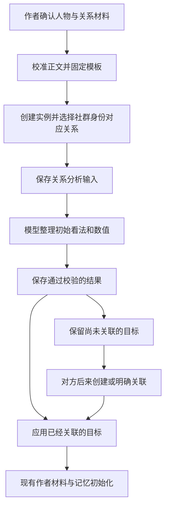

# 人物编号、关系材料与初始化

人物创作可以记录角色认识的人，即使对方尚未创建为社群成员。作者确认人物编号和关系材料；模型负责提供建议、整理正文、分析初始关系。角色运行继续使用现有玩家身份、角色实例、人设正文、关系状态和记忆。

## 人物与社群身份

characters 模块维护人物登记和社群身份对应关系。人物编号与模板编号、实例编号分别保存。同一人物可以在不同社群对应不同成员，同一社群内一个人物编号对应一个成员。重复使用模板的独立副本可以明确选择另一个人物编号。

人物登记包含名称、身份说明和作者归属。作者可以选择自己登记的人物，以及共同社群内已关联成员的人物编号。身份说明用于识别人，属于该目录可见资料。具体角色对对方的评价保存在自己的关系材料中，不进入公共目录。

玩家可以将自己在社群中的身份关联到人物编号。自定义角色的身份关联由其作者执行。已有关联允许原请求重试；变更已经确立的对应关系返回冲突，避免将已有记忆和关系转给另一个人物。

模型不会直接登记、合并或关联人物。同名人物保持独立，作者明确选择后才共用编号。选择已有社群成员时，使用其已关联编号；尚未登记时，作者通过确认操作登记并关联。

## 创作材料与审核

创作第二步同时接受故事和“与 TA 的关系”。每条关系有独立编号、目标人物编号、目标名称和关系原文。作者可以只填写关系，继续完成第二步与采访。单个对象使用一份合并后的关系说明。

故事 AI 辅助返回人物关系建议，接受故事保留这些建议，关系编辑区逐条选择人物后添加。建议本身不会成为正式关系材料。手写全过程可以使用，作者也可以手工确认运行正文符合材料。

修改故事、关系或当前人物编号后，第二步、采访依据和正文审核需要复核。采访冻结确认后的关系材料；校准可以通过 `relationship:<relationship_id>` 引用关系依据。复制草稿、固定模板均保留人物引用和关系原文。

三份运行正文仍为 profile、voice、relational_dynamics。profile 组织身份、生活和影响选择的特征；voice 组织措辞、节奏、情景变化及代表性例句；relational_dynamics 组织一般社交形式。具体人物的共同过去、认识与评价保留在关系材料中，由关系初始化和后续关系状态维护。关系材料可以帮助理解有条件的一般倾向，不逐人复制进相处方式文档。必要的身份背景可简要进入 profile，体现语言特征的称呼进入 voice。

## 初始化执行



CharacterBootstrap 负责创建实例、登记材料、关联人物和安排初始化。关系初始化工作器属于角色模块，复用模型预算和模型路由，使用创作模型。memory 和 reflection 继续负责材料索引、记忆事实及认知整理。

关系分析输入固定人物名字、确认材料、人物编号、提示和模型组。模型只能返回已有关系条目的编号，不能选择实际成员。每条结果包含是否已经认识、亲近/信任/依恋分数、态度和逐字材料依据。依恋独立判断；明确的帮助、支持或承诺才提供朋友资格依据。

模型调用期间不持有数据库写事务。有效结果先独立保存，再写入关系事实。写入失败可以复用成功的分析结果；模型或材料校验失败保持当前阶段，通过现有记忆重试入口继续执行。完成关系阶段后进入原有 materials、organize、views 阶段。

初始关系通过专用方法设置基准，引用真实作者材料，保留现有关系状态格式。日常互动继续使用已有增减规则。证据读取扩展为支持本角色的作者材料，供后续态度刷新使用。

已经有社群经历的关系保留当前数值和态度，只补充初始来源及可检索的过去。重复执行不重复写入证据。关系有方向，两位角色分别依据自己的材料建立看法。

对方尚未关联时，关系正文与记忆正常准备，实例不会等待对方创建。成员后来关联时，处理新成员指向现有成员、现有成员指向新成员的已准备结果，不重做整套记忆。仅听说某个人不等于已经认识，相关材料保留在背景中。

简单模式保留原文检索和固定人设的读取行为；关系材料也需要完成初始分析。完整模式继续读取结构化关系，并进行后续反思和记忆更新。角色仍通过现有 memory_status 和 memory_phase 展示准备进度。

## 百科辅助入口

WikiAuthoring 是后端辅助服务，命令入口为 `tools/prepare_wiki_character.py`，没有公开网页抓取 HTTP 接口。它通过 HTTP 获取材料，用 BeautifulSoup 解析正文；支持萌娘百科存放正文的 HTML template。无法获得正文时明确失败，也可通过 `--source` 提供导出的文本。

模型先整理创作候选，再独立审核知情范围、名字与经历的对应、成长阶段、当前状态及三份文档的内容归属。百科整理与普通创作共用 `resources/authoring/persona-documents.md` 的职责说明；已取得的角色台词选取代表性短例句进入 voice。默认采用正文描述的最后时间点，`--scope` 可以指定时期。原文、初稿、审核稿和审核说明保存在输出文件中；人物可读材料仅来自确认后的正文、故事和关系文本。

审核模型同样可能出错。作者需要检查人物及关系建议，修正越界信息，并明确选择编号。不能把“本人不知道某个秘密”及其秘密内容放入角色可读材料。审核说明不参与人设校准和记忆初始化。

```powershell
uv run python tools/prepare_wiki_character.py <百科地址> <角色名字> --output data/verification/wiki/candidate.json
```

`tools/verify_wiki_community.py` 接受已审核的材料文件，通过正式业务入口创建独立测试社群、固定模板及完整模式实例。它保留人物选择和进度文件，检查后加入人物的关联、玩家关联、重复请求及真实记忆初始化。原始第三方材料与测试数据库保存在本地忽略目录，不随源码发布。

## 接口与数据变更

| 接口 | 用途 |
|---|---|
| GET /api/character-people | 查询可选人物 |
| POST /api/character-people | 作者明确登记人物 |
| GET /api/communities/{community_id}/person-bindings | 查询社群身份对应关系 |
| PUT /api/communities/{community_id}/person-bindings | 明确关联人物与角色或当前玩家 |
| 原有草稿创建、保存、确认接口 | 保存 person_id 与 relationships |
| 原有角色创建接口 | 可选择 person_id，默认采用模板中确认的人物 |

新增迁移保留原有记录，增加人物登记与社群对应关系表、初始化输入输出字段，并扩展作者材料和关系来源类别。旧草稿、模板缺少新增字段时读取为空关系；已有实例不会自动推断或重写身份关系。社群清理包含身份对应关系，人物登记按原有玩家清理范围处理；范围外的草稿或模板仍引用人物编号时，保留数据并报告具体引用。

公开契约见 [HTTP 接口](../reference/http-api.md)，完整字段见 [OpenAPI](../reference/openapi.json) 和 [数据库](../reference/database-schema.md)。
