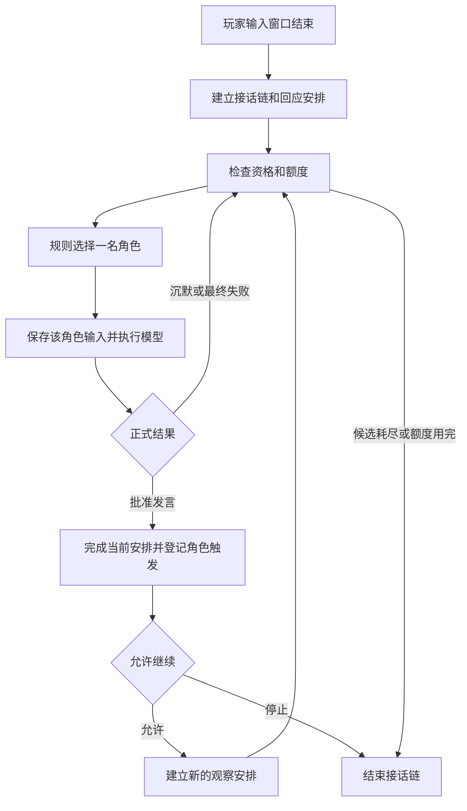

# 会话、输入、社会轮次与角色回应

## 1. 对象与模块职责

InputBatch（输入批次）保存一位主体向同一受众发出的消息集合。SocialChain（接话链）保存一批玩家输入引起的连续回应。SocialTurn（回应安排）固定一次来源和观察上限；一次安排最多保存一条角色发言，可以逐个尝试多个角色。ConversationTask（回应任务）执行一名角色自己的模型调用。

`social` 负责参与资格、排序、候选进度、接话链和停止规则。`conversations` 负责消息、任务、角色上下文、审核与提交。`perspective` 提供共同可见性规则；`characters` 和 `memory` 分别提供角色材料与私有记忆。

`social/contracts.py` 定义 `ConversationTaskPort`、`TaskCancellationPort`、`SocialLifecyclePort` 及明确的数据对象。任务创建和取消由 `conversations/tasks/dispatch.py` 实现，结果登记由 `social/lifecycle.py` 实现，`app/composition.py` 连接实现。各模块的 Repository（存储对象）只修改所属业务记录。跨模块结果登记使用当前事务；规划由社交后台工作推进。

群聊同一时刻最多一个有效回应任务；不同会话可以并发。私聊由玩家输入安排一次角色回应，角色回答不触发自身连续发言。升级前已有的多角色轮次按原决定完成，见第 10 节。

### 1.1 创建、成员与个人列表

私聊固定一个玩家和一个角色。同一社群的同一组合通过 `direct_conversation_pairs` 唯一约束关联一份权威会话；查询组合、创建和加入在同一写事务完成，参与者顺序和新请求编号不产生副本。再次打开恢复权威私聊的活动状态，按需建立新成员区间并取消该玩家的隐藏设置；历史重复副本继续归档。

新群聊至少三位不同参与者，公开创建包含发起玩家和至少两位其他成员。新群聊保存 `creator_player_id`，人数后来减少时保留类型和历史。成员退出关闭自己的区间；活动群聊可重新加入，退出期间的消息保持不可见。最后一名当前玩家退出时，在同一事务结束群聊。

群聊创建者和管理端可以结束群聊。结束将 `status` 改为 `archived` 并增加 `state_version`，禁止发送和加入；群聊没有恢复入口。私聊的个人退出和隐藏保留双方历史，不提供玩家结束整个私聊的操作。

`conversation_list_preferences` 保存玩家对会话的 `hidden`，不改变成员、消息、记忆或其他玩家的列表。当前活动私聊收到新消息时取消当前玩家的隐藏，退出玩家不会因此重新加入。公开列表、个人操作和权限字段见 [玩家读取](player-api.md)。

### 1.2 版本 17 的历史处理

迁移 `0017_conversation_lifecycle.sql` 按同一组合选择最早活动私聊，没有活动私聊时选择最早历史私聊，时间相同时按会话编号确定顺序。其他副本归档，保留原消息、序号、成员区间和记忆引用；只有权威私聊可以再次打开。创建人数不足三位的旧群聊标记 `legacy_small_group`，仍然保持群聊类型。

旧创建请求没有保存足够证据，因此旧 `creator_player_id` 保留空值，由管理端结束。没有当前玩家的旧活动群聊自动归档。迁移同步封闭收集批次，取消未完成回复、轮次和接话链，清除租约并丢弃待处理触发；历史事实保留。原成员操作表改名为 `conversation_operations`，已有请求与结果继续可读。

## 2. 消息事实与接受事务

| 字段 | 含义 |
|---|---|
| message_id、sequence | 正式身份及会话内递增位置 |
| sender、membership_id | 真实发送主体及发生时的成员区间 |
| text | 完整权威发言，前端可以分成气泡 |
| visibility、audience | 实际受众；历史 recipients 范围继续保留 |
| mentions、reply_to_message_id | 结构化提及与真实可见回复来源 |
| client_message_id | 玩家请求幂等键 |
| source_turn_id、result_id | 角色发言对应的安排及批准结果 |

新玩家消息固定为 conversation 范围，实际受众保存发送时的会话成员区间。提及影响排序，部分成员交流使用独立会话。离开再加入产生新区间，历史受众保持原记录。SystemSource（系统来源）使用 source_id，没有成员区间；自动系统通知尚未接入。

接受事务检查社群、会话、成员、提及与回复，保存消息、受众、批次和检索投影。成功接受群聊新消息时，同时取消旧活动接话链、使旧任务租约失效并丢弃待处理触发。已经提交的角色消息保留。新的回应等待玩家输入窗口结束。

幂等检查先执行：相同 player_id 和 client_message_id 的相同请求返回原确认，不再次取消任务、不追加消息、不延长窗口。内容冲突或与历史私有消息身份冲突时拒绝。

## 3. 收集窗口与精确来源

批次按社群、会话、发送主体、可见性与实际受众区分。消息通过明确关联加入批次，序号范围只用于排序，不能包含其他发送者交错的消息。

玩家窗口默认六秒，从最后一条新消息计算；窗口为零时立即 sealed（来源固定）。规划等待同会话的收集批次全部结束，将同受众的玩家批次组成安排。角色窗口固定为零，正式提交时同时保存 sealed 批次。

角色消息只有通过新接话链登记的 `social_triggers` 才能引起后续安排。触发状态为 pending（等待）、consumed（已消费）、discarded（已丢弃）；一个角色批次只消费一次。历史角色批次不补建触发。

## 4. 规划与参与算法

调度采用 `RuleBasedParticipationPolicy`，版本为 `rules-v1`，不调用模型。选择前检查社群与会话、链条预算及角色资格：仍处于原成员区间、属于来源受众、看见当前触发与根玩家输入、记忆准备完成且可用。角色消息触发时排除发送者；同一次安排已经尝试的角色不会再次执行。

合格候选按以下顺序选择一名：

1. 当前输入中被提及或被回复消息的发送角色优先。
2. 本链已创建任务较少的角色优先。
3. 从未发言优先，其次最近发言时间较早优先。
4. 角色标识稳定排序。

选择后只准备该角色自己的上下文。模型通过既有聊天调用决定发言或沉默。规则没有计算独立的参与意愿分数。后续独立意愿模型的探索保留在设计草案中。

## 5. 快照、执行与提交

每个安排固定来源、观察上限和成员版本。根玩家输入与当前触发均为必须保留的材料，按消息身份去重、按序号排列；超出必要输入预算时记录 `context_budget_exceeded`，不截断事实。选中角色获得自己的人设、状态、关系、历史 Thought（私有内心）、摘要和合法记忆。

自动记忆准备在领取之前完成；执行与重试读取原快照。正式角色发言产生下一次安排，新的任务获得更新后的观察上限，能够读到该发言。旧任务重试仍使用原输入。

审核检查身份、任务尝试、租约、原成员区间、来源、链条有效性、长度和可见回复目标。批准事务同时保存结果、完整消息、受众、非空 Thought、检索投影、角色批次、参与结果、接话触发与计数。重复提交不重复保存事实或增加计数；调用模型期间没有写事务。

`character_message.v1` 保持 thought、utterance 和可选 reply_to_message_id。合法沉默为 `{"outcome":"silent"}`，不创建空消息或角色批次。表达和提示规则见 [角色提示契约](character-prompt-contracts.md)。

## 6. 回应受众与停止规则

回应受众为原安排受众与仍有效原区间的交集。后续安排继承正式角色消息的实际受众，不扩大到新加入区间。所有候选必须能够观察根玩家输入，引用不能恢复不可见材料。

新链固定创建时的上限，默认最多 3 条正式角色消息和 6 个角色任务。沉默、失败和取消均占用已经创建的任务额度；同一任务内部重试不增加任务数，继续受现有请求、尝试与期限限制。配置只影响新链。

| chain.stop_reason | 含义 |
|---|---|
| message_limit | 正式消息数量达到上限 |
| task_limit | 已创建任务数量达到上限 |
| candidates_exhausted | 当前安排的候选已经尝试完毕 |
| no_eligible_candidates | 没有可以安排的候选 |
| player_input | 新玩家消息取消旧链 |
| member_left | 原玩家输入所属成员区间已经结束 |
| conversation_archived | 会话归档取消旧链 |

正常停止为 completed，明确中断为 cancelled；暂停由社群状态表达，保留链条进度。重复观点、附和和语义相似不会被程序作为停止条件。已到达供应商的请求可能继续产生用量，迟到结果无法写入正式消息。

## 7. 输入批次的生命周期

| InputBatch.status | 含义 |
|---|---|
| collecting | 仍在收集同主体、同受众的新消息 |
| sealed | 消息集合固定 |

安排、任务与结果保存在各自对象中。任务失败和重试不改变已固定的批次。

## 8. 参与决定的生命周期与结果

`social_candidates` 保存原成员区间及 waiting（等待）、excluded（资格排除）、attempted（已经安排）、skipped（安排结束后跳过）。等待时不提前记录为模型沉默。

| ParticipationDecision.status | 含义 | outcome |
|---|---|---|
| silent | 规则没有安排任务，reason_code 说明原因 | silent |
| selected | 已建立角色任务，尚未结束 | 空值 |
| completed | 模型结果通过正式处理 | message 或 silent |
| failed | 任务最终失败 | failed |
| cancelled | 任务被业务变化取消 | cancelled |

reason_code 表达 mentioned、replied_to、rotation 或明确排除、停止原因。只有 completed / silent 表示模型实际选择沉默。最终失败保留失败含义。任务等待重试或暂停时，决定仍为 selected。

## 9. 社会轮次的生命周期

| SocialTurn.status | 含义 |
|---|---|
| running | 正在执行选中角色，或等待规划下一名候选 |
| completed | 已保存一条角色发言，或无法继续尝试 |
| cancelled | 整次安排因业务变化取消 |

没有 selected 决定时，仍需检查等待候选和预算。全部沉默后正常完成；一个角色失败后仍可尝试其他人。单次安排完成后接话链可能继续 active（进行中）。

公开 TurnView 提供 chain_id、parent_turn_id、depth、chain_status、chain_stop_reason 和 stop_reason。管理详情增加链条额度、候选进度和触发处理状态。公开读取要求当前来源及根玩家来源均对阅读者可见，不返回私有上下文。

## 10. 对话任务如何连接这些对象

沉默或最终失败登记参与结果，下一次社交规划选择剩余候选。可重试失败继续当前任务。批准发言结束本次安排，预算允许时消费角色触发并建立新安排。暂停保留进度；角色离开取消对应任务并检查其他候选。原输入玩家退出时取消依赖该区间的回复及接话链；尚未安排的固定输入记录取消轮次，避免后来重新安排。归档和新玩家输入取消旧链。取消使租约失效，已生成的迟到结果保存为失效结果，不发布消息。

迁移 `0010_social_continuation.sql` 增加链条、候选、触发及轮次关联。版本 9 及更早的轮次 chain_id 为空，保留原多角色决定、快照与完成方式，不创建后续角色触发。新私聊同样没有接话链，只有一个角色任务。任务状态与恢复见 [持久任务](task-execution.md)。

## 11. 历史读取与例子

Alice 的两条公共消息和 Bob 的一条消息分别形成批次，同受众来源进入首轮安排。甲先被规则选中，正式发言后建立新安排；乙的实际请求包含甲的新发言和最初玩家问题。三条角色消息后默认结束。玩家在执行期间补充问题，旧链立即取消，新链等待输入窗口结束。

私聊、历史 recipients 消息和离开再加入继续使用共同观察规则。验证入口见 [验证指南](../guides/verification.md)，协议见 [HTTP](../reference/http-api.md)，当前验收范围见 [状态](../status.md)。
