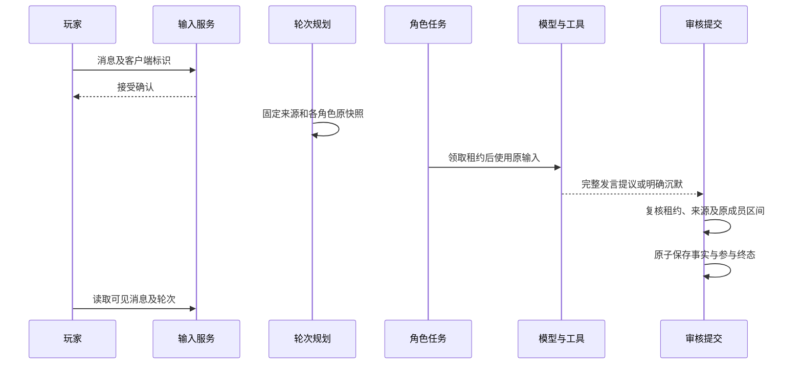

# 会话、输入、社会轮次与角色回应

## 1. 四个对象解决四个问题

InputBatch 保存一位主体向同一受众发出的具体输入。SocialTurn 组织对一组来源的多人回应。ParticipationDecision 解释一个候选角色是否参与及最终结果。ConversationTask 执行被选角色自己的模型调用。

直接会话由一个玩家和一个角色组成。群聊允许多名玩家与角色。会话拥有独立递增序号、成员版本及 active/archived 状态。同一会话同时推进一个 running 轮次，后续输入继续接受和保存；不同会话分别推进。

## 2. 消息事实与接受事务

| 内容 | 意义与责任 |
|---|---|
| message_id、sequence | 后端生成的正式身份和会话内递增位置 |
| sender、membership_id | 玩家和角色使用 ActorRef 与发生时的成员区间；系统来源使用 SystemSource，成员区间为空 |
| text | 一条完整权威发言，界面可以分气泡 |
| visibility、实际受众 | conversation 或 recipients；均保存具体区间 |
| mentions | 结构化提及，用于参与排序，必须是当前合法主体 |
| reply_to_message_id | 已存在且发送者可见的回复来源 |
| client_message_id | 玩家请求幂等键 |
| source_turn_id、result_id | 角色发言的轮次及批准结果来源 |

接受事务检查社群与会话成员、归档、输入、提及、接收者和回复来源，分配序号，保存消息、受众、提及、批次关联、检索投影与追踪。返回接受确认后，模型执行在后台发生。

SystemSource 保存 system 类别及 source_id。系统消息仍保存实际受众，沿用消息观察规则；系统来源不能加入社群、成为关系目标或使用玩家发送接口。数据表达、存储与读取已经实现，自动通知及活动消息发送入口尚未实现。系统消息不进入当前玩家和角色的 InputBatch。

幂等键为 player_id 与 client_message_id。重复比较会话、正文、可见性、接收者、提及与回复。内容一致返回原消息；内容冲突拒绝。重复请求不追加消息、不延长窗口；发送者离开后仍可以查询原接受结果。

## 3. 收集窗口与精确来源

批次按社群、会话、发送主体、可见性与排序后的实际受众区分。每条消息通过明确关联加入批次，起止序号只用于排序和范围，不能包含其他发送者交错的消息。

玩家窗口默认六秒，从最后一条新消息计算。窗口内继续消息延长期限；到期后新消息先结束原批次，再创建新批次。受众变化产生新批次。quiet_window_seconds 为零时立即 sealed。

角色窗口固定为零。一次模型产物保存一条完整消息并在同一事务建立 sealed 批次。气泡分割不增加输入次数。角色批次保存原轮次因果来源，当前不自动触发角色连续接话。未来策略必须另行检查主动来源、连续次数与参与预算。

批次状态为 collecting 与 sealed。批次不保存任务执行状态，assigned、covered 与 terminal_failed 的含义由轮次和任务承担。

## 4. 规划与参与算法

扫描到期玩家批次，按会话和同一实际受众组合结束来源，在短事务中冻结完整消息列表、共享观察上限及原成员版本。社群暂停、会话归档或会话已有运行轮次时保留等待来源。

候选角色必须仍为成员、处于来源受众、看见全部输入且可用。角色能力由正式模板与任务能力政策决定。排序依次为被提及优先、未发言优先、最近发言时间较早优先、实例标识稳定排序。直接会话最多一个角色，群聊默认最多两个。

每个候选保存决定，原因包含 mentioned、rotation、responder_limit、unavailable、member_left、outside_audience 和 source_not_visible。只有 selected 建立任务，唯一关系为轮次与角色。一个角色可以在任务中明确沉默，完成状态为 completed，outcome 为 silent。

模型意愿和话题评分未接入。未来替换选择政策继续使用相同轮次、决定及任务边界，不更改来源事实。

## 5. 快照、执行与提交

规划事务为每个被选角色保存自己的 ContextSnapshot。共享历史上限相同，身份、状态、关系、能力与私有记忆分别保存。任务重试、恢复和第二角色较晚执行都读取原快照。

CharacterMessageProposal 包含 thought、utterance 与可选真实回复身份。thought 记录角色当下真实出现的一点内心反应，可以为空，保持私有；utterance 是完整对外文字。thought 不承担回复计划、对话分析、模型推理或规则说明。默认上限分别为 1000 和 2000 字符。空发言不能代替沉默。完整表达规则见 [角色提示契约](character-prompt-contracts.md)。

审核检查本次身份、用途、输出契约、任务和尝试、租约 owner 和 generation、当前社群与会话、原成员区间、长度与可见回复来源。第一角色提交的新消息不使第二角色原任务失效；整体当前历史版本不能取代这些具体审核。

批准事务同时保存尝试结果、完整发言、受众、非空 Thought、搜索投影、角色批次、任务终态、参与终态、轮次完成与 outbox。模型调用期间不持有写事务。重复尝试提交返回已有结果；失去租约或旧代次结果不能再次写事实。

## 6. 回应受众与提交资格

回应沿用原轮次受众，与仍有效的原区间取交集。模型不能扩大接收者，私有输入产生私有回应。发送角色必须仍在原区间，重新加入不能让原任务恢复资格。

例如 Alice 离开又重新加入会话，她获得新的成员区间。原轮次仍引用她原来的区间，因此不会向新加入区间发送迟到回应。角色自身离开又重新加入时，原任务也不能通过资格审核。受众资格决定结果能否提交，与任务当前处于等待、执行还是重试分别判断。

## 7. 输入批次的生命周期

InputBatch 回答“这批输入是否还在收集”。由消息输入服务和窗口结束服务改变状态。

| InputBatch.status | 含义 | 改变条件 |
|---|---|---|
| collecting | 还可以接收同主体、同受众的新消息 | 玩家窗口大于零，最后一次新消息后尚未到期 |
| sealed | 来源已经固定 | 窗口到期、受众改变，或窗口为零 |

sealed 后消息集合保持不变。批次进入轮次后仍为 sealed；是否已经安排回应由批次与轮次的关联记录判断。任务重试和角色失败不会让批次重新 collecting。

## 8. 参与决定的生命周期与结果

ParticipationDecision 回答“这个角色是否被安排回应，以及最终怎样结束”。规划服务建立决定，对话提交和取消服务更新选中角色的决定。每个轮次、每个候选角色只有一个决定。

| ParticipationDecision.status | 含义 | 是否存在 ConversationTask | outcome |
|---|---|---|---|
| silent | 规划时没有选中 | 否 | silent |
| selected | 已安排角色，任务尚未结束 | 是 | 空值 |
| completed | 任务合法结束 | 是 | message 或 silent |
| failed | 任务终态失败 | 是 | failed |
| cancelled | 任务被业务操作取消 | 是 | cancelled |

reason_code 解释规划原因，如人数限制或角色不可用。outcome 表达实际结果。selected 角色在模型执行后决定不发言时，状态为 completed、outcome 为 silent；它与规划时没有任务的 silent 保留不同含义。任务在 pending、processing、retry_wait 或 suspended 之间变化时，参与决定保持 selected。

## 9. 社会轮次的生命周期

SocialTurn 回答“这组输入安排的回应是否都处理完了”。由规划服务建立，由角色完成、失败和取消后的轮次更新服务结束。

| SocialTurn.status | 含义 | 进入条件 |
|---|---|---|
| running | 至少一个 selected 决定尚未结束 | 规划事务建立了角色任务 |
| completed | 本轮不再有 selected 决定 | 所有选中角色都结束，或规划时没有选中角色 |
| cancelled | 整轮被明确取消 | 会话归档等业务操作取消本轮 |

等待规划的输入由 sealed 批次表达。规划在同一事务中建立轮次、参与决定、角色任务和快照，正式轮次采用 running、completed、cancelled，无需另存一份尚未规划的 pending 轮次。

全部角色沉默时正常 completed。一个角色 failed、另一个成功发言时，轮次同样可以 completed，各角色结果仍分别保存。轮次完成仅说明安排已经结束，不能据此判断每个角色都成功发言。

## 10. 对话任务如何连接这些对象

ConversationTask 的状态、领取、重试、暂停及取消规则统一见 [对话任务生命周期](task-execution.md#3-对话状态与生命周期)。本节只说明它对参与决定和轮次的影响。

例如甲乙都被选中：轮次 running，两份决定 selected；甲任务 completed 并保存发言后，甲决定 completed、outcome=message，乙仍 selected，轮次仍 running。乙暂时故障进入 retry_wait，决定保持 selected。乙随后完成沉默，决定 completed、outcome=silent，轮次 completed。

暂停保留任务和原输入，参与决定继续等待；恢复后继续执行。成员离开取消对应任务，会话归档取消未完成回应。反思图和活动行动不改变本轮的角色回应完成条件。

## 11. 历史读取与例子

消息读取要求实际 player_id，游标绑定玩家、会话和扫描位置。过滤私有消息后仍前进，避免反复扫描不可见内容。轮次读取仅返回玩家可见全部输入的轮次，公开响应不包含 Thought、完整输入或内部失败堆栈。

Alice 的两条公共消息与 Bob 的一条消息归入各自批次，再组成一轮。提及甲乙使两者选中，丙记录人数限制。甲先提交，乙网络重试后按原快照提交。下一条玩家消息进入下一轮。若 Alice 改为只向甲发私有消息，Bob 与乙均看不到来源、对应回应和私有轮次。

验证重点为交错批次、重复请求、受众分组、独立原快照、各类终态、迟到提交及重新加入。接口协议见 [HTTP](../reference/http-api.md)，具体能力状态见 [状态](../status.md)。
