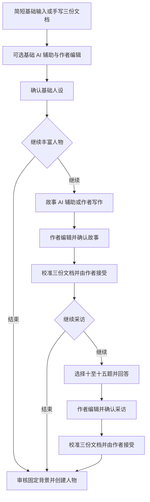
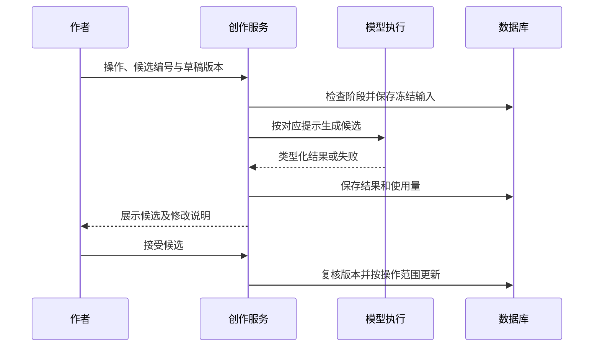

# 自定义人物创作

本文定义人物从作者设定到固定资源和独立实例的完整过程，包括三阶段创作、AI 辅助、人设校准、候选审核、材料归属与执行边界。实现范围与验证结果见 [状态说明](../status.md)，实际接口见 [HTTP 参考](../reference/http-api.md)。

## 1. 三个阶段的目的与顺序

人物创作按基础人设、过去故事、人物采访依次进行。后一步根据作者已经接受的前一步内容生成。人设丰富程度与角色运行模式独立，简单及完整模式见 [记忆设计](memory.md#2-初始化可见性与有效期)。

| 阶段 | 作者提供什么 | AI 辅助负责什么 | 作者确认的结果 |
|---|---|---|---|
| 基础人设 | 名字与五组自介资料；可选简述和手写三份文档 | 展开允许补充的基础设定，准备三份初始正文 | 一个已有完整运行正文的基础人物 |
| 过去故事 | 经历关键词或自行撰写的故事 | 根据已确认的人物，构思或完善经历 | 背景原文，以及这些经历对人物的影响 |
| 人物采访 | 选择 10～15 个问题，允许自行填写回答 | 根据已确认的人设和故事，代入角色回答 | 人物细节、价值观、自我描述和实际表达样本 |

基础阶段完成后可以结束创作；故事阶段完成并审核运行正文后也可以结束。进入采访要求前两阶段已经确认，三份文档已经反映当前故事。背景简短也可以进入采访，故事篇幅不作为资格条件。

原始材料与运行正文分别保存。故事和采访用于校准人设，也可成为初始记忆来源。材料保存与记忆消化具有独立的完成状态；material_processing=stored_only（仅保存原文）表示材料尚未通过反思形成可检索记忆。

## 2. 作者操作与三份运行正文

每个阶段采用相同流程：填写或导入材料，按需使用本阶段 AI 辅助，作者编辑并接受。前三套提示完成各自阶段的生成和必要的文字完善；其余材料修改由作者完成。

基础阶段就提供 profile（身份、性格和动机）、voice（表达方式）、relational_dynamics（相处倾向）三份文档。普通作者只写简短描述，由默认组织或 AI 辅助准备正文；熟悉创作的作者可以直接撰写和编辑三份文档。

新草稿只需名字即可创建，缺少简述时用确定性身份句准备初始正文。自介卡以 introduction 保存 identity、daily_life、personality、speech、appearance 五组编辑资料，名字仍只保存于 display_name。按资料生成正文时，身份、生活、性格与外貌以稳定模板在 profile 开头成段，台词与语气进入 voice，相处方式和限制进入 relational_dynamics；空项省略，不根据年龄、性别或职业推断性格。故事和采访按各自阶段保存，经过作者确认和人设校准后再影响运行正文。模板、基础引导、题库和固定背景提醒集中维护，四套创作提示按职责分别保存。

自介资料的字符串和列表上限由 AuthoringContent 的明确类型定义；合计最多 8000 字符，计入 40000 字符作者材料总预算。列表去除两端空白、空项与重复文字。`profile` 上限为 9000 字符，容纳 8000 字符自介资料及模板称呼、标签和标点。结构化资料用于编辑、创作输入与插画，角色实际读取已经确认的三份正文，不增加人物文档类型或独立自介记忆来源。

保存自介不覆盖手写正文，但使基础及已有后续阶段、采访依据和正文审核需要重新检查。按资料生成正文是无模型的业务操作：先按当前修订号返回修改预览，接受时复核同一修订号并重新计算确定性模板，再更新简述和三份正文。预览、取消、过期接受和保存失败均不改变原正文。AI 候选使用同一已保存资料，接受候选不反向填写自介字段。校准只允许引用实际非空字段 introduction:<字段路径>，空项不能成为依据。

三份文档中的作者手写内容也是明确设定。创作助手根据最新确认正文继续工作；与其他作者材料冲突时，列出具体出处，交给作者修正。AI 候选在接受之前不改变草稿。

校准可由 AI 产生修改稿，也可由作者手工编辑后明确确认文档符合当前材料。手工创作全过程可用，不要求通过模型调用才能创建人物。

## 3. 四套创作提示

| 提示 | 依据 | 生成范围 |
|---|---|---|
| 基础人设创作 | 基础输入、现有正文、作者补充要求 | 基础描述与三份初始人设候选 |
| 背景故事创作 | 已确认的人设、故事草稿与作者要求 | 第三人称的完整背景故事及新增说明；作者规定的留白与知情范围继续有效 |
| 角色采访 | 人物正文、已确认故事、选定问题与创作采访情景 | 尽量坦诚的第一人称回答及独立的新背景建议；普通偏好可以沿设定丰富 |
| 人设校准 | 作者最终编辑的三阶段材料与现有三份正文 | 三份文档修改稿、修改依据与待处理冲突 |

编辑与校准只处理三份运行正文，故事和问答保持作者已经接受的内容。校准结果将修改稿和简短说明一起展示，由作者一次审核接受。

校准提取理解人物必需的背景、语言特点和相处倾向，控制正文重复；完整故事和采访继续独立保存。没有来源支持的经历、性格、关系及能力不进入确定正文。冲突涉及身份、价值取舍或经历时，保留出处，等待作者决定。

角色对自己的描述、采访中实际表现出来的表达方式、助手根据材料的推断分别说明。回答“我经常主动聊天”属于自我描述；回答的措辞、节奏和回避方式属于这次实际表达样本。校准不将自我描述自动视为已观察到的行为。

## 4. 采访与实际角色扮演的共同部分

聊天与采访共用人物正文的组装方法。采访使用自己的创作情景：人物尽量把生活、经过与感受讲清，保留原有用词、语气和明确限制。日常聊天的表达指导及允许回避、主动补写往事的规则不进入采访输入。寡言与谨慎影响口吻，不能成为整批问题的回避理由。

CharacterAgent 绑定正式社群角色实例，检查调用身份、输出契约和工具权限。创建阶段采用明确的草稿采访调用，复用人物正文与模型网关；不创建临时社群实例，不伪造 InvocationScope（社群角色调用范围）。

采访输入包括作者故事，标明它是作者设定的过去经历。采访原文及候选始终属于创作材料，不生成正式会话消息、Thought（私有内心记录）、关系变化、状态或记忆。

采访中的普通偏好、观点、作息和小习惯可以在已有方向上丰富。缺少过去事实时，回答已有内容能够支持的部分，以人物口吻说明资料缺口；新增过去、身份或重要关系只放在 `new_background_suggestions` 中，等待作者确认。角色明确不知情的内容不用于自述，作者明确不能谈的事项和能力限制继续有效。

校准区分这次采访表现与稳定倾向。一次拒答、短答、玩笑或情绪不能成为日常规则；一般倾向保留条件，手写硬性限制完整保留。同一条件下互相矛盾的事实或成因写入 `conflicts`，包含实际来源，不补写解释替作者决定。

新候选冻结本次人物正文、故事、问题、模型配置及完整实际系统提示，`prompt_version=2.0`。JSON Schema 由输出模型追加并一同冻结。采访同时冻结生成和检查提示、两种实际模型组及检查的思考深度。采访依据中的 `agent_contract` 保存本次采访情景，`expression_guidance` 为空；旧候选、旧依据和已定格人物保持原内容。旧依据继续提供其人物与故事快照，新候选使用当前采访情景并保存实际提示；执行直接读取该候选的冻结提示。

## 5. 采访问题

默认提供下面 15 题，作者可以取消最多 5 题。完整采访保留 10～15 个问题，每题有唯一编号和明确问题正文。可以分批回答；完成阶段时全部选定问题都有回答，明确拒答或说明没有相关经历同样是有效回答。

分批采访沿用开始采访时已确认的前两阶段材料和三份正文。回答新增细节使文档需要最终校准，但不会阻止完成后面的提问。作者修改基础设定、故事或手写正文时，这份采访依据失效，后续回答需在重新审核前置设定后继续。

| 编号 | 问题 | 重点 |
|---|---|---|
| daily_rhythm | 平时一个普通的日子，你从起床到睡觉大概怎样度过？其中哪个时刻最舒服，哪个最让你烦躁？ | 日常节奏与感受 |
| food_drink | 你最喜欢什么食物或饮品？有没有固定的吃法、搭配，或者绝对不碰的东西？ | 具体生活偏好 |
| free_day | 突然多出一整天自由时间，没有任务，也没人催你，你大概率会怎样度过？ | 兴趣与恢复方式 |
| place_weather | 你喜欢什么样的地方和天气？比如城市还是郊外、晴天还是雨天、热闹还是安静？ | 环境与生活审美 |
| personal_ritual | 有没有一个别人觉得奇怪或没用，但你一直保留的爱好、小习惯或仪式？它为什么对你重要？ | 有辨识度的细节 |
| conversation_habit | 你是会主动找人聊天的人吗？平时聊天最容易聊些什么？ | 主动交流与话题偏好 |
| spending_values | 有什么东西值得你花很多钱或时间？又有什么东西，即使别人都觉得值得，你也不愿意投入？ | 欲望与价值排序 |
| emotional_recovery | 累了、难过或者生气的时候，你通常先有什么反应？什么具体的事情能让你好受一点？ | 情绪表现与恢复 |
| close_relationships | 和亲近的人相处，怎样的状态最让你自在？对于不常联系但仍然在意的人，你怎样表达关心？ | 相处与关系维护 |
| social_boundaries | 什么样的行为会让你对一个人产生好感？什么行为会让你明显不舒服，甚至想保持距离？ | 信任条件与边界 |
| conflict_cooperation | 和朋友意见不合，或者一起做事情出了差错时，你通常怎样处理？能讲一个具体例子吗？ | 冲突、合作与失败 |
| difficult_choice | 有没有一个让你为难的选择？你最在意哪些事情，最后为什么那样决定？ | 原则与实际取舍 |
| past_influence | 过去哪个人或哪件事，对现在的你影响很大？你现在怎样看待这份影响？ | 经历的主观理解 |
| self_and_others | 熟悉你的人会怎样形容你？你觉得他们哪里说得准确，哪里误解了你？ | 自我与他人印象 |
| future_change | 如果接下来几年生活基本保持现在这样，你会满意吗？你最想改变什么，又有什么希望一直保留下去？ | 愿望、顾虑与珍惜的内容 |

题库覆盖日常生活、情绪、关系、价值取舍与自我认识。人物按自己的世界回答题目中的例子；手机应用等特定时代的问题根据人物背景替换。

## 6. 生成详细度与过去经历

基础三份正文通常合计约 600～1000 字；故事通常约 800～1500 字，围绕少量重要经历。采访回答的详略由采访情境、人物性格和表达意愿决定，短答、展开与拒答均保留角色差异。实际字段上限属于接口预算，与内容引导分开维护。

故事生成依据已有性格和动机推展经历，避免所有人物都拥有相同的悲惨或神秘背景。采访尽量提供具体细节、动作和理由，减少逐题重复性格标签。

采访优先使用已确认故事。新过去经历作为独立背景建议返回，角色回答保留假设性质；作者接受该经历并写入故事后，再复核采访和人设。采访产生的日常喜好、习惯和价值表达可以在作者接受问答后用于校准。

## 7. 阶段变化与最终固定

草稿阶段允许修改前面内容。修改基础设定或作者手写正文，会让已有故事和采访需要复核；修改故事会让已有采访需要复核。材料保留，作者按先后顺序编辑并重新确认。选题或问答变化使采访需要重新确认。未接受的候选仍按输入 revision（草稿版本）检查，过期结果可以读取，不能直接接受。

任何影响人物含义的材料变化都会让三份文档需要审核。校准候选仅修改三份文档并经过作者接受时，不再次使作为输入的故事和采访失效；作者自主改写文档按上游设定变化处理。

最终创建要求基础阶段已确认、已填写的后续阶段没有待复核材料、三份正文已经由作者审核。采访可整段省略；已经参加采访的角色需要完成其 10～15 题。单纯调整名字或头像不要求重新构思故事；改名要求审核正文并重新建立采访依据，改头像保留流程状态。

确认后固定资源仍不可编辑，复制得到新草稿，既有实例及经历不随草稿变化。背景变更需要重新初始化的原则保留，已有实例重置见 [剩余草案](../design-drafts/01-custom-characters.md)。

## 8. AI 候选执行与接受

创作服务在短事务中复核作者、草稿版本与阶段条件，冻结本次材料，再请求模型。AuthoringAgent 负责生成建议，不能访问数据库或直接修改草稿；保存结果和接受结果由创作服务执行。

basic（基础）、story（故事）、interview（采访）、calibrate（校准）分别使用独立输入和输出类型。接受候选只更新其操作允许的内容：故事只更新故事，采访只更新指定回答，校准只更新三份文档。材料接受与阶段确认分别执行。校准来源逐项引用基础、故事、已有正文或采访编号；只将同一条件下无法同时成立的事实与要求列为冲突，不同情境下的反应可以共存。

每个候选的总期限为 90 秒，包含模型额度等待。最多两次逻辑请求；采访先生成草稿，再检查过去事实、知情范围与人物表达，第二次结果作为最终候选。首份结构无效时，第二次同时修正结构与内容。其他操作第二次仅用于修正无效输出。每次输出上限为 6000 tokens（模型输出单位）。供应商网络重试沿用模型配置，记录逻辑请求、供应商尝试与模型使用量。采访每批处理一至五题，整份采访按十至十五题验收。检查提示与初始提示一起冻结，实际使用量包含两次调用。

创作、聊天和反思共享 ModelBudget（模型并发额度）。模型请求期间不持有数据库写事务。生成期间作者可以继续保存；接受时检查 input_revision 与当前草稿 revision，过期候选返回 candidate_stale。

候选编号由客户端生成。同编号和同请求返回保存状态，同编号不同请求返回 idempotency_conflict；失败后再次生成使用新编号。未接受结果或模型失败不改变作者材料。进程中断留下的 processing 候选在超过截止时间后读取时标记 authoring_interrupted，不自动生成。

## 9. 身份、固定资源与实例

草稿属于一个 player_id。完整材料、候选、确认、复制与人物资源读取检查作者归属。作者属于目标社群后才可创建人物实例；同社群其他成员可以正常与实例交流。

草稿不具备社群角色身份。作者完成阶段与正文审核后，通过 expected_revision 和 acknowledge_fixed_background=true 确认固定资源。确认在一个短事务中保存 CharacterBlueprint（人物资源）并将草稿设为 confirmed；重复相同确认返回原人物。

自定义资源编号为 custom:<UUID>，content_version 为 0.1.0，预置资源不得使用 custom: 前缀。确认后内容固定；复制产生新的可编辑草稿，不复制实例、消息、状态、关系或记忆。草稿 revision 用于编辑冲突检查，与资源版本各有职责。

实例绑定固定资源，每个实例分别保存状态、关系与记忆。BlueprintReader（共同人物读取服务）按身份与资源版本读取预置文件或 SQLite 自定义人物，展示、上下文、执行绑定与初始化共用该入口。任务快照保留实际准备时的人物正文，重试沿用原输入。

固定人物资源与实例准备分别完成。实例创建选择运行模式，默认简单且创建后不可切换；有故事或采访时，完成相应初始化后才能聊天，只有基础人设时直接可使用。作者故事及采访保持独立原文，不直接成为 memory_preload（初始记忆资源）；简单模式建立原文分块检索，完整模式进一步整理长期记忆。材料和准备状态见 [记忆设计](memory.md#2-初始化可见性与有效期)。共同 agent_contract（角色规则）与工具权限由项目提供，创作请求只修改作者材料和人物正文。

## 10. 保存与读取边界

character_authoring_drafts 保存作者材料、三份正文、阶段状态与采访依据，以及最近接受候选及其接受后 revision；character_authoring_candidates 保存独立候选、冻结输入、输出、状态和使用量；custom_character_blueprints 保存已确认人物资源与作者材料。

旧草稿及固定资源通过迁移补充空 introduction，原描述、正文、历史候选和实例绑定版本保持原样，复制与定格保留结构化资料。

输入和 JSON 保存前按明确类型校验，固定资源按 CharacterBlueprint 契约读写。原文超过预算时明确返回错误，作者可以提供整理后的运行正文；材料不会被静默截断。人物运行读取三份确认正文，具体作者经历通过有来源的记忆初始化与检索进入上下文。

公共角色展示提供名字、头像与绑定信息，完整人物正文和采访仅作者可读。预置 GET /api/blueprints 提供公共文件目录，自定义人物列表按作者分页。当前 player_id 是本地测试选择，账户认证的实现范围见状态说明。

人物图像通过独立资产服务上传或生成。生成先产出带环境背景的胸像到半身完整插画，人物与背景的时间、环境和光照沿用选定场景预设。作者确认方形取景后由后端另存头像，头像关联来源插画；选择时通过该关联同时更新人物头像与插画展示，并复核所属玩家、用途及草稿 revision。定稿固定作者选定的资产引用；原有外部头像地址继续支持。草稿生图从已保存版本读取名字、简述与 introduction.appearance，外貌事实、画风、此次姿态和场景补充分段组装；作者确认选择后才修改草稿。实例展示头像可以单独覆盖，保留固定人设版本；规格、展示档位、公共提示、文件与引用规则统一见 [图像资产](image-assets.md)。

公开错误不包含模型凭据或内部堆栈。数据库字段见 [数据库参考](../reference/database-schema.md)，人物结构见 [资源参考](../reference/character-resources.md)，运行模式和材料处理见 [记忆设计](memory.md)。
