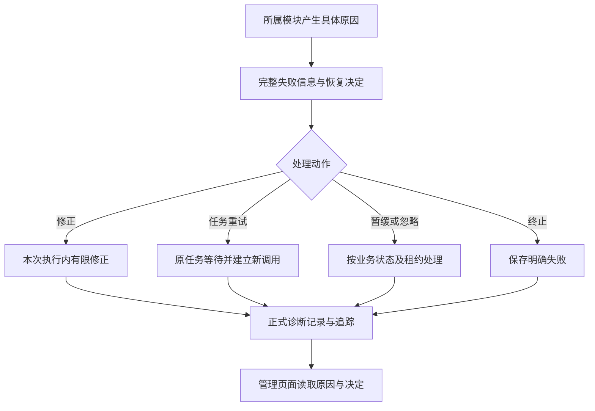

# 错误分类、重试与恢复

日期：2026-10-04。状态：已核实实现差距，本文中的恢复要求待实施。当前接口字段仍以 [HTTP 参考](../reference/http-api.md) 和 [管理接口](../reference/management-api.md) 为准。

本说明负责错误信息和恢复决定从产生到保存的完整规则。任务状态与租约见 [任务执行](task-execution.md)，三层调用预算见 [Agent 与模型](agents-and-models.md)，固定修正正文由 [角色提示契约第 13 节](character-prompt-contracts.md#13-格式修正与任务审核提示) 维护。

## 1. 核查依据与结论

核查比较当前后端提交 `0c7b9d8053b695ffde6b45f537f320a82c4a1325` 与原项目 [echo 主分支提交](https://github.com/Weilan0811/echo/tree/c1d8a27c78565d3a8f2271a0f11ca6b5bd9f1b4d/server) `c1d8a27c78565d3a8f2271a0f11ca6b5bd9f1b4d`。用户提供的《错误修复.md》作为差异线索；以下结论根据两边源码确认。

当前仍有统一失败对象、供应商错误分类、网关重试、执行循环内修正、持久任务次数限制、心跳和过期租约恢复。主要缺口是：具体错误码在部分路径被覆盖，恢复动作被简化，修正提示和诊断信息没有完整传递与保存。

| 核查项目 | 原项目实现 | 当前实现及恢复要求 |
|---|---|---|
| 失败信息契约 | `FailureInfo` 保存错误码、类别、动作、可重试性、等待时间与修正提示 | 契约保留；执行结果及队列入口仍需完整传递它 |
| 供应商分类与请求重试 | 区分超时、限流、临时故障、认证、额度和无效请求 | 已保留；继续使用实际供应商尝试次数和建议等待时间 |
| 输出与工具参数修正 | 在同次执行内有限修正，权限与预算错误结束 | 已保留；不能通过持久任务重试重新获得已耗尽的修正额度 |
| 运行结果的恢复决定 | `decide_agent_run` 保留已有恢复动作；暂停对应 `defer`，取消对应 `ignore` | `decide_run` 主要按运行状态选择重试或失败，其他停止结果可能进入失败；需要恢复动作区分 |
| 已定义异常的错误码 | 原调度器优先读取异常的 `.code`，并单独处理未登记的任务处理器 | 当前通用异常分支保存异常类名并终止；需要为已知错误保留具体错误码和相应规则 |
| 任务再次执行的审核提示 | `decide_review` 定义具体审核提示，设计要求传入新调用；原对话提交、调用创建没有完整使用该决定 | 属于原项目已有的实现缺口。当前对话只有合并的长度提示，反思入口缺少传递，需要完成端到端实现 |
| 恢复诊断 | 原设计要求传递类别、等待和提示，实际任务及追踪也主要保存错误码和次数 | 属于原项目已有的实现缺口；当前也需补充正式记录和管理查询 |
| 输入快照 | 原对话尝试重新构建上下文，设计允许部分来源变化后重新选择输入 | 当前冻结原任务快照；继续保留当前规则，恢复功能不重建快照 |
| 租约及图失败传播 | 有限重试、拒绝迟到结果、必需节点失败传播、复用成功产物 | 当前仍有这些机制；保留，部分成功图的补充运行仍属独立待办 |

原项目的 [恢复策略](https://github.com/Weilan0811/echo/blob/c1d8a27c78565d3a8f2271a0f11ca6b5bd9f1b4d/server/src/echo_server/runtime/recovery.py)、[调度器](https://github.com/Weilan0811/echo/blob/c1d8a27c78565d3a8f2271a0f11ca6b5bd9f1b4d/server/src/echo_server/runtime/dispatcher/dispatcher.py)、[对话执行](https://github.com/Weilan0811/echo/blob/c1d8a27c78565d3a8f2271a0f11ca6b5bd9f1b4d/server/src/echo_server/runtime/conversation/execution.py)、[对话提交](https://github.com/Weilan0811/echo/blob/c1d8a27c78565d3a8f2271a0f11ca6b5bd9f1b4d/server/src/echo_server/runtime/conversation/commit.py) 和 [持久任务设计](https://github.com/Weilan0811/echo/blob/c1d8a27c78565d3a8f2271a0f11ca6b5bd9f1b4d/server/docs/infrastructure/durable-task-runtime.md) 共同说明上述区别。恢复范围包含迁移差距和原先未完成的要求。

## 2. 当前需要修正的具体路径

| 路径 | 已确认行为 | 实际影响 |
|---|---|---|
| [共享恢复决定](../../src/echo_commons/execution/recovery.py) 与 [执行契约](../../src/echo_commons/execution/contracts.py) | `ExecutionOutcome` 只保留处理结果、错误码和等待时间；`decide_run` 没有完整使用 `RecoveryAction` | 类别、修正提示和动作语义丢失；暂停或取消结果可能记为失败 |
| [通用调度器](../../src/echo_commons/execution/dispatcher.py) | `StorageError` 单独分类，其他异常使用 `type(error).__name__` | 已有 `.code` 的来源、配置错误也可能变成异常类名 |
| [反思节点审核](../../src/echo_commons/modules/reflection/tasks/review.py) 与 [节点提交](../../src/echo_commons/modules/reflection/tasks/commit.py) | 审核返回具体原因，再通过 `ConflictError(error)` 抛出 | 最终保存 `ConflictError`；简单读取 `.code` 也只能获得通用 `conflict` |
| [反思来源检查](../../src/echo_commons/modules/reflection/contexts/sources.py) | `ReflectionSourceUnavailable.code` 已是 `reflection_source_unavailable` | 节点执行路径仍被通用异常处理覆盖；图级提交已单独捕获该异常，保留这条正确路径 |
| [对话调用准备](../../src/echo_commons/modules/conversations/tasks/execution.py) 与 [反思调用准备](../../src/echo_commons/modules/reflection/tasks/executor.py) | 对话只对两种长度错误附合并提示，反思没有对应审核提示 | 新调用缺少具体错误码与针对该错误的修正要求 |
| 调用准备、角色解析、输入检查 | 部分失败发生在模型循环之前，沿通用异常路径处理 | 需要在所属模块分类；不能只覆盖模型请求阶段 |
| 对话与反思队列、对话提交 | 普通队列按指数退避并考虑建议等待；对话审核重试另用固定等待 | 已有等待传递需要保留；审核重试应使用同一恢复规则，避免两套调度行为 |
| [管理响应](../../src/echo_commons/app/management_schemas.py) 与任务追踪 | 提供状态、最近错误码、尝试次数等信息，没有完整恢复历史 | 关闭完整捕获后，难以确定为什么重试、等待多久、下一次是否带修正提示 |

社群暂停、成员离开和会话归档的正式对话生命周期已经分别处理暂停与取消。需要修正的是通用运行结果及错误路径，不能据此把已有生命周期描述为全部缺失。

## 3. 错误信息的职责与传递

继续使用现有 `FailureInfo`（失败信息）和 `TaskRecoveryDecision`（任务恢复决定），每个字段各有明确用途：

| 字段 | 含义 |
|---|---|
| `code` | 稳定的具体原因，供后端、管理页面和诊断查询共同识别 |
| `category` | 负责这类问题的边界，如供应商、模型输出、工具、来源、审核、预算、租约、存储或配置 |
| `action` | 接下来进行修正、任务重试、暂缓、终止或忽略 |
| `retryable` | 当前决定是否允许修正或任务重试；必须与 `action` 一致 |
| `retry_after_seconds` | 建议至少等待的秒数，可以为空 |
| `repair_hint` | 针对模型可修正问题的简短要求，可以为空，现有上限为 500 个字符 |

错误由最了解原因的模块分类。模型网关负责供应商与模型配置；执行循环负责格式、工具和预算；对话、反思审核负责具体业务规则；队列负责租约及调度；存储负责数据库错误。共享调度器执行已确定的处理决定，保留未知异常的终止处理和异常类型诊断。

已分类对象在跨层传递时保持错误码、类别、动作、等待和提示。需要根据剩余任务次数终止重试时，保留原始失败信息，另外记录最终采用的动作及次数耗尽原因。

审核返回值必须携带具体原因，采用明确的审核结果或有稳定错误码的专属异常。不得从异常消息文字反向解析错误码。通用 `ConflictError.code = conflict` 不能代替 `reflection_output_too_long` 等具体审核原因。

调用准备阶段也使用明确分类：已有模型配置错误继续使用现有代码；角色绑定、输出契约和冻结输入不一致分别定义对应的配置或来源错误。未经分类的 `ValueError`、`KeyError` 不直接代表可重试失败。启动配置使应用无法运行时，记录启动故障；没有实际领取的任务就不创建任务失败记录。

## 4. 恢复动作与状态

| 动作 | 处理规则 |
|---|---|
| `repair`（本次修正） | 由执行循环继续当前调用；遵守该错误的修正次数、步骤、请求和期限限制 |
| `retry_task`（任务重试） | 仍有持久任务次数时进入 `retry_wait`；到期重新领取，使用新的尝试、租约代次和调用身份 |
| `defer`（暂缓） | 当前业务暂时不允许执行，交给所属模块的正式恢复条件处理；社群暂停的对话任务保持 `suspended`，恢复后继续原任务 |
| `fail`（终止失败） | 记录具体原因并完成相应任务失败传播；不重复相同的不可恢复调用 |
| `ignore`（忽略当前结果） | 重复提交、已取消任务或失效租约的结果不再提交事实；保持当前权威状态 |

`AgentRunResult.suspended` 和 `cancelled` 是执行停止信号。所属任务在事务中复核业务状态，分别执行正式暂停或取消规则，不能统一转换为 `failed`。`ignore` 不负责把一个仍在处理的任务遗留在原状态；有效租约下的业务取消由正式服务完成任务和参与记录，旧租约只停止提交。

暂缓必须有明确的业务原因和恢复入口。本文不增加反思暂停能力，当前对话与反思支持的生命周期范围仍以 [任务执行](task-execution.md) 为准。来源永久失效按来源错误终止原任务，不无限暂缓。

`asyncio.CancelledError`（异步操作取消）在进程关闭时继续向外传递，未完成任务由租约到期恢复。它与业务取消信号分别处理。失去租约的执行不能修改新代次状态；已经保存的结果不能因诊断投递失败重新生成。

## 5. 已有错误码与目标规则

下表中的代码已经存在。供应商、执行循环与工具分类大多已经实现；完整传递、审核恢复和诊断保存属于本次待恢复范围。完整枚举以所属模块的类型和分类函数维护，增加代码时同步维护本文对应规则。

| 错误码或原因 | 类别与处理规则 | 新的任务调用是否附修正提示 |
|---|---|---|
| `timeout`、`rate_limited`、`temporary_unavailable` | `provider`；网关请求重试耗尽后，允许有限 `retry_task`，保留供应商建议等待 | 否 |
| `authentication`、`quota_exceeded`、`invalid_request`、`provider_not_configured`、`model_configuration_invalid` | `configuration`；`fail` | 否 |
| 供应商 `unknown` | `provider`；保留当前不可重试分类，`fail` | 否 |
| `invalid_model_output`、`invalid_json`、`missing_utterance`、`output_truncated` | `model_output`；执行循环内有限 `repair`；修正次数耗尽后 `fail` | 否 |
| `invalid_query`、`query_too_long`、`invalid_limit` | `tool`；执行循环内有限 `repair`；修正次数耗尽后 `fail` | 否 |
| `memory_search_failed`、`tool_error`、`tool_execution_error` | `tool`；保留现有有限 `retry_task` 分类 | 否 |
| `memory_source_changed` | `source`；现有工具分类允许有限 `retry_task`，重新执行时仍遵守原快照及授权；若原冻结来源已永久失效，按来源检查终止 | 否 |
| `memory_search_not_authorized`、`tool_not_allowed` | 分别属于 `configuration`、`tool`；`fail`，不扩大读取权限 | 否 |
| `tool_budget_exhausted`、`model_step_budget_exhausted`、`model_request_budget_exhausted` | `budget`；`fail` | 否 |
| `deadline_exceeded` | `deadline`；现有规则允许有限 `retry_task`，各层预算仍分别限制 | 否 |
| `thought_too_long`、`utterance_too_long` | `review`；在模型已生成且业务审核能明确指出修正要求时，允许有限 `retry_task` | 是，使用对应代码及固定短提示 |
| `reflection_output_too_long`、`reflection_summary_required`、`reflection_digest_required` | `review`；允许有限 `retry_task`，保留原长度和必需产物要求 | 是 |
| `reflection_evidence_unknown`、`reflection_relationship_target_unknown`、`reflection_digest_coverage_mismatch`、`reflection_entity_duplicate`、`reflection_edge_target_unknown` | `review`；原输入有合法材料和目标时允许有限 `retry_task`，要求使用原允许范围 | 是，指出要修正的规则，不复制私有材料 |
| `reflection_evidence_missing`、`reflection_source_unavailable` | `source`；没有可用证据或冻结来源永久失效，`fail` | 否，不要求模型编造证据 |
| `invocation_identity_mismatch`、`reflection_input_mismatch` | 分别属于 `harness`、`source`；`fail`；有效旧租约已丢失时由租约路径忽略迟到结果 | 否 |
| `reflection_action_mismatch` | `review`；输出了其他节点的行动类型，原节点有合法行动时允许有限 `retry_task` | 是，要求使用本节点允许的行动 |
| `reflection_contract_mismatch`、`reflection_output_missing` | 分别属于 `configuration`、`harness`；`fail`，检查输出登记和执行结果契约 | 否 |
| `community_paused`、`member_left`、`conversation_archived`、`result_already_processed` | 分别按暂停、取消或重复结果处理，保留业务状态和已有结果 | 否 |
| `lease_expired` 或租约不再属于当前执行 | 当前旧结果 `ignore`；正式队列按次数恢复过期任务，次数耗尽则结束 | 否 |
| `sqlite_busy`、`sqlite_locked` 等已有可重试存储错误 | `persistence`；有限重试，写入仍检查结果重复和租约代次 | 否 |

执行循环内的 `repair` 会在当前调用中附修正提示；第三列说明持久任务重试建立的新调用。模型输出或工具参数的修正次数耗尽后，任务直接失败，不再启动下一次任务尝试继续修正。

供应商状态判断继续以当前 [网关分类](../../src/echo_commons/infrastructure/models/errors.py) 为准；不扩展未验证的供应商特殊响应规则。其他存储错误与未知程序异常明确失败并保留安全诊断。

原项目的 `empty_utterance` 处理与当前输入校验路径不同：当前产物类型已拒绝空发言，解析失败进入执行循环修正。保留现有字段校验及 `missing_utterance`、`invalid_model_output` 路径，避免为相同问题重复增加审核入口。对话的 `character_unavailable` 属于业务资格问题；`invalid_agent_result`、`unexpected_silent_output` 属于执行结果问题；`invalid_output_contract` 属于契约问题；`reply_target_not_visible` 属于来源与读取范围问题，均保留具体代码并按现有规则终止。

准备阶段补充稳定代码：未登记处理器恢复原项目的 `task_handler_not_registered`；角色蓝图或目的绑定无效使用 `agent_binding_invalid`；输入契约无法投影使用 `agent_input_contract_invalid`，均为 `configuration / fail`。持久任务与快照身份不一致使用 `task_snapshot_identity_mismatch / source / fail`；反思已有的 `reflection_input_mismatch` 继续复用。这些准备阶段代码是待实现契约。

反思聚合节点执行确定性的审核与事实消费，不请求模型。聚合失败保持具体原因及拒绝结果，不能把聚合重试变成重新生成已批准产物。必需节点终态失败使图失败；可选节点失败保留明细，其他可执行节点继续，聚合按原规则形成完整或部分成功结果。

## 6. 三层重试、快照与提示

| 层次 | 一次尝试的范围 | 次数与等待 |
|---|---|---|
| 供应商请求重试 | 同一次网关请求内部的实际网络尝试 | 使用网关上限、退避、建议等待和期限；记录真实 `provider_attempt` |
| 执行循环修正 | 同一次 `AgentInvocation` 内修正格式或工具参数 | 消耗本次步骤、模型请求及对应错误修正额度；不增加持久任务尝试次数 |
| 持久任务重试 | 整次任务再次领取并执行 | 增加 `attempt` 和租约代次；保留原任务、快照及来源；建立新 `AgentInvocation` |

持久任务建议等待和实际等待分别记录。普通重试采用现有队列规则：实际等待为 `max(基础退避 × 2^(attempt - 1), 建议等待或 0)`，下一次执行时间使用 UTC 保存。审核重试统一采用该规则。业务暂停等待正式恢复条件，过期租约恢复遵守租约规则，各自保留原因。

持久任务次数耗尽时，保留导致最后一次失败的代码，另记 `retry_exhausted = true` 和最终 `fail` 决定；不把具体原因改写成通用的“重试耗尽”。已耗尽的格式、权限和调用预算不能通过新任务尝试自动增加。

对话原持久快照、反思原图快照及节点已绑定的前驱产物保持不变。新的任务尝试从这些正式记录建立输入，不重新选择当前消息、状态、关系或材料。原来源失效时结束对应执行；后续按正式业务入口对新来源建立新运行，保留原失败记录。

需要模型修正的审核错误在 `ExecutionPolicy.repair_hint` 中附稳定错误码和简短要求，由提示投影加入本次请求。提示不写回快照，不修改前驱产物，不继承上次循环中整段临时修正消息。网络、限流、存储等问题的提示为空。

当前已有固定提示保持 [提示契约](character-prompt-contracts.md#13-格式修正与任务审核提示) 的正文。反思新增审核提示在实施时集中登记于该契约，并与具体审核规则一起检查；本文维护何时使用提示，避免在多个文档维护同一段固定文字。

## 7. 正式诊断与管理接口需求

增加独立于完整模型捕获的持久尝试与恢复记录，关联现有业务任务。每次领取、调用、审核和恢复决定可以沿任务身份查询；已有任务表继续保留最近错误码。新增存储通过正式数据库迁移完成，不改写历史快照和已有迁移。

| 记录内容 | 保存要求 |
|---|---|
| 关联身份 | 任务类型与编号、尝试次数、租约代次、追踪编号；已建立调用时保存 `invocation_id`；反思保存图、节点及图执行代次 |
| 失败与决定 | 完整 `FailureInfo`、决定发生阶段、最终采用的动作、终止或次数耗尽原因、异常类型辅助信息 |
| 时间与次数 | 发生时间、实际供应商尝试及模型请求次数、建议等待、实际等待、下一次执行时间、`retry_exhausted`；无下一次执行时相应时间为空 |
| 提示 | 本次调用实际使用的修正提示，以及此次决定为下一次准备的提示，分别保存；未使用或未计划使用时明确为空 |
| 停止结果 | 合法沉默、暂停、取消、旧结果忽略各有明确原因；这些记录不伪装成失败或发言成功 |

调用准备失败时 `invocation_id` 可以为空。进程在网络请求中退出时，没有可靠的完整尝试数，保存已有事实及信息缺失状态，不编造调用结果或次数。旧记录未包含的新字段保持信息缺失，不补写推测的恢复历史。

任务状态更新与对应恢复记录在同一短写事务中完成，追踪通过已有 outbox（待投递事件表）保存并投递。日志与追踪不能代替任务和业务事实；投递失败不再次生成模型内容。调用期间不持有数据库写事务。

普通日志记录安全的身份、阶段、错误码、类别、动作、次数和等待；不记录密钥、供应商原始报错正文、私有消息、Thought 或完整提示。实际采用的固定短修正提示由正式诊断记录提供；追踪使用相同的安全字段范围，不能依赖启用完整捕获才能定位恢复原因。

管理接口调整以下现有响应，具体字段随实现加入响应模型、OpenAPI 和前端生成类型：

- 任务列表保留状态及最近错误，补充最近错误类别、最终恢复动作和下一次执行时间，便于判断正在等待、暂停或失败。
- 任务详情提供按尝试与租约代次组织的 `recovery_history`（恢复历史），显示完整原因、等待、次数耗尽与实际提示。
- 反思图及节点详情提供相同范围的恢复记录，区分节点失败、必需节点造成图失败、图级审核拒绝及人工重启后的执行代次。
- 追踪响应保留相同的稳定错误码及处理决定；关闭完整捕获后仍可通过正式记录诊断。

复用现有 `/internal` 任务、图、节点及追踪查询路径，不为这项恢复单独增加玩家诊断接口。错误恢复记录与冻结输入、私有内心和管理材料遵守现有社群及对象范围检查。玩家界面继续读取公开轮次状态和允许显示的失败反馈，内部供应商、工具及完整修正信息留在管理范围。

HTTP 请求错误与后台任务失败分别展示：发送接口成功表示玩家消息已接受，角色任务后续失败不改变原发送结果，也不要求前端重新发送相同消息。

## 8. 具体应用例子

### 8.1 对话发言太长

任务第一次调用得到合法 JSON，业务审核发现 `utterance_too_long`。保存审核拒绝和 `review / retry_task`，等待退避后再次领取。第二次调用读取同一个快照，附该错误码及提示契约中的缩短要求。第二次审核通过后只保存一条角色消息。

管理详情能够分别看到第一次拒绝、计划使用的提示、第二次实际提示及成功结果。次数耗尽时保留 `utterance_too_long`，同时显示重试已耗尽。

### 8.2 供应商限流

真实供应商返回限流并建议等待 20 秒。网关在请求预算内重试；仍失败时任务保存 `rate_limited / provider / retry_task`。若队列退避为 2 秒，实际采用 20 秒。下一次调用使用原快照，修正提示为空。

管理页面能够区分供应商内部尝试与持久任务尝试，显示实际下一次执行时间。限流不要求模型缩短发言或改变证据。

### 8.3 反思引用了输入中没有的证据

审核返回 `reflection_evidence_unknown`，保存具体错误及 `review / retry_task`。原输入中存在合法证据时，新调用只附“使用本次输入允许的证据”的具体修正要求。成功后继续正式提交和图级审核。

若冻结来源已清除或版本失效，保存 `reflection_source_unavailable / source / fail`，结束原节点并按必需节点规则处理图。后端不重新抓取其他材料替换这次原来源。

### 8.4 配置失败、进程退出与迟到结果

调用前发现模型凭据未配置，保存 `provider_not_configured / configuration / fail`，实际供应商请求次数为零。修复配置后，后续执行由明确的业务入口安排，原失败记录保留。

进程在另一任务执行期间退出，数据库保留租约和原快照。租约到期后正式队列按剩余次数恢复，新执行使用新代次；旧执行的迟到结果被忽略，不能修改新任务状态或重复提交消息。

## 9. 实施范围与验收

实施依次完成以下相互依赖的工作；全部完成后共同验收：

1. 补充明确的审核结果和准备阶段错误分类，保留已有稳定代码。
2. 让执行结果、任务处理器、调度器和队列完整传递恢复决定，统一审核重试规则，保留生命周期及旧租约限制。
3. 新调用按具体审核原因附独立修正提示，补充反思入口和集中提示登记，原快照及绑定产物保持不变。
4. 通过数据库迁移增加正式恢复记录，完善安全日志、追踪和现有管理响应。
5. 同步接口参考、OpenAPI、前端生成类型、管理展示及实现状态，使用真实路径验证。

| 验收场景 | 必须确认的事实 |
|---|---|
| 具体审核拒绝 | 错误产生、任务记录、追踪和管理查询的具体代码一致；未被异常类名或 `conflict` 覆盖 |
| 模型修正后重试 | 原快照与已绑定产物内容不变；新的调用身份和实际请求中有对应错误码及短提示；只提交一次合法事实 |
| 来源不可用 | 真实来源清除或版本变化产生具体来源错误，终止原执行，不替换来源或编造证据 |
| 配置、工具权限与预算 | 真实登记或授权限制触发明确失败；未执行禁止的调用，未重置耗尽预算 |
| 暂时故障与等待 | 实际网络或供应商故障通过正式网关分类；建议等待、实际等待、下次时间及空修正提示正确 |
| 暂停、取消与重复结果 | 采用正式生命周期服务；任务及参与状态正确，停止信号未被记为普通失败 |
| 重试耗尽及图失败传播 | 保留原具体原因、次数和耗尽标记；必需与可选节点按各自规则传播 |
| 重启与旧租约 | 实际进程停止、重启、到期领取及迟到提交；复用原输入，旧代次不改变权威状态 |
| 捕获关闭后的诊断 | 真实 SQLite 记录、追踪投递及管理 HTTP 查询仍提供恢复原因；日志不含密钥与私有正文 |

验证使用真实服务、数据库和必要的真实模型请求。供应商限流等外部情形如未实际发生，明确登记未验证，不以模拟对象、预设响应或虚构次数替代。

本次完成源码比较和需求整理，未修改业务代码、数据库、固定提示或实际接口契约，也未把上述验收场景报告为已通过。
