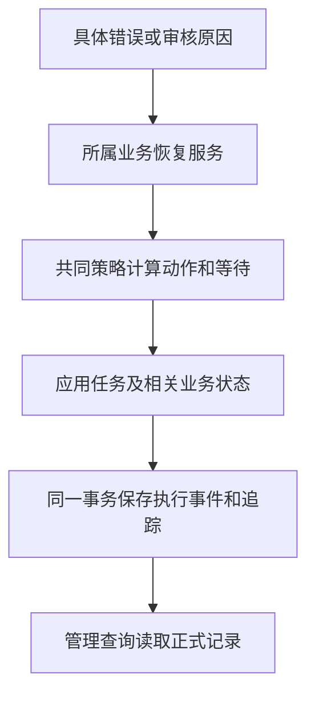

# 错误分类、重试与恢复

本设计规定对话和反思任务的失败契约、恢复动作、输入保留与诊断记录。任务状态及租约见 [任务执行](task-execution.md)，模型执行见 [Agent 与模型](agents-and-models.md)，固定提示正文见 [角色提示契约第 13 节](character-prompt-contracts.md#13-格式修正与任务审核提示)，实际管理字段见 [管理接口](../reference/management-api.md)。

## 1. 职责与依赖

错误发生位置提供明确原因。`TaskRegistry`（任务登记）将处理器和所属模块的分类函数一起登记；`TaskDispatcher`（调度器）统一捕获执行异常，调用分类函数和队列恢复入口。取消信号向外传递。

| 模块 | 责任 |
|---|---|
| `execution/recovery.py` 的 `RecoveryPolicy` | 完整运行结果解释、共同异常分类、次数耗尽、等待和提示适用规则 |
| `execution/records.py` 的 `ExecutionRecorder` | 安全执行观察、事件、日志和追踪的统一转换与保存 |
| `modules/conversations/tasks/recovery.py` | 对话审核规则、固定提示、任务和参与记录的恢复处理 |
| `modules/reflection/tasks/recovery.py` | 反思审核规则、来源分类、节点恢复和图失败传播 |
| 队列和提交服务 | 在原有事务中调用所属恢复服务；保留正常事实提交职责 |
| 领域对象和存储 | 校验状态、租约和时间，保存权威状态；领域对象接收已计算的恢复目标 |

两个业务恢复服务通过组合复用共同策略与记录服务。公共执行模块不导入对话或反思的具体业务模块。模型网关负责供应商请求重试；执行循环负责当前调用内的格式和工具参数修正。

## 2. 完整失败契约

`FailureInfo`（失败信息）和 `TaskRecoveryDecision`（任务恢复决定）是不可变的正式对象。

| 字段 | 含义 |
|---|---|
| `code` | 稳定的具体原因，最长 120 个字符 |
| `category` | 负责解释失败的边界：供应商、模型输出、工具、来源、审核、预算、期限、租约、存储、配置或执行循环 |
| `action` | 当前建议采用的恢复动作 |
| `retryable` | 当前错误是否允许修正或再次尝试 |
| `retry_after_seconds` | 允许的建议等待秒数 |
| `repair_hint` | 当前错误对应的短修正要求，最多 500 个字符 |
| `status_code`、`exception_type`、`request_id` | 供应商 HTTP 状态码、异常类型及请求标识；没有信息时为空，不保存异常原文 |

`repair` 和 `retry_task` 必须允许重试；`defer`、`fail` 和 `ignore` 的 `retryable` 为假。短提示仅适用于修正和任务重试。决定的动作必须与失败对象一致。

已经提供完整失败对象的运行结果保持其原因和动作。完成或合法无提议返回无恢复决定，仍需经过业务提交。`ExecutionOutcome`（执行结果）分别表达 `completed`（完成）、`recovery_required`（需要恢复）、`handled`（恢复已处理）和 `ignored`（忽略）；完整决定及安全观察独立携带。已经处理的恢复不会再次交给调度器处理。

## 3. 三层次数与期限

| 层级 | 适用问题 | 计数与停止规则 |
|---|---|---|
| 供应商请求重试 | 网络、供应商期限、限流和临时故障 | 网关使用当前模型条目的请求次数、等待与期限 |
| 当前执行内修正 | 已知输出格式和工具参数错误 | 执行循环使用当前请求、步骤、工具及每种错误的修正上限 |
| 持久任务重试 | 完整决定允许再次尝试的执行或审核失败 | 队列使用当前任务真实 `attempt` 和配置的最大次数 |

当前执行的修正额度耗尽后结束任务。它产生的失败决定不会开启新的任务尝试来重新获得修正额度。预算和权限错误也结束任务；恢复不自动换模型或增加上限。

普通任务重试采用 `max(基础退避 × 2^(attempt - 1), 建议等待或 0)`。审核重试使用同一规则。耗尽时保留原 `FailureInfo`，将实际动作记录为 `fail`，`retry_exhausted=true`，下一次时间为空。

反思调用关闭网关即时重试。供应商的可重试错误由持久任务安排，总共最多尝试四次；前三次失败分别等待 30、120、600 秒，增加不超过该等待时间 10% 的随机延迟，且等待时间不小于服务端建议。其他反思错误继续采用原有次数与审核修正规则。聊天调用的网关和任务策略保持原配置。

反思节点保存累计 `attempt_count` 和本轮起点 `attempt_base_count`。手动重新启动将起点设置为当前累计次数，本轮尝试次数用两者之差计算；累计历史、租约代次和成功产物保留。达到上限后不自动重新启动，失败图仍阻止同会话自动安排同类型任务，原始材料有效时可通过管理接口重新启动。

逻辑模型请求在实际进入网关调用时计数，失败调用也计入。供应商 HTTP（网络请求）尝试从真实网关响应或错误汇总到 `provider_attempt_count`。准备阶段没有模型请求；网关配置拒绝可以出现逻辑请求一次、HTTP 尝试零次。历史记录、整体取消或进程退出导致次数无法确认时，统计保持缺失值。

## 4. 稳定分类

| 原因 | 处理规则 |
|---|---|
| 模型配置和凭据 | 保留 `model_configuration_invalid`、`provider_not_configured` 等配置码，终止 |
| HTTP 413 输入过大 | `input_too_large`，终止并缩减输入；不归为额度不足 |
| 蓝图、版本或调用目的绑定缺失 | `agent_binding_invalid`，配置终止 |
| 调用身份不符、工具越权或输出能力不符 | `invocation_identity_mismatch`、`tool_not_allowed`、`agent_output_contract_invalid`，终止 |
| 输入类型或输出登记缺失 | `agent_input_contract_invalid`，配置终止 |
| 对话任务与冻结快照身份不符 | `task_snapshot_identity_mismatch`，来源终止 |
| 反思冻结输入或来源失效 | `reflection_input_mismatch`、`reflection_source_unavailable`，来源终止 |
| 未登记任务处理器 | `task_handler_not_registered`，配置终止 |
| SQLite 存储失败 | 保留实际 SQLite 错误码；忙碌和锁定允许重试，其他错误终止 |
| 未知程序异常 | `execution_unexpected_error`，执行循环终止；异常类名仅作辅助诊断 |

已知错误通过明确类型提供代码。分类不从异常消息解析原因，也不把所有 `ValueError` 或 `KeyError` 统一解释为配置错误。诊断载荷不保存异常原文。

## 5. 动作、资格与租约

| 情况 | 实际处理 |
|---|---|
| `retry_task` | 使用原任务、冻结输入和新调用身份，等待后再次领取 |
| `defer` | 释放当前租约，等待业务资格恢复；本次暂缓不执行次数耗尽或图失败传播 |
| `fail` | 对话完成失败参与记录；反思按必需或可选节点规则传播 |
| `ignore` | 忽略迟到或已经失效的结果，不修改新代次状态 |
| 社群暂停对话 | 正式生命周期转为 `suspended` 并增加租约代次，恢复后继续原任务 |
| 成员离开或会话归档 | 正式取消任务及参与记录，使旧执行失效 |
| 反思有效租约下暂时不可执行 | `defer` 后进入已有 `retry_wait`；领取资格阻止暂停期间执行 |
| 进程退出 | 停止在途调用；未提交任务由到期租约恢复 |

owner（执行者）、attempt（尝试）、generation（代次）及到期时间共同确定租约。真正失效的租约使用 `LeaseLostError`；反思资格暂时变化使用明确的 `ExecutionDeferred`。运行返回暂停或取消信号时，恢复服务重新检查真实业务状态；信号与状态不符时使用 `agent_run_state_invalid`。

租约到期恢复使用本次 `lease_expired` 原因。原审核或网络错误保留在历史中。后续领取仍记录真实尝试，暂停不会扩大预算。数据库无法写入时不能声称已经保存恢复；原持久租约由后续恢复处理。

## 6. 审核与业务提交

对话的 `thought_too_long` 和 `utterance_too_long` 允许带对应短提示重试。空发言由输出契约拒绝并在当前执行循环修正。其他已有终止审核规则保持明确原因。

反思的输出超长、必须生成摘要、证据越界、关系目标越界、覆盖范围、实体重复、关系边目标及行动类型问题可以按对应提示重试。证据越界只有存在合法证据时才可修正；关系目标越界只有存在合法目标时才可修正。缺少真实来源时终止，模型不能编造或重新选择来源。

审核拒绝、实际恢复决定、任务状态、参与状态和正式事件在同一事务保存。通过审核后保存消息或产物及完成状态。模型执行期间不持有写事务。

反思必需节点失败会结束图并取消未完成节点；可选节点失败允许其他节点继续并形成部分成功。聚合节点读取已批准产物，确定性地生成图结果；聚合拒绝不重新生成已批准产物。事实消费使用保存点，业务拒绝时撤销事实写入，保留具体审核原因和拒绝记录。

重复提交复用已有结果；迟到结果不能修改当前状态。事实与 outbox（待投递追踪记录）同事务保存，追踪投递失败独立重试，不再次请求模型。

## 7. 冻结输入与短提示

重试保留原对话快照、反思图快照和已经绑定的前驱产物。每次调用有新的 `invocation_id`，临时执行循环消息不会复制到下一次调用。

业务恢复服务读取最近的实际执行恢复决定。仅实际安排 `retry_task`、类别为审核且含短提示时，准备入口填写 `ExecutionPolicy.repair_hint`。格式构造由执行循环内和跨尝试修正共用。固定正文由 [提示契约](character-prompt-contracts.md#13-格式修正与任务审核提示) 维护。

暂停和恢复等生命周期事件不覆盖待使用的审核提示。新的网络或租约失败替代原审核决定，使下一次提示为空。人工重启反思图产生新 `execution_generation`，提示读取限定当前代次，不继承旧代次临时要求；成功产物继续复用。

## 8. 正式执行记录与管理查询

`task_execution_events`（执行事件表）按真实过程追加领取、调用开始、运行结束、恢复决定、生命周期、忽略结果和完成事件。记录具有任务、尝试、租约代次、对象归属、调用、追踪及时间身份；反思额外保存图身份和图执行代次。

安全内容使用正式类型：完整失败、建议和实际动作、等待、下次时间、耗尽、真实用量及修正观察。分别记录本次开始使用的跨尝试提示、执行循环实际加入的修正提示和计划用于下次调用的提示。尚未领取的生命周期记录允许尝试零次及空调用身份。旧数据库没有恢复历史时返回空列表，不补造记录。

正式诊断不保存完整模型消息、生成正文、内心、来源私文、供应商原始错误或密钥。普通日志只保存安全字段，短提示仅在正式事件和范围化追踪中提供。完整模型捕获作为独立调试功能按显式设置启用。

管理查询先验证真实对象归属，再读取记录。对话任务及反思节点详情使用现有 `limit`、`cursor` 对 `recovery_history` 分页；游标绑定社群、角色、任务和图。图详情的 `node_recovery` 提供各节点概要，图概要与历史按当前执行代次区分。具体字段以 [管理参考](../reference/management-api.md) 和 OpenAPI 为准。

## 9. 规范示例

1. 发言超长：第一次审核记录 `utterance_too_long` 和重试决定，等待后使用原快照及针对发言长度的短提示再次调用。达到任务上限仍未通过时结束，历史保留实际拒绝和耗尽。
2. 网络连接失败：网关先完成有限请求重试；任务恢复记录真实网络次数及原错误。新的任务尝试不附审核提示，等待和次数使用共同策略。
3. 反思来源已清除：来源检查使用 `reflection_source_unavailable` 终止。模型不能通过重试取回已经失效的内容；必需节点失败结束图。
4. 进程中断：尚未提交的任务保留租约，过期后记录 `lease_expired`。重新领取使用原输入和新代次；旧结果只能追加自身诊断，不能重复保存事实。
