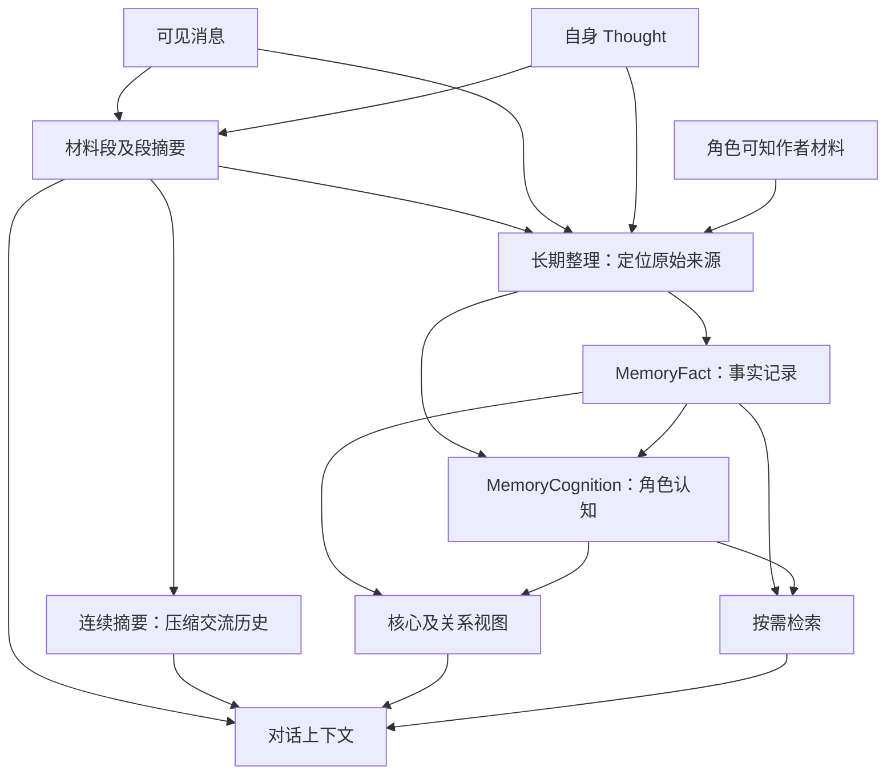

# 角色记忆、来源与检索

记忆保存角色实际获得的信息、自己的内心记录及由这些材料形成的认识。conversations 保存消息，characters 保存短时状态和关系数值，memory 保存私人思考、摘要、长期记录及来源。反思提出整理结果，运行编排层审核后通过所属存储入口保存。

## 1. 原始记录、摘要和长期记忆

三级材料结构分为来源层、摘要层和长期记录层。段摘要与连续摘要压缩交流上下文；长期事实与认知供以后按事项检索。一个长期记录可以引用多个段中的原始来源，同一段也可以支持多个长期记录。

| 材料 | 保存什么 | 主要用途 |
|---|---|---|
| Message（消息） | 谁在何时、哪个会话、对什么受众说了什么 | 原始经历、可见历史、事实依据 |
| Thought（内心记录） | 当前角色当时实际留下的注意、感受和判断 | 私人历史、摘要及认知依据 |
| GameEvent（游戏事件） | 角色参与期间可见的正式动作与结果 | 经历摘要、事实依据及来源复核 |
| MemorySegment（材料段） | 一个角色可见的精确消息、游戏事件与自身 Thought 引用 | 冻结、定位和登记处理范围 |
| SegmentSummary（段摘要） | 对这段经历的压缩，保留人物、事项和主观理解 | 近期交流连续性、后续材料定位 |
| 连续摘要 | 前一回顾和新段摘要的累计压缩，保存实际覆盖段 | 跨场景交流连续性 |
| MemoryFact（长期事实记录） | 一项值得检索的信息及其来源性质、时间、条件 | 回想具体信息和经过 |
| MemoryCognition（长期认知记录） | 角色对某个人或事项的体验、理解和推断 | 回想自己的看法及其变化 |
| MemoryView（常驻视图） | 核心记忆、关系描述和状态概括 | 在有限上下文中表达已有记录 |

消息是“发言发生过”的客观记录。消息正文里的自述、转述或计划仍保留这些性质。Thought 是角色留下的主观原始记录；它能够说明当时怎样想，不能证明对方的隐藏动机或外部动作已经发生。系统正式保存一条材料，只表示它经过所属业务入口。

“页”用于称呼一个可以独立读取的长期记忆项。它围绕一项信息或认识组织，不要求包含某个段的全部内容，也不按段层层生成更高概括。处理过程见 [长期整理](reflection/memory-organize.md)。

### 1.1 游戏经历

游戏经历已接入正式游戏事件、局内消息和活动产生的真实私人材料。每个参与区间独立保存关闭边界与来源位置，复用阶段摘要、连续摘要及长期整理；具体规则见[游戏经历与记忆整理](activity-memory.md)。

完整棋谱保存在游戏。角色选择关键结果、动作和交流作为经历，实际简短判断以自身 Thought 保存；自动行动不补造思考。任务快照保留调用依据，不自动成为长期记忆。主观判断保持主观性质，动作意图只有正式回执才能证明执行。

游戏经历沿用本文件的简单与完整模式。活动结束提供材料边界，普通每步操作不强制触发反思。权威行为规则与保存分工见[角色活动设计的经历来源](activity-integration.md#7-持久化主观材料与长期记忆)。

## 2. 初始化、可见性与有效期

实例创建时固定人物版本并选择记忆模式，默认 simple（简单），另可选择 full（完整）；创建后模式不可切换。每个实例独立保存自己的经历和认识。

| 处理能力 | 简单模式 | 完整模式 |
|---|---|---|
| 作者故事和采访分块、全文索引 | 使用 | 使用 |
| 段摘要、连续性压缩 | 执行 | 执行 |
| 日常状态与关系反思 | 不安排 | 按材料与条件安排 |
| 日常长期事实和认知整理 | 不安排 | 执行 |
| 核心、关系及状态视图刷新 | 不安排 | 按正式变化安排 |

作者原文绑定人物版本、实例、材料种类和位置。故事按完整事件语境拆分；采访问答按题目拆分，长回答片段保留题目和位置。完整模式使用这些分块生成长期事实和认知。作者材料没有聊天序号，不能生成与当前玩家的共同经历、关系分数或今天的活动状态。背景人物保留原文称呼和出处。

模板预置材料保存明确的作者来源。简单模式保留可检索的预置内容，不安排日常深层反思；完整模式按作者材料的性质整理。预置正文中的经历和认识不能仅凭类别标签直接归入新记录。

有故事或采访材料时，实例进入 preparing（准备中）；完成该模式的材料处理与全文索引后进入 ready（可使用），失败进入 failed（准备失败）。准备完成前不能聊天、加入会话或活动。完整模式需要完成作者长期整理及必要的核心刷新。只有基础人设的实例无需制造空初始化任务。重试沿用同一实例的原文和成功阶段；可选向量索引不影响准备完成。

resident（常驻）、recallable（按需检索）和 private（私人）表示读取用途。记录始终属于明确社群和角色；私人标记不会给其他角色读取资格。正式来源、有效版本、观察时间和共同可见性规则共同决定可读范围。

### 2.1 初始化预算与来源引用

普通反思使用 `reflection.max_candidates` 和 `reflection.max_output_chars`。作者初始化候选额度取普通额度与“材料数量 × `initialization_candidates_per_material`”的较大值，受 `initialization_max_candidates` 限制；正文额度取普通额度与“输入字符 × `initialization_chars_per_input_char` + 8000”的较大值，受 `initialization_max_output_chars` 限制。具体默认值见 [配置参考](../reference/configuration.md)。

事实与认知共用一次长期整理的总输出预算。事实先占用实际操作数量和业务正文，认知使用余额，不强制分配固定比例。来源引用单独校验，重复引用只作为同一份依据。认知预算不足时保留未完成范围；调整预算或按合法范围重新准备后恢复认知，不能登记为没有新认识。

原始来源、必要摘要和有限旧背景共同受输入预算约束。一个完整消息及对应自身 Thought 一起选择；一段材料超过批次容量时按这些完整来源分组继续处理。阶段预算与恢复规则见 [长期整理](reflection/memory-organize.md#6-预算部分成功与恢复)。

## 3. 来源与精确归段

正式来源保存种类、身份和内容版本。消息、正式游戏事件和作者材料支持事实提取，自身 Thought 支持摘要与认知。整理完成不删除 Thought；正文已清除时保留实际身份和读取状态。

MemorySealing 以社群、角色、会话和实际成员区间整理材料，通过共同观察入口固定消息上限与观察时刻。新段只包含一个会话的一个成员区间，自身发言和对应 Thought 组成完整事件。各场景按自身材料时间判断空闲，优先冻结最早符合条件的范围。一个事件恰好归入一个段；旧跨场景段继续按原有来源读取。

默认某场景连续 600 秒没有新可见消息后整理阶段材料，使用 `memory.cycles.experience_idle_seconds`。其他群聊或私聊的新消息不延后该场景的期限。扫描延迟时依次处理原文里的真实静默间隔；会话归档、角色退出和管理主动整理仍提供实际边界。阶段材料完成后，同一会话可以继续产生新的段。

当前聊天原文即将超出上下文容量时，`ContextPreparation` 可以提前冻结需要退出的历史并安排已有 `segment_reflect`。任务保留读取截止、原文和等待状态，成功保存摘要后才缩减这段原文；等待期间不领取聊天执行租约，也不消耗聊天尝试次数。摘要失败保留来源和既有反思恢复入口。容量不足以容纳人设及当前必要输入时明确失败，原始记录保持可读。

持续交流达到消息、材料数量或字符硬上限时，按完整事件拆段。后段按场景读取前段末尾最多四条消息及必要回复原文，优先直接回复和上一条发言，通常预留五分之一材料及字符容量；必要的首条前情更长时，在容纳首个新事件的前提下扩大预留。前情与对应 Thought 成组保留，单个事件必须能够放入配置预算；前情过大时继续按实际容量选择。前情标为只读，计入输入预算，不再归段或登记消费，不能独立支持本段状态及关系变化。

`memory_segments` 保存角色处理顺序 `position`、实际起止时间、冻结时刻、集合版本及处理状态。`memory_segment_scenes` 保存实际场景、该场景独立序号范围和冻结成员身份；`memory_segment_sources` 保存新材料的精确引用，`memory_segment_context` 保存只读前情。跨场景没有共同消息序号，起止时间也不扩大读取资格。某场景序号 1、3 可见而 2 不可见，实际引用仍只有 1、3。

业务发生时间来自原始材料；提交、租约和等待使用实际执行时间。未知事件时间保持未知。段摘要完成后标为 ingested（已处理），无可靠摘要的有效空结果同样登记新材料覆盖。

## 4. 摘要批次与独立进度

每段保存单份第一人称回忆，叙述交错场景时交代人物、地点和私人性质。段摘要和连续摘要压缩上下文；长期整理按精确引用读取原始材料，摘要没有提到的内容仍可进入长期消化。

continuity_compress 与 memory_organize 各自保存消费。批次按角色处理顺序选择已完成段，遇到前段未完成或预算限制停止；未归段的新消息继续供聊天读取。两种消费者互不等待，成功连续压缩不会推进长期处理范围。

连续批次通过 `memory_summary_batch_digests` 关联前驱摘要；`memory_digests` 保存单份正文，`memory_digest_segments` 保存累计覆盖段，`memory_continuity_consumption` 登记本消费者处理完成。旧数据可能留下多个场景的前驱正文，下一次压缩共同继承它们。仅有空段时由程序推进消费并保留已有正文，无需模型调用。

长期批次保存选中的原文引用和事实、认知两个阶段进度。段的某阶段只有全部所需原文已处理才完成阶段消费，两个阶段完成后才结束整个长期消费者。空摘要允许原文继续进入长期整理。

### 4.1 扫描与独立触发

| 流程 | 触发与范围 |
|---|---|
| 扫描 | 默认每 30 秒检查角色待处理范围 |
| 原始材料归段 | 各会话及成员区间独立静默 600 秒、上下文容量压力、材料硬预算或实际结束操作 |
| 连续摘要 | 未压缩摘要约 12000 字符、最早已完成材料等待 7200 秒，或当前摘要已超出聊天容量时提前安排 |
| 长期整理 | 独立使用材料量或等待条件，原文另按预算分批 |
| 作者初始化 | 立即安排 |
| 常驻视图 | 正式状态、关系、事实或认知发生相关变化后安排 |

归段的静默期限只随本场景的新消息更新，连续压缩和长期整理保留最早材料的等待年龄。连续压缩可以跨场景合并已完成材料，按角色保存独立消费；容量触发不会重做已消费的长期阶段。来源范围固定后不重复安排，失败保留原材料与未完成进度。世界时间不参与真实租约和执行等待。共同上下文选择见[角色观察与任务上下文](perspective-and-context.md#4-历史裁剪与自身思考)。

## 5. 长期事实和认知

### 5.1 事实记录

MemoryFact 保存一项有独立后续价值的信息。正文清楚交代人物、对象、否定、条件和来源性质，不要求角色口吻。小明发言说喜欢蛋糕，可保存“小明说自己喜欢蛋糕”；如果小明说已经完成任务，记录仍保留为自述，完成业务动作需要实际正式结果。

| 字段含义 | 设计要求 |
|---|---|
| 身份与版本 | 稳定 `memory_id`、递增 `version`、`community_id`、观察者 `character_id` |
| 内容 | 明确主题、可独立理解的正文、必要条件及后续重要程度；陈述归属、计划及不确定性写在正文中，不设细分类别 |
| 人物 | 输入清单中的实际 ActorRef（主体身份）；背景人物保留原文称呼及出处 |
| 时间 | 系统结果使用实际发生时间，普通发言和作者往事的事件时间未知时留空；原始发言时间、角色获知时间、记录时间分别保留 |
| 依据 | 每项独立的原始来源种类、编号及版本 |
| 当前状态 | 明确哪个版本为当前版本，保存失效与修订结果 |

新增、补充依据、纠正提取错误使用不同操作，由 fact_review 模型根据新依据和允许比较的旧事实判断，程序审核后保存。重复出现的同一信息可以给旧事实增加依据，措辞无需要求完全相同；不同时间或条件的事件分别保存。纠正针对提取或归属错误，不改写当时实际发出的消息。较晚的新说法不能自动覆盖早先的陈述。获知时间取依据中最晚的已知时间，补充版本保留新旧依据的最新获知边界。

### 5.2 认知记录

MemoryCognition 保存角色对某个人或事项的体验、理解或推断。正文使用自然第一人称，说明认识范围和必要的不确定性。一项事实不要求对应一项认知；用另一种说法复述事实没有独立的认知价值。

| 字段含义 | 设计要求 |
|---|---|
| 身份与版本 | 独立稳定编号、递增版本、社群及观察角色 |
| 内容 | 对象或事项、正文、适用范围及重要程度；原有感受、后来理解和推测通过正文说明，不设细分类别 |
| 时间 | formed_at_utc 保存本轮整理形成时间；已有 Thought 的原始时间保留在依据中，正文区分当时感受与后来理解 |
| 依据 | 支持事实的编号和版本、自身原始主观来源或可知作者材料 |
| 更新 | 替换的实际旧认知版本；没有新依据时维持旧记录 |
| 当前状态 | 当前有效、需要重新审核等状态，与历史版本分别保存 |

旧认识提供比较背景，不增加新的独立证据。自己的期待不能成为他人的承诺；现在形成的解释不能补写成当时已有的感受。事实被纠正或依据失效时，依赖它的当前认识标记需要重新审核，完成前不作为有效认识进入上下文。历史内容和支持版本继续可查。

### 5.3 存储、引用与版本

两类记录使用独立表，分别维护自己的版本。每个编号只允许一个当前版本；修订在同一事务结束旧版本并保存新版本，旧正文保留。模型只填写正文和本次材料编号，两类记录由所属节点确定；程序将编号转换为冻结的实际来源和旧记录版本，并分配正式身份。

| 表 | 职责 |
|---|---|
| `memory_facts` | MemoryFact 的版本记录 |
| `memory_cognitions` | MemoryCognition 的版本记录 |
| `memory_fact_sources` | 某事实版本的逐项原始依据 |
| `memory_cognition_sources` | 某认知版本的原始主观或作者依据 |
| `memory_cognition_fact_supports` | 某认知版本支持的事实编号与版本 |

记录来源表通过复合外键绑定所属记录版本；认知的事实依据通过复合外键绑定实际事实版本。原始来源指向不同所属存储，按来源类型使用正式读取入口复核存在、内容版本和观察资格。冻结输入也保存这些原始身份，不把批次范围当作逐项证据。

程序为本批新增事实生成局部引用，模型使用对应材料编号。在正式提交事务中，运行层分配事实编号并转换认知引用；复用旧事实则引用实际版本。任何引用无法转换或资格变化均阻止对应提交。数据库写入不保留指向未保存事实的认知。

补充依据保持事实语义，已经支持旧版本的认知仍按其原有依据核查；版本号变化本身不会制造新的推断。事实语义被纠正或支持来源失效时，依赖相关版本的当前认知需要重新审核。新操作更新当前记录时仍必须复核实际最新版本。

两类正式模型分别表达自己的字段和操作，记录主题只用于组织与更新。持久化事务规则见 [持久化](persistence.md)，候选操作和阶段提交见 [长期整理](reflection/memory-organize.md)。

## 6. 搜索与重建

SearchScope（搜索范围）固定社群、角色、观察时间及各会话上限和历史成员区间。任务检索复用快照边界，独立查询在开始时取得边界。共同观察规则构造允许来源集合，再以 jieba 分词和 SQLite FTS5 检索；返回前复核权限、有效版本与来源性质。其他参与过的会话继续遵守成员区间、消息受众和观察时刻。

简单模式查询作者分块、预置内容、已审核段摘要及其连续摘要。完整模式增加长期事实与认知。询问具体经过时优先事实及实际经过的依据；询问看法时读取相关认知及必要事实；询问约定是否完成时保留约定和实际完成证据。普通查询可以合并两类合法候选，统一排序、去重和控制预算，不增加生成模型查询规划。

消息继续作为近期历史和来源读取；Thought 原文只用于自身历史及认知依据，不成为独立普通搜索集合。连续摘要供上下文及经历检索使用，核心与关系视图用于上下文表达；这些整理正文不作为新事实证明。搜索只返回实际命中的合法正文，不按人物邻接扩展材料。

向量索引为可选投影，默认关闭。开启时通过 embedding（文本向量）合并语义候选，后台计算不持有写事务；保存前复核来源、模型和维度。未完成或失败的向量来源继续使用合法全文结果。记录版本变化后旧索引不再参与读取，重建从正式记录和共同权限产生。

对话准备以需要回应的实际内容构造有限查询；普通问候可以跳过，没有合适结果可以为空。结果包含事实／认知类型、身份、版本、正文、来源性质和必要时间。近期原文与其长期记录避免重复提供。同一来源不因多份摘要增加证据数量。

自动预检索先取得有限匹配候选，再在匹配内容中优先选择正式事实，按数量和正文预算去重。总输入预算不足时先减少一般检索结果、常驻背景和旧历史，相关事实最后裁剪；人物正文和当前输入保持完整。工具查询沿用自己的检索顺序。测试分别核对候选、选择结果和最终模型输入，已保存的事实可能未命中检索，也可能在预算不足时被删除。

memory_search（记忆搜索）与自动预检索共用这些规则。来源版本变化时报告 `memory_source_changed`。玩家看到自然的角色表达，类型与内部错误留在模型材料和管理诊断。

运行层按本次请求的剩余容量限制工具返回内容，并为后续正式输出保留空间。记忆工具保持原来源编号与版本，在容量内返回正文；长材料只返回明确标记的摘录，`summaryTruncated` 表示该项未显示全文，`budgetLimited` 表示本次结果受容量限制。原始消息和摘要保持完整。输出修正时，过长的无效草稿保留在调用诊断中，不重复加入已经接近上限的模型输入。

## 7. 事实、回忆和猜想的判断

角色相信并遵循提供给自己的记忆，保持已确立经历的一致性。尚未设定且符合人设的个人日常可以自然补充，主动分享和回答问题采用相同边界，随后按相关性保存。涉及他人的行动、原话、共同往事及旧约定时保留实际依据；游戏结果与已执行行动遵循系统记录。当前约定和后续履行分别保存，状态、偏好与打算按实际变化新增记录。

他人提起角色想不起的往事时，保持未知并允许追问。搜索为空、核心正文未包含或摘要省略，都不足以证明事件没有发生。Alice 说“我们去年去过海边”可以保存为她的陈述；角色想不起时保留“她提到一段我记不清的旅行”。

“我觉得 Alice 有些生气”是自己的判断，“Alice 说她生气了”是她的陈述。这些材料不改变 Alice 内部状态。具体来源资格见下一节，聊天表达规则见 [人物共同规则](../../src/echo_commons/resources/identity/common/agent-contract.md)。

整理流程负责准确保存材料及其归属。可选诊断检查整理草稿，原写作者处理反馈，规则见[整理草稿诊断](reflection/execution-model.md#7-整理草稿诊断)。角色表达按照记忆的实际含义使用经历、听闻与认识。

## 8. 不同材料能够证明什么

| 材料 | 可支持内容 | 使用边界 |
|---|---|---|
| 可见消息 | 发送者实际说过的话，陈述、计划、约定或自述 | 正文里的隐藏动机或完成声明不自动升级为业务结果 |
| 自身 Thought | 当时已记录的体验和判断 | 不证明其他人的行动或未知内心 |
| 角色可知作者原文与预置材料 | 作者明确确认的过去或主观认识 | 设定中的习惯不能写成今天已经完成的行动 |
| 正式活动结果 | 角色实际可观察到的执行结果 | 聊天里的提议不能代替正式执行 |
| 段摘要、连续摘要 | 阅读背景、定位和压缩覆盖 | 不能代替新增长期事实的原始来源 |
| 已有 MemoryFact | 保留明确性质的旧信息及其原始依据 | 只允许引用冻结范围内的真实版本 |
| 已有 MemoryCognition | 比较旧认识和更新范围 | 不能充当新增的独立证据 |
| 人物正文、状态、关系与常驻视图 | 理解角色和表达已有材料 | 不补写外部经历，不作为新长期记录的原始证明 |
| 已审核前驱事实候选 | 本批认知阶段的明确支持事实 | 提交时转换为正式版本；未审核产物不获得引用资格 |

## 核心视图的依据与读取记录

每个角色保存一份核心正文，可包含自然的几个段落，整体使用同一字符预算和引用集合。它从有效事实、认知及支持材料选取常驻重点，完整关系态度和普通偏好保留在对应记录中。页面版本、未读范围、成功读取和视图替换由所属服务维护，详细规则集中在 [认识刷新](reflection/view-refresh.md#6-核心分支选材预算与重建)。

## 9. 数据重建与模块职责

结构升级使用新增迁移。重建前备份并导出旧内容、版本和来源，逐项检查作者材料、消息、自身 Thought、预置内容和段来源的可读性。来源不足时停止对应重建并明确范围，不能凭旧摘要或混合页补造原文。

简单模式保留有作者来源的预置记录；完整模式从实际原文和经历执行事实及认知流程。旧混合正文不能按关键词或模型自报置信度直接分类。在备份副本上验证升级和重建，正式升级删除旧页结构和执行入口，历史内容只留在备份及审计中。关系数值和状态历史保留，重建认识不再次增加影响值。

依据发生实际变化后，由 view_refresh 重建核心和关系文字。新索引从正式记录建立，检查来源、版本和权限。未完成旧协议任务取消，已成功的新阶段保留，未处理原始范围明确重新安排。

memory 负责来源、归段、记录、索引和读取范围；reflection 负责节点输入、候选审核、阶段进度和提交编排；characters 继续负责状态和关系数值；API 与前端负责输入及展示。图像、日志、调试捕获均不替代记忆事实。
