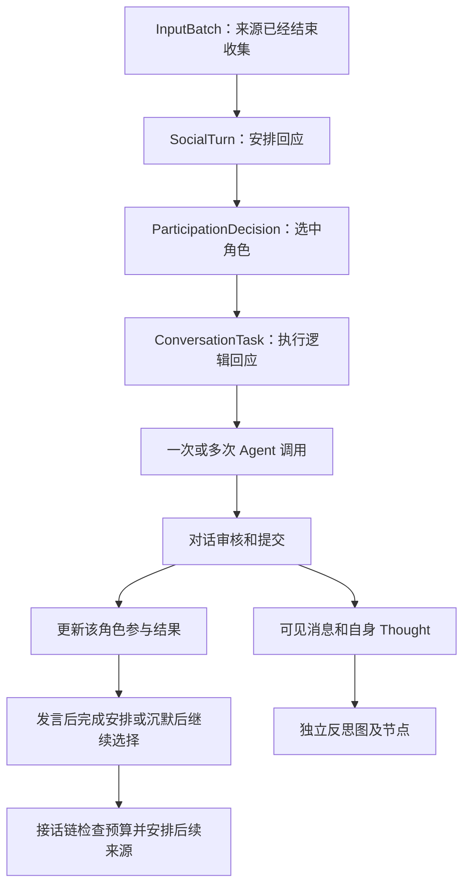

# 对象状态、结果与生命周期的归属

## 1. 先确定状态属于谁

每个状态回答所属对象的问题。相同的 completed 可以出现在不同对象中，含义由对象确定。说明和诊断应写出 `ConversationTask.status`、`ParticipationDecision.status` 等完整名称；不要把多个对象的状态放进一个没有对象归属的列表。

| 对象 | 状态回答的问题 | 改变状态的责任方 | 详细规则 |
|---|---|---|---|
| Community、Conversation、Membership | 社群是否运行、会话是否归档、某次加入是否仍有效 | 各自业务服务 | [身份与社群](identity-and-communities.md)、[会话](conversation-and-social.md#11-创建成员与个人列表) |
| CharacterInstance | 角色当前是否具备执行资格 | 角色服务 | [状态与关系](character-state-and-relationships.md) |
| InputBatch | 消息是否还在收集 | 输入和窗口服务 | [输入批次](conversation-and-social.md#7-输入批次的生命周期) |
| SocialChain | 一批玩家输入引起的接话是否继续，额度是否用完 | 社交规划与结果服务 | [接话规则](conversation-and-social.md#6-回应受众与停止规则) |
| SocialTurn | 本组来源安排的回应是否全部结束 | 轮次规划和完成服务 | [社会轮次](conversation-and-social.md#9-社会轮次的生命周期) |
| ParticipationDecision | 某个角色是否被选中、最终如何结束 | 规划、任务提交和取消服务 | [参与决定](conversation-and-social.md#8-参与决定的生命周期与结果) |
| ConversationTask | 一次逻辑回应任务是否等待、执行、重试或结束 | 对话队列与业务提交 | [持久任务](task-execution.md) |
| AgentRunResult | 一次调用有没有得到提议，怎样停止 | Agent 执行循环 | [调用结果](agents-and-models.md#4-预算与三层重试) |
| ReflectionNodeTask | 当前节点的依赖、执行和产物是否完成 | 反思队列与节点提交 | [反思执行](reflection/execution-model.md#4-状态与失败) |
| ReflectionGraphRun | 整张图是否得到必需结果、部分完成或失败 | 图运行与图提交 | [反思执行](reflection/execution-model.md#4-状态与失败) |
| GraphReview | 图级候选是否批准、拒绝或失效 | 图级审核 | [图级审核](reflection/execution-model.md#5-图级审核与事务) |
| MemorySegment、SummaryBatch | 实际材料处于什么处理阶段、是否被特定用途消费 | 记忆归段及正式消费者 | [记忆处理](memory.md) |
| Activity、ActivityTask | 玩法是否结束、某次行动机会是否完成 | 未来活动规则及队列 | [活动接入](activity-integration.md) |

此表索引各对象的权威定义。具体枚举与转移在所属文档保存，共享执行器使用具体任务的队列接口。

Conversation 的 `state_version` 随活动与归档状态变化，Membership 的变化使用 `membership_version` 和实际区间身份。群聊结束为最终状态；权威私聊再次打开可恢复活动。个人隐藏是独立列表设置，不改变这两类业务资格。完整转移和迁移规则见上表的会话设计。

## 2. 执行状态、结果和资格分别判断

一次合法沉默可以表示：AgentRunResult 为 no_proposal；ConversationTask 为 completed；ParticipationDecision 为 completed、outcome 为 silent；仍有等待候选时 SocialTurn 保持 running，后续规划继续选择。

模型调用成功返回提议后，AgentRunResult 可以 completed。提交层仍需审核原成员区间和租约；如果角色已经离开，提议不能保存为消息。调用完成和业务事实保存分别产生自己的记录。

角色 busy 是人物的运行资格。retry_wait 是任务等待重试。网络超时记录在任务与调用结果中，不修改人物情绪、身体状态或关系。

反思节点 completed 表示该节点已有合法产物。图可能仍在等另一个节点；即使全部模型节点完成，图级审核也可能拒绝候选。因此需要同时读取节点、图及审核记录，才能解释是否保存了长期事实。

## 3. 对象怎样相互影响

上述箭头表示业务事件及明确更新关系。节点错误不能直接把会话改成失败，反思失败也不撤销已经提交的聊天。

## 4. 同一个角色同时聊天和下棋

甲拥有针对棋局版本 8 的 ActivityTask，同时拥有回应 Alice 的 ConversationTask。两份任务分别等待模型额度，各自持有输入、租约和结果。棋局动作提交成功后，活动推进至下一位；聊天任务还可以继续重试。

飞行棋的“轮到谁”由活动规则决定。SocialTurn 的“哪些角色可以回应”由聊天规划决定。两者名称都可能包含“轮次”，仍使用各自完整对象名和身份，不能相互代替。

活动生命周期与任务枚举由具体活动模块在接入时定义。当前不将对话的状态表复制到尚未实现的活动代码中。
