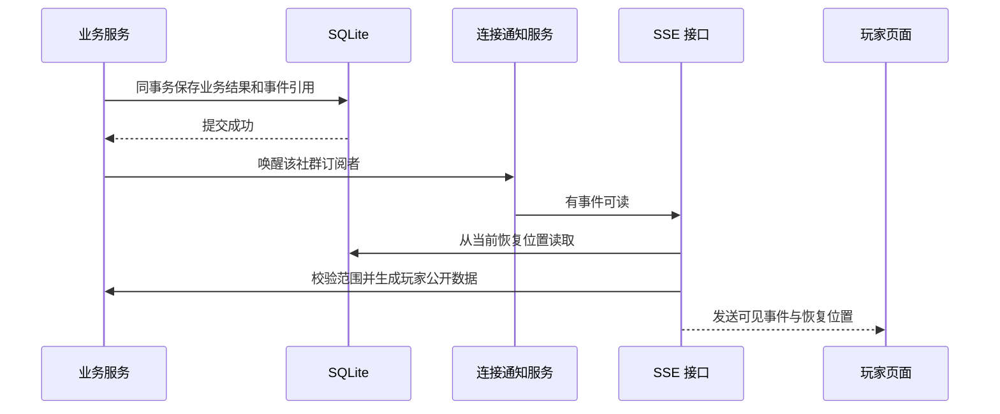

# HTTP 与 SSE 实时通信

## 1. 通信职责

玩家通过 HTTP 提交消息、成员操作、阅读位置及活动行动，业务接口返回接受结果或明确错误。SSE（服务器事件推送）传递已提交的变化。首次读取、历史翻页和完整状态恢复使用 HTTP 查询。

同一页面为选定玩家与当前社群复用一条 SSE 连接。切换玩家或社群时关闭原连接，再建立新连接。连接接收该范围内玩家可见的会话、回应、成员、阅读位置及社群运行状态变化；活动采用相同传输机制。

SQLite 保存权威业务状态。连接在线、断开或发送失败均不改变消息、轮次和活动的执行结果。角色发言完整生成、通过审核并保存后推送；生成中的文字不进入正式消息事件。后台任务调度与客户端通信分别运行。

## 2. 模块边界

| 组成 | 职责 |
|---|---|
| 所属业务模块 | 判断是否发生实际变化，在业务事务中记录事件引用；检查玩家可见范围并生成公开事件数据 |
| 共同事件契约 | 定义事件编号、社群范围、类型、对象引用与恢复位置 |
| 事件存储 | 记录提交顺序、按位置分页读取、保存清理边界 |
| 连接通知服务 | 登记订阅、提交后唤醒等待者、关闭订阅 |
| SSE 接口 | 校验连接范围与恢复位置，调用业务投影，编码事件、发送心跳并处理断开 |
| 应用组合与生命周期 | 注入业务事件端口，统一启动与关闭连接服务和清理任务 |

业务模块依赖共同事件写入端口，不依赖 SSE 编码或浏览器连接。传输层通过明确的业务读取端口取得公开数据，不直接把内部记录序列化给玩家。消息投影复用现有玩家消息读取及共同观察规则。

事件记录与诊断追踪分别保存。事件编号是恢复位置，不能作为业务对象身份，也不能作为玩家已读位置。事件记录不成为聊天、反思或活动经历的独立事实来源。

## 3. 事务与在线通知

业务结果与对应事件记录使用同一连接、同一短事务提交。回滚不保留事件；幂等重试返回原结果时不新增事件。无实际变化的操作不发送变化通知。

游戏规则通过 `GameChangeRecorder`（游戏变化记录端口）提供对局编号、状态版本和正式事件编号，宿主 `GameEvents` 登记 `game.changed` 引用。创建的社群关联由参与服务保存后登记；同一事务中的相同引用合并为一次通知。结束已结算活动仍需通知会话关联与资格变化，但不增加棋局版本。投影按社群资格返回公开编号和版本，正式事件受众由游戏历史接口另行检查。

数据库事务成功后唤醒当前社群的订阅者。事务边界负责提交后通知，业务方法在事务块内提前返回仍须完成通知；回滚不得唤醒。同步 HTTP 线程与异步任务均通过同一线程安全通知入口合作。通知服务故障不得把已经提交成功的业务响应改成失败。

订阅者被唤醒后按自己的读取位置查询持久事件，分别过滤与投影。一名订阅者消费通知不会阻止其他订阅者读取相同事件。无事件时异步等待，不按固定间隔查询数据库；心跳只维护连接。读取和网络发送之间不保持数据库事务。

## 4. 事件内容与可见性

新消息事件直接携带现有 PlayerMessageView，包括发送者展示、正文与可见引用预览。回应状态、会话概要、成员、阅读位置及社群状态采用变化通知，携带所属对象编号，客户端据此重新读取对应现有 HTTP 查询。通知不携带未经审核的模型输出、Thought、冻结输入、租约、诊断或密钥。

变化通知表示该对象需要重新读取；它不承诺携带发生当时的完整状态。客户端可以合并同一对象连续通知，读取当前权威状态。已有版本字段继续用于相应写操作；事件编号不替代业务版本。业务没有版本字段时，不为推送额外引入一套业务版本。

消息事件逐条应用共同消息可见规则，包括发生时受众与成员区间。轮次通知只向能够读取相关轮次的玩家发送；不可见私人消息不得影响其他玩家的通知、会话预览或未读。已读事件仅向该阅读位置所属玩家发送。成员变化按玩家仍可读取的会话范围发送；退出后保留历史读取资格，重新加入不取得离开期间的消息。

退出、加入、结束和个人列表操作复用会话概要与成员变化通知，向仍有历史读取资格的参与玩家发送对象引用，不发送当前成员名单或消息正文。前端重新取得详情和各列表，成员通知重建历史与增量位置；发送资格消失时移除输入器。活动私聊新消息取消个人隐藏，与消息和概要通知一起提交。

事件扫描可以经过不可见记录。恢复位置表示已扫描位置，因此允许编号间存在缺口，不暴露被过滤事件的类型、对象和正文。重放时重新检查实际资格；玩家不再属于社群时结束连接。

## 5. 初次同步与重连

恢复游标绑定玩家、社群和事件扫描位置，采用类型化数据编码和范围校验，不与列表、历史或消息增量游标互换。数据库维护单调递增的事件序号；清理和重启后不重复使用已发出的序号。

初次同步按以下顺序执行：

1. 获取当前社群事件位置 C。
2. 通过现有 HTTP 查询加载会话列表、选定会话历史、轮次和社群状态。
3. 以 C 建立事件连接，补充 C 之后的可见变化，再进入在线等待。

HTTP 查询可以已经包含 C 之后的数据；客户端按 message_id 去重，变化通知重新读取当前状态。读取历史不会覆盖事件位置。此顺序保证初始加载期间发生的变化仍有事件可读。

服务端先登记订阅，再读取待补充事件。读取与进入等待之间检查通知代次，避免检查为空后恰好提交新事件导致等待遗漏。补充读取和在线读取使用同一顺序扫描流程。

连接使用 SSE id 传递恢复游标。浏览器自动重连提供 Last-Event-ID（上次事件编号）；完整页面重新打开可用保存的游标作为查询参数。请求同时包含两者时以 Last-Event-ID 为准。

没有业务事件可发、但扫描位置已推进时发送 checkpoint（位置确认）事件。心跳不推进读取位置。传输允许重复事件，客户端负责去重，不承诺只送达一次。

游标超过保留范围时发送 resync_required（需要重新同步），客户端关闭旧连接，重新获取位置并执行初次同步。未来位置、错误格式或错误身份范围的游标明确拒绝。连接建立前使用普通 HTTP 错误；开始事件响应后以明确控制事件处理恢复和资格变化。

## 6. 连接资源与保留

持久事件保留最近 24 小时，清理任务每小时执行一次，保存已清理序号边界。超过保留范围采用完整重新同步，不为离线页面永久保留投递队列。

心跳间隔为 15 秒。每次最多读取 100 条事件，处理后继续读取直到当前没有积压。每个连接只保存当前批次和读取位置，不把全部待补充内容放进内存；同社群通知可以合并。网络发送连续 30 秒不能完成时关闭连接，由重连流程恢复。页面断开与应用关闭均释放订阅。

服务沿用本地单进程与 SQLite 运行模型。连接登记保存在进程内；事件记录和清理边界持久化。进程重启后客户端重新建立连接，按持久位置补充数据。

## 7. 活动扩展

当前游戏已接入共同实时通知。独立游戏包负责合法操作、权威状态、参与者观察和隐藏信息，保存正式游戏事件；宿主使用共同通知存储、恢复位置和社群连接返回玩家可见变化。正式游戏历史与 SSE 通知分别保存读取位置，通知保留期限不限制游戏历史。

局内消息由 `game` 会话管理，角色接话和行动由 ActivityTask 协调。动作与表达恢复安排在同一短事务保存，正式消息通过独立表达阶段提交；两个阶段分别产生具有真实来源的游戏通知与消息通知。消息不证明动作执行，正式回执负责执行结果；同一局内消息不重复触发普通群聊任务。调用与失败细则见[角色活动设计](activity-integration.md)。

需要持续上传高频控制输入的玩法，可在活动协议中采用专用双向通道；权威游戏状态、业务校验和可见性仍归游戏模块。HTTP 与 SSE 的选择背景见 [架构决定](../adr/0009-http-and-sse-communication.md)。
