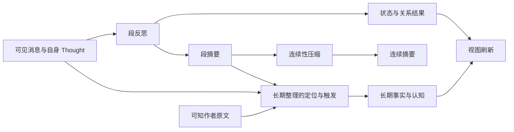

# 四种反思执行图

反思执行图规定一次整理有哪些节点、依赖、审核和提交。每次运行属于明确的社群和角色，材料范围由共同观察资格决定。群聊中的不同角色各自反思，不共享私有 Thought（内心记录）。

| 执行图 | 解决的问题 | 输入 | 正式结果 |
|---|---|---|---|
| [segment_reflect](segment-reflect.md) | 一段交流怎样保持连续性，是否改变状态或关系 | 精确可见消息、自身 Thought | 段摘要、允许的状态与关系结果 |
| [continuity_compress](continuity-compress.md) | 长交流历史怎样压缩后继续使用 | 前一连续摘要、新段摘要 | 连续摘要和独立压缩覆盖 |
| [memory_organize](memory-organize.md) | 哪些信息和认识值得以后单独检索 | 从段定位的原始来源、作者材料及有限旧背景 | 长期事实、认知和各阶段覆盖 |
| [view_refresh](view-refresh.md) | 怎样在有限常驻正文中表达已有记录 | 正式状态、关系、事实及认知变化 | 核心记忆、关系描述和状态概括 |

段和连续摘要负责上下文压缩。长期整理通过精确来源取回原文，维护可独立更新的事实和认知。view_refresh 选择已有内容表达常驻重点，新的长期推断由长期整理形成。完整对象定义见 [记忆](../memory.md)。

简单模式安排段摘要和连续性压缩，不激活日常状态、关系或长期整理；完整模式使用四条流程。作者材料通过自己的来源进入初始化，预置内容仍保持作者资格。两类模式均使用正式来源、可见性和输入预算。

流程之间通过正式记录及明确消费联系。事实审核节点的本批候选只在同一次长期运行内提供给认知，提交时转换为正式引用；其他运行不能读取它作为已提交事实。

## 模型输入的组织

固定的公共规则、节点任务、输出字段结构和材料性质说明前置，人物资料、已有背景、本批材料及来源清单后置。认知与核心记忆在固定区域加入对应任务的概括示例，默认使用日富美单示例；事实提取和关系数值分析不加入这些语言示例。示例展示多份材料怎样合并、取舍和保留人物语气，例中经历与编号不能成为当前角色的依据。

基础输出结构保持稳定，本批允许编号单独提供，提交仍检查正式来源资格。核心记忆和关系描述的结构上限、任务说明及末尾输出预算使用相同的实际字符限制，避免宽泛预算覆盖具体限制。固定前缀能否命中供应商缓存，以真实调用返回的缓存读取量为准。

共同对象、节点、租约、阶段提交和恢复见 [执行模型](execution-model.md)，状态和关系算法见 [角色状态与关系](../character-state-and-relationships.md)。日记保留独立的 [定义](diary-compose.md)，采用自己的正式入口时也要遵守同样的来源和提交规则。各流程的实现与验收范围统一见 [状态](../../status.md)。
