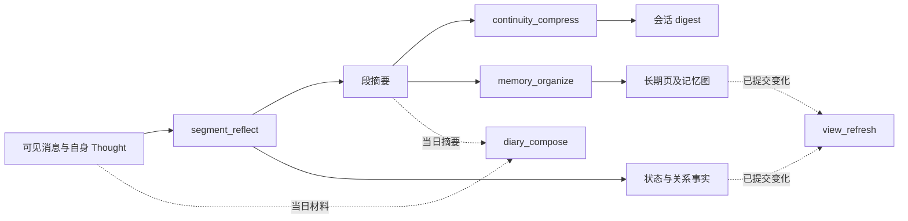

# 五种反思图

反思把角色真正收到的材料整理成自身认识和长期记忆。每次运行属于一个社群、一个独立角色；群聊中的角色分别反思，各自材料由观察权限决定。

| 图 | 解决的问题 | 来源 | 审核后保存 | 当前消费者 |
|---|---|---|---|---|
| [segment_reflect](segment-reflect.md) | 这一段发生什么，是否改变自身状态和关系 | 精确消息、自身 Thought | 段摘要、状态、关系证据 | 已接入 |
| [continuity_compress](continuity-compress.md) | 长会话如何保留连贯历史 | 前一 digest、新段摘要 | 新 digest、连续性消费 | 已接入，NoOp 有设计差异 |
| [memory_organize](memory-organize.md) | 哪些经历值得独立检索 | 段摘要及允许补充材料 | 长期页、实体、边、整理消费 | 已接入 |
| [diary_compose](diary-compose.md) | 如何按游戏日整理角色的私人经历 | 当日真实来源 | 日记、覆盖 | 未实现 |
| [view_refresh](view-refresh.md) | 如何把已保存事实包装成易读认识 | 已提交 ChangeSet | 态度、状态摘要、核心记忆视图 | 未实现 |

前三种图的正式后台工作流选择未归段材料、准备段反思，再为两个摘要消费者分别冻结批次。图之间通过正式事实和消费身份联系，不能把一个节点的未审核候选当成另一图的既成事实。

日记与视图保留完整目标设计、图定义、契约和存储；本轮不补写其调度器和消费者。它们的触发策略、具体代码接入和当前缺口在各自文档说明。

读五图前先看 [共同执行模型](execution-model.md)，材料选择见 [记忆](../memory.md)，状态和关系算法见 [角色事实](../character-state-and-relationships.md)。独立节点完成、图完成与事实提交是三个不同阶段。
