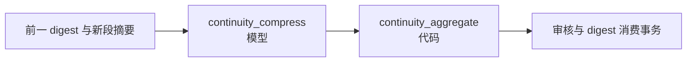

# continuity_compress：持续保留会话历史

## 1. 来源与冻结

本图处理 continuity 消费者冻结的 SummaryBatch。材料为前一 ConversationDigest 和新的 ingested 段摘要，携带精确摘要身份、版本、顺序与覆盖上限。它不读取全部原始消息或整个长期记忆库。

批次从尚未被本消费者处理的连续材料开始；遇到前段未完成、未归段可见消息或预算限制停止。私有消息的合法缺口遵守角色实际可见来源。前一 digest 与摘要正文共同计入材料预算，默认最多 256 项、20000 字符。

没有可选摘要时不创建批次和图。一旦存在正式冻结批次，本图必须生成推进覆盖的 digest，不能以 NoOp 完成并丢失连续性进度。当前代码接受这种 NoOp，属于 D02。

## 2. 两节点拓扑与契约

| 节点 | 输入 | 输出 |
|---|---|---|
| continuity_compress | continuity_context.v1；冻结摘要批次、前一 digest、角色身份与允许证据 | ContinuityDigestAction：content、covers_through_sequence、可选 content_version、evidence_refs；版本由运行层复核 |
| continuity_aggregate | reflection_artifacts.v1，本次模型产物 | 一份 ContinuityDigestCandidate，绑定批次和前驱 |

正文非空且最多 6000 字符。模型输出的 covers_through_sequence 必须等于后端从批次算出的实际覆盖上限；不能只引用最末摘要名字却漏掉中间材料。模型整理历史时保留重要事件、人物认识和未完事项，不补写原材料没有的经历。

content 使用角色第一人称，形成下一次对话能够直接使用的累计记忆。按时间阅读前一 digest 和本批摘要，用新材料补充或更新已有内容；新材料没有说明的内容保持原样或省略，不自行补全。重要事件、约定、承诺、未解决事项、重要偏好和关系变化继续保留；寒暄、重复细节和没有后续价值的短期情绪可以删除。

正文不逐条复述段摘要，也不提到批次、序号、版本或数据库。覆盖数字单独填写到结构字段。evidence_refs 使用本批允许的 summary 及前一 digest 来源，不能以模型自己刚生成的文字作为证据。完整指令与示例见 [连续性节点提示](../character-prompt-contracts.md#continuity_compress)。

## 3. 审核与事实事务

审核检查批次角色和会话、来源版本、前一 digest 仍为最新、顺序连续、覆盖上限和正文预算。没有前一 digest 时允许创建链的首项。新版本和正式身份由后端分配。

同一事务保存新 digest、前驱关联、摘要消费、覆盖和图结果。重复消费不能再次生成不同链分支。前驱已经变化时拒绝旧候选，重新准备新的业务输入；普通请求重试仍使用原快照。

## 4. 失败与两批例子

模型节点和聚合结果均必需，失败不推进消费，有限重试后留下明确失败图。已经完成的模型产物用于继续聚合；过期租约结果拒绝。无合法 NoOp 的规则同时适用于节点审核和图级审核。

第一批是角色能看到的序号 1—3 的两个段摘要，没有前一 digest。生成 D1，覆盖至 3。新段摘要覆盖可见消息 4—6，第二批绑定 D1，生成 D2，覆盖至 6。下一次对话读取 D2 加其后近期消息及允许重叠，详见 [上下文裁剪](../perspective-and-context.md)。重启重新提交第二批返回已经保存的 D2，不能把同一摘要再消费一次。

正式图和消费者已接入；NoOp 与完整恢复差异见 [实现状态](../../status.md)。
