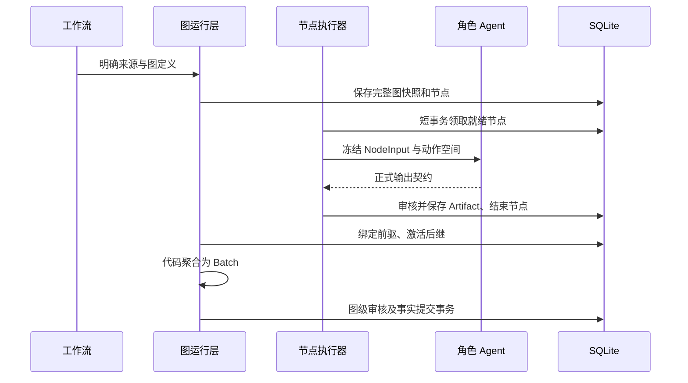
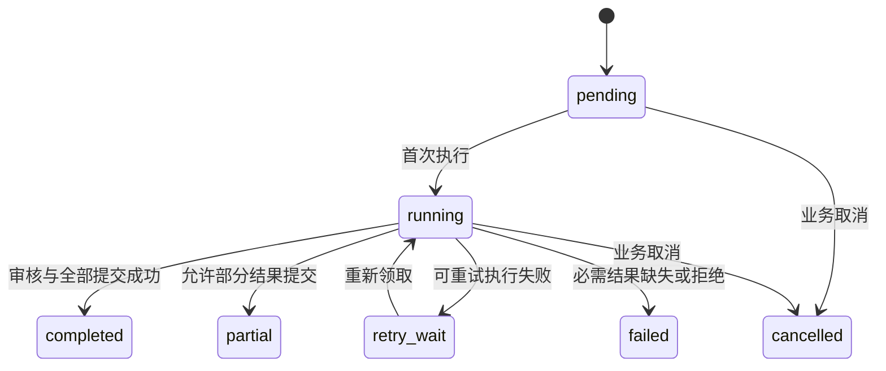

# 反思图共同执行模型

## 1. 对象与权威边界

| 对象 | 内容与作用 |
|---|---|
| GraphDefinition | 图种类、v1 版本、固定节点、依赖与输入输出契约；节点声明允许材料、背景栏目、提示资源、行动类型及事实与视图类型 |
| GraphRun | 社群、角色、图定义、来源身份、完整快照、运行状态与时间 |
| GraphContextSnapshot | 本次身份、自身信息、观察、记忆、精确材料、来源版本 |
| NodeTask | 节点身份、激活状态、依赖、前驱绑定、租约和尝试次数 |
| NodeInput | 快照引用、节点契约、真实材料投影、前驱产物、证据集合及输入版本 |
| Artifact | 一次节点尝试的不可变产物、契约、行动、证据和内容身份 |
| Candidate | 从合法行动映射出的某类待审核事实 |
| Batch | 代码聚合器生成的候选集合或明确 NoOp |
| GraphReview | 图级审核决定、理由、来源及最终提交结果 |

输入来源和内容身份用于复用冻结输入、绑定前驱及阻止材料变更后的旧候选提交。模型只能选择契约允许的内容和行动；正式标识、观察者、版本、可信证据类别、时间及覆盖边界由运行层确定或复核。

同一图种类、版本、角色和来源身份具有唯一运行关系。数据库保存完整快照，重启不依靠重新检索构造“相同”输入。已经存下的 Artifact 不随候选事实变化而修改。

## 2. 节点准备与提交

模型节点使用角色身份、用途和本节点投影；不获得整库读取能力。代码节点规划或聚合，不调用模型。required 依赖要求前驱成功；conditional 依赖由明确 follow_up 或刷新请求激活，未激活分支标记 skipped。聚合节点等待相关分支已经成功、失败或跳过，再按本图规则处理。

前驱绑定保存 ArtifactRef 及内容身份。前驱产物提供依赖结果和分析背景；运行层从本节点实际输入中生成允许引用的来源字符串列表，模型输出的 evidence_refs 只能选择列表中的完整字符串。消息使用 message:<id>，自身 Thought 使用 thought:<id>，摘要和连续性材料使用各图提供的 summary:<id>、digest:<id>。省略 evidence_refs 时只补充该节点允许的默认来源；有效来源为空时按本图的 NoOp 条件处理。关系和状态变化不能用前驱分析替代本次消息或自身 Thought。连续性使用前一 digest 与本批 summary 的来源，长期整理使用允许的摘要、消息和自身 Thought；常驻记忆只作背景。

运行层保存产物依赖引用和材料证据引用，各自保留类型和身份。它可以验证前驱产物，但不能据此将分析正文自动升级为新变化的事实证据。材料选择是独立函数，提示组装和结果审核共同使用；文字排版不参与审核。认识刷新规划根据节点定义中的事实类型选择分支。共同图快照保留完整信息，模型输入按以下规则选择。

| 模型节点 | 身份 | 自身状态 | 关系 | 记忆 | 实际材料及前驱 |
|---|---|---|---|---|---|
| segment_summary_plan | 共同规则、档案、关系表达；不含 voice | 使用 | 使用 | 使用 | 本段消息和自身 Thought，无前驱 |
| relationship_reflect | 同上 | 不使用 | 使用真实目标对应关系 | 不使用 | 原段材料，摘要产物用于背景 |
| state_reflect | 同上 | 使用 | 不使用 | 不使用 | 原段材料，摘要产物用于背景 |
| continuity_compress | 同上 | 不使用 | 不使用 | 使用 | 前一 digest、本批段摘要 |
| page_compose、graph_extract | 同上 | 不使用 | 不使用 | 使用 | 本批摘要及允许补充材料；常驻材料不作为新证据 |
| relationship_attitude_view | 同上 | 不使用 | 不使用背景关系 | 不使用 | 当前单个目标的正式关系事实及规划产物 |
| state_summary_view | 同上 | 不使用背景状态 | 不使用 | 不使用 | 当前有效的正式状态事实及规划产物 |
| core_memory_view | 同上 | 不使用 | 不使用 | 使用 | 已保存记忆及规划请求；尚未接入 |

代码规划和聚合节点读取实际依赖，不发送模型提示。多角色扩展为关系节点补充明确目标，为材料补充实际发送者，不改变上述信息选择职责。完整第一人称表达、职责、判断规则和示例见 [角色提示契约](../character-prompt-contracts.md)。当前代码将整个图快照交给模型的差异登记于 D11。

### 输入和产物字段

GraphContextSnapshot 保存 schema_version、snapshot_id、prepared_at_utc、scope、graph_kind、source_kind、source_id、source_version、conversation_id、observation_upper_sequence、self、memory、environment、public_facts、materials、action_space、source_versions。目前 source_kind 的具体类型只允许 memory_segment 和 memory_summary_batch；作者材料初始化和认识刷新需要独立正式来源类型，现有快照类型尚未承载它们。diary 暂缓，不进入当前运行政策。

| 材料类型 | 字段与意义 |
|---|---|
| MessageMaterial | kind=message、source_id、version、ObservedMessage 和 mentions；消息中有正式身份、序号、发送者、名字、正文、发生时间与可选回复 |
| ThoughtMaterial | kind=thought、source_id、version、content、occurred_at_utc；只允许本角色实际思考 |
| SummaryMaterial | kind=segment_summary、source_id、version、content、first_sequence、last_sequence |
| DigestMaterial | kind=conversation_digest、source_id、version、content、covers_through_sequence |

ReflectionNodeInput 在公共调用元数据之外保存 graph_run_id、node_key、node_kind、graph_snapshot 和 artifacts。每个前驱 ArtifactInput 保存 artifact_id、node_key、content_version 和正式行动 payload。节点 scope、准备时间、动作空间必须与图快照一致；source_versions 包含实际使用前驱的版本。

Artifact 保存图、节点、Invocation、attempt、输入身份、输出契约种类与版本、payload、证据引用、审计及时间。证据结构包含 kind、ref 和可选 version；模型输入中的 `kind:source_id` 引用由运行层映射到实际身份。模型节点输出 reflection_node.v1，代码聚合输出 reflection_batch.v1。

图结果保存 result_id、graph_run_id、aggregate_fingerprint、payload_json、status、decision_code、created_at_utc、decided_at_utc。审核状态 pending 表示未决定；approved、rejected、expired、skipped 各自保留决定与时间。图执行状态和审核状态分别保存，不能只看其中一个判断是否产生事实。

## 3. 行动与候选映射

| 输出行动 | 聚合候选 | 运行层补充与复核 |
|---|---|---|
| segment_summary | SegmentSummaryCandidate | 段身份、精确覆盖与来源版本 |
| relationship_reflection | RelationshipImpactCandidate | 观察者、真实目标、可信 evidence_kind |
| state_reflection | StateEntryCandidate | 实例、类别、当前版本和有效期 |
| continuity_digest | ContinuityDigestCandidate | 前一 digest、批次及覆盖上限 |
| long_term_memory_page | MemoryUpsertCandidate | 主体解析、页身份与来源 |
| graph_extraction | MemoryEntityCandidate、MemoryEdgeCandidate | 局部引用解析和正式标识 |
| view_refresh | ViewRewriteCandidate、CoreMemoryRewriteCandidate | 已提交事实和源版本 |
| no_op | 无候选、明确理由 | 逐图判断许可条件 |

输出类型合法不代表事实已获准。节点审核负责契约、材料与租约；图级审核负责组合、业务边界和消费。批次不能混入其他角色、其他图或未出现的证据。

## 4. 状态与失败

节点状态为 pending、processing、retry_wait、completed、failed、skipped。就绪节点领取后 processing；可重试错误退避为 retry_wait，超过尝试预算或不可重试错误为 failed；条件关闭或图取消后 skipped。completed 必须绑定成功产物。

| ReflectionNodeTask.status | 含义 | 改变状态的责任方 |
|---|---|---|
| pending | 已建立，等待依赖与执行资格 | 图准备和依赖服务 |
| processing | 有效租约正在执行本节点 | 反思队列 |
| retry_wait | 本节点等待下一次有限尝试 | 执行结果处理和队列恢复 |
| completed | 合法产物已保存 | 节点审核与提交 |
| failed | 本节点无法继续 | 节点失败处理 |
| skipped | 条件未激活，或图已取消 | 依赖或业务取消服务 |

pending 的节点可以尚未满足依赖。completed 的节点可以产出合法 no_op；它仍需要有产物，不能仅修改状态。必需节点 failed 阻止图提交；可选节点 failed 与条件未激活的 skipped 分别记录。

图状态为 pending、running、retry_wait、completed、partial、failed、cancelled。图开始执行进入 running；必需结果齐全且提交成功进入 completed；允许的可选分支失败、其余有效事实被保存时进入 partial；必需分支终态失败或图审核拒绝进入 failed；业务取消进入 cancelled。retry_wait 表达仍待恢复的执行，不能被当成已完成事实。

GraphRun 与 NodeTask 分别管理自己的状态。NodeTask.retry_wait 表示某个节点等待重试；图中仍有其他可运行节点时，GraphRun 可以保持 running。不能看到一个节点重试就直接把整图也改成 retry_wait。图自己的 retry_wait 只由图恢复规则使用，其具体可达入口以当前实现状态为准。

图级审核记录的 pending、approved、rejected、expired、skipped 解释候选处理决定：未决定、批准、拒绝、来源或资格失效、按正式规则无需事实提交。它与执行状态分开。例如关系节点 completed 后，整图审核 rejected，节点产物仍保留，但不会写入关系事实。图级 no_op 同样是有明确理由的审核结果，不能用它证明模型或节点没有执行。

租约检查 owner、attempt、generation 和期限。到期节点恢复重新领取，旧尝试结果失效。普通重试读取原输入。已完成产物保留，不能因为其他节点失败重做并覆盖。

再次调用正式段或摘要调度入口时，尚无图级审核结果的 failed 运行重新进入 pending。调度先检查已保存材料是否仍然有效，再重新激活失败节点及因必需节点失败而被中断的节点。成功产物、条件未请求的 skipped 节点和输入快照保持不变；条件分支按已经保存的摘要计划恢复。重新领取增加尝试次数和租约代次，图重新开始增加执行代次。

已有 rejected 或 expired 图级审核决定的运行保持终态，重复调度返回该运行。原运行的审核结果和已拒绝候选保持不变。后台工作者处理已经调度的节点和过期租约；重新启动通过正式调度入口发起。

段反思和认识刷新 partial 后的补充恢复通过重新启动入口执行：新建明确关联失败图的恢复运行，复用该图的冻结输入和成功产物，仅执行尚未完成的可选分支，已经提交的事实不再次消费。重复请求返回已有补充运行；诊断详情提供原运行及补充运行编号。节点过期租约恢复使用已保存的节点输入、新尝试次数及新租约代次；旧尝试结果不得提交，已成功产物不得重做或覆盖。

## 5. 图级审核与事务

审核检查图种类与版本、实例归属、源版本、前驱绑定、候选数量与总字符、精确覆盖、业务字段、重复来源和逐图 NoOp 规则。默认候选上限 64、输出总字符 20000；节点模型预算见 [配置](../../reference/configuration.md)。

获准时调用各事实服务，跨模块共用连接。业务拒绝保存明确拒绝决定，不写入候选事实；数据库异常回滚事实、消费和图结果。两者都不能留下“已消费但没有产物”的半次处理。图结果按图唯一，重复提交返回已有一致结果，冲突明确报告。

NoOp 只在该图定义允许时结束并登记相应结果。segment 的实际材料需要摘要；冻结的 continuity 批次必须推进 digest；memory_organize 可以没有值得长期保存的事实；没有事实变化不创建刷新请求。各图详细规定优先于通用动作类型。

共同运行权限、暂停及关闭见 [持久任务执行](../task-execution.md)。诊断可展示运行和 Artifact 来源链，公开消息接口不会暴露私有反思正文。
