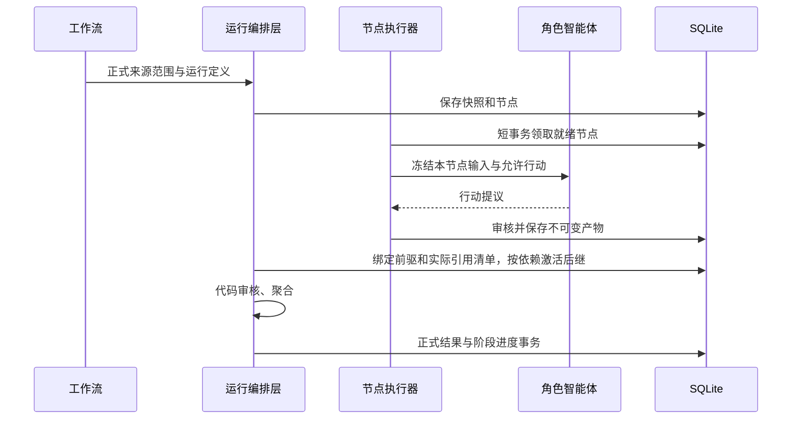

# 反思执行图的共同执行模型

## 1. 运行对象与权威边界

Graph（执行图）组织反思的处理步骤：节点表示模型或代码任务，有向边表示前驱依赖。运行层绑定前驱产物，按依赖和执行资格激活后继节点；节点状态、整图状态及业务提交分别维护。GraphDefinition、GraphRun 等名称沿用这一含义。

反思执行图定义节点、依赖和提交规则。模型只提交行动提议；运行编排层核对真实输入、当前资格和版本，通过所属业务服务保存正式结果。模型调用期间不持有数据库写事务。

| 对象 | 职责 |
|---|---|
| GraphDefinition | 图种类、独立版本、固定节点和依赖；声明材料、背景、提示及输出契约 |
| GraphRun | 社群、角色、来源范围、完整快照、执行状态和时间 |
| GraphContextSnapshot | 冻结身份、观察上限、原始来源、必要背景及源版本 |
| NodeTask | 节点状态、前驱绑定、租约、尝试与实际输入身份 |
| NodeInput | 本节点材料投影、前驱产物、允许引用和更新范围 |
| Artifact（节点产物） | 一次成功尝试的不可变输出、契约、来源和审核记录 |
| Candidate（候选） | 尚未正式提交的明确业务操作 |
| Batch（候选批次） | 代码聚合的操作、来源映射和阶段结果 |
| GraphReview | 最终审核、拒绝原因及实际提交决定 |

同一图种类、版本、角色与实际来源范围复用已经保存的运行。协议含义变化使用新版本，不能把旧产物转换为新协议执行。数据库保存真实输入和成功产物，重启不靠重新检索猜测原输入。

“正式业务记录”包含角色状态、关系、摘要、长期事实和认知；它表达记录已经通过业务入口。MemoryFact 是 [记忆设计](../memory.md#51-事实记录) 中的具体类型，认知、状态和模型自报置信度不会因此取得外部真实性。

## 2. 节点输入与引用资格

节点只能读取其职责需要的投影。背景可以帮助理解，来源清单决定证据资格，允许更新清单决定可以操作的旧记录。模型不能自行查询整库、创造参与者身份或选择输入外的版本。

前驱绑定保存产物身份和内容版本。普通分析只能作为背景；fact_review 已批准的事实候选可以在同一次长期运行中成为认知支持，引用由代码清单提供。局部引用在保存时转换为实际事实编号与版本，不能指向未保存内容。

| 模型节点 | 人物信息 | 可引用材料 | 背景与限制 |
|---|---|---|---|
| segment_summary_plan | 共同人物规则、档案与关系表达 | 本段可见消息、自身 Thought | 现有状态、关系和记忆帮助理解 |
| relationship_reflect | 人物及明确目标 | 本段允许的原始消息、自身 Thought | 摘要和当前关系只帮助判断本次变化 |
| state_reflect | 人物及自身状态 | 本段允许的原始消息、自身 Thought | 摘要只提供经历背景 |
| continuity_compress | 角色名称和第一人称要求 | 前一连续摘要和本批段摘要 | 只压缩提供的范围 |
| fact_extract | 正式观察者及人物身份背景 | 本批原始消息、可知作者材料 | 段摘要定位，旧事实用于识别重复和纠正 |
| cognition_reflect | 人物、关系表达及 voice（表达习惯） | 已审核事实候选、允许旧事实、自身 Thought、可知主观作者材料 | 旧认知比较变化，不作为新的独立证据 |
| relationship_attitude_view | 人物、目标自然称呼及 voice | 该目标已有关系证据和相关有效长期记录 | 选择和表达已有认识，不新增长期推断或分数 |
| state_summary_view | 人物 | 当前正式状态记录 | 不能生成新的身体、心情或活动状态 |
| core_memory_view | 人物及 voice | 本次选中的有效事实、认知和支持材料 | 旧正文帮助保留重点，不作为新增依据 |

事实阶段不以 Thought 证明外部事件；认知阶段不以摘要或旧认识冒充新证据。段摘要与连续摘要允许引用压缩材料，新增事实需要原始依据。共同写作要求与完整节点提示见 [提示契约](../character-prompt-contracts.md)。

## 3. 快照、产物与行动

图快照固定 schema_version、snapshot_id、prepared_at_utc、scope、graph_kind、source_kind、source_id、source_version、conversation_id、observation_upper_sequence、self、memory、environment、public_facts、materials、action_space 和 source_versions。来源入口区分材料段、摘要批次、作者批次和正式变化集合。

| 材料 | 保存内容 |
|---|---|
| 原始消息 | 身份、版本、真实发送者与名称、正文、受众、时间及回复关系 |
| 自身 Thought | 角色归属、来源版本、原始正文与当时记录时间 |
| 段摘要、连续摘要 | 正文、正式身份、版本和实际覆盖 |
| 作者分块、预置材料 | 作者来源、固定人物版本、正文及必要采访题目 |
| 长期事实、认知 | 类型、记录编号和版本、内容、性质、必要时间及支持资格 |
| 视图读取范围 | 本轮记录、未读范围、旧正文、实际可读状态；不能作为证据 |

NodeInput 绑定运行、节点、实际快照和前驱 ArtifactRef（产物引用），其观察范围和准备时间与图快照一致。来源引用选择输入中的完整值，源版本由运行层补齐；旧记录更新引用同时包含正式编号和版本。逐项证据单独保存，顶层合集不能取代它。

Artifact 记录节点、调用、尝试、输入身份、输出契约、行动、证据、审计和时间。产物保存不等于业务记录提交，批准候选与正式编号映射也分别保存。代码节点使用自己的产物契约，不调用模型或伪造模型输出。

| 行动或代码结果 | 后续操作 |
|---|---|
| segment_summary | 段摘要、精确覆盖及后续分析选择 |
| relationship_reflection | 明确目标的关系影响和实际证据 |
| state_reflection | 自身状态变化 |
| continuity_digest | 连续摘要及独立压缩消费 |
| memory_fact_extract | 新增、补充依据、纠正提取错误的事实候选 |
| fact_review | 已批准事实候选及其引用资格 |
| memory_cognition_reflect | 新增、替换认知的候选 |
| view_refresh | 核心、关系描述或状态视图的替换结果 |
| no_op | 本节点已合法处理，但没有需保存的内容 |

每个运行定义声明准确的契约版本。类型、输出字符、候选数量、真实来源及租约由节点审核检查；整体操作组合、版本更新、消费和事务由最终审核检查。原始候选、审核决定和正式提交各有记录。

## 4. 节点、运行和阶段状态

| 节点状态 | 含义 |
|---|---|
| pending | 已建立，等待依赖及执行资格 |
| processing | 有效租约正在执行 |
| retry_wait | 等待一次有限重试 |
| completed | 合法产物已保存，可能为明确 no_op |
| failed | 调用、审核或配置错误已终止本次执行 |
| skipped | 条件未激活，或业务取消 |

运行状态使用 pending、running、retry_wait、completed、partial、failed、cancelled。节点正在重试时，其他就绪节点仍可以执行；运行与单个节点各自维护状态。最终审核的 pending、approved、rejected、expired、skipped 记录候选决定，与执行状态分别保存。

必需摘要、连续摘要及事实审核失败会阻止其所负责结果的提交。可选状态、关系、视图或认知失败时，只有所属流程明确允许的结果可以部分提交。跳过未激活的条件与执行失败分别记录。

长期整理额外保存事实和认知阶段的正式提交与覆盖进度。fact_review 完成表示候选已获准读取；事实阶段完成需要实际提交或明确无变化结果及其来源覆盖。completed 节点、已提交事实阶段和完整长期消费具有不同含义。

## 5. 事务与部分成功

保存前复核社群、角色、运行版本、原始来源、观察资格、旧记录版本、前驱绑定、输出预算和 NoOp 许可。取得写事务后使用实际执行时间更新任务状态；世界时间不能作为租约时钟。

完整成功时，业务记录、来源、版本修订、索引投影、消费进度和运行结果在同一事务保存。合法拒绝可以保留审核决定，候选不写入业务表。数据库异常回滚当前事务，不能留下“已消费但没有产物”的状态。

长期事实已合法完成、认知失败时，聚合可以保存事实、正式映射及事实阶段覆盖，运行标记 partial（部分成功）。认知范围保持未完成，后续补充运行只提交该阶段。详细操作和结果组合由 [长期整理](memory-organize.md#6-预算部分成功与恢复) 定义。

正式结果唯一绑定本次运行和实际阶段。重复提交复用已保存结果，不能再次增加来源依据、关系影响或消费。认知依赖的局部事实引用在同一提交事务中转为正式版本；任何无法转换的引用阻止对应保存。

## 6. 重试、补充运行与版本变化

普通重试使用原冻结输入和有限尝试上限。租约检查 owner（执行者）、attempt（尝试次数）、generation（租约代次）和期限；过期后新尝试取得新代次，旧执行结果失效。成功产物保持不变。

无最终审核结果的失败运行，经正式恢复入口检查来源后重新激活失败节点和被依赖失败阻止的节点。已有拒绝或失效决定保持历史终态；新合法范围通过新的明确运行处理。

部分成功的恢复新建关联原运行的补充运行，读取成功产物、正式阶段结果和未完成范围。段摘要、关系数值、已保存事实及其覆盖不会重新提交。事实完成后，认知恢复使用正式事实引用，不能继续假设局部候选尚未保存。

来源或引用的旧记录版本已变化时，相关候选失效。恢复保留原始处理范围和已提交阶段，重新取得合法背景并登记新的输入；原有快照、审计和成功事实不改写。预算调整同样登记实际新执行限制，不伪装成原输入。来源缺失时停止受影响范围，不能制造替代材料。

配置、输出、模型和持久化错误使用 [共同恢复规则](../errors-and-recovery.md)，社群暂停与成员变更使用 [任务生命周期](../task-execution.md)。管理端可读取原始审计和阶段结果，公开用户响应保持自然的操作状态。
