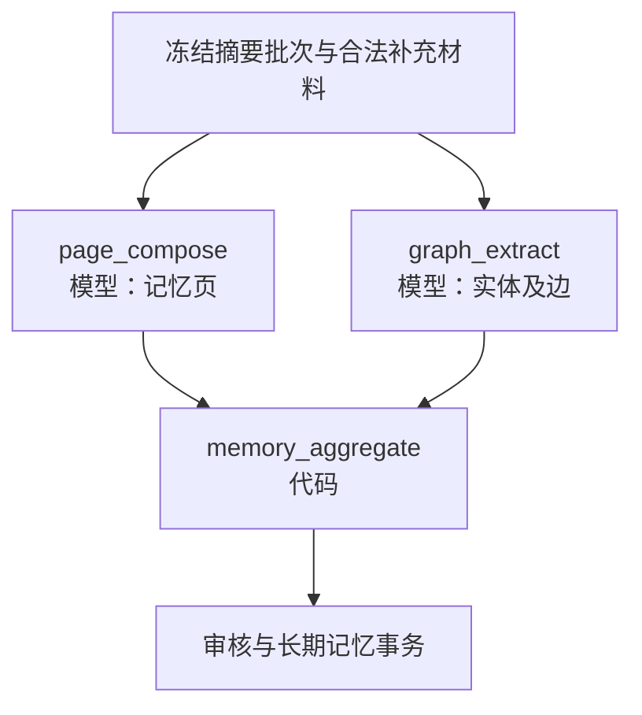

# memory_organize：形成可检索的长期记忆

## 1. 目标与材料

本图把真实经历整理为独立记忆页及记忆中的实体关系。SummaryBatch 属于 memory_organize 消费者，独立于连续性消费。输入以真实段摘要为主，可以加入允许且预算内的关联消息、自身 Thought 和常驻记忆；不能读取其他角色材料或整个记忆库。

完整模式的作者初始化使用独立作者材料批次，读取已确认故事、采访问答及分块引用，复用本图的节点、审核和保存设施。它没有会话序号或连续性消费，不生成与当前玩家的共同经历。简单模式不安排本图，材料和准备条件见 [记忆设计](../memory.md#2-初始化可见性与有效期)。

冻结保存实际来源、版本、允许主体、已有别名及覆盖范围。每个节点只读取其任务所需材料；材料默认上限 256 项、20000 字符，输出共同上限 64 候选、20000 字符。

## 2. 双分支拓扑

两个模型分支均为必需执行；单个分支可以输出有理由的 NoOp。聚合等待二者成功，不用失败代替“没有内容”。无值得长期保留的事实时，可生成图级 NoOp，明确登记本批处理结果。

## 3. 节点输入与行动

| 节点 | 输入重点 | 输出 |
|---|---|---|
| page_compose | memory_organize_context.v1；摘要正文、作者已有记忆、明确主体及相关证据 | LongTermMemoryPageAction 的 pages 列表或 NoOp |
| graph_extract | memory_organize_context.v1；同批材料、已有实体别名、允许局部引用 | GraphExtractionAction 或 NoOp |
| memory_aggregate | 两个前驱的实际 Artifact、证据映射 | MemoryUpsert、Entity、Edge 候选或 NoOp |

页行动包含非空 pages 和行动级 evidence_refs；每页含 memory_kind（fact、event、preference、promise、thread、other）、content（最多 6000 字符）、subject_kind、subject_id、confidence、salience。confidence 和 salience 为 0—1。每页承载可单独取回的内容；多主题不必强行压成一页。无页时使用 NoOp，不能提交空 pages。

实体含局部 entity_id、entity_kind、canonical_name；边含局部 from_entity_id、to_entity_id、edge_kind 和 confidence。行动最多 64 实体、128 边，图聚合还必须满足共同候选预算。后端分配正式标识，解析同一候选中的局部引用，通过规范化别名复用已知实体。

### 3.1 怎样形成独立记忆页

一条页围绕一个以后能够独立回想的主题，用第一人称表达。几个互不相关的约定、承诺、事件或事实分别形成页；同一事实重复出现时合并，相关细节只有需要共同回想时才放在同一页。

普通寒暄、一次性安排、未获角色支持的猜测和瞬间情绪不写成长期记忆。confidence（来源支持程度）表示材料对该条内容的支持，salience（记忆重要程度）表示它对后续相处连续性的价值。subject_id 保存页的主体标识；本批实体提取存在同一局部标识时，后端替换为正式实体身份并建立页与实体的关联。没有对应实体时保留主体标识，页正常保存，不创建实体关联。图的边仍要求两端都能解析为本批实体。整组 pages 共用的证据必须支持每一条页。

### 3.2 怎样提取实体和关系

人物、角色、地点、物品、事件及组织可以作为实体，普通代词、模糊指代和没有独立身份的动作不作为实体。一个实体在同一输出中使用同一局部身份与稳定称呼。

每条边的起点和终点都必须出现在本次 entities 中，即使某实体已经存在于常驻记忆也需要列出。两个实体共同出现在一句话中，不能单凭共同出现生成关系。边有明确方向，关系名称保持稳定，如 participated_in（参与）、knows（认识）、promised_to（向其承诺）。同一实体和同一方向的同一种边不重复返回，整组证据支持全部实体及边。

数据库身份、别名写入和提交命令由运行层负责。完整提示正文与多页、实体关系示例见 [记忆页提示](../character-prompt-contracts.md#page_compose)和[记忆图提示](../character-prompt-contracts.md#graph_extract)。

## 4. 来源与审核

页主体和图端点须能解析到当前角色允许的信息；所有证据来自冻结材料。完全相同内容可复用，语义相近但来源不同的页应保留可说明的差异，不能擅自删除过去记忆。

玩家自述、作者提供的历史、角色自身判断与已发生的共同经历分别保存。比如 Alice 说“我喜欢蓝色”，可记录其偏好及这条消息来源；Alice 说“我们去年去过海边”，可记录她的陈述，不能补造角色确认过的旅行。

已审核摘要提供整体背景；角色消息表达其实际说过的话；自身 Thought 表达当时注意、感受或判断；玩家陈述只证明玩家这样说过。常驻记忆用于理解背景和发现重复，不填写到本次 evidence_refs；常驻内容不完整也不能证明本批内容一定是新的。事实、回忆和猜想的完整规则见 [记忆判断](../memory.md#7-事实回忆和猜想的判断)。

## 5. 事务、失败与重复

同一事务保存记忆页及来源、实体与规范化别名、页实体关联、边、摘要消费、搜索映射和图结果。任何非法引用或真实数据库错误全部回滚；消费记录不能领先于实际保存。

图级 NoOp 记录没有产出及理由，不创建空页或空实体，但完成本消费者对本批的处理。一个必需分支失败时整个图不能消费材料。重复提交按来源和图结果复用，不能重复生成事实或关系边。

## 6. 社群例子与当前状态

Alice 表示喜欢蓝色、答应下周带棋盘；甲看到两条消息，乙只看到第一条。甲形成两个独立页，主体 Alice，分别为 preference 和 promise；图分支形成 Alice 与棋盘实体及承诺关联。乙只形成偏好页。连续性压缩已经消费这些段摘要，也不影响本次整理的独立进度。

正式图及长期记忆消费者已接入。检索规则见 [记忆](../memory.md)。派生核心记忆视图属于未实现的 [view_refresh](view-refresh.md)，长期页保存成功不会自动证明视图刷新已经运行。
