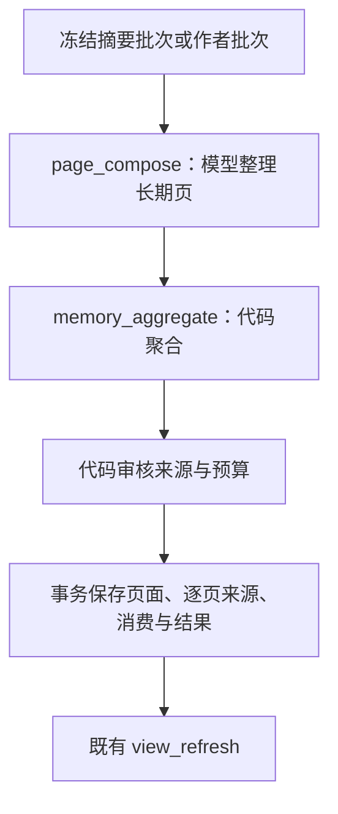

# memory_organize：形成可检索的长期页

## 1. 目标与材料

完整模式把值得以后单独回想的经历整理为长期页。当前页仍允许事实、经历与角色认识类正文，事实与认知分离等待 [U07.3](../../../../docs/04-experience-and-character-quality-plan.md#104-u073重构长期消化管线) 实施。

SummaryBatch 属于 memory_organize 消费者，独立于连续性压缩。当前执行输入是冻结的已审核段摘要；摘要保留来源性质，人物资料和常驻记忆只帮助理解。本节点不能读取其他角色材料或整个记忆库。

作者初始化使用独立作者批次，读取已确认故事、采访问答和分块。它没有聊天序号，不生成与当前玩家的共同经历或关系分数。简单模式只准备原文分块和索引，详见 [记忆设计](../memory.md#2-初始化可见性与有效期)。

## 2. 执行流程与版本

当前运行定义为 `memory_organize.v3`，包含 page_compose 和 memory_aggregate。模型输出为 `reflection_node.v3`，聚合输出为 `reflection_batch.v1`。其他反思任务仍使用各自现行版本。

| 节点 | 输入 | 输出 |
|---|---|---|
| page_compose | memory_organize_context.v3；本批摘要或作者分块，人物与已有记忆背景 | LongTermMemoryPageAction 或明确的 NoOp |
| memory_aggregate | page_compose 的已审核 Artifact（节点产物）及来源映射 | 各页独立的 MemoryUpsertCandidate 或 NoOp |

只有模型节点成功并通过审核后才能聚合；调用失败不能转换成“没有内容”。没有可靠长期内容时，NoOp 登记处理结果并完成本批消费。

## 3. 页面正文、来源与预算

每页围绕一件事情或一个明确主题，以角色第一人称保存具体人物、条件、必要时间与结果。重复说法合并，无关事项分别整理。对方自述、计划、猜测及自身感受保留原有性质；背景和语气不能补写没有来源的经历、动机或因果。

每页包含 memory_kind、content、confidence、salience、evidence_refs。memory_kind 使用 fact、event、preference、promise、thread、other；content 最多 6000 字符，confidence 与 salience 使用 0—1 的数字。页面归属直接使用当前正式角色身份，正式编号、版本及时间由运行编排层确定。完整写作要求见 [page_compose 提示资源](../../../src/echo_commons/resources/prompts/reflection/nodes/page_compose.md)。

每页必须引用实际支持自己的允许来源。顶层 evidence_refs 必须等于逐页引用的去重合集。当前允许的逐页依据为 `segment_summary:<id>` 或 `author_chunk:<id>`，版本由冻结材料补齐。来源身份、版本和角色范围在提交前再次检查。材料缺失、版本变化、越界或缺少逐页依据均不能保存页面或推进消费。

页面节点获得整批候选和正文额度。普通额度及作者初始化按材料规模计算的动态额度见 [记忆预算](../memory.md#21-初始化预算与来源引用)。来源引用不计入业务正文字符预算，但始终校验；最终提案仍使用来源组去除重复保存的引用。

## 4. 保存、读取与重复处理

一次事务保存 `memory_entries` 正文、`memory_entry_sources` 的逐页来源、正式记忆变化、批次消费、搜索映射和反思结果。任何真实数据库错误全部回滚。批次消费不能领先于实际保存；已消费来源不能再次整理。

管理页分别显示批次范围与逐页依据。来源内容按社群、角色、正式身份与版本读取；无法读取时保留引用和状态，正文为空。核心记忆使用各页真实支持材料；仅在来源集合完全相同时复用支持正文。普通检索读取实际命中的合法材料，规则见 [记忆检索](../memory.md#6-搜索与重建)。

旧页正文、身份、来源批次及版本保留。旧页未保存逐页依据时返回空依据列表，批次只说明整理范围。已有核心正文保留；需要这类旧页作为证据的刷新会明确失败，不能用整批材料填补逐页证据。模板预置页保留明确的作者原文来源。事实与认知重构时的数据处理按 U07.3 执行。

迁移取消未完成、部分成功和失败的旧整理，释放租约，重置受影响的作者初始化进度；未消费材料通过当前运行版本重新安排。历史输入、产物和结果保留原始记录，可在管理端查看；旧节点不再组装执行输入，旧协议无法恢复执行。

## 5. 来源范围例子

Alice 在两个段中分别说喜欢蓝色、承诺下周带棋盘。观察角色可以形成 preference 和 promise 两页，每页分别引用实际支持自己的段。另一角色只看到偏好消息时，其材料中不会出现承诺。连续性压缩消费了这些摘要，也不会改变长期整理的独立进度。
