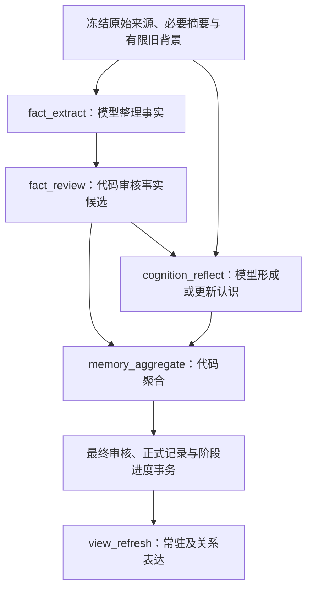

# memory_organize：长期事实与认知整理

## 1. 材料与处理目标

长期整理把角色实际获得的信息保存为 MemoryFact（事实记录），把有依据的体验、理解和推断保存为 MemoryCognition（认知记录）。记录、来源性质、时间和版本由 [记忆设计](../memory.md) 定义，本文件定义一次整理的操作和提交过程。

日常输入从尚未长期处理的段中定位原始可见消息及自身 Thought。段摘要帮助理解和确定处理范围，连续摘要用于对话压缩。作者初始化读取角色可知的故事、采访问答及预置原文，使用独立作者批次，不借用聊天序号。

本次社群、角色、会话范围、观察时刻、原始内容与版本一并冻结。按正式人物身份和本批主题，使用普通检索取得有限旧事实与旧认知。背景人物保持自然称呼和出处。人物资料帮助理解，旧认识帮助比较，两者不会增加本批原始证据。

## 2. 四节点执行流程

| 节点 | 材料与职责 | 产物 |
|---|---|---|
| fact_extract | 原始消息、可知作者材料，必要摘要及有限旧事实背景 | 新增、补充依据或纠正提取错误的事实操作；或明确 no_op |
| fact_review | 事实行动、冻结来源、允许更新的旧版本 | 合法事实操作和可供认知使用的引用清单；或审核失败 |
| cognition_reflect | 已审核事实候选、可引用旧事实、自身 Thought、有限旧认知 | 新增或替换认识的操作；或明确 no_op |
| memory_aggregate | 事实审核及已结束的认知阶段、实际依据映射 | 正式提交候选、局部引用映射及阶段结果 |

事实提取和事实审核是必需阶段。认知阶段在事实审核成功后执行；没有值得长期保存的新事实时，合法 no_op 仍代表完成了事实阶段，自身 Thought 或可引用旧事实可以支持认知。

审核事实的代码节点不新增事实，也不调用另一个模型评判真假。未经审核的产物不能提供给认知。节点输入与成功产物保持不可变，事务与恢复由 [共同执行模型](execution-model.md) 负责。

## 3. 原始来源覆盖

本批按完整消息与对应自身 Thought 分组，原文、必要摘要和旧背景都计入输入预算。某个段超出一批容量时分批选择完整来源，保存实际覆盖范围。摘要没有提到的原文也需要纳入后续合法批次。

事实阶段登记消息及作者材料的实际处理覆盖，认知阶段登记本轮认识形成所需的相应来源范围。处理完成与是否生成记录分别保存。段的某阶段只有全部所需原始来源已处理，才能完成阶段消费；整个长期消费者在事实与认知均完成后结束。

一个来源没有后续保存价值时，可以完成处理并不生成记录。模型调用失败、审核失败或预算不足不属于这种情况。不同消费者的进度不相互推进，连续摘要成功不代表本段已经完成长期整理。

## 4. 事实操作与审核

每项事实保留说话者或参与者、对象、时间、否定、条件和来源性质。自述、转述、未来计划及承诺保持自己的性质；动作完成由实际权威结果证明。Thought 的外部判断不能写成已经发生的事件。

| 操作 | 模型提交的内容 | 运行层处理 |
|---|---|---|
| 新增事实 | 本批局部键、完整事实内容和本项原始依据 | 分配正式编号及初始版本 |
| 补充依据 | 输入中实际旧事实的编号、版本及新增原始依据 | 保持原有事实含义，追加带新依据的版本 |
| 纠正提取错误 | 实际旧事实引用、修正内容及支持修正的原文 | 保存新版本和修订关系，保留旧正文及原始材料 |

不同操作使用明确的对象类型。补充依据不能同时改写正文；正文与原材料不符时使用纠正操作。不同时间的独立事件、不同条件的说法分别保存；较晚陈述不能抹去早先真实发言。

fact_review 检查结构、非空内容、局部键唯一性、实际原始依据、观察权限、来源版本、参与者身份、旧记录范围和更新版本。每项依据分别校验；顶层 evidence_refs（来源引用）是逐项引用的去重合集。输入外的身份、历史版本或来源不能获得更新资格。

代码审核决定候选是否具备提交资格。语义是否忠于原文、是否有长期价值由真实材料验收检查，字段合法不等于内容得到证实。

## 5. 认知操作与支持关系

认知围绕一个明确的人或事项形成。已有同一认识时，模型可以维持、细化、减弱或修正；维持且没有新内容时返回 no_op，避免为重复摘要制造新认识。支持事实与原始主观依据可以单独或共同存在，每项至少有一类合法支持，不要求为没有 Thought 的认识补造内心原文。

| 操作 | 内容与依据 | 版本处理 |
|---|---|---|
| 新增认知 | 对象或事项、认识性质、正文、形成时间和范围、支持事实或自身原始依据 | 分配独立编号及初始版本 |
| 替换认知 | 本次允许的旧认知编号与版本、新内容及真实新依据 | 保存新版本，保留旧认识及其支持版本 |

当时已经记录的体验按自身 Thought 保存原始时间；后来根据经历形成的解释保持后来形成的性质。对方动机属于推断，不能仅因角色相信它便转成外部事实。人物背景影响理解和措辞，不生成新的事件。

已审核本批事实候选可以用其局部引用支持认知，旧事实使用允许清单中的实际版本。正式提交时局部引用转换为保存后的事实编号和版本。旧认知只是比较背景；多次引用同一个认识或摘要不增加独立证据。

认知不修改关系数值、短时状态、人设、其他角色记忆或活动结果。某项认知只绑定背景人物自然称呼时，不按姓名创建成员关系。状态与关系反思继续通过自己的业务规则处理原始证据。

## 6. 预算、部分成功与恢复

事实与认知使用 [共同输出预算](../memory.md#21-初始化预算与来源引用)。事实操作先占用实际候选数量和业务正文，认知使用余额，引用单独审核。没有剩余预算时保留认知阶段未完成；调整预算或合法缩小选择范围后重新准备该阶段输入，并保留原始冻结材料和执行审计。

| 结果 | 可提交内容 | 后续处理 |
|---|---|---|
| 事实审核失败 | 本批不提交长期事实或认知 | 不推进事实覆盖；按有限恢复处理失败阶段 |
| 事实成功，认知成功 | 实际事实、认知及两个阶段覆盖 | 完成本轮长期处理 |
| 事实成功，认知明确 no_op | 实际事实、认知阶段的无变化结果及覆盖 | 完成本轮长期处理 |
| 事实明确 no_op，认知成功 | 有依据的认知与两个阶段覆盖 | 完成本轮长期处理 |
| 事实成功，认知调用或审核失败 | 合法事实及事实阶段覆盖 | 保存部分成功，仅恢复认知 |
| 认知预算不足 | 已合法完成的事实及对应覆盖 | 保留预算原因及认知范围，不能记录无变化 |

每批保存阶段结果、正式事实映射和实际来源覆盖。事实提交后，恢复认知读取这些事实的实际编号和版本及原有冻结主观来源，不再提取事实，不重复增加依据，也不丢失本批未处理材料。补充运行关联原运行，重复恢复请求复用已经存在的恢复记录。

模型调用失败沿用现有退避、输出修正和尝试上限。必需阶段失败阻止对应提交；认知终态失败允许事实部分成功。重启从持久阶段状态和产物继续，不用内存布尔值猜测消费情况。

并发会话可能引用同一旧记录版本。保存前复核实际版本；过期候选不能覆盖后来更新。来源或旧背景版本已经变化时，新执行输入保留原始处理范围与已提交阶段，重新取得合法背景，不修改旧输入或审计。原始来源本身失效时明确停止受影响范围，不能靠旧候选恢复缺失内容。

## 7. 正式保存与变化通知

最终审核检查事实和认知的操作、依据、版本及预算。事务分配正式事实身份，转换认知支持关系，再保存事实、认知、版本变化、阶段覆盖、索引投影、正式变化集合与运行结果。任何数据库错误回滚本次事务。

事实部分成功也是一个明确的提交边界。已保存事实及覆盖保持有效，之后认知事务只保存剩余结果；认知失败不回滚已完成事实。只有真实来源完整处理后才完成对应阶段消费。

事实语义被纠正或依据失效时，依赖它的当前认知标记需要重新审核，旧内容留在历史中。变化通知进入已有机制，更新实际受影响的核心或关系表达。关系数值不因长期记录新增或重建而再次计算。

## 8. 初始化、读取与数据处理

作者初始化采用相同的事实、审核、认知和提交规则，使用角色可知的作者材料。全部批次和必要核心刷新完成后才开放完整模式聊天；阶段失败保留成功记录和实际未完成范围。

事实与认知分别供检索，管理端显示内容、性质、时间、当前版本、逐项依据和修订关系。原始来源按自己的实际权限读取，缺失正文显示读取状态。核心和关系视图仅选择或表达已有记录，见 [认识刷新](view-refresh.md)。

旧数据按 [数据重建规则](../memory.md#9-数据重建与模块职责) 处理。运行定义、输出类型和引用含义变化时使用新的协议版本；旧协议不能转换为可执行新任务。备份与原始审计独立保留。

## 9. 一次整理的例子

小明在消息 M1 说“我喜欢蛋糕”，角色的 Thought T1 写下“下次见面可以问他要不要一起尝尝”。事实可保存“小明说自己喜欢蛋糕”，原始依据为 M1；认知如果没有独立后续价值，可以 no_op。角色想一起吃蛋糕的意图不能变成小明已经同意的事实。

后来小明在 M2 再次说喜欢蛋糕，并提到生日希望吃蛋糕。事实阶段给偏好补充实际重复陈述的依据，另保存这次生日说法；认知阶段引用本次审核事实及允许的偏好版本形成“送蛋糕可能比较合适”的有限判断。生日送礼是否执行由实际来源记录。

若事实保存成功但认知调用失败，重启只恢复认知；两条消息与已保存事实不会重新消费。即使角色以后改变送礼看法，小明当时真实说过的话仍保留。
