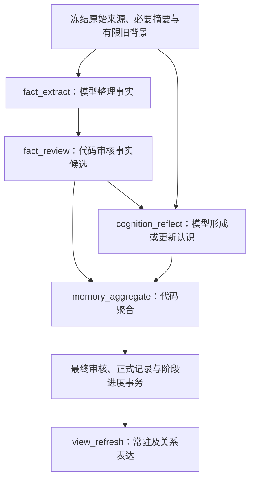

# memory_organize：长期事实与认知整理

## 1. 材料与处理目标

长期整理把角色实际获得的信息保存为 MemoryFact（事实记录），把有依据的体验、理解和推断保存为 MemoryCognition（认知记录）。记录、来源性质、时间和版本由 [记忆设计](../memory.md) 定义，本文件定义一次整理的操作和提交过程。

日常输入从尚未长期处理的段中定位原始可见消息及自身 Thought。段摘要帮助理解和确定处理范围，连续摘要用于对话压缩。作者初始化读取角色可知的故事、采访问答及预置原文，使用独立作者批次，不借用聊天序号。

本次社群、角色、会话范围、观察时刻、原始内容与版本一并冻结。按正式人物身份和本批主题，使用普通检索取得有限旧事实与旧认知。背景人物保持自然称呼和出处。人物资料帮助理解，旧认识帮助比较，两者不会增加本批原始证据。

## 2. 四节点执行流程



| 节点 | 材料与职责 | 产物 |
|---|---|---|
| fact_extract | 原始消息、可知作者材料及有限旧事实背景 | 新增、补充依据或纠正提取错误的事实操作；或明确 no_op |
| fact_review | 事实行动、冻结来源、允许更新的旧版本 | 合法事实操作和可供认知使用的引用清单；或审核失败 |
| cognition_reflect | 已审核事实候选、可引用旧事实、自身 Thought、有限旧认知 | 新增或替换认识的操作；或明确 no_op |
| memory_aggregate | 事实审核及已结束的认知阶段、实际依据映射 | 正式提交候选、局部引用映射及阶段结果 |

事实提取和事实审核是必需阶段。认知阶段在事实审核成功后执行；没有值得长期保存的新事实时，合法 no_op 仍代表完成了事实阶段，自身 Thought 或可引用旧事实可以支持认知。

审核事实的代码节点不新增事实，也不调用另一个模型评判真假。未经审核的产物不能提供给认知。节点输入与成功产物保持不可变，事务与恢复由 [共同执行模型](execution-model.md) 负责。

## 3. 原始来源覆盖

本批按完整消息与对应自身 Thought 分组，原文、必要摘要和旧背景都计入输入预算。某个段超出一批容量时分批选择完整来源，保存实际覆盖范围。摘要没有提到的原文也需要纳入后续合法批次。

事实阶段登记消息及作者材料的实际处理覆盖，认知阶段登记本轮认识形成所需的相应来源范围。处理完成与是否生成记录分别保存。段的某阶段只有全部所需原始来源已处理，才能完成阶段消费；整个长期消费者在事实与认知均完成后结束。

一个来源没有后续保存价值时，可以完成处理并不生成记录。模型调用失败、审核失败或预算不足不属于这种情况。不同消费者的进度不相互推进，连续摘要成功不代表本段已经完成长期整理。

## 4. 模型输出、事实操作与审核

材料按本节点实际选择顺序标为材料 1、材料 2 等。事实节点只提供原始消息、作者材料和有限旧事实；摘要及旧认知不进入事实节点。模型有序返回记忆项，每项只有两个字段：

事实节点的消息按真实会话序号排列，已提供的回复对象使用对应材料编号及发送者称呼说明。事实与认知的旧记录明确标为“事实记录”“角色认识”。原始身份留在冻结输入中，模型使用本次编号。

```json
{"items":[{"content":"小明说自己喜欢蛋糕。","sources":[1]}]}
```

事实与认知由所属节点区分，不要求模型填写细分类别。正文保留人物、对象、时间、否定和条件。自述、转述及未来计划保持性质，动作完成需要实际系统结果。空 `items` 表示本批没有值得保存的新事实。

程序把材料编号转换为冻结的实际来源，生成局部键、主题、参与者、必要时间和明确的领域操作。主题取正文前 80 字符，条件保留在正文中；参与者取引用消息的实际发送者及提及对象，作者材料归于自身。系统结果的发生时间取对应系统消息的实际时间；普通发言及作者往事的事件时间未知时留空，正文保留材料中已知的时间。原始消息时间由依据保存，获知及保存时间由程序确定。

| 条件 | 领域操作 | 保存行为 |
|---|---|---|
| 原始依据有效，未满足旧记录更新条件 | 新增事实 | 分配正式编号及初始版本 |
| 引用一项旧事实，正文完全相同，并提供原始依据 | 补充依据 | 保持含义，追加带实际依据的新版本 |
| 引用一项旧事实，正文有修正，所引用原始身份和版本与旧记录全部原始依据相同 | 纠正提取错误 | 保存新版本，保留旧正文并标记依赖认知需要重新审核 |

无法通过这些条件确认相同的信息，分别保存其依据。程序不使用文字相似度猜测更新对象。不同时间、条件的事件及较晚的新说法不能抹去早先真实发言。同批完全相同的操作合并原始引用。

只引用旧事实且没有原始依据的条目保持旧记录，不保存新的事实，也不妨碍同批合法条目的处理。

fact_review 检查非空内容、材料编号、原始依据、观察权限、来源版本、参与者身份、旧记录范围和更新版本。摘要只能帮助定位，Thought 不能证明外部事件。每项来源分别保存，内部去重合集由程序生成。代码审核决定候选的提交资格，内容忠实性及长期价值由真实材料验收检查。

## 5. 认知输出与支持关系

认知模型同样只返回 `content`、`sources`；正文使用自然第一人称，围绕明确人物或事项保留必要范围和不确定性。旧认识只是比较背景，不能单独作为新认识的证据。没有新认识时返回空 `items`。

程序为已审核本批事实分配后续材料编号，恢复时编号绑定实际已保存的事实版本。认知的编号可以引用这些事实、允许的旧事实、自身 Thought 和作者材料。每项至少有一类合法支持；原有感受引用自身原始主观材料，后来理解引用实际事实，不为没有 Thought 的理解补造过去的内心原文。

| 模型引用和正文 | 领域操作 | 版本处理 |
|---|---|---|
| 有合法支持，未引用旧认知、引用多项旧认知，或同一旧认知对应多条新认识 | 新增认知 | 分别分配独立编号及初始版本，保留旧认识 |
| 有合法支持，一项旧认知仅由本批一条新认识承接，正文有变化或旧记录需要重新审核 | 替换认知 | 保存新版本及实际依据，保留旧内容 |
| 当前旧认知正文没有变化，或只引用旧认知而没有新支持 | 无变化 | 保持旧记录，不影响同批其他合法条目 |

程序从支持材料的正式参与者中确定目标：只有一个自身以外的对象时绑定该对象，其他情况保持事项认识，不用名字猜测成员身份。主题和范围取正文，formed_at_utc 使用本轮整理形成时间；自身 Thought 的原始时间保留在依据中，作者往事的已知时间保留在正文中。后来解释不能补写为当时已经产生的想法。

认知不修改关系数值、短时状态、人设、他人记忆或活动结果。自身期待不能成为对方承诺，对方动机保持推测性质。正式事务将本批事实引用转换为实际编号和版本，不能保存指向未保存事实的认知。

## 6. 预算、部分成功与恢复

事实与认知使用 [共同输出预算](../memory.md#21-初始化预算与来源引用)。事实操作先占用实际候选数量和业务正文，认知使用余额，引用单独审核。没有剩余预算时保留认知阶段未完成；调整预算或合法缩小选择范围后重新准备该阶段输入，并保留原始冻结材料和执行审计。

| 结果 | 可提交内容 | 后续处理 |
|---|---|---|
| 事实审核失败 | 本批不提交长期事实或认知 | 不推进事实覆盖；按有限恢复处理失败阶段 |
| 事实成功，认知成功 | 实际事实、认知及两个阶段覆盖 | 完成本轮长期处理 |
| 事实成功，认知明确 no_op | 实际事实、认知阶段的无变化结果及覆盖 | 完成本轮长期处理 |
| 事实明确 no_op，认知成功 | 有依据的认知与两个阶段覆盖 | 完成本轮长期处理 |
| 事实成功，认知调用或审核失败 | 合法事实及事实阶段覆盖 | 保存部分成功，仅恢复认知 |
| 认知预算不足 | 已合法完成的事实及对应覆盖 | 保留预算原因及认知范围，不能记录无变化 |

每批保存阶段结果、正式事实映射和实际来源覆盖。事实提交后，恢复认知读取这些事实的实际编号和版本及原有冻结主观来源，不再提取事实，不重复增加依据，也不丢失本批未处理材料。补充运行关联原运行，重复恢复请求复用已经存在的恢复记录。

模型调用失败沿用现有退避、输出修正和尝试上限。必需阶段失败阻止对应提交；认知终态失败允许事实部分成功。重启从持久阶段状态和产物继续，不用内存布尔值猜测消费情况。

并发会话可能引用同一旧记录版本。保存前复核实际版本；过期候选不能覆盖后来更新。来源或旧背景版本已经变化时，新执行输入保留原始处理范围与已提交阶段，重新取得合法背景，不修改旧输入或审计。原始来源本身失效时明确停止受影响范围，不能靠旧候选恢复缺失内容。

## 7. 正式保存与变化通知

最终审核检查事实和认知的操作、依据、版本及预算。事务分配正式事实身份，转换认知支持关系，再保存事实、认知、版本变化、阶段覆盖、索引投影、正式变化集合与运行结果。任何数据库错误回滚本次事务。

事实部分成功也是一个明确的提交边界。已保存事实及覆盖保持有效，之后认知事务只保存剩余结果；认知失败不回滚已完成事实。只有真实来源完整处理后才完成对应阶段消费。

事实语义被纠正或依据失效时，依赖它的当前认知标记需要重新审核，旧内容留在历史中。变化通知进入已有机制，更新实际受影响的核心或关系表达。关系数值不因长期记录新增或重建而再次计算。

## 8. 初始化、读取与数据处理

作者初始化采用相同的事实、审核、认知和提交规则，使用角色可知的作者材料。全部批次和必要核心刷新完成后才开放完整模式聊天；阶段失败保留成功记录和实际未完成范围。

事实与认知分别供检索，管理端显示内容、记录类型、时间、当前版本、逐项依据和修订关系。原始来源按自己的实际权限读取，缺失正文显示读取状态。核心和关系视图仅选择或表达已有记录，见 [认识刷新](view-refresh.md)。

旧数据按 [数据重建规则](../memory.md#9-数据重建与模块职责) 处理。运行定义、输出类型和引用含义变化时使用新的协议版本；旧协议不能转换为可执行新任务。备份与原始审计独立保留。

## 9. 一次整理的例子

小明在消息 M1 说“我喜欢蛋糕”，角色的 Thought T1 写下“下次见面可以问他要不要一起尝尝”。事实可保存“小明说自己喜欢蛋糕”，原始依据为 M1；认知如果没有独立后续价值，可以 no_op。角色想一起吃蛋糕的意图不能变成小明已经同意的事实。

后来小明在 M2 再次说喜欢蛋糕，并提到生日希望吃蛋糕。事实阶段在引用旧偏好且正文相同时补充实际依据，另保存这次生日说法；认知阶段引用本次审核事实及允许的偏好版本形成“送蛋糕可能比较合适”的有限判断。生日送礼是否执行由实际来源记录。

若事实保存成功但认知调用失败，重启只恢复认知；两条消息与已保存事实不会重新消费。即使角色以后改变送礼看法，小明当时真实说过的话仍保留。
