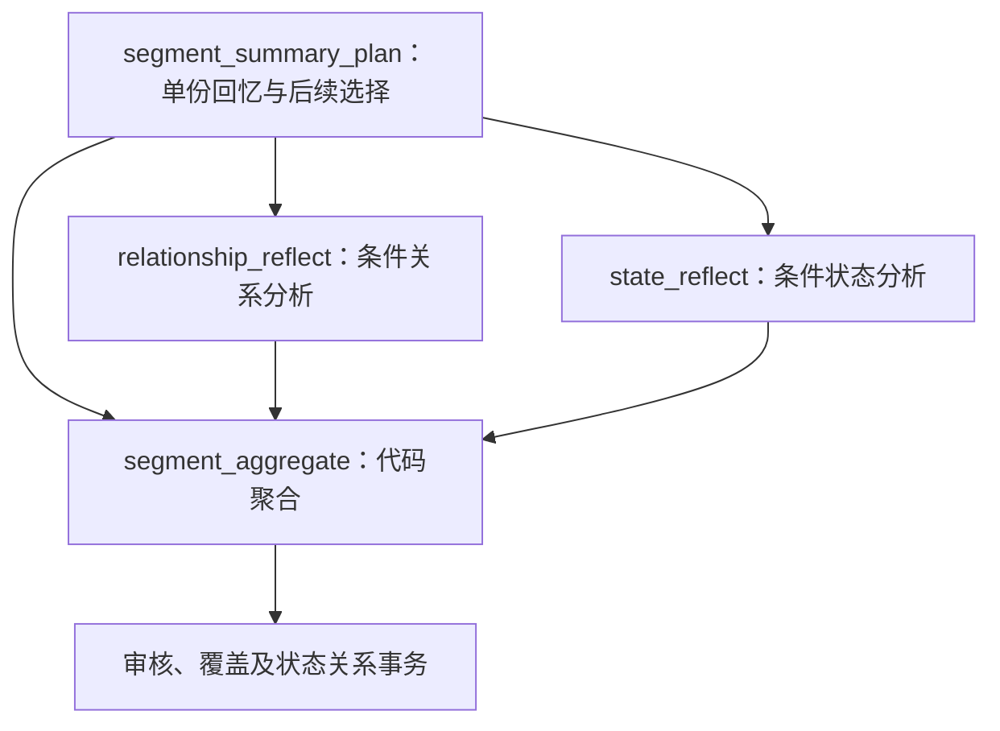

# segment_reflect：压缩一段经历并判断状态变化

## 1. 原始材料与摘要职责

输入是角色在同一社群中的 sealed（已冻结）经历段。新段按会话与实际成员区间独立形成，旧跨场景段继续读取。新消息及自身 Thought 保存精确引用，前情另标为只读；材料按场景分组、组内按时间排列。空闲、容量压力及结束边界通过相同任务整理，归段和预算规则见 [记忆](../memory.md#3-来源与精确归段)。

段摘要把这一段实际经历写成一份连贯回忆，用自然称呼交代在哪里与谁交流。对方说法、自身感受和猜测保持性质，私人内容不能变成全群已知事实。输入分组帮助阅读，输出保存单份 summary，按实际经过表达跨场景延续。

## 2. 四节点执行流程

简单模式只整理摘要，完整模式按 follow_up 激活关系和状态分析。每段一次摘要请求，多个人物由同一次关系请求处理，实际重试另计。未激活分支记录 skipped（已跳过）。

## 3. 编号输出与逐项证据

`reflection_node.v6` 使用本次材料编号和人物编号。模型无需填写正式身份、版本、时间或覆盖。程序将编号转换为冻结的 ActorRef（主体身份）和来源。

| 节点 | 模型字段 |
|---|---|
| segment_summary_plan | kind、summary、follow_up；后者包含两个分支布尔值和 relationship_targets |
| relationship_targets 每项 | target 人物编号、sources 新材料编号 |
| relationship_reflect | kind、dimensions；每项填写 target、dimension、direction、level、evidence_kind、sources |
| state_reflect | kind、state_kind、value、sources |
| 有效空结果 | kind=no_op、reason |

summary 为第一人称单份正文，最多 4000 字符。程序登记所有新材料覆盖，正文可省略无后续价值的小事。无可靠回忆且没有后续判断依据时允许 no_op，段仍完成摘要处理。

每个关系目标只使用该人物实际发言及相关自身回应、Thought，至少包含其实际参与依据。关系后续判断必须引用计划为该人物允许的新材料，不能给多个人复制整段来源。相同目标与维度最多出现一次，目标不能为观察者自己。状态只选择身体、心境、活动之一，value 最多 1000 字符，并保存独立的新材料依据。数值和期限规则见 [状态与关系](../character-state-and-relationships.md)。

只读前情和摘要帮助理解，不能单独产生新变化。关系依据保存到 `relation_evidence_sources`，状态依据保存到 `character_state_sources`；后续态度读取实际相关原文。完整提示见 [提示契约](../character-prompt-contracts.md#8-摘要状态与关系的节点细则)。

## 4. 提交与恢复

最终审核检查角色范围、版本、逐项来源、精确覆盖、目标、维度及预算。摘要正文或有效空结果、覆盖、允许的状态关系结果、ingested 状态及运行结果在同一事务保存。模型或审核失败不完成消费。

可选关系或状态分支终态失败时可以保存合法摘要和成功分支，运行标为 partial（部分成功）。补充运行只恢复失败分支，复用已成功材料，不重复提交摘要或关系影响，见 [执行模型](execution-model.md)。

摘要完成后，连续压缩和长期整理独立取得本段。空摘要同样允许长期整理读取原始消息和 Thought；新的长期认知不改写段摘要。
