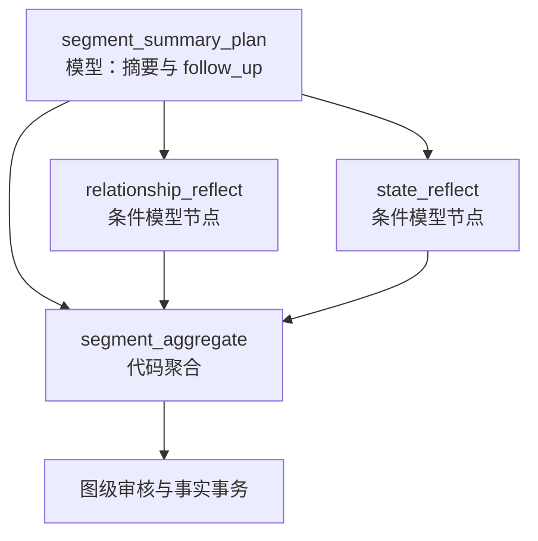

# segment_reflect：整理一段经历

## 1. 触发、材料与目标

工作流取得 sealed MemorySegment 后创建该图。材料包括该角色实际可见的精确消息及自身 Thought，携带发送者 ActorRef、来源标识、版本和序号。图快照还保存身份、当前状态、关系认识及允许的记忆上下文。来源选择和上限见 [记忆](../memory.md)。

本图需要给实际段生成一份摘要，决定是否进一步分析关系和自身状态。没有新材料时归段返回空结果，工作流不创建空图。已有同来源运行复用正式记录，不能重复消费。

## 2. 四节点拓扑

| 节点 | 必需性与输入 | 输出与作用 |
|---|---|---|
| segment_summary_plan | 必需；segment_context.v1，精确段材料及角色信息 | SegmentSummaryAction：summary、follow_up、evidence_refs |
| relationship_reflect | follow_up.relationship_reflect 与材料策略允许时激活；segment_summary_context.v1，段、摘要产物、真实关系目标与当前关系 | RelationshipReflectionAction 或有理由的 NoOp |
| state_reflect | follow_up.state_reflect 与材料策略允许时激活；段、摘要产物及当前自身状态 | StateReflectionAction 或有理由的 NoOp |
| segment_aggregate | 代码节点；reflection_artifacts.v1，摘要及已解决的分支产物 | 摘要、关系与状态候选 Batch |

follow_up 的两个布尔值只要求分析，不表示已经发生事实变化。运行模式先决定分支是否允许：简单模式始终跳过关系和状态分支，模型建议不能扩大权限；完整模式再按 follow_up 与材料条件激活。关闭的分支 skipped；已激活分支仍可认为没有合适变化。

摘要节点先把消息和自身 Thought 一起阅读：消息确定实际发生的内容，Thought 提供当时的注意、感受和判断。回复计划、猜想和规则说明不写成已经发生的事实。summary 使用第一人称，保留具体细节和没有说完的部分，停留在经历本身；进一步的关系或状态结论交给对应分支。

关系节点使用原段来源及对应目标的关系背景。对每个目标分别判断 affection（好感）、trust（信任）、attachment（依恋）。一次自然、没有冲突的交流通常可形成好感一级正向；信任需要可靠、诚实、尊重边界或愿意表达真实感受的信号；依恋需要对对方本人的直接依赖、持续吸引或明确希望保持关系的感受。普通聊天、一次关心或顺畅接话不足以证明依恋。

负向变化同样需要失望、受伤、欺骗、越过边界或主动疏远等具体来源。等级表示本次变化幅度；一级对应清楚的信号，二级或三级需要更强或相互印证的信号。没有对应信号时使用 neutral 或合法 no_op。模型提出的变化继续受正式证据类别和数值规则审核，不能凭文字判断绕过依恋资格。

状态节点从 physical（身体）、mood（心境）、activity（活动）中选择一种，用第一人称的一两句描述具体的当下体验，不写对话总结或关系结论。没有可靠状态信号时可以 no_op。完整提示正文、输出示例和所有判断条件见 [节点提示](../character-prompt-contracts.md#8-六类节点的完整任务细则)。

## 3. 行动字段与证据

摘要正文非空，最多 4000 字符；必须引用实际材料。起止序号和段标识由后端确定，不由模型决定。

关系行动包含 1—64 个 dimensions，每项包括 target ActorRef、dimension、direction、level。同一目标与维度不能重复。目标须出现在真实材料允许范围内，不能指向观察角色自身。关系证据类别由本消费者确定为 interaction；资格与数值算法见 [角色事实](../character-state-and-relationships.md)。

状态行动包含 state_kind 和非空 value，内容最多 1000 字符。类别为 physical、mood、activity。实例、记录版本、时间和有效期由正式事实服务确定。事实服务在提交事务中读取最新状态版本，校验后追加下一版本记录，详见 [状态版本](../character-state-and-relationships.md#2-状态历史时间与版本)。模型不输出期望版本。

每个行动的 evidence_refs 来自输入提供的证据集合，不能引用旁观者的私有消息或其他角色 Thought。产物保留行动、证据及来源节点，聚合不能删除其来源身份。

## 4. 聚合、审核与提交

实际段必须恰好有一份摘要；关系和状态候选可为零至多项。全部候选遵守共同数量与字符预算。审核复核段仍为原角色、会话、来源版本，精确覆盖没有遗漏或扩大，目标有效、维度唯一、状态版本正确。

同一事务保存段摘要、精确覆盖、关系证据及状态历史、段 ingested、图结果和诊断 outbox。摘要已经存在时，一致的重复返回原结果，不同内容拒绝。不能只保存关系变化却让段继续被当成未处理材料。

## 5. 失败、重复与例子

必需摘要节点失败时图不能提交。有实际消息却只得到摘要节点 no_op 时，图级审核同样不能将本段标记为已摘要。可选关系或状态分支终态失败时，可按 partial 规则提交成功摘要与其他合法事实，保留失败记录；针对失败可选分支新建补充运行，复用成功产物且不重复保存摘要，见 [共同执行模型](execution-model.md)。租约到期重试冻结输入，成功产物保持不变。

Alice 对两位小槿说“谢谢你们帮我分析”。甲还有自己的 Thought“她很认真，我有些开心”，乙没有该 Thought。甲的摘要节点要求两条分支；关系节点提出对 Alice 的好感一级正向，状态节点提出 mood“开心”。乙独立图只生成摘要。甲从基准好感 50 变为 50.5，乙的关系不随甲更新。甲的关系和状态分支虽然读取摘要作为背景，变化证据仍引用原段允许的消息与自身 Thought。

当前正式图和消费者已接入。实现状态不代表所有恢复及版本要求已经满足，具体差异统一见 [状态说明](../../status.md)。
