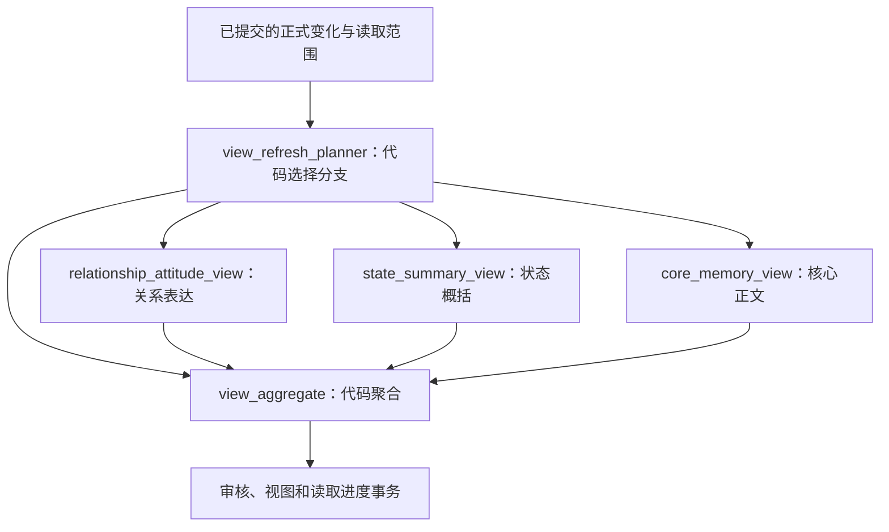

# view_refresh：表达已有记录的常驻视图

## 1. 变化输入与视图职责

输入来自已提交的 ChangeSet（业务变化集合），按需要更新核心记忆、关系描述和自身状态概括。它选择并自然表达已有内容，新的长期理解和推断由 memory_organize 维护，状态与关系数值由 characters 维护。

| 视图 | 依据 | 表达用途 |
|---|---|---|
| core_memory（核心记忆） | 有效 MemoryFact、MemoryCognition 及支持材料 | 常驻的重要经历、约定和当前认识 |
| relationship_attitude（关系描述） | 该目标正式关系状态、实际证据及相关有效事实和认知 | 对明确对象已有的有限印象 |
| state_summary（状态概括） | 当前正式身体、心境和活动状态 | 对当前状况的简洁表达 |

视图不新增事实依据、长期认知、关系影响或活动结果。自身主观认识与他人陈述保留性质，视图正文也不反过来成为下一轮长期整理的独立证据。

ChangeSet 保存社群、角色、记录类型、身份及源版本。调度合并同一目标尚未处理的变化，冻结当前合法记录和观察范围。状态、关系、事实、认知发生相关变化，首次描述遗漏，核心存在未读记录或明确重建请求时可以安排刷新。没有这些条件时无需调用模型。

## 2. 五节点执行流程

规划器按实际变化类型和请求选择分支，不调用模型。未选择的分支 skipped（已跳过）；已选择分支按自己的内容规则返回正文或合法 no_op。认知阶段失败时已经提交的事实可以进入刷新，旧认识保留实际有效状态，不能把失败解释为角色改变了看法。

## 3. 输入、输出与来源

长期材料标明事实或认知类型、来源性质和必要时间，正式身份及版本保留在冻结输入中。核心模型读取记录正文，程序核查原始来源，不重复向模型提供整份原始证据；管理详情仍可追溯原文。正式关系和状态按自己的权威记录提供。读取范围说明包含本轮已选择与未读记录、旧正文、完整性和来源状态；它是执行说明，不是回忆依据。

模型输出只包含 `content` 正文和 `sources` 材料编号；空正文表示没有需要改写的内容。程序从编号还原支持记录的类型、身份和版本，关系目标由冻结的正式关系确定。模型不生成目标身份、视图种类或版本。所有引用必须属于本次实际提供的有效材料。

正文使用自然第一人称，人物和 voice（表达习惯）影响措辞。事实保存说过什么，认知保存怎样理解，视图选择这些内容表达当前重点。具体规则见 [提示契约](../character-prompt-contracts.md)，身份、来源和更新权限由程序验证。

## 4. 关系描述与目标进度

陌生人没有共同经历描述，聊天可以说明目前还不熟。第一次实际互动按既有 50/50/0 基准与证据计算数值，并登记待刷新变化；后续中性证据也可以更新表达。数值、证据类别和依恋资格统一见 [状态与关系](../character-state-and-relationships.md)。

每个关系分支只处理一个目标。材料包括观察者及目标正式身份、自然称呼、状态版本、截止时间内实际证据、已有描述、首次描述标记和该目标相关的有效长期记录。多人来源额外提供目标本人可见发言，不把其他人的经历转给当前目标。

首次描述已有实际证据时需要生成有限正文。尚无长期认知时，可以概述实际互动和已了解的内容，不补写隐藏动机或稳定性格。已有描述且没有新的相关认识时可以 no_op。长期认知有合法更新时，选择其当前内容表达，不在这里维护另一套认识更新规则。

正文读取不到的证据保留身份和不可读状态，允许表达有实际记录支持的有限印象。真正没有证据时记录 `relationship_evidence_missing`，不调用模型补造经历。输入预算无法放入任何证据时报告预算冲突。

描述通常 80 至 180 字符，`reflection.relationship_attitude_max_chars` 默认 300，范围 1 至 3000。首次错误 no_op 或超长输出沿用有限修正。保存前检查目标、状态与证据版本及长期引用资格，保存只更新描述、来源和时间，不增加数值状态版本。

目标进度保存实际来源版本、请求类型、批次及运行。相同版本的遗漏修复只安排一次；失败目标不阻止其他未处理目标。新证据或新的有效认知可以形成新的合法变化，恢复复用成功分支并关联实际补充运行。

手动入口接受 UUID `request_id` 和可选目标；省略目标分别安排已初始化目标，陌生人不参加。重复请求复用原组运行，改变范围报告冲突。用户端只展示自然状态和正文，目标错误、阶段材料和原始审计留在管理端。

## 5. 保存与版本失效

核心和状态概括保存在 memory_views；关系描述保存在明确目标的 relationship_state 字段及其来源。视图结果、引用、成功读取进度、变化消费和运行结果在同一事务保存。失败不会删除原有正文，也不会回滚此前已提交的长期记录。

保存前再次检查源版本及本轮有效候选范围。支持事实被纠正、认知待重新审核或其他引用失效时，旧结果不能覆盖当前视图，通过正式恢复入口重新准备。已失效支持不能继续作为当前有效认识进入对话；历史视图正文留供诊断，按有效依据恢复或重建。

一个可选分支失败时，其他合法分支可以 partial（部分成功）提交。成功分支的读取范围不重复消费，补充运行只完成剩余分支，详见 [共同执行模型](execution-model.md)。

## 6. 核心分支选材、预算与重建

每个角色保存一份核心正文。它可以由自然的几个段落组成，整体是一个字符串，使用一个字符上限和支持引用集合。长期事实和认知各自独立保存。

选材保留仍重要的经历、未完成约定、已确认长期打算和有依据的当前认识。性格与表达习惯由人物正文负责，普通偏好按话题检索，完整的人物态度由关系描述表达。核心压缩不会生成新的长期结论或以后每次都要执行的回答规则。

准备材料时保留旧正文中仍有效的支持记录，再读取新增或版本变化的未读记录，其他记录按重要程度与时间安排。事实和认知标明性质；必要支持材料由所属来源入口读取。只有实际引用集合完全相同才复用支持正文，不能按同批次推定各条记录的证据相同。

正式记录、支持材料和读取范围共用 `reflection.max_materials` 与 `reflection.max_material_chars`。其他关系或状态分支可以先使用预算；核心不能容纳时保留未完成变化。单独核心任务仍无法容纳有效旧支持或任何未读记录时报告预算冲突，不能反复调用模型却没有读取新材料。

容量按实际选中的正文及完整读取说明计算。发送者和目标的自然称呼来自冻结人物上下文，在来源容量检查后补充为展示信息。候选数量增加时，未读记录继续按实际剩余容量进入后续批次。

`reflection.core_memory_max_chars` 默认 600，范围 1 至 6000。正文通常为 200 至 400 字符，不设最低长度。提示、输出和审核使用同一上限，超长内容通过有限修正压缩重复表达，程序不截取字符串。

只有核心分支正式成功提交或合法 no_op 才推进本分支读取进度。未读范围通过已有刷新机制继续处理，记录新版本重新进入未读范围。成功进度与被预算排除的范围分别保存。

no_op 表示实际阅读的范围没有需常驻的新内容。只有全部有效候选已读取、来源完整且审核通过，才允许清除旧核心正文。输入不完整、来源不足、模型或审核失败时保留旧正文；清除视图不删除长期记录。

手动重建使用 UUID 请求编号，重新冻结当前有效范围，成功后替换正文。管理查询显示当前正文、上限、支持记录、实际阅读与未读进度、来源状态和最近运行。固定请求和响应字段见 [管理接口](../../reference/management-api.md)，实现范围见 [状态](../../status.md)。

## 7. 模块职责与例子

记忆服务选择正式记录、支持原文和输入范围，记忆存储保存视图、版本、变化批次与读取进度；反思运行层准备节点、审核候选并编排事务。characters 继续管理状态与关系数值，提示组装不查询数据库。

小明说生日希望吃蛋糕，事实保存他的说法，认知保存角色有依据的送礼判断。核心可以保留“他提过生日想吃蛋糕，我在考虑这份礼物”，引用这两项已有记录。礼物实际送出后，正式结果使相关事实和认知更新，核心再表达已更新内容。视图本身不能把考虑写成已经送出。
